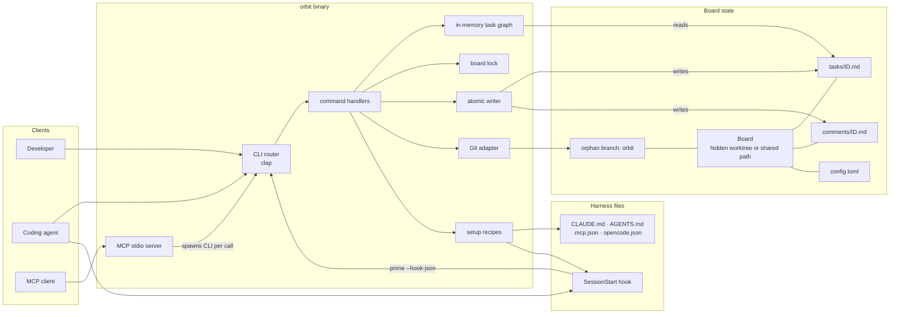

# Orbit: an AI-native issue tracker

**Status:** pre-alpha. v0.5.0 is the latest release. M0 (core CLI), M1 (agent setup), M2 (MCP), M3 (release tooling), M4 (labels, comments, triage), M5 (one-command onboarding), and M6 (workspaces, SubTasks, scoped queues, deterministic export) are implemented. v0.5.0 adds a metadata-only Task Type. The canonical design is in [SPEC.md](./docs/SPEC.md); vocabulary is in [GLOSSARY.md](./docs/GLOSSARY.md). Requires Git 2.31+ (Rust 1.89+ only when building from source).

### Brief description

Orbit is a zero-daemon, AI-native local issue tracker built in Rust. Tasks are plain Markdown files on a dedicated Git branch, served through a strict `--json` CLI and an MCP server. Labels, append-only comments, atomic claims, and a single locked writer make triage and concurrent agents safe without a database server.

### The goal

Eliminate context-window bloat and pipeline freezes in multi-agent workflows. Orbit gives agents a deterministic ready queue with atomic claims, expiring leases, dependency validation, and a strict error contract — while keeping every task change human-readable and reviewable in Git.

### The pitch

When building micro-SaaS products at maximum velocity, your autonomous toolchain — Cursor, Claude Code, Codex, OpenCode, Superpowers — needs a central nervous system. Standard issue trackers force LLMs to burn thousands of tokens parsing flat files or opaque databases, and database-backed trackers put task state in a binary that code review cannot see.

Orbit keeps the board as Markdown, but compiles it into an in-process graph on every command. Agents ask `orbit ready --claim` for exactly one piece of work, hold a time-bounded lease, and get structured errors when a dependency is unfinished or another agent already owns the task. Writes serialize on one repo-wide lock and publish through temp-file plus rename, so a crash cannot truncate a task and two agents cannot corrupt the queue. Installation is a single binary, with shell/PowerShell installers and an npm wrapper. There is no daemon, no watcher, and no Dolt.

### Architecture

Commands are short-lived processes. A board command resolves one Board, takes a shared or exclusive lock, rebuilds the task graph from Markdown, applies one transition, publishes changed files atomically, and optionally commits to the orphan `orbit` branch. The MCP server is a bridge over the same CLI, so it reuses the same lock, write path, and error contract.



The full component map, board-resolution flow, domain model, state machine, readiness gate, command map, and sequence diagrams for `init`, the task lifecycle, concurrent claims, and MCP live in [docs/ARCHITECTURE.md](./docs/ARCHITECTURE.md).

### Quick start

```bash
# Install once (see below), then in your repository:
orbit init
orbit add "Build the CLI router" -p 1
orbit ready --claim --by claude
orbit heartbeat orb-a7b2c9 --by claude
orbit done orb-a7b2c9 --by claude --comment "Implemented and verified"
```

`orbit init` creates the Board and wires the coding-agent harnesses it detects. In a terminal it shows what it found and asks which ones to wire; without a terminal it wires the detected ones and never prompts.

Board commands accept `--json`, and `orbit <command> --help` explains its semantics with examples. [docs/commands.md](./docs/commands.md) is the full command guide, including when to use each command and end-to-end scenarios.

### Install

Prebuilt binaries are the primary path. v0.5.0 is the latest release.

```bash
# macOS / Linux
curl --proto '=https' --tlsv1.2 -LsSf https://github.com/rcmendes/orbit/releases/latest/download/orbit-tracker-installer.sh | sh

# Windows PowerShell
irm https://github.com/rcmendes/orbit/releases/latest/download/orbit-tracker-installer.ps1 | iex

# npm / npx
npx @rcmendes/orbit --version
npm install -g @rcmendes/orbit
```

The installer adds its directory to `PATH` unless it is already there, and tells you what to source if a restart is needed. The npm package is scoped because the bare name is taken; the command is always `orbit`.

From source, with Rust 1.89 or newer:

```bash
cargo install --path .
```

See [RELEASING.md](./docs/RELEASING.md) for the release process.

### Agent setup

`orbit init` is the one in-repository command. It creates the Board, detects installed harnesses from their commands and project markers, and writes only the integrations that apply. Every file is written with a managed marker, so re-running is safe and `--remove` deletes only what Orbit added.

```bash
orbit init                    # Board + detected harnesses (asks in a terminal)
orbit init --agents all       # wire every supported harness
orbit init --agents none      # Board only; no agent files
orbit init --print            # preview without writing
orbit init --board ~/board    # create a shared Board and link this repository
```

Use `orbit setup` to repair or adjust one harness later:

```bash
orbit setup claude --hooks   # CLAUDE.md + SessionStart hook + MCP
orbit setup cursor           # .cursor/rules/orbit.mdc + skill + MCP
orbit setup codex            # AGENTS.md + skill + MCP
orbit setup opencode         # AGENTS.md + MCP
orbit setup mattpocock       # docs/agents/issue-tracker.md
orbit setup all --check      # installed / missing / stale
orbit setup all --no-mcp     # instruction files only
orbit setup all --remove     # remove only Orbit-managed content
```

CI runs `orbit setup opencode --no-mcp --check` on every push and pull request, so the checked-in `AGENTS.md` managed block cannot drift from the generator. `--no-mcp` keeps the machine-local `opencode.json` out of the check.

A hand-written tracker guide is respected. If `docs/agents/issue-tracker.md` exists without Orbit's managed marker, `orbit setup mattpocock` reports it as `skipped` and leaves it untouched; `--check` treats the custom doc as installed, and `--remove` does not delete it. Tracker files Orbit wrote continue to update and remove normally.

MCP configuration is written by default for Claude, Cursor, Codex, and OpenCode. Entries record the absolute path of the running binary, so editors launched outside a shell do not need `PATH`. The Claude SessionStart hook records the same absolute binary and runs `orbit prime --hook-json --by claude` at session start. Use `--mcp-bin orbit` if you want a portable command that relies on the editor's `PATH`.

OpenCode uses the V2 shape: the Orbit server lives at `mcp.servers.orbit` with `type: local` and a command array, and no `enabled` flag. Setup migrates a legacy `mcp.orbit` entry to that location without duplicating the server, and `--remove` clears both forms while preserving unrelated servers.

`orbit init` and `orbit setup` refuse to record a binary inside npm's prunable `_npx` cache or a temporary directory. Install globally, or pass `--mcp-bin orbit`.

Because the generated MCP command is machine-specific, keep those config files untracked when possible. If one is committed, regenerate it after installing Orbit elsewhere, or use `--mcp-bin orbit`.

### Several related repositories

A Workspace is one Board plus every repository linked to it. Create the workspace and its Board once, then link the repositories that share it:

```bash
# Create ~/src/acme/board as an independent Board
orbit workspace ~/src/acme

# In each related repository: use the same Board
orbit link ~/src/acme
```

`orbit workspace` only creates the workspace and Board; it does not clone or link repositories, and it refuses to put the workspace inside a Git working tree. Commands in a linked repository find the shared Board without an environment variable, including from Git worktrees. `orbit unlink` returns a repository to its own Board. An explicit override wins for one command:

```bash
orbit --dir ~/src/acme/board list
ORBIT_DIR=~/src/acme/board orbit ready
```

Discovery order is `--dir`, then `ORBIT_DIR`, then the repository link, then the repository's own Board.

### Features and SubTasks

A Parent Task groups SubTasks. Create the parent once, then add one SubTask per piece:

```bash
orbit add "SSO login across api, web, infra" --body-file feature.md
# created orb-a7b2c9
orbit add "api: OIDC callback" --parent orb-a7b2c9 --label repo:api
orbit add "web: login redirect" --parent orb-a7b2c9 --label repo:web
```

A SubTask ID is the parent ID, a dot, and a fresh suffix (`orb-a7b2c9.b3c4d5`). SubTasks are one level deep and are claimed independently. The parent is not Ready until every SubTask is done or cancelled; `orbit done` on the parent with open SubTasks is refused unless `--force`, which cancels them. `orbit list --tree` keeps each Parent Task next to its SubTasks, `orbit list --parent <id>` lists only that family's children, and `orbit ready --parent <id>` scopes an agent to one feature. Use `orbit list --repo <name>` and `orbit ready --repo <name>` to scope work to one repository.

### Epics, specs, and issues

Orbit has no separate Epic entity. A spec or epic is a top-level Task with `type: epic`; the tickets under it are SubTasks:

```bash
orbit add "Spec: SSO login" --type epic --body-file spec.md
# created orb-a7b2c9
orbit add "api: OIDC callback" --parent orb-a7b2c9 --label ready-for-agent
orbit add "web: login redirect" --parent orb-a7b2c9 --label ready-for-agent
```

This is the compatibility mapping for Beads and Matt Pocock's skills:

- **Issue** = Task
- **Sub-issue** = SubTask, created with `--parent`
- **Epic** or **spec** = top-level Task with `type: epic`

`type` is metadata, not lifecycle: valid values are `task` (default), `epic`, `spike`, `chore`, and `decision`. It does not affect readiness; `bug` and `enhancement` remain triage labels. `epic` is refused on a SubTask.

The parent is held out of the ready queue until every SubTask is resolved, and `orbit ready --parent <id>` is the frontier for the family. `orbit tree <id>` shows the parent, its tickets, and their blocking edges in one scoped view. Use `--type epic` and `--exclude-type epic` on `list` or `ready` to find or hide spec containers. The old `epic` label still works with `--exclude-label epic` on legacy boards, but Orbit does not infer `type: epic` from it. SubTasks are one level deep: if a ticket needs its own breakdown, flatten it into sibling tickets with `--depends-on` instead of nesting further. Never use `done --force` or `cancel --force` on a spec parent while tickets are open; unlike Beads' force-close, it cancels every open SubTask. See [ADR 0009](./docs/adr/0009-keep-task-vocabulary.md) and [ADR 0010](./docs/adr/0010-structural-type-field.md).

### Export the board

`orbit export --json` emits a deterministic snapshot of every Task and SubTask, including terminal work, type, labels, dependency and parent edges, parent progress fields, comments, and derived readiness. It is ordered by task ID, carries `schema_version`, and contains no timestamp or machine-local paths.

```bash
orbit export --json > board.json
```

Use it to feed a knowledge base, archive a board, or diff two snapshots. Pin `schema_version` in the collector.

### Triage metadata

```bash
orbit label add <id> bug needs-triage
orbit label remove <id> needs-triage
orbit label list
orbit list --label ready-for-agent
orbit list --unlabeled

orbit comment add <id> --by opencode --body "Triage notes..."
orbit comment list <id>
```

The default hold labels are `needs-triage`, `needs-info`, and `ready-for-human`: tasks carrying one are excluded from `ready` and cannot be claimed until the label is removed. `ready-for-agent`, `bug`, and `enhancement` are neutral. Comments are append-only and stored per task under `comments/`.

### MCP

```bash
orbit mcp
```

`orbit mcp` speaks JSON-RPC 2.0 over stdio and exposes 13 tools: `ready`, `list`, `get`, `create`, `update`, `claim`, `release`, `heartbeat`, `finish`, `link`, `delete`, `label`, `comment`. `create` accepts `parent` to make a SubTask, and `list`/`ready` accept `parent`, `repo`, `labels`, and `exclude_labels` to scope a feature or repository. It also serves `orbit://tasks/{id}` as a Markdown resource. Tool calls reuse the CLI's lock, atomic writes, auto-commit, and error envelope. See [SPEC.md](./docs/SPEC.md) section 9.

### Why not Beads or Beans?

- **Beans** proved that Markdown-as-truth is pleasant for humans, but it has no atomic claims, leases, or dependency-aware ready queue.
- **Beads** proved that agents need claims, ready-work detection, priorities, and hash IDs, but its source of truth is a Dolt database and its multi-writer mode needs a server.

Orbit is the narrow overlap: Beans' human-readable storage with Beads' queue semantics, in one static Rust binary with no daemon. Coming from Beads, an **issue** is a Task, a **sub-issue** is a SubTask, and an **epic** is a top-level Task with `type: epic`; there is no separate issue entity or arbitrary-depth hierarchy.

For several related repositories, Orbit links each one to the same Board instead of copying Tasks into a hub, so cross-repository Dependencies share one graph. Beads hydrates copies into a central database; Beans has no multi-repository model. See [ADR 0006](./docs/adr/0006-shared-board-across-repositories.md).
