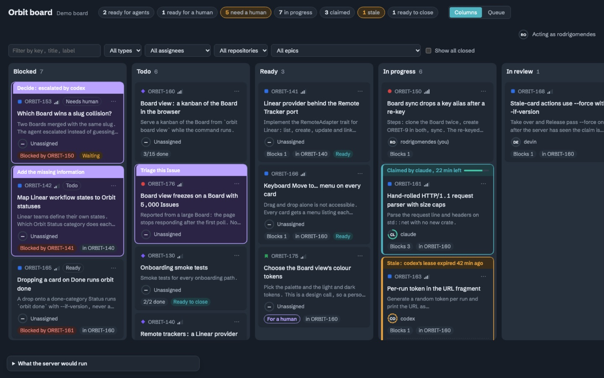
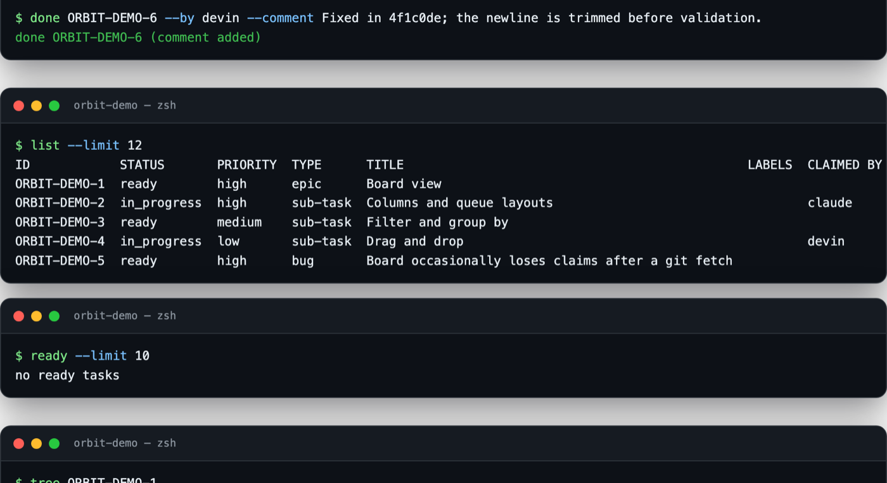
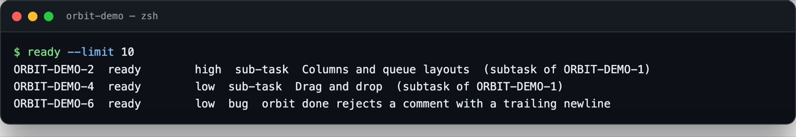
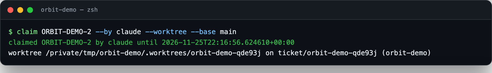
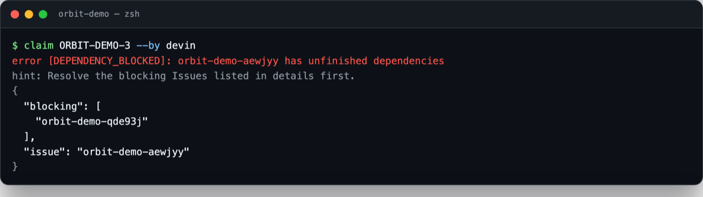

<div align="center">

# 🪐 Orbit

### The Git-native issue tracker for humans and coding agents.

**One binary. One Markdown board. Zero daemons.**

[](https://github.com/rcmendes/orbit/actions/workflows/ci.yml)
[](https://github.com/rcmendes/orbit/actions/workflows/release.yml)
[](https://www.npmjs.com/package/@rcmendes/orbit)
[](https://www.rust-lang.org)
[](./LICENSE)
[](https://github.com/rcmendes/orbit/releases)

</div>

<p align="center">
  
</p>

Orbit is a local issue tracker whose issues are Markdown files in a Git repository. Every issue and comment lives on a dedicated `orbit` branch in the Board's own Git repository, so people and agents work from the same reviewable source of truth. Mutations are serialized by one lock and published with `fsync` + rename; meaningful changes are committed to Git. There is no database, daemon, server, or context-window tax.

Claude Code, Cursor, Codex, OpenCode, Devin, and any shell-capable agent get a deterministic, dependency-aware ready queue through a strict JSON CLI or an MCP server. Every claim is atomic, so two agents never take the same issue. Humans get readable Git diffs and exactly the same board.

**1 binary · 0 daemons · 4 statuses · 17 MCP tools · 100% Markdown issues**

Orbit requires **Git 2.31+** (Rust 1.89+ only when building from source). The latest release is [`v0.12.0`](https://github.com/rcmendes/orbit/releases/tag/v0.12.0); the canonical design is [SPEC.md](./docs/SPEC.md) and vocabulary is [GLOSSARY.md](./GLOSSARY.md).

## Install

**macOS / Linux** — Git 2.31+:

```bash
curl --proto '=https' --tlsv1.2 -LsSf https://github.com/rcmendes/orbit/releases/latest/download/orbit-tracker-installer.sh | sh
```

**Windows PowerShell** — Git 2.31+:

```powershell
irm https://github.com/rcmendes/orbit/releases/latest/download/orbit-tracker-installer.ps1 | iex
```

**npm** — Node.js 14.14+, npm 6+, and Git 2.31+:

```bash
npm install -g @rcmendes/orbit
```

The npm package is scoped because the bare name is taken. The command is always `orbit`. Every route, prerequisite, and `npx` trial is in [Install details](./docs/guides/install.md).

## Quickstart

```bash
cd your-repository
orbit init
orbit add "Try Orbit" -p 2 --label ready-for-agent
orbit ready --claim --by <agent>
```

`orbit init` creates the Board, prints a numbered setup report, and asks once whether to wire the coding agents it detects. The full walkthrough — install routes, Board creation, filing work, the agent loop, and the human views — is in [Quickstart](./docs/guides/quickstart.md).

## Why Orbit

Most trackers were designed for humans clicking through a web UI. Agents need something different: a stable contract, a small context footprint, and a queue that cannot hand the same ticket to two workers.

| The usual problem | Orbit's answer |
| --- | --- |
| Issue state lives in a database nobody can review | Issues are Markdown files on a dedicated Git branch, diffable like code |
| Two agents grab the same ticket | `ready --claim` is atomic; the loser gets a typed error |
| An agent dies mid-issue and the ticket is lost | Claims expire after a lease; recover with `claim --steal` |
| Agents burn tokens parsing the whole backlog | A dependency-aware ready queue returns one actionable issue |
| Writes race and truncate files | One board lock, temp-file + `fsync` + rename, serialize every mutation |
| Work spans repositories but the board does not | One shared Board for a whole anchor, including every Git worktree |
| The tracker requires infrastructure to run | One binary, no daemon, no database, no hosted service |
| Status is prose an agent has to interpret | Stable JSON envelope, typed error codes, and retryability |

Orbit is deliberately narrow. It is not a project-management suite, a time tracker, or a hosted sync service. It is the smallest reliable queue that lets several coding agents work on one product without stepping on each other. See [Why Orbit, and what it is not](./docs/guides/comparison.md) for the full argument and how it compares to Beads and Beans.

### Built for

- **Solo builders** who want a fast local backlog that lives beside the code and never needs a server.
- **Agent squads** running Claude Code, Cursor, Codex, OpenCode, and Devin in parallel against one product.
- **Multi-repository products** where the API, web app, infrastructure, and agent tooling all need one dependency graph.

## Features

- **Atomic claims with leases** — `ready --claim` hands exactly one issue to one agent; leases expire, checkpoints survive handoff, and `--steal` recovers stale work. → [Concepts](./docs/guides/concepts.md)
- **Dependency-aware ready queue** — blockers, hold labels, open sub-issues, and live claims are all evaluated on every read; `ready` is derived, never stored. → [How it works](./docs/guides/how-it-works.md)
- **Sub-issues and epics** — a parent waits for its family; children are claimed independently across repositories. → [Daily use](./docs/guides/usage.md)
- **Worktree isolation** — `claim --worktree` creates `.worktrees/<id>` on `ticket/<id>`, optionally based on a spec's integration branch with `--base`. → [Daily use](./docs/guides/usage.md)
- **Review loop** — `submit` records evidence, `review` approves or requests changes, and `needs_human`/`blocked` holds keep humans in the loop. → [How it works](./docs/guides/how-it-works.md)
- **One Board, many repositories** — an anchor folder discovers member repositories automatically; issues record their owning repository. → [Boards and repositories](./docs/guides/boards.md)
- **Optional GitHub sync** — link issues to GitHub, sync fields both ways, or auto-push mapped changes. → [Boards and repositories](./docs/guides/boards.md)
- **Board view in the browser** — `orbit board view` serves a local kanban with Columns and Queue layouts; every move runs the same guarded `orbit` command you would type. → [Quickstart](./docs/guides/quickstart.md)
- **Agent-native front doors** — strict JSON CLI plus an MCP stdio server; `orbit prime` gives an agent ~1k tokens of starting context. → [Agent setup](./docs/guides/agents.md)
- **Human-readable by default** — issues are Markdown with YAML frontmatter; every mutation is a reviewable Git commit on the `orbit` branch. → [Concepts](./docs/guides/concepts.md)

## The agent loop

```text
$ orbit ready --claim --by claude
claimed orb-a7b2c9 by claude until 2026-10-24T22:30:00Z
```

<p align="center">
  
</p>

The common path is `add` → `ready --claim` → `heartbeat` → `checkpoint` → `submit`/`done`. Each step is a separate process; the board lock is held only for that step. Real output from a demo board:

<p align="center">
  
  
  
</p>

The full loop, the readiness gate, checkpoints, and the review flow are in [How it works](./docs/guides/how-it-works.md).

## Contents

- [Quickstart](./docs/guides/quickstart.md) — install, create a Board, file work, run the agent loop, see the board
- [Install details](./docs/guides/install.md) — every install route, prerequisites, and verification
- [Concepts](./docs/guides/concepts.md) — Issues, sub-issues, claims, leases, checkpoints, Ready
- [How it works](./docs/guides/how-it-works.md) — architecture, the agent loop, readiness gate, review flow
- [Daily use](./docs/guides/usage.md) — sub-issues, epics, triage, labels, comments, export, change feed
- [Boards and repositories](./docs/guides/boards.md) — anchors, member discovery, remote hosts, GitHub sync
- [Agent setup](./docs/guides/agents.md) — harness wiring, MCP servers, SessionStart hooks
- [Command reference and recovery](./docs/guides/reference.md) — command map and what to do when things go wrong
- [Why Orbit, and what it is not](./docs/guides/comparison.md) — the argument, Beads/Beans comparison, compatibility vocabulary

## Documentation

| Document | What it covers |
| --- | --- |
| [Command guide](./docs/commands.md) | Every command, when to use it, scenarios, and error recovery |
| [Architecture](./docs/ARCHITECTURE.md) | Component map, board resolution, domain model, state machine, readiness gate, command flow, sequence diagrams |
| [Specification](./docs/SPEC.md) | Canonical behavior, issue format, config, command rules, JSON contract, concurrency, testing, distribution |
| [GitHub sync](./docs/github-sync.md) | Basic and full GitHub modes, sync behavior, limitations, and upgrade path |
| [Glossary](./GLOSSARY.md) | Canonical vocabulary and the words Orbit avoids |
| [Issue tracker guide](./docs/agents/issue-tracker.md) | How agents should use the board in this repository |
| [Triage labels](./docs/agents/triage-labels.md) | The five canonical triage roles and category labels |
| [Triage workflow](./docs/agents/triage-workflow.md) | Review/apply proposals for Issues, Local or Linked |
| [Domain docs](./docs/agents/domain.md) | How engineering skills consume this repo's domain documentation |
| [ADRs](./docs/adr/) | Durable design decisions, from the orphan branch to the Orbit folder and Type field |
| [Releasing](./docs/RELEASING.md) | cargo-dist, npm, smoke checks, and release operations |
| [Changelog](./CHANGELOG.md) | What changed in each release |

## Development

```bash
cargo fmt --check
cargo clippy -- -D warnings
cargo test
```

The test suite covers frontmatter round-trips, label normalization, comment parsing, ID generation, graph validation, readiness, lifecycle transitions, property-based DAG checks, multi-process claims and deletes, crash recovery, worktree sharing, Orbit folder discovery and migration, setup recipes and scopes, onboarding, sub-issues, export determinism, MCP over a real stdio child, golden JSON, and error envelopes. CI runs on macOS, Linux, and Windows.

Useful local checks:

```bash
cargo run -- --help
cargo run -- init --print
cargo test --test concurrency
cargo test --test mcp
```

## Contributing

Contributions are welcome. This repository tracks its own work on Orbit:

```bash
orbit ready --claim --by <agent>
orbit show <id> --json
```

Before opening a pull request, run `cargo fmt --check`, `cargo clippy --all-targets -- -D warnings`, and `cargo test`. Changes to behavior, output, configuration, or workflow must update the relevant docs in the same change; design decisions that constrain future work belong in an [ADR](./docs/adr/).

## License

Apache-2.0. See [LICENSE](./LICENSE).

---

<div align="center">

**If Orbit fits the way you work, give it a star — and put your next agent issue on the board.**

```bash
orbit init && orbit add "Try Orbit" -p 2 --label ready-for-agent
```

</div>
