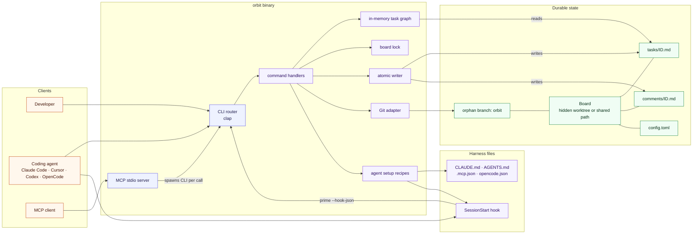
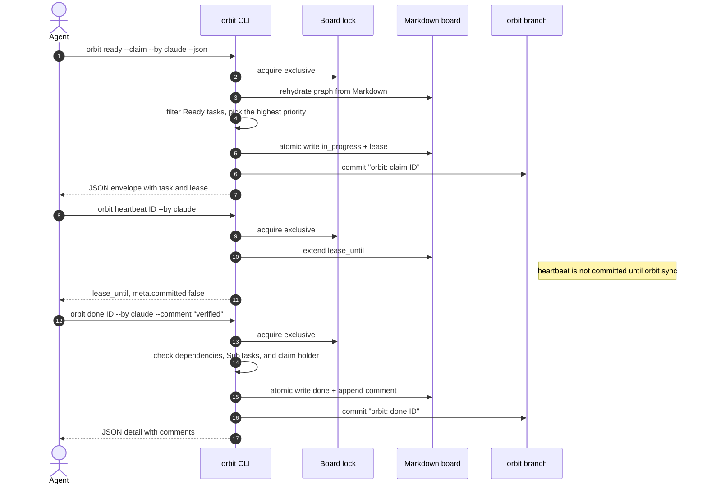
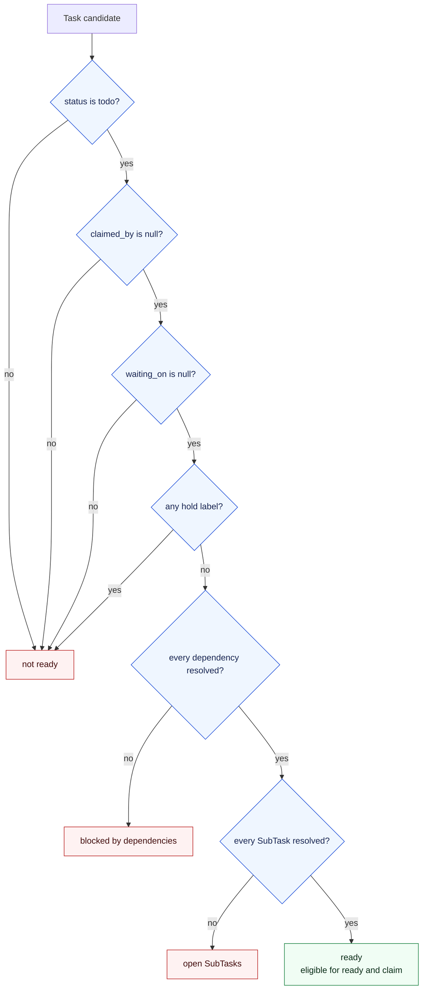
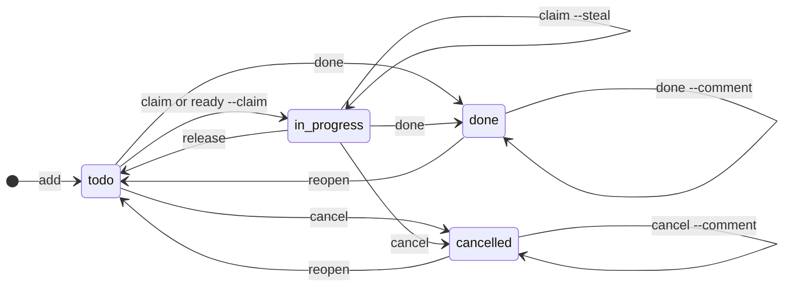
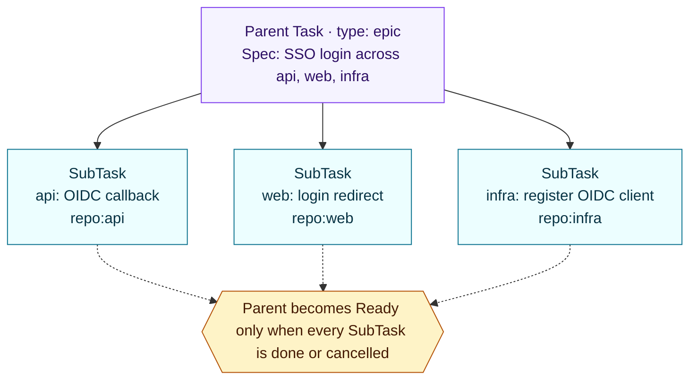
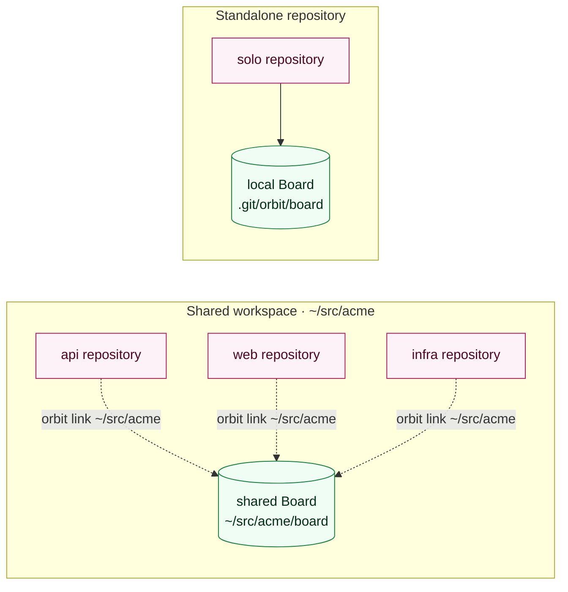

<div align="center">

# 🪐 Orbit

### The AI-native issue tracker that lives in your Git repo.

**One binary. One Markdown board. Zero daemons.**

[](https://github.com/rcmendes/orbit/actions/workflows/ci.yml)
[](https://github.com/rcmendes/orbit/actions/workflows/release.yml)
[](https://www.npmjs.com/package/@rcmendes/orbit)
[](https://www.rust-lang.org)
[](./LICENSE)
[](https://github.com/rcmendes/orbit/releases)

[Quick start](#quick-start) · [Why Orbit](#why-orbit) · [How it works](#how-it-works) · [Command map](#command-map) · [Documentation](#documentation)

</div>

---

**Orbit gives coding agents a deterministic work queue without taking your tasks out of Git.** Every task is a Markdown file on a dedicated orphan branch. Every claim is atomic. Mutations are serialized by one lock and published with `fsync` + rename; meaningful changes are committed to Git. There is no database, no daemon, no server, and no context-window tax.

Claude Code, Cursor, Codex, OpenCode, and any shell-capable agent talk to the same board through a strict JSON CLI or an MCP server. Humans get readable Git diffs; agents get exactly one next task.

**1 binary · 0 daemons · 4 statuses · 13 MCP tools · 100% Markdown tasks**

```text
$ orbit ready --claim --by claude
claimed orb-a7b2c9 by claude until 2026-10-24T22:30:00Z
```

> **Status:** pre-alpha. [`v0.5.0`](https://github.com/rcmendes/orbit/releases/tag/v0.5.0) is the latest release. `main` adds the aligned `orbit list` table shown below. The canonical design is [SPEC.md](./docs/SPEC.md); vocabulary is [GLOSSARY.md](./docs/GLOSSARY.md). Orbit requires Git 2.31+ (Rust 1.89+ only when building from source).

<details>
<summary><strong>Contents</strong></summary>

- [Why Orbit](#why-orbit)
- [Quick start](#quick-start)
- [Core concepts](#core-concepts)
- [How it works](#how-it-works)
- [The agent loop](#the-agent-loop)
- [Features and SubTasks](#features-and-subtasks)
- [Multi-repository workspaces](#multi-repository-workspaces)
- [Triage, labels, and comments](#triage-labels-and-comments)
- [Two front doors: JSON CLI and MCP](#two-front-doors-json-cli-and-mcp)
- [Export the board](#export-the-board)
- [Agent setup](#agent-setup)
- [Command map](#command-map)
- [Recovery and maintenance](#recovery-and-maintenance)
- [Why not Beads or Beans?](#why-not-beads-or-beans)
- [Compatibility vocabulary](#compatibility-vocabulary)
- [Install details](#install-details)
- [Documentation](#documentation)
- [Development](#development)
- [Contributing](#contributing)

</details>

## Why Orbit

Most trackers were designed for humans clicking through a web UI. Agents need something different: a stable contract, a small context footprint, and a queue that cannot hand the same ticket to two workers.

| The usual problem | Orbit's answer |
| --- | --- |
| Task state lives in a database nobody can review | Tasks are Markdown files on an orphan Git branch, diffable like code |
| Two agents grab the same ticket | `ready --claim` is atomic; the loser gets a typed error |
| An agent dies mid-task and the ticket is lost | Claims expire after a lease; recover with `claim --steal` |
| Agents burn tokens parsing the whole backlog | A dependency-aware ready queue returns one actionable task |
| Writes race and truncate files | One board lock, temp-file + `fsync` + rename, serialize every mutation |
| Work spans repositories but the board does not | One shared Board for a whole workspace, including every Git worktree |
| The tracker requires infrastructure to run | One binary, no daemon, no database, no hosted service |
| Status is prose an agent has to interpret | Stable JSON envelope, typed error codes, and retryability |

Orbit is deliberately narrow. It is not a project-management suite, a time tracker, or a hosted sync service. It is the smallest reliable queue that lets several coding agents work on one product without stepping on each other.

### Built for

- **Solo builders** who want a fast local backlog that lives beside the code and never needs a server.
- **Agent squads** running Claude Code, Cursor, Codex, and OpenCode in parallel against one product.
- **Multi-repository products** where the API, web app, infrastructure, and agent tooling all need one dependency graph.

## Quick start

### 1. Install

```bash
# macOS / Linux
curl --proto '=https' --tlsv1.2 -LsSf https://github.com/rcmendes/orbit/releases/latest/download/orbit-tracker-installer.sh | sh

# Windows PowerShell
irm https://github.com/rcmendes/orbit/releases/latest/download/orbit-tracker-installer.ps1 | iex

# npm / npx
npx @rcmendes/orbit --version
npm install -g @rcmendes/orbit
```

From source, with Rust 1.89 or newer:

```bash
cargo install --path .
```

The npm package is scoped because the bare name is taken. The command is always `orbit`.

### 2. Create the Board and wire your agents

```bash
cd your-repository
orbit init
```

`orbit init` creates the Board, detects the coding-agent harnesses installed on your machine, and writes only the integrations that apply. In a terminal it asks which harnesses to wire; without a terminal it wires the detected ones and never prompts.

```bash
orbit init --agents all     # wire every supported harness
orbit init --agents none    # Board only, no agent files
orbit init --print          # preview every file that would change
orbit init --board ~/src/acme/board   # join a shared Board
```

### 3. Put real work on the board

```bash
orbit add "Spec: SSO login across api, web, infra" \
  --type epic -p 1 --label ready-for-agent --body-file spec.md

orbit add "api: OIDC callback" \
  --parent orb-a7b2c9 -p 1 --label repo:api --label ready-for-agent

orbit add "web: login redirect" \
  --parent orb-a7b2c9 -p 2 --label repo:web --label ready-for-agent

orbit add "infra: register OIDC client" \
  --parent orb-a7b2c9 -p 0 --label repo:infra --label ready-for-agent
```

A spec or epic is a top-level Task with `type: epic`; the tickets under it are **SubTasks**. Each SubTask is claimed and completed independently, and the parent becomes Ready only when every child is done or cancelled.

### 4. Let an agent work

```bash
# Take exactly one task, atomically. The envelope includes the task and lease.
orbit ready --claim --by claude --json

# Load the body, acceptance criteria, dependencies, and comments.
orbit show orb-a7b2c9.z21c2w --json

# Extend the lease during a long build or test run.
orbit heartbeat orb-a7b2c9.z21c2w --by claude

# Close the task and record the note in the same transaction.
orbit done orb-a7b2c9.z21c2w --by claude --comment "Implemented and verified; tests added."
```

That is the entire loop. There is no daemon to start, no database to migrate, and no background worker to supervise.

### 5. See the board

`orbit list` is a fast, human-readable view of the graph:

```text
$ orbit list --tree
ID                 STATUS  P   TYPE  TITLE                                   LABELS                       CLAIMED BY
orb-a7b2c9         todo    P1  epic  Spec: SSO login across api, web, infra  ready-for-agent
orb-a7b2c9.z21c2w  todo    P0  task    infra: register OIDC client           ready-for-agent, repo:infra
orb-a7b2c9.hxdmqt  todo    P1  task    api: OIDC callback                    ready-for-agent, repo:api
orb-a7b2c9.c5qmed  todo    P2  task    web: login redirect                   ready-for-agent, repo:web
```

Columns are `ID`, `STATUS`, `P` (priority), `TYPE`, `TITLE`, `LABELS`, and `CLAIMED BY`. Long titles are shortened to 60 characters in the table; `--json` always returns the full title and every field.

For one feature, `orbit tree` shows the parent, its children, progress, and blockers:

```text
$ orbit tree orb-a7b2c9
orb-a7b2c9  todo  P1  epic  Spec: SSO login across api, web, infra  [ready-for-agent]  0/3 resolved
  orb-a7b2c9.c5qmed  todo  P2  web: login redirect  [ready-for-agent, repo:web]
  orb-a7b2c9.hxdmqt  todo  P1  api: OIDC callback  [ready-for-agent, repo:api]
  orb-a7b2c9.z21c2w  todo  P0  infra: register OIDC client  [ready-for-agent, repo:infra]
```

## Core concepts

Orbit keeps the vocabulary small on purpose. Everything else is derived.

| Concept | Meaning |
| --- | --- |
| **Task** | One unit of work. A Markdown file under `tasks/`. This is what external trackers call an issue. |
| **SubTask** | A Task with a `parent`. It is claimable and completable in its own right, not a checklist item. |
| **Parent Task** | A Task that groups SubTasks. Its completion waits for its children. |
| **Kind** | Structural and derived: `task` or `subtask`. |
| **Type** | Work shape: `task` (default), `epic`, `spike`, `chore`, or `decision`. Metadata only; it never changes readiness. `epic` is top-level only. |
| **Status** | Stored lifecycle: `todo`, `in_progress`, `done`, or `cancelled`. |
| **Priority** | `P0` (highest) through `P3` (lowest), stored as `0`–`3`. |
| **Label** | A lowercase string for filtering and workflow state. |
| **Hold Label** | A label that suspends readiness. Defaults: `needs-triage`, `needs-info`, `ready-for-human`. |
| **Dependency** | Another Task that must be `done` or `cancelled` before this one is Ready. |
| **Claim** | Exclusive, time-bounded responsibility for a Task, held by one agent. |
| **Lease** | The time window during which a Claim is valid. Default: 30 minutes. |
| **Ready** | Derived: `todo`, unclaimed, not Waiting, no Hold Label, every Dependency resolved, and every SubTask resolved. Never stored. |
| **Waiting** | An external blocker recorded in `waiting_on`. Not a Status. |
| **Comment** | An append-only, authored, timestamped note attached to a Task. |

The full definitions, including the words Orbit avoids, are in [GLOSSARY.md](./docs/GLOSSARY.md).

## How it works

Orbit is one binary with two front doors: the JSON CLI and the MCP stdio server. A command is a short-lived process. It resolves one Board, takes the right lock, rebuilds the task graph from Markdown, applies one transition, publishes changed files atomically, and optionally commits to the orphan `orbit` branch.



The full component map, board-resolution flow, domain model, state machine, readiness gate, command map, and sequence diagrams for `init`, the task lifecycle, concurrent claims, and MCP live in [docs/ARCHITECTURE.md](./docs/ARCHITECTURE.md).

### Board anatomy

The board is a real Git repository on an orphan branch, checked out in a hidden worktree:

```text
<repository>/.git/orbit/board/          # shared by every worktree
├── config.toml                         # branch, lease, priorities, hold labels
├── tasks/
│   ├── orb-a7b2c9.md                   # a top-level Task
│   └── orb-a7b2c9.d4b3df.md            # a SubTask
└── comments/
    └── orb-a7b2c9.md                   # append-only thread
```

Tasks are Markdown with YAML frontmatter:

```yaml
---
title: Build the CLI router
status: todo
type: task
priority: 2
labels:
- ready-for-agent
depends_on:
- orb-f14c02
created_at: 2026-10-23T11:00:00Z
updated_at: 2026-10-23T12:00:00Z
---

Body text, acceptance criteria, and notes.
```

The filename is the ID. There is no `id` field in frontmatter. A SubTask ID is the parent ID, a dot, and a fresh suffix (`orb-a7b2c9.d4b3df`). One dot, one level.

### Why an orphan branch?

Task churn does not belong in your feature PRs. The `orbit` branch is separate from `main`, so an agent can update a ticket while a human reviews code without either change polluting the other. Because every worktree resolves the same board, a claim made from a linked worktree and a claim made from the main checkout serialize on the same lock and see the same tasks.

### Safety without a server

- **One writer at a time.** Mutations take a repo-wide exclusive lock; readers take it shared for a consistent snapshot.
- **Atomic publishes.** Each file is written to a temp file, fsynced, renamed, and the directory is fsynced on Unix. A crash cannot leave a half-written task.
- **No persistent index.** Every command rebuilds the graph from Markdown. There is no cache to corrupt and no watcher to miss an event.
- **Auto-commit with an escape hatch.** Meaningful mutations commit to the `orbit` branch. Heartbeats are lease-only and wait for the next mutation or `orbit sync`. Nothing is pushed.
- **Typed failures.** `LOCKED` is retryable; dependency, claim, label, and parent failures carry the IDs you need to resolve them.

## The agent loop

The common path is `add` → `ready --claim` → `heartbeat` → `done`. Each step is a separate process, and the board lock is held only for that step.



If nothing can start, `ready --claim` is still a success:

```json
{"ok": true, "data": null, "meta": {"reason": "NO_READY_TASKS"}}
```

Polling loops should wait and retry rather than treating that as an error. When another agent holds the task, the loser gets `ALREADY_CLAIMED` with the holder and lease. When a lease expires, the task becomes **stale**, not Ready; recover it with `orbit claim <id> --steal` or return it to the queue with `orbit release <id> --force`.

### The readiness gate

`ready` is computed on every command. It is never a stored flag.



The failure codes follow the gate: `WAITING_EXTERNAL` for `waiting_on`, `LABEL_BLOCKED` for a hold label, `DEPENDENCY_BLOCKED` for unfinished dependencies, `SUBTASKS_OPEN` for open children, `ALREADY_CLAIMED` for a live claim, and `CLAIM_STALE` for an expired one. `--steal` bypasses only the claim checks, never the gate.

### Status vs. derived state

Only four values are stored in `status`:



Ready, blocked, waiting, stale, and held are derived from claims, dependencies, labels, and `waiting_on`. They cannot be written as a Status. `done` and `cancelled` both resolve dependents; `delete` is not a transition, it removes the task file.

## Features and SubTasks

A Parent Task groups SubTasks. The parent waits for the family; the children do not wait for each other unless you add a real dependency.



```bash
# Create the parent once.
orbit add "SSO login across api, web, infra" --type epic --body-file feature.md
# created orb-a7b2c9

# One SubTask per piece of work.
orbit add "api: OIDC callback" --parent orb-a7b2c9 --label repo:api
orbit add "web: login redirect" --parent orb-a7b2c9 --label repo:web
orbit add "infra: register OIDC client" --parent orb-a7b2c9 --label repo:infra

# Scope an agent to one feature or one repository.
orbit ready --parent orb-a7b2c9 --claim --by api-agent
orbit ready --repo api --claim --by api-agent

# Inspect the family and its blockers.
orbit tree orb-a7b2c9
orbit list --parent orb-a7b2c9 --json

# Close the parent explicitly when the family is finished.
orbit done orb-a7b2c9 --by coordinator --comment "SSO shipped"
```

SubTasks are one level deep. If a ticket needs its own breakdown, flatten it into sibling tickets with `--depends-on` instead of nesting further.

> **Warning:** `orbit done --force` or `orbit cancel --force` on a parent with open SubTasks cancels every open child. Use it when the remaining pieces are genuinely abandoned, not as a shortcut.

`orbit prime` surfaces **close candidates**: non-terminal Parent Tasks with at least one SubTask and no open children. Orbit never closes them automatically, so a coordinator decides when the feature is actually done.

## Multi-repository workspaces

A **Workspace** is one Board plus every repository linked to it. Create it once, then join each repository. Cross-repository dependencies share one graph, and every Git worktree resolves the same Board.



```bash
# Create the workspace and its independent Board.
orbit workspace ~/src/acme

# In each related repository: join the same Board.
orbit link ~/src/acme

# One-off command against the shared Board from anywhere.
orbit --dir ~/src/acme/board list

# Return this repository to its own Board.
orbit unlink
```

`orbit workspace` only creates the workspace and Board; it does not clone or link repositories. The workspace must live outside every Git working tree. Linking does not delete a repository's own Board; it shadows it and prints a warning.

Board discovery order is `--dir`, then `ORBIT_DIR`, then the repository link, then the repository's own Board. An explicit override wins for one command:

```bash
ORBIT_DIR=~/src/acme/board orbit ready --json
```

## Triage, labels, and comments

Labels are free-form lowercase slugs. Three of them are **hold labels**: while present, the task is not Ready and cannot be claimed.

```bash
# A new report arrives.
orbit add "Login rejects valid tokens" -p 1 \
  --label bug --label needs-triage --body-file report.md

# Triage it into the agent queue.
orbit label add orb-a7b2c9 ready-for-agent
orbit label remove orb-a7b2c9 needs-triage

# Record the reasoning without rewriting the body.
orbit comment add orb-a7b2c9 --by rodrigo \
  --body "Confirmed on macOS. Add a regression test before closing."

# Hand off a long command's output.
cargo test 2>&1 | orbit comment add orb-a7b2c9 --by claude --body-file -
```

- **Hold labels:** `needs-triage`, `needs-info`, `ready-for-human` (configurable in `config.toml`).
- **Neutral labels:** `ready-for-agent`, `bug`, `enhancement`.
- **Comments** are append-only and immutable. A correction is a new comment; the thread is merged into `show`.
- **Waiting** is an external blocker: `orbit add "..." --waiting-on "upstream 2.4"`, cleared later with `orbit update <id> --clear-waiting`.
- **Dependencies** are real blockers: `--depends-on` at creation or `orbit depend <id> <dep-id>` later.
- **`wontfix`** is a label plus a terminal status: add the label and `orbit cancel <id> --by <agent>`.

Triage is what keeps the agent queue clean without hiding unfinished work from humans. `orbit list --label needs-triage` is the inbox; `orbit ready` is the frontier.

## Two front doors: JSON CLI and MCP

Every board command prints human-readable text by default. Add `--json` and stdout becomes exactly one JSON object, including errors.

```bash
orbit ready --claim --by claude --json
orbit show orb-a7b2c9 --json
orbit list --all --json
```

```json
{
  "ok": true,
  "data": {
    "id": "orb-a7b2c9",
    "title": "Build the CLI router",
    "status": "in_progress",
    "priority": 2,
    "ready": false,
    "claimed_by": "claude"
  },
  "meta": {}
}
```

Errors are just as structured:

```json
{
  "ok": false,
  "error": {
    "code": "DEPENDENCY_BLOCKED",
    "message": "Cannot complete orb-a7b2c9",
    "retryable": false,
    "details": { "blocking": ["orb-f14c02"] }
  }
}
```

Exit codes are `0` for success, `1` for a domain failure, and `2` for a usage error. `LOCKED` is the one retryable code: another writer holds the lock, so retry after a short backoff.

### MCP

`orbit mcp` speaks JSON-RPC 2.0 over stdio and exposes 13 tools:

`ready` · `list` · `get` · `create` · `update` · `claim` · `release` · `heartbeat` · `finish` · `link` · `delete` · `label` · `comment`

```bash
orbit mcp
orbit --dir ~/src/acme/board mcp   # serve a shared Board
```

MCP is a bridge, not a second implementation. Each tool call spawns the installed `orbit` binary, so it reuses the same lock, atomic writes, auto-commit, and error envelope. It also serves `orbit://tasks/{id}` as a Markdown resource. `create` accepts `parent` and `type`; `update` accepts `type`; `list` and `ready` accept `parent`, `repo`, `labels`, `exclude_labels`, `types`, and `exclude_types`.

Editors launch the server from their MCP configuration. `orbit setup` writes project-local configs for Claude, Cursor, Codex, and OpenCode by default, recording the absolute path of the running binary so editors launched outside a shell do not need `PATH`. Use `--no-mcp` for instructions only or `--mcp-bin orbit` for a portable command.

## Export the board

`orbit export --json` emits a deterministic snapshot of every Task and SubTask, including terminal work, type, labels, dependency and parent edges, parent progress fields, comments, and derived readiness.

```bash
orbit export --json > board.json
orbit export --json | jq '.data.tasks[] | select(.kind == "subtask")'
```

The snapshot is ordered by task ID, carries `schema_version` (currently `2`), and contains no timestamp or machine-local paths. The same board state produces the same data, which makes export suitable for a knowledge base, an archive, or a diff between two points in time. Pin `schema_version` in the collector.

## Agent setup

`orbit init` is the one in-repository command. It creates the Board, detects installed harnesses from their commands and project markers, and writes only the integrations that apply. Instruction files use managed markers and MCP configs are merged at the key level, so re-running is safe and `--remove` deletes only what Orbit added.

```bash
orbit init                    # Board + detected harnesses (asks in a terminal)
orbit init --agents all       # wire every supported harness
orbit init --agents none      # Board only; no agent files
orbit init --print            # preview without writing
orbit init --board ~/board    # create a shared Board and link this repository
```

Use `orbit setup` to repair or adjust one harness later:

```bash
orbit setup claude --hooks   # CLAUDE.md + SessionStart hook + MCP
orbit setup cursor           # .cursor/rules/orbit.mdc + skill + MCP
orbit setup codex            # AGENTS.md + skill + MCP
orbit setup opencode         # AGENTS.md + MCP
orbit setup mattpocock       # docs/agents/issue-tracker.md
orbit setup all --check      # installed / missing / stale
orbit setup all --no-mcp     # instruction files only
orbit setup all --remove     # remove only Orbit-managed content
```

A hand-written tracker guide is respected. If `docs/agents/issue-tracker.md` exists without Orbit's managed marker, `orbit setup mattpocock` reports it as `skipped` and leaves it untouched; `--check` treats the custom doc as installed, and `--remove` does not delete it. Tracker files Orbit wrote continue to update and remove normally.

CI runs `orbit setup opencode --no-mcp --check` on every push and pull request, so the checked-in `AGENTS.md` managed block cannot drift from the generator. `--no-mcp` keeps the machine-local `opencode.json` out of the check.

### Claude Code hook

`orbit setup claude --hooks` installs a SessionStart hook in `.claude/settings.json`. The hook records the absolute Orbit binary and runs:

```bash
orbit prime --hook-json --by claude
```

`prime` prints the agent workflow, board counts, top ready tasks, close candidates, and stale claims — about 1k tokens of starting context. `--hook-json` wraps the same text in Claude Code's SessionStart envelope.

Because generated MCP commands are machine-specific, keep those config files untracked when possible. If one is committed, regenerate it after installing Orbit elsewhere, or use `--mcp-bin orbit`.

## Command map

| Stage | Commands |
| --- | --- |
| **Set up** | `init` · `workspace` · `link` · `unlink` · `setup` |
| **Author** | `add` · `update` · `depend` · `undepend` · `label` · `comment` · `delete` |
| **Inspect** | `list` · `ready` · `show` · `tree` · `prime` · `export` |
| **Execute** | `claim` · `heartbeat` · `release` · `done` · `cancel` · `reopen` |
| **Maintain** | `doctor` · `sync` · `mcp` |

Every command explains its own semantics:

```bash
orbit <command> --help    # long description, options, and examples
orbit <command> -h        # compact summary
```

The full guide — when to use each command, end-to-end scenarios, and a common-errors table — is in [docs/commands.md](./docs/commands.md).

## Recovery and maintenance

| Situation | What to do |
| --- | --- |
| Nothing is startable | `NO_READY_TASKS` is a success with `data: null`. Wait, triage, or remove a hold label. |
| Another agent owns the task | Pick other work, or `orbit claim <id> --by you --steal`. |
| A lease expired | `orbit claim <id> --by you --steal`, or `orbit release <id> --force` to requeue it. |
| Dependencies are unfinished | Read `error.details.blocking`, then finish or cancel those IDs. |
| A parent has open children | Finish the children, or pass `--force` to `done`/`cancel` to cancel them. |
| A test failed after a crash | `orbit doctor` reports integrity issues; `doctor --fix` removes stale temp files. |
| Heartbeats are uncommitted | `orbit sync` commits lease-only changes. |
| The Board is missing | `orbit init` creates one; a missing linked Board returns `LINK_NOT_FOUND`. |
| A writer is busy | `LOCKED` is retryable. Retry after a short backoff. |

`doctor` never rewrites tasks or comments, so it is always safe to run. It checks malformed tasks, dangling dependencies, missing or nested parents, parent/ID mismatches, cycles, orphan or corrupt comments, stale temp files, uncommitted changes, the checked-out branch, and a Claude hook that cannot find the Orbit binary.

## Why not Beads or Beans?

- **Beans** proved that Markdown-as-truth is pleasant for humans, but it has no atomic claims, leases, or dependency-aware ready queue.
- **Beads** proved that agents need claims, ready-work detection, priorities, and hash IDs, but its source of truth is a Dolt database and its multi-writer mode needs a server.

Orbit is the narrow overlap: Beans' human-readable storage with Beads' queue semantics, in one Rust binary with no daemon.

| | Orbit | Beads | Beans |
| --- | --- | --- | --- |
| Source of truth | Markdown on Git | Dolt database | Markdown |
| Task diffs reviewable in Git | Yes | No | Yes |
| Atomic claims + leases | Yes | Yes | No |
| Dependency-aware ready queue | Yes | Yes | No |
| Shared Board across repositories | Yes | Central database with hydrated copies | No |
| Server required for concurrency | No | Yes for multi-writer | No |

Orbit does not try to beat Beads at distributed sync, federation, or scale. It wins by keeping the board human-readable and diffable, and by making concurrent local agents safe with a single locked writer instead of a database server.

## Compatibility vocabulary

External trackers and skills use different words. Orbit translates at the boundary instead of inventing a second model:

- **Issue** = Task
- **Sub-issue** = SubTask, created with `--parent`
- **Epic** or **spec** = top-level Task with `type: epic`

`kind` is structural (`task` or `subtask`). `type` is the work shape (`task`, `epic`, `spike`, `chore`, or `decision`) and is metadata only. `epic` is refused on a SubTask. `bug` and `enhancement` remain triage labels, not Types.

The `epic` label is legacy. Orbit does not infer `type: epic` from it, and `--exclude-label epic` still works on boards created before the Type field. New work should use `--type epic` and `--exclude-type epic`.

See [ADR 0009](./docs/adr/0009-keep-task-vocabulary.md) and [ADR 0010](./docs/adr/0010-structural-type-field.md).

## Install details

Prebuilt binaries are the primary path. `v0.5.0` is the latest release.

| Platform | Command |
| --- | --- |
| macOS / Linux | `curl --proto '=https' --tlsv1.2 -LsSf https://github.com/rcmendes/orbit/releases/latest/download/orbit-tracker-installer.sh \| sh` |
| Windows | `irm https://github.com/rcmendes/orbit/releases/latest/download/orbit-tracker-installer.ps1 \| iex` |
| npm (global) | `npm install -g @rcmendes/orbit` |
| npm (one-off) | `npx @rcmendes/orbit --version` |
| From source | `cargo install --path .` (Rust 1.89+) |

The installer adds its directory to `PATH` unless it is already there, and tells you what to source if a restart is needed. The npm package is scoped because the bare name is taken; the command is always `orbit`.

`orbit init` and `orbit setup` refuse to record a binary inside npm's prunable `_npx` cache or a temporary directory. Install globally, or pass `--mcp-bin orbit`.

See [RELEASING.md](./docs/RELEASING.md) for the release process, supported targets, and packaging checks.

## Documentation

| Document | What it covers |
| --- | --- |
| [Command guide](./docs/commands.md) | Every command, when to use it, scenarios, and error recovery |
| [Architecture](./docs/ARCHITECTURE.md) | Component map, board resolution, domain model, state machine, readiness gate, command flow, sequence diagrams |
| [Specification](./docs/SPEC.md) | Canonical behavior, task format, config, command rules, JSON contract, concurrency, testing, distribution |
| [Glossary](./docs/GLOSSARY.md) | Canonical vocabulary and the words Orbit avoids |
| [Issue tracker guide](./docs/agents/issue-tracker.md) | How agents should use the board in this repository |
| [Triage labels](./docs/agents/triage-labels.md) | The five canonical triage roles and category labels |
| [Domain docs](./docs/agents/domain.md) | How engineering skills consume this repo's domain documentation |
| [ADRs](./docs/adr/) | Durable design decisions, from the orphan branch to the Type field |
| [Releasing](./docs/RELEASING.md) | cargo-dist, npm, smoke checks, and release operations |
| [Changelog](./CHANGELOG.md) | What changed in each release |

## Development

```bash
cargo fmt --check
cargo clippy -- -D warnings
cargo test
```

The test suite covers frontmatter round-trips, label normalization, comment parsing, ID generation, graph validation, readiness, lifecycle transitions, property-based DAG checks, multi-process claims and deletes, crash recovery, worktree sharing, setup recipes, onboarding, SubTasks, export determinism, MCP over a real stdio child, golden JSON, and error envelopes. CI runs on macOS, Linux, and Windows.

Useful local checks:

```bash
cargo run -- --help
cargo run -- init --print
cargo test --test concurrency
cargo test --test mcp
```

## Contributing

Contributions are welcome. This repository tracks its own work on Orbit:

```bash
orbit ready --claim --by <agent>
orbit show <id> --json
```

Before opening a pull request, run `cargo fmt --check`, `cargo clippy --all-targets -- -D warnings`, and `cargo test`. Changes to behavior, output, configuration, or workflow must update the relevant docs in the same change; design decisions that constrain future work belong in an [ADR](./docs/adr/).

## License

Apache-2.0. See [LICENSE](./LICENSE).

---

<div align="center">

**If Orbit fits the way you work, give it a star — and put your next agent task on the board.**

```bash
orbit init && orbit add "Try Orbit" -p 2 --label ready-for-agent
```

</div>
