# Orbit Architecture

Status: describes Board-anchor discovery (`<anchor>/.orbit/board`), the repository-local Board (`.orbit/board`, a standalone repository per ADR 0019), member Repositories joined by folder layout or `orbit repo add`, the optional Board host (`orbit board host|sync`), user-scoped agent setup, legacy layout migration via `orbit migrate`, and the provider-neutral Remote Tracker port (ADR 0018). [`SPEC.md`](./SPEC.md) is canonical for behavior and the JSON contract; [`GLOSSARY.md`](./GLOSSARY.md) defines the vocabulary. This document visualizes that design and maps it to the Rust modules.

The approved platform rebuild — Issue vocabulary, declarative workflow with status categories, project keys, optimistic concurrency, and the frozen-contract kernel / opt-in modules / declarative profiles layering — is recorded in [ADR 0022](./adr/0022-issue-model-and-platform-architecture.md). It supersedes ADR 0009 and parts of ADRs 0007 and 0021; this document describes the current implementation and is rewritten as each phase lands.

The short version: Orbit is one binary, two front doors (the JSON CLI and the MCP stdio server), and no daemon. A board command resolves a Board, takes a lock, rebuilds the task graph from Markdown, applies one transition, publishes files atomically, and optionally commits to the Board's `orbit` branch.

## 1. Component map

Solid arrows are calls or data flow. Dotted arrows are selection or lookup. The `orbit mcp` server is a bridge, not a second implementation: it spawns the CLI for every tool call.

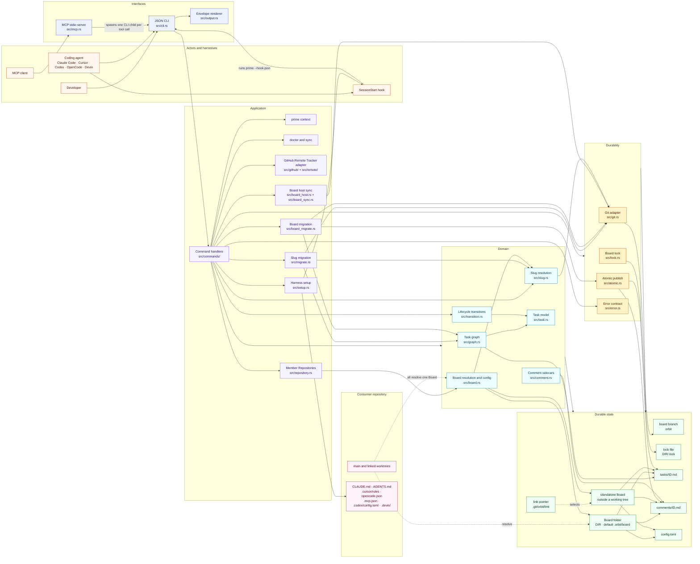

### What each layer owns

| Layer | Modules | Responsibility |
| --- | --- | --- |
| Interface | `src/cli.rs`, `src/output.rs`, `src/mcp.rs`, `src/registry.rs` | Parse commands, render terminal output or exactly one JSON object on stdout in `--json`, expose the same operations over MCP, and describe every public command once in the registry that generates the MCP tools, `orbit schema`, and the `docs/commands.md` reference. |
| Application | `src/commands/`, `src/migrate.rs`, `src/board_migrate.rs`, `src/repository.rs`, `src/board_host.rs`, `src/board_sync.rs`, `src/health.rs`, `src/github/`, `src/remote/`, `src/workspace.rs` | Dispatch, acquire the right lock mode, hydrate the graph, call one Task transition, call the writer, and shape the result. `src/remote/` owns the provider-neutral Remote Tracker port — sync engine, baselines, auto-push, relationships, link persistence, and the Remote Issue catalog seam — while `src/github/` is the built-in GitHub adapter. `src/repository.rs` owns Board membership (discovered child Repositories plus explicit `[repositories]` entries) and the rebuildable inventory cache; `src/board_host.rs`/`src/board_sync.rs` own host configuration and the Orbit-aware merge used by `orbit board sync`. `src/workspace.rs` is a compatibility shim that still stores the `[workspace]` config block and the Board-anchor lookup. `doctor` adds read-only repository/cache, migration, link, and managed-agent diagnostics. Prefix migration rewrites one Board's IDs; `orbit migrate` converts a legacy layout and `init` merges child Boards on an anchor. |
| Domain | `src/board.rs`, `src/slug.rs`, `src/graph.rs`, `src/task.rs`, `src/transition.rs`, `src/workflow.rs`, `src/policy.rs`, `src/review.rs`, `src/comment.rs`, `src/feed.rs`, `src/search.rs`, `src/scheduler.rs`, `src/hooks.rs`, `src/index.rs` | Board discovery and config, slug normalization and validation, task parsing and rendering, the Board-defined Workflow (statuses, categories, transitions, templates), lifecycle transition rules, dependency validation, the declarative transition policy (`[policy]` rules, readiness lint, post-functions), review/evidence/Ask state on the `evidence`/`orbit` Properties, the Change feed — named events `orbit changes`/`orbit history` derive by replaying Board Git history with a monotonic commit cursor — readiness, counts, comments, and the query layer behind `list`/`search`/`digest`: qualifier parsing, snippets, JSON filters, field projection, and the opaque keyset cursors that page results stably under writes. `src/scheduler.rs` is the opt-in ready-queue module (ADR 0022): `[scheduler]` config plus `ready --strategy` select comma-separated strategies — `critical-path` ordering, `touches` overlap avoidance against other assignees' declared `touches` Property paths, `capability` matching against `[scheduler.capabilities]`, and a per-agent `wip` claim limit — applied to the filtered queue in `cmd_ready`; the kernel's default order is untouched when no strategy is configured. `src/hooks.rs` is the opt-in event-hook module: `[[hooks]]` rules map feed event kinds to shell commands the write path spawns detached after its commits replay, so a hook never blocks or fails a write. `src/index.rs` is the opt-in derived-index module: `[index] enabled` caches parsed Tasks under `cache/index.json` (stamped with per-file length+mtime fingerprints) and `Graph::load_indexed` serves the read commands from it, re-parsing stale or missing entries from the files — the only source of truth — exactly as `Graph::load` does; the module exists because the large-Board benchmark in `docs/benchmarks.md` showed the plain scan too slow, per the ADR 0022 gate. |
| Durability | `src/lock.rs`, `src/atomic.rs`, `src/git.rs` | One Board-wide advisory lock at `<DIR>/.lock`, temp-file + fsync + rename publication, and auto-commit to the board branch. |
| Execution | `src/mutation.rs`, `src/remote/execution.rs` | Board mutation execution (lifecycle, terminal, reopen, shared Task persistence and commit warnings) and provider-neutral Remote Tracker execution (`synchronize`, `create_and_link`, `apply_plan`) behind a resolved `RemoteAdapter`; both run inside the caller's Board access scope. |
| Contract | `src/error.rs`, `src/contract.rs`, `src/output.rs`, `src/capabilities.rs`, `src/concurrency.rs` | Stable error codes rendered as RFC 9457-style problem fields (`type`, `title`, `detail`, `retryable`, `hint`), the Board contract semver and its compatibility gate, the `orbit capabilities` handshake that reports contract version, modules, and workflow — including on Boards the gate refuses — and the shared optimistic-concurrency (`--if-version` against `updated_at`) and write-idempotency (`--idempotency-key` records under the Board cache) checks every mutation runs inside the exclusive lock. |
| Setup | `src/setup.rs` | Detect harnesses and write managed instruction files, MCP entries, and the Claude SessionStart hook. |

### Board sync tree seam

`src/board_sync.rs` materializes the base, local, and host Git revisions as
path-to-content maps before merging divergent histories. Its private
`merge_trees` seam runs the ADR 0019 Task, Claim, and Comment rules entirely in
memory; the caller supplies the timestamp used for Claim-loser notices. An
empty base map represents unrelated histories. Git reads, applying files,
creating the merge commit, and pushing remain outside the merge engine.

Unit tests exercise these rules with in-memory trees. Board host integration
tests retain end-to-end coverage of unrelated histories, CLI conflict resolution,
and preserving merge history, alongside host configuration and transport checks.
This seam does not add to the Board host module's public interface.

### Child-Board consolidation

`src/commands/init.rs` holds the destination Board's exclusive lock while it
preflights all child Boards into in-memory Task and Comment maps and merges
accepted prefixes. Repository attribution is applied before comparing Task
content, so retries accept unchanged previous imports. Collisions, read failures,
and invalid merged configuration stop before import publication or backup moves.
The destination Board itself may already have been created by init.
Publication still uses atomic writes per file, followed by the prefix commit
and child-Board backup moves; it does not promise rollback after I/O failure or
interruption. Existing Tasks and Comments are never overwritten by import.

### Scoped access and execution modules

`board::BoardAccess::open` keeps discovery policy and the Board lock in one scope.
Discovery runs once and never writes files or repairs Git worktrees. `Read`
and `Inspect` take a shared lock; `Write` takes an exclusive lock. Orphan `orbit`
worktree records are reported by `doctor`; restore them explicitly with
`doctor --fix`, then convert the legacy Board with `orbit migrate`. Dropping the access value releases the lock. Command handlers keep the
scope alive through execution and append its discovery warnings to the result.

`mutation` owns lifecycle execution and shared Task persistence. It returns
structured mutation outcomes for presentation by command handlers, centralizes
commit-failure warnings, and preserves the heartbeat policy of publishing without
an immediate commit. Terminal execution includes graph checks, forced SubTask
cancellation, optional comments, and commit outcomes. Publication remains atomic
per file; multi-file operations do not promise rollback.

`remote::execution::synchronize` resolves the tracker named on the request to a
`RemoteAdapter` (the `github` tracker maps to `GitHubAdapter`) and returns a
typed report of provider-neutral `SyncPlan`s. It owns preflight, mode
restrictions, conflict choices, relationship planning, application, baseline
updates, and Remote Issue catalog upserts. The CLI owns argument conversion
and human/JSON presentation. Both execution modules run inside the caller's
Board access scope; they do not acquire a second lock.

`remote::auto_push` is the opt-in post-mutation path. The task command wrapper
snapshots `tasks/*.md` before and after a successful write, then pushes changed
mapped fields for every linked Task, creating a Remote Issue for a newly added
Task when exactly one Remote Project is available. It runs inside the same
exclusive Board lock, never pulls, and turns remote failures and conflicts into
warnings. Remote Tracker commands, `sync`, migrations, and `delete` use the
non-auto-push wrapper. The publish path is selected by
`[remote].auto_push` plus the `--no-sync`/`ORBIT_NO_AUTO_SYNC` escape hatch.

### Human output and JSON

Board commands have two output paths. Human output is for terminals: `list` renders an aligned table with `ID`, `STATUS`, `PRIORITY`, `TYPE`, `ISSUE`, `TITLE`, `LABELS`, and `CLAIMED BY` columns, while `ready`, `tree`, and `prime` use compact summary lines. `ISSUE` is `-` for a Local Task, `#N` for a Linked Task, and `~#N` for detached provenance. Table widths follow the current data, labels are comma-joined, and titles longer than 60 characters are shortened. Root Tasks are ordered by priority, then creation time and ID; each Parent Task is followed by its SubTasks, also ordered by priority. `--group` renders one outlined table with a banner for each Parent Task, its SubTasks underneath, and a final `No parent` section.

`--json` is the contract. It always returns the full title and every field through the standard envelope, so the table's layout, truncation, and column set can change without breaking a consumer. Agents and scripts should parse JSON, not scrape the table.

### Board resolution

Every command resolves the Board before it does any work. The first match wins.

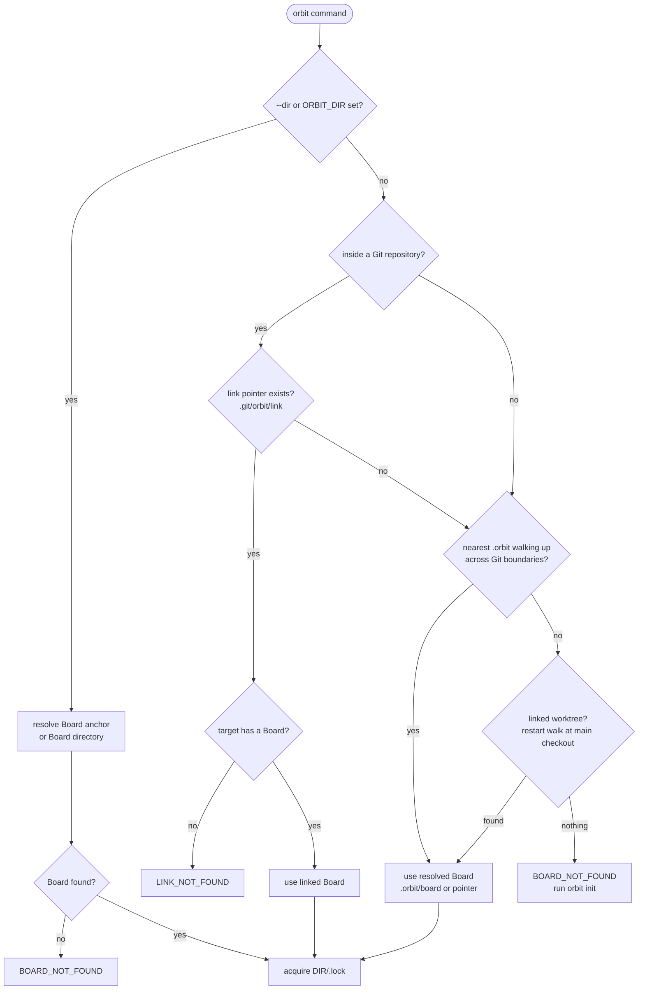

The pointer lives in the Git common directory, not in a worktree — `orbit repo add` writes it — so a claim made from a linked worktree and a claim made from the main worktree serialize on the same Board lock and see the same tasks. An anchored Board at `<anchor>/.orbit/board` is found above child Git roots and needs no per-repository pointer. A Board in the home directory (`~/.orbit/board`, created by running `orbit init` in `~`) is an ordinary Board found by the same upward walk; discovery never creates one. Every Board is a standalone repository on branch `orbit`; a pre-ADR-0019 layout resolves with a `LEGACY_LAYOUT` warning and then fails commands with `BOARD_NOT_MIGRATED` until `orbit migrate` converts it. When a child-local Board competes with the Board above it, the ancestor wins and the command warns with `AMBIGUOUS_BOARD`; `doctor` reports the duplicate.

### Domain relationships

A Task is the unit of work. Its claim fields are a single time-bounded claim, and its comments live in a sidecar file keyed by the same ID. Dependency edges are IDs stored in frontmatter, so they can point across the whole Board, including Tasks owned by different member Repositories. A SubTask is a Task whose `parent` names another Task; parentage follows the Board's configured Issue hierarchy (`board.hierarchy`, default `epic` > `story`/`task`/`bug` > `sub-task`) and is not a Dependency. A Task's Issue type comes from `board.types` (default `epic`, `story`, `task`, `bug`, `sub-task`) and decides where in the hierarchy it may sit.

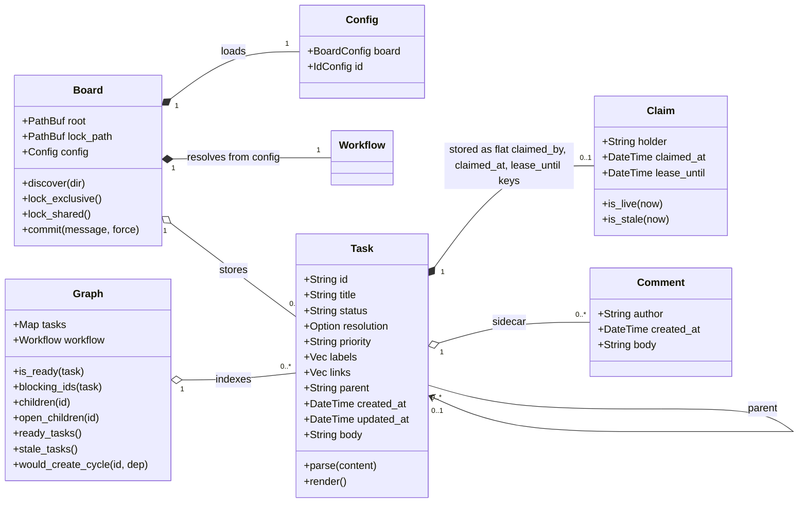

## 2. Task state machine

The lifecycle is a **Workflow** resolved from Board config (`src/workflow.rs`): named Statuses, each with a Status Category (`todo`, `active`, `done`, `canceled`), named Transitions between them, the initial Status, and exactly one Status flagged `ready`. Boards select a shipped template — `minimal`, `standard` (default), or `agentic` — or define `[workflow]` `statuses`/`transitions`/`initial` in `config.toml`. Commands read the category, never the status name, for terminal and closable checks; `Graph` carries the resolved `Workflow` so readiness, counts, and `allowed_transitions` share one definition. Ready, blocked, waiting, stale, and held are **derived** from other fields, so they are not states and cannot be written as one.

The standard template's graph:

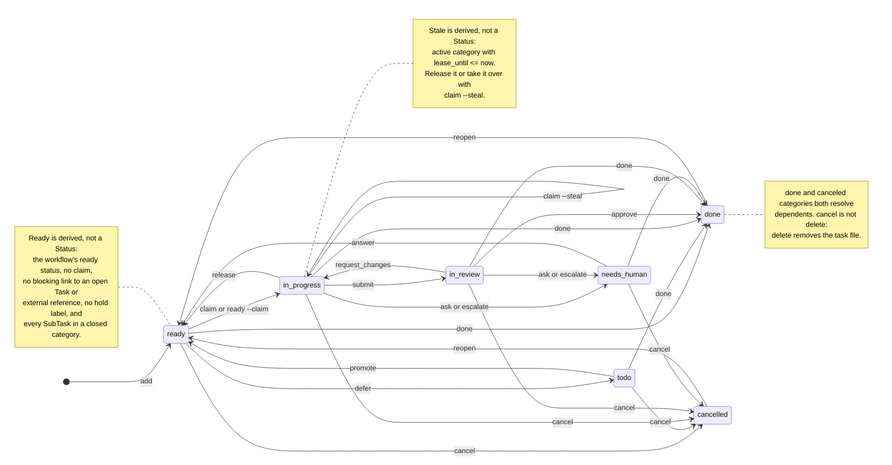

`minimal` drops the `todo` backlog, `needs_human`, `in_review`, and their edges; `agentic` adds `blocked` and `needs_decision` holds on top of the same review loop (`escalate` lands on `needs_decision`; `ask` and attempt-limit escalations land on `needs_human`). The review bookkeeping lives in `src/review.rs`: submit evidence under the `evidence` Property, the latest submit/verdict under `orbit.review`, the open question under `orbit.ask`, and attempt-limit reroutes under `orbit.escalation`. An open Ask is a derived block like a hold label — `is_ready` reports false and `claim`, `done`, and transitions refuse with `ASK_OPEN` until `answer` records the reply. A custom `[workflow]` may still define its own review and escalation statuses and edges; `Workflow::from_config` validates unique names, valid categories, exactly one ready Status, an existing initial Status, transitions that reference defined statuses, and resolution placement (resolutions only on transitions into closed categories).

### Transition rules

These rules live in `src/transition.rs`, which stays pure: every method takes the resolved `&Workflow` and returns a typed `TransitionError`. Command handlers only load, call one transition, persist and print. `orbit show` reports `status_category`, `resolution`, and `allowed_transitions` — the Workflow edges valid from the current Status; an `INVALID_TRANSITION` error names the transitions valid from the Task's current Status (or every defined transition for an unknown name).

| From | Command | Transition | To | Rules |
| --- | --- | --- | --- | --- |
| none | `add` | — | initial Status | Creates `tasks/ID.md`. Type defaults to `board.default_type`; priority defaults to `board.default_priority`; dependencies must exist. `--parent` must name an existing, non-terminal Task whose type sits strictly below the parent's type in `board.hierarchy`. |
| Ready Status | `claim` or `ready --claim` | `claim` | `in_progress` | The readiness gate must pass, including open SubTasks. `--by` is required unless `ORBIT_AGENT`, `USER`, or `USERNAME` identifies the agent. A live claim returns `ALREADY_CLAIMED`; a stale claim returns `CLAIM_STALE` unless `--steal`. |
| `active` | `heartbeat` | — | `active` | Only the claim holder; extends `lease_until` by `lease_minutes`. The heartbeat write is not auto-committed. |
| `active` | `checkpoint` | — | `active` | Only the claim holder; a stale claim still counts. Replaces `checkpoint`, keeping omitted optional fields; the first write needs `progress`; `--clear-next` and `--clear-blocker` remove one. Never changes Status or readiness. Rejected on a closed task or a task with no claim. |
| `active` | `claim --steal` | `claim` | `active` | Replaces the holder and resets `claimed_at` and `lease_until`, preserving the latest checkpoint. `--steal` does not bypass hold labels or dependencies. |
| `active` | `release` | `release` | Ready Status | The holder must release unless `--force`; clears all claim fields and preserves the latest checkpoint. Releasing an unclaimed task is a no-op. Links are untouched. |
| `active` | `done` | `done` | `done` | Every dependency must be in a closed category, and every SubTask must be resolved or cancelled by `--force` first. A **live** claim requires the caller to be the holder unless `--force`; a stale claim does not block. Clears claim fields; links are untouched. Records the transition's resolution. |
| `active` | `cancel` | `cancel` | `cancelled` | A Parent Task with open SubTasks requires `--force`, which cancels them first. A live claim requires the holder unless `--force`. Clears claim fields; links are untouched. Records the transition's resolution. Resolves dependents. |
| closed | `reopen` | `reopen` | Ready Status | Reopening a SubTask reopens every closed ancestor too, nearest first; an actively claimed ancestor ends the walk. Refuses when a dependent is already closed unless `--force`. Clears claim fields; links are untouched; clears the resolution. |
| any | `transition <name>` | named edge | edge target | Runs one Workflow transition directly, honoring the claim-holder check where the edge requires it. |
| `active` | `submit` | `submit` | `in_review` | Records evidence on the `evidence` Property and the submitter on `orbit.review`; needs at least one evidence flag. |
| `in_review` | `review --verdict approve` | `approve` | `done` | Records the verdict; the reviewer is checked against `distinct_from` policy as the transient assignee. |
| `in_review` | `review --verdict request-changes --reason` | `request_changes` | `in_progress` | Records the verdict and reason, reassigns to the recorded submitter; `max_attempts`-only violations reroute through `escalate` instead of failing. |
| open | `ask QUESTION` | `ask` | `needs_human` when allowed | Records `orbit.ask` with `return_to`; the open Ask blocks readiness, `claim`, `done`, and transitions (`ASK_OPEN`). |
| open | `answer ANSWER` | `answer` (fallback) | `return_to` or `answer` target | Records the reply on `orbit.ask` and restores the recorded status when still open. |
| closed | `done --comment` / `cancel --comment` | — | unchanged | Appends a comment and updates `updated_at`; without a comment it is a no-op (`changed: false`). |
| closed | opposite terminal command | — | rejected | `INVALID_TRANSITION`; reopen first. |
| any | `update`, `label`, `comment`, `depend`, `undepend` | — | unchanged | Metadata only. `update`, `label`, and `comment` also work on terminal tasks. `depend` refuses terminal tasks, cycles, and parent/child edges; `undepend` is idempotent. |

### The readiness gate

`ready` is computed fresh on every command. It never comes from a stored flag.

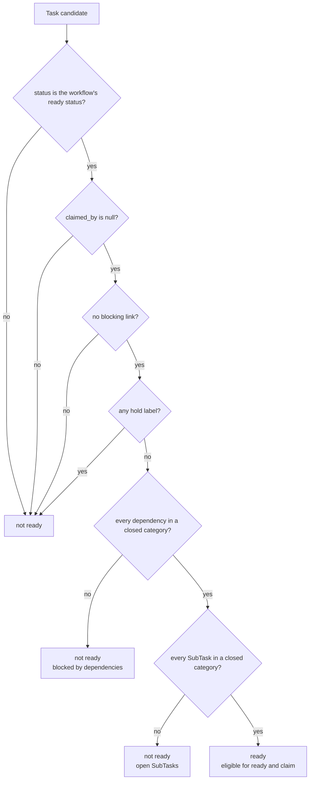

The failure codes follow the gate: `WAITING_EXTERNAL` for an external blocking link, `LABEL_BLOCKED` for a hold label, `DEPENDENCY_BLOCKED` for unfinished dependencies, `SUBTASKS_OPEN` for open SubTasks, `ALREADY_CLAIMED` for a live claim, and `CLAIM_STALE` for an expired one. An open Ask (`orbit.ask` without `answered_at`) is another derived block: `is_ready` reports false and `claim`, `done`, and transitions refuse with `ASK_OPEN` until `orbit answer` records the reply. `--steal` bypasses only the claim checks, never the gate. `graph::is_ready`, `ready_tasks`, `counts`, `prime`, and the MCP `ready` tool all share this one definition.

On top of the structural gate, `[policy]` rules with `lint = true` (`src/policy.rs`) add declarative field/property requirements to `is_ready` itself: a Task that fails the Board's readiness lint leaves the `ready` queue, and `claim` reports `POLICY_VIOLATION` instead of claiming it. Transition guards beyond the lint — required fields, evidence properties, WIP limits, attempt limits, reviewer/assignee distinctness, and post-functions — are enforced in `src/ops.rs`, the shared operation layer every surface (CLI, `orbit batch`, MCP) funnels through, so a violating transition fails atomically with `POLICY_VIOLATION` and `details.violations` naming each failed check.

### Stored versus derived

| Concept | Stored? | Source |
| --- | --- | --- |
| Status | yes | `status` in frontmatter, a Workflow status name |
| Resolution | yes | `resolution` in frontmatter, set by closing Transitions |
| Priority | yes | `priority`, a name from `board.priorities` |
| Labels | yes | `labels`, normalized, sorted, deduplicated |
| Links | yes | `links`: type, target (Task ID or external ref), blocking, attributes |
| Parent | yes | `parent` ID on a SubTask |
| SubTasks | yes, on the child | `parent` points at the Parent Task |
| Claim and lease | yes | `claimed_by`, `claimed_at`, `lease_until` |
| Checkpoint | yes | `checkpoint` with `by`, `at`, `progress`, `next`, `blocker` |
| Comments | yes, separately | `comments/ID.md` |
| Workflow | yes, in config | `[workflow]` in `config.toml` or a shipped template |
| Ready | no | `Graph::is_ready` |
| Blocked | no | `Graph::blocking_ids` and `Graph::open_children` |
| Stale | no | `active` category with `lease_until <= now` |
| Held | no | labels intersect `non_ready_labels` |

## 3. Command flow

The command map shows which command feeds the next stage. The state machine above defines the actual status transitions; this map shows how the commands relate.

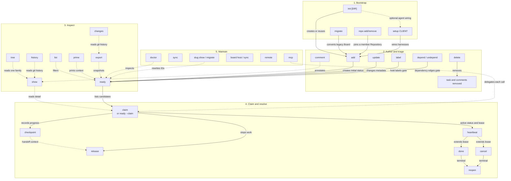

This map shows forward flow; solid arrows are the primary path, while dotted arrows are inspection or maintenance relationships. The state machine above holds the back edges where `release`, `done`, `cancel`, or `reopen` return a task to an earlier state. `delete` removes a task and its comments without a Status transition. `sync` commits pending heartbeat-only changes independently of the forward path. `slug` changes the Board's identity by rewriting every ID and then returning to the one-prefix model.

| Family | Commands | Effect |
| --- | --- | --- |
| Bootstrap | `init`, `migrate`, `setup`, `repo add`/`remove` | Create or convert the Board; optionally wire harness files and MCP entries, or register a member Repository on a multi-Repository Board. |
| Authoring | `add`, `update`, `label`, `comment`, `depend`, `undepend`, `delete` | Create tasks and change metadata. No command here changes Status except `delete`, which removes the task. |
| Inspection | `list`, `search`, `digest`, `show`, `tree`, `ready`, `prime`, `export`, `changes`, `history`, `remote status`, `remote create`/`sync` preview, `repo list` | Read-only by default. `tree` is the scoped family view; `ready` is the derived queue; `search` matches free text plus `key:value` qualifiers with snippets; `digest` is the compact per-Issue read with an epic rollup; `prime` is the compact agent context; `export` is the deterministic full snapshot; `changes` pages the Change feed with a commit cursor and `history` replays one Issue's timeline from Git history. `list`/`search` page with stable keyset cursors. Sync and create previews do not write; only `--apply` changes Board state or GitHub. |
| Execution | `claim`, `ready --claim`, `heartbeat`, `checkpoint`, `release`, `done`, `cancel`, `reopen`, `transition`, `submit`, `review`, `ask`, `answer` | Change Status, the claim, review/evidence bookkeeping, or the claim holder's handoff record. Writes take the exclusive lock. |
| Maintenance | `doctor`, `sync`, `remote`, `repo`, `board`, `slug`, `mcp` | Check Board and configured Remote Tracker health, commit heartbeat-only changes, explicitly create or synchronize Remote Issues or push mapped changes when auto-push is enabled, manage member Repositories and the rebuildable repository catalog, configure and synchronize the Board host, inspect or rewrite the Task-ID prefix, and serve MCP over stdio. |

## 4. Board layouts and initialization

### Topology

A Board anchor is an ordinary, non-Git folder containing repositories and one Board. Its Board is the standalone repository at `<anchor>/.orbit/board`; the rebuildable cache is separate at `<anchor>/.orbit/cache`. Repositories discovered below the anchor are member Repositories: they find the Board by walking above their Git boundary and need no explicit membership. Repositories outside the anchor join with `orbit repo add`, which records an explicit `[repositories]` entry and writes the link pointer in that Repository's Git common directory. The repository-local Board remains `<repository>/.orbit/board`, and a home-directory Board at `~/.orbit/board` (created by running `orbit init` in `~`) is found by the same upward walk.

`src/repository.rs` owns Board membership: discovered child Repositories merge
with the explicit `[repositories]` config entries, deduplicated by
main-checkout path. `orbit repo refresh` rescans the anchor's child directories
and rebuilds the inventory snapshot at `.orbit/cache/member-repositories.json`
— name, path, kind (`child` or `explicit`), and best-effort `origin` — reporting
additions and removals. The cache is rebuildable and never stored in the Board
Git repository. `orbit repo list` reads membership live; `orbit repo remove`
drops an explicit entry and clears the link pointer when it points back to this
Board, while a discovered child cannot be removed because its membership comes
from the folder layout.

`orbit remote issues refresh` stores Remote Issue summaries separately at
`.orbit/cache/remote-issues.json`; per-project errors retain the last
successful snapshot. `orbit remote issues list` reads cached summaries, while
`show` fetches the live body and comments. `orbit remote import` explicitly
previews selected catalog identities, then optionally creates Linked Tasks or
links Local Tasks without overwriting Orbit fields. Duplicate checks use stable
identity and import does not write to the Remote Tracker. Only applied imports
enter the Task graph.

Task detach moves cached summaries into the archived cache section and marks
prior Remote provenance inactive on the Task. `orbit remote reattach` matches
the exact Remote Issue identity, previews current sync plans and conflicts,
then reactivates links without syncing them. Inactive provenance is excluded
from sync and duplicate link counts until reattached.

`init` on an anchor folder writes the managed `AGENTS.md`/`CLAUDE.md` entry
points at the anchor root, and `orbit setup` inside each member Repository
installs its managed harness integrations. Generated MCP configurations
contain no Board path: each Repository resolves the Board through ordinary
Orbit discovery across its Git boundary.

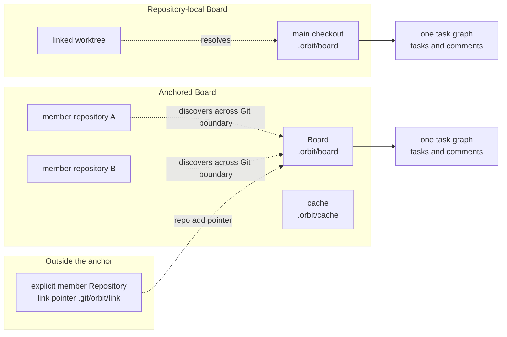

### Resolving the Task-ID slug

`orbit init` resolves the literal `id.prefix` from the repository or Board anchor name before creating a Board. A Board anchored at `~/.orbit` uses `orb` with a warning; an explicit `--slug` overrides. Auto-derived names are normalized and never fail; explicit names are strict. Re-runs preserve the stored prefix, an empty Board can change it, and a hand-edited new-style prefix is detected as `PREFIX_MISMATCH` before task parsing. `src/slug.rs` owns normalization, validation, suggestions, and the anchor rule.

`orbit slug show` reads the stored prefix, task/SubTask counts, and comment-file count without loading the graph. `orbit slug migrate <slug>` is the explicit rewrite path for a populated Board. It keeps each random suffix, rewrites `parent`, internal `links` targets, comment filenames and Orbit headers, updates `id.prefix`, and records one commit. It refuses an unhealthy Board, a target collision, and live claims unless `--force`; a dry run reports the plan and claims without writing.

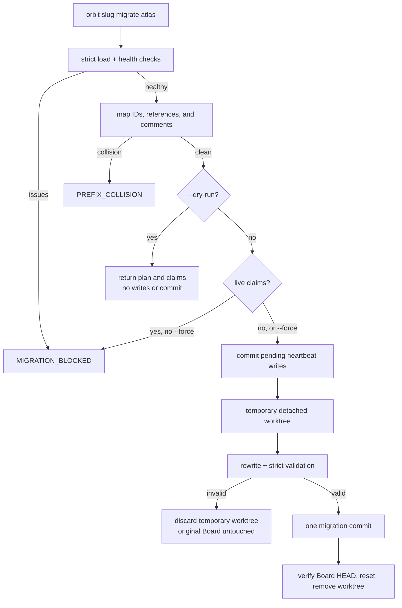

The temporary worktree is the transaction boundary: the real Board is not touched until the migrated tree has passed strict loading and the doctor-equivalent integrity checks. A failure after the reset can leave the migrated commit and a removable temporary worktree, but not a half-renamed Board. `src/migrate.rs` owns the plan, safety checks, rewrite, and commit.

### Creating a Board

`orbit init [DIR]` creates a repository-local Board at `./.orbit/board` inside Git or an anchored Board at `<anchor>/.orbit/board` outside Git. A `DIR` that is already a Git working-tree root, including `.`, also resolves to that checkout's `./.orbit/board` (the main checkout's from a linked worktree), so `orbit init .` matches plain `orbit init`; any other `DIR` inside a repository is a visible Board folder anchored by the repository's `.orbit/board` pointer file, and outside Git it is anchored by a sibling `.orbit`. `--dir`/`ORBIT_DIR` accept the anchor or a Board directory. Init on an anchor previews and merges any child-repository Boards it finds — Task IDs are preserved, child prefixes move to `id.accepted_prefixes`, imported Tasks record their Repository, and the child Boards stay on disk as backups under `<anchor>/.orbit/backups` — and refuses to overwrite unknown `.orbit` contents. A legacy Board directly at the anchor's `.orbit` gets a migration diagnostic, and any other pre-ADR-0019 Board is refused with `BOARD_NOT_MIGRATED`. Once the anchor's Board exists, `init` reuses it. Running `init` from a member Repository whose anchored Board already resolves reuses it. A Board at `~/.orbit` is exempt from conflicting-Board checks.

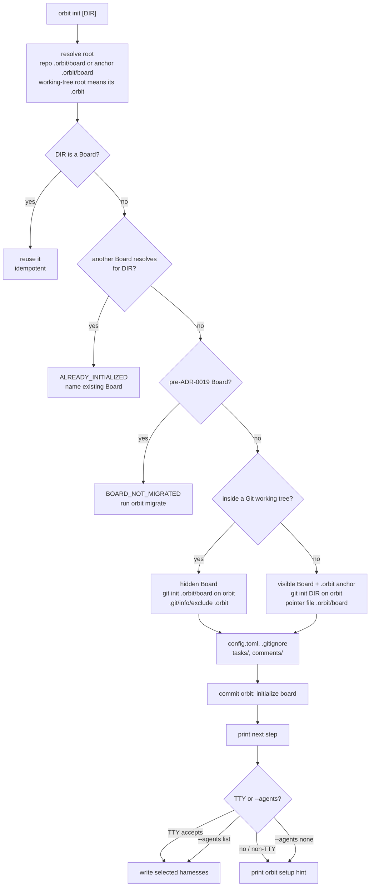

A standalone Board directory must be empty apart from `.git`, so its first commit contains only Board files. The anchor folder itself may contain repositories and user data; init only creates the reserved `.orbit/board` and `.orbit/cache` entries plus `.orbit/backups` for merged child Boards, and refuses other unknown entries under `.orbit`. Inside a code repository, init lists the Orbit folder — and the visible Board folder when there is one — in `.git/info/exclude`; it never edits a tracked `.gitignore`. `--print` returns the same plan without writing.

### Initializing a Board and wiring agents

`init` is pure until the user asks for agent wiring. It creates the Board, commits, and then either prompts in a TTY, respects `--agents`, or prints the `orbit setup` hint. The first MCP wiring also chooses between the absolute Orbit binary path, which needs no editor `PATH`, and the portable `orbit` command, which does.

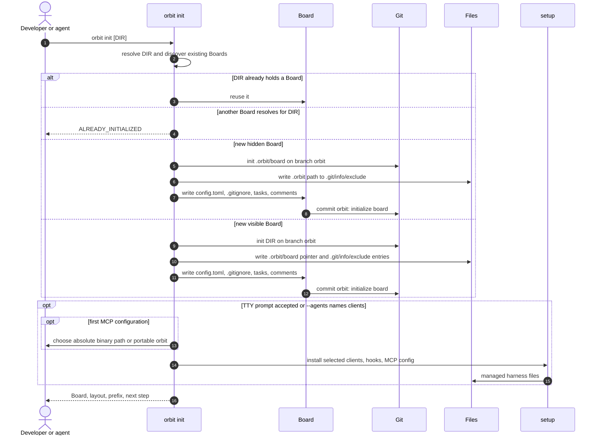

With `--print`, the Board, exclusion entries, and harness files are planned but not written. Re-running `init` reuses the Board and reports unchanged managed files when wiring is requested.

### Legacy migration

Legacy Boards keep resolving with a `LEGACY_LAYOUT` warning, after which Board
commands fail with `BOARD_NOT_MIGRATED`. `orbit migrate` performs the explicit
conversion; it previews by default and `--apply` writes the result.

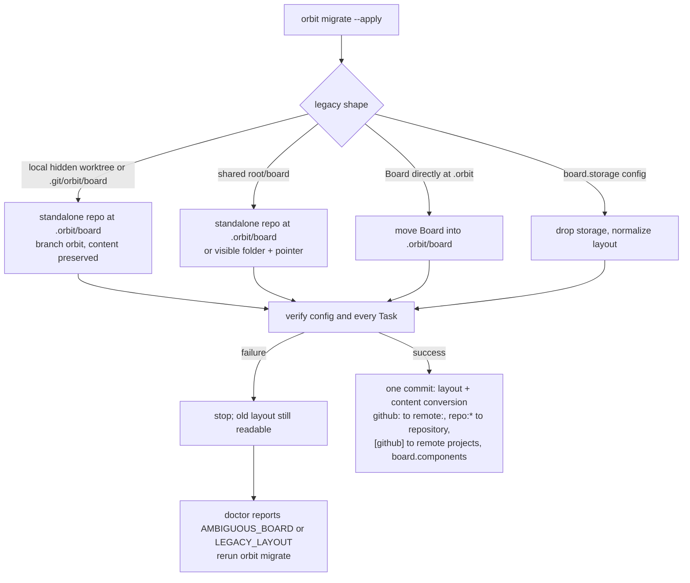

The conversion also rewrites task frontmatter `github:` links to `remote:`,
moves `repo:*` labels into the `repository` field, converts `[github]` configuration
into remote project entries, drops `board.storage`, and seeds `board.components`
from the Component values Tasks already use — all in the same commit. Re-running
after `--apply` is a no-op.

A forced `git clean -xdff` that removes `DIR` leaves the `orbit` branch and a stale worktree record. `doctor` reports `ORPHAN_WORKTREE`; `doctor --fix` or `init` prunes the record and re-attaches `DIR` without task loss.

### Child Board consolidation

`orbit init <ANCHOR>` on a folder that already contains repositories with their
own Boards previews the merge and, when accepted, folds every child Board into
the new anchored Board: Task IDs are preserved, each child's prefix moves to
`id.accepted_prefixes`, imported Tasks record their Repository in the `repo`
field, and the child Boards stay on disk as backups under
`<anchor>/.orbit/backups`. `src/board_migrate.rs` owns the equivalent
one-Board conversion for `orbit migrate`; both flush heartbeat-only writes,
build the result off to the side, commit once, and keep the sources untouched
(ADR 0017).

### Membership and the link pointer

| Command | Pointer | Board | Harness config |
| --- | --- | --- | --- |
| `init` | unchanged | Creates or reuses the Board at the resolved root. | Writes only when the prompt is accepted or `--agents` names clients. |
| `repo add PATH` | written in the added Repository | The Repository joins this Board as an explicit `[repositories]` member. | Refreshes existing managed client files; no Board path is stored. |
| `repo remove NAME` | cleared when it targets this Board | Drops the explicit member; discovered child Repositories cannot be removed. | Refreshes existing managed client files; no Board path is stored. |

`orbit repo add` writes the link pointer `.git/orbit/link` in the member
Repository's Git common directory, so every worktree of that Repository resolves
the same Board. Adding a Repository that still has its own Board on disk
shadows that Board — add reports every shadowed path — without deleting it. A
linked target with no Board returns `LINK_NOT_FOUND`; the pointer is not
repaired automatically. A linked legacy Board keeps returning a
`LEGACY_LAYOUT` warning until it is migrated. Generated configs record the
Orbit binary but no Board path, so moving the Board does not stale them;
`doctor` reports an older absolute path as `ABSOLUTE_BOARD_PATH`.

## 5. Task lifecycle

The common agent path is `add` → `ready --claim` → `heartbeat` → `checkpoint` → `done`. Each command is a separate process; the Board lock is held only for that process.

```mermaid
sequenceDiagram
    autonumber
    actor Agent
    participant CLI as orbit CLI
    participant BRD as Board
    participant LCK as Board lock
    participant FS as Markdown files
    participant GIT as Git

    Note over Agent,GIT: add
    Agent->>CLI: orbit add "Build the router" -p high
    CLI->>BRD: discover
    BRD->>LCK: acquire exclusive
    CLI->>FS: read all tasks, hydrate graph
    CLI->>FS: atomic write new task in the initial status
    CLI->>GIT: commit orbit: add ID
    CLI-->>Agent: JSON task detail

    Note over Agent,GIT: claim
    Agent->>CLI: orbit ready --claim --by claude
    CLI->>BRD: discover
    BRD->>LCK: acquire exclusive
    CLI->>FS: read all tasks and compute ready
    alt no ready task
        CLI-->>Agent: ok true, data null, meta.reason NO_READY_TASKS
    else first ready task
        CLI->>CLI: check waiting, hold labels, dependencies, claim
        CLI->>FS: atomic write the active status plus lease
        CLI->>GIT: commit orbit: claim ID
        CLI-->>Agent: JSON detail, meta.claimed true
    end

    Note over Agent,GIT: heartbeat
    Agent->>CLI: orbit heartbeat ID --by claude
    CLI->>BRD: discover
    BRD->>LCK: acquire exclusive
    CLI->>FS: read all tasks
    CLI->>CLI: verify the active claim and holder
    CLI->>FS: atomic write new lease_until
    Note right of GIT: no commit until orbit sync
    CLI-->>Agent: lease_until, meta.committed false

    Note over Agent,GIT: checkpoint
    Agent->>CLI: orbit checkpoint ID --by claude --progress "..." --next "..."
    CLI->>BRD: discover
    BRD->>LCK: acquire exclusive
    CLI->>FS: read all tasks
    CLI->>CLI: verify holder; merge progress, next, blocker
    CLI->>FS: atomic write checkpoint in frontmatter
    CLI->>GIT: commit orbit: checkpoint ID
    CLI-->>Agent: JSON detail with the checkpoint

    Note over Agent,GIT: complete
    Agent->>CLI: orbit done ID --by claude --comment "verified"
    CLI->>BRD: discover
    BRD->>LCK: acquire exclusive
    CLI->>FS: read all tasks
    CLI->>CLI: Task.complete checks dependencies and live claim holder
    CLI->>FS: atomic write done, clear claim and waiting
    opt comment supplied
        CLI->>FS: append immutable comment
        CLI->>FS: atomic write updated_at
    end
    CLI->>GIT: commit orbit: done ID
    CLI-->>Agent: JSON detail with comments

    Note over CLI,LCK: Every writer can return LOCKED after lock_timeout_ms. The caller retries with backoff.
```

`done` refuses unfinished dependencies and tasks already in a closed category. A live claim requires the holder unless `--force`; a stale claim does not. If a completion comment fails after the status write, the task is still done and the result carries `COMMENT_FAILED` with exit code `1`.

A checkpoint is optional and independent of the lease: the holder can record progress, the next action, and a blocker at any point, then release or let the lease expire. `claim --steal`, `release`, and `reopen` preserve the record; terminal transitions keep it as archived history while the active queue stops exposing it.

### Concurrent claims

Two agents can ask for work at the same time. The second process waits for the lock, then re-reads the board, so it cannot claim the task the first process just took.

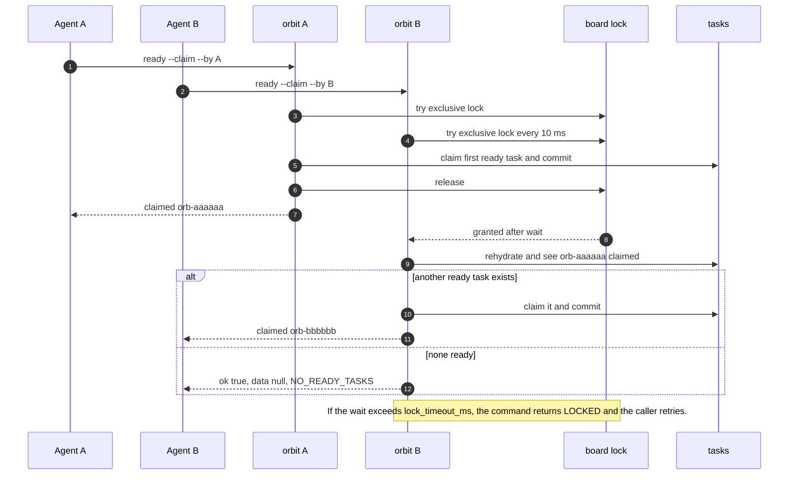

## 6. MCP bridge

`orbit mcp` speaks JSON-RPC 2.0 over stdio. For each `tools/call`, it maps the tool arguments to CLI flags, spawns the installed `orbit` binary with `--json`, and returns the CLI envelope as text. The server holds no board lock between calls.

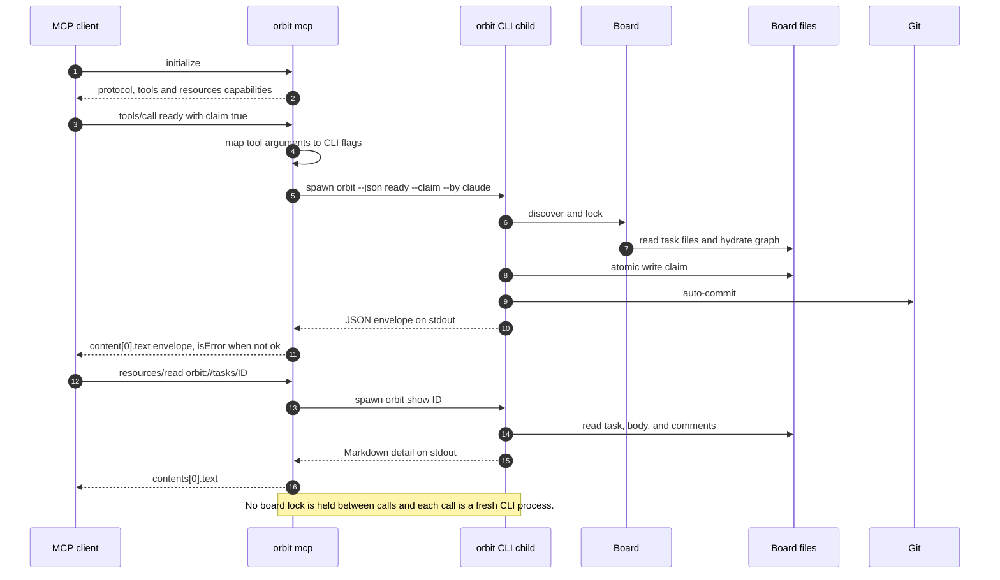

## 7. Failure and recovery

| Situation | Behavior |
| --- | --- |
| Lock contention | Writers wait up to `lock_timeout_ms`, retrying every 10 ms, then return `LOCKED` with `retryable: true`. Retry with backoff. |
| Crash during a write | The old file survives; a `.tmp-orbit-*` file may remain. `doctor` reports it and `doctor --fix` removes it. |
| Multi-file mutation crash | Files are serialized but not transactional across files. `doctor` reports dangling dependencies and a repeated `delete --force` resumes cleanup. |
| Auto-commit failure | The state is already on disk. The command succeeds with `meta.warnings: ["COMMIT_FAILED: ..."]`; `orbit sync` retries the commit. |
| Heartbeat-only changes | Not committed immediately. The next meaningful mutation or `orbit sync` commits them. |
| Slug migration fails | No files are changed if validation fails; fix the issues from `orbit doctor`. If the reset fails after a commit, inspect the temporary worktree named in the error and run `git worktree prune` after recovery. |
| Missing linked Board | `LINK_NOT_FOUND`; run `orbit repo add` again or restore the Board. |
| Missing local Board | `BOARD_NOT_FOUND`; run `orbit init`. |
| Removed `DIR` | The `orbit` branch still holds every Task. `doctor` reports `ORPHAN_WORKTREE`; `doctor --fix` or `orbit init` re-attaches it. |
| Half-moved or duplicated layout | `doctor` reports `AMBIGUOUS_BOARD`; `orbit migrate` resolves the pair. |
| Legacy Board layout | Commands fail with `BOARD_NOT_MIGRATED`; `orbit migrate` converts the Board to the standalone layout. |
| Storage key leftover | `doctor` reports `STORAGE_MISMATCH`; `orbit migrate` drops the retired `board.storage` key. |
| Corrupt task, comment, or graph | `doctor` reports `CORRUPT_TASK`, `CORRUPT_COMMENT`, `ORPHAN_COMMENT`, `DANGLING_DEP`, `DANGLING_PARENT`, `PARENT_CYCLE`, `INVALID_TYPE`, `MISSING_REQUIRED_FIELD`, or `CYCLE_DETECTED`. `doctor --fix` removes stale temp files and re-attaches an orphan worktree; it does not rewrite tasks or comments. |
| Forced reopen of a done dependency | A done dependent can keep an unfinished dependency as a historical fact. `doctor` warns; the next `done` of that dependent still enforces its dependencies. |

## 8. Where to change what

| Change | Start here | Also update |
| --- | --- | --- |
| Add a CLI command | `src/cli.rs`, then the dispatch in `src/commands/mod.rs` and an entry in `src/registry.rs` (`COMMANDS`, plus a `TOOLS` entry or an MCP exemption) | `tests/cli.rs`, `tests/schema.rs`, `SPEC.md`, and this command map |
| Change a status transition | The Task transition in `src/transition.rs`, plus `Graph::is_ready` or `blocking_ids` if readiness changes | `tests/properties.rs`, the state machine in this document, and `SPEC.md` |
| Add a task field | `TaskFrontmatter` and parsing in `src/task.rs` | `graph::task_summary` and `task_detail`, plus round-trip tests |
| Add an MCP tool | A `TOOLS` entry in `src/registry.rs` (argument schema, safety hints, argv mapping); hand-written argv translation goes in `dispatch_tool` in `src/mcp.rs` for `custom` tools | `tests/mcp.rs`, the registry parity tests, the MCP bridge section, and `SPEC.md` |
| Change human `list` output | `format_table` in `src/commands/render.rs` and `truncate` in `src/commands/mod.rs` | The human-output note here, `docs/commands.md`, and the README example |
| Add a harness | `SetupClient` and the install and remove plans in `src/setup.rs` | Detection tests in `tests/setup.rs`, onboarding tests, and `docs/agents/` |
| Change board layout or migration | `src/board.rs`, `src/board_migrate.rs`, and the init path | [ADR 0001](adr/0001-markdown-board-on-orphan-branch.md), [ADR 0002](adr/0002-single-writer-lock-and-atomic-rename.md), [ADR 0012](adr/0012-orbit-folder.md), [ADR 0019](adr/0019-board-folder-is-its-own-repository.md), and the component map here |

## 9. Invariants

- The board is the only source of truth. There is no persistent index, cache, or watcher; every command rehydrates from Markdown.
- A Board is one standalone Git repository on branch `orbit` in a Board folder; the hidden/visible placement changes only where `.orbit` anchors it, not the files, lock, command behavior, or JSON contract.
- Discovery never creates a Board. `init` refuses when a repository-local Board already resolves for the target `DIR` (except a Board at `~/.orbit`), and `~/.orbit` is used only when it already exists.
- Readers take the shared lock for a consistent snapshot. Writers take the exclusive lock for the read-modify-write.
- Each file is published with a temp file, `fsync`, and rename. A crash cannot truncate a task.
- Ready and blocked are derived on every command. They are never stored in frontmatter.
- Parentage follows `board.hierarchy` and is not a Dependency. A Parent Task is Ready only when every descendant is in a closed Status Category.
- Statuses in the `done` and `canceled` categories both resolve dependents. `delete` is not a status; it removes the task and its comments, and `--force` removes a SubTask subtree.
- Comments are append-only and immutable. A correction is a new comment.
- Meaningful mutations auto-commit to the `orbit` branch. Heartbeats wait for the next mutation or `sync`. The branch is pushed only to a configured Board host, with `orbit board sync` or `board.host_sync = auto`; Remote Issue auto-push is a separate opt-in per Board.
- `export` takes the shared lock and writes nothing. Its snapshot is sorted by task ID and contains no timestamps or machine-local paths.
- Human output is presentation only. `list` tables may truncate titles or change column widths; `--json` carries the complete, stable shape.
- MCP does not bypass the CLI. Every tool call reuses the same lock, atomic-write, auto-commit, and error envelope.
- Agent configuration is written with managed markers or key-level merges so `setup --remove` deletes only Orbit-managed content. Generated configs record the Orbit binary but not the Board path.

- Parentage follows `board.hierarchy` and is not a Dependency. A Parent Task is Ready only when every descendant is in a closed Status Category.
- Statuses in the `done` and `canceled` categories both resolve dependents. `delete` is not a status; it removes the task and its comments, and `--force` removes a SubTask subtree.