# Orbit Architecture

Status: describes v0.2.0. [`SPEC.md`](./SPEC.md) is canonical for behavior and the JSON contract; [`GLOSSARY.md`](./GLOSSARY.md) defines the vocabulary. This document visualizes that design and maps it to the Rust modules.

The short version: Orbit is one binary, two front doors (the JSON CLI and the MCP stdio server), and no daemon. A board command resolves a Board, takes a lock, rebuilds the task graph from Markdown, applies one transition, publishes files atomically, and optionally commits to an orphan Git branch.

## 1. Component map

Solid arrows are calls or data flow. Dotted arrows are selection or lookup. The `orbit mcp` server is a bridge, not a second implementation: it spawns the CLI for every tool call.

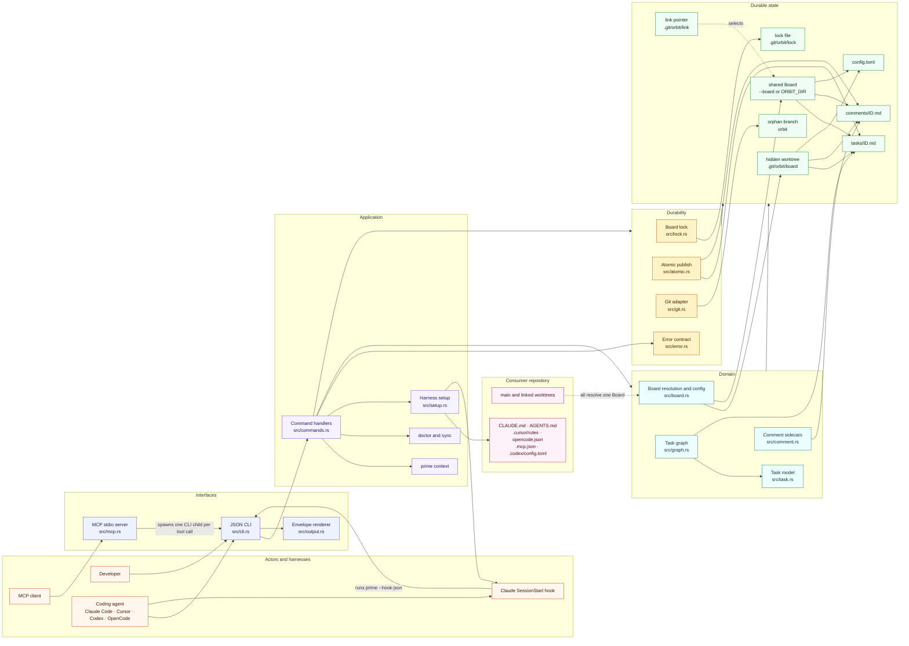

### What each layer owns

| Layer | Modules | Responsibility |
| --- | --- | --- |
| Interface | `src/cli.rs`, `src/output.rs`, `src/mcp.rs` | Parse commands, emit exactly one JSON object on stdout in `--json`, and expose the same operations over MCP. |
| Application | `src/commands.rs` | Dispatch, acquire the right lock mode, hydrate the graph, enforce transition rules, call the writer, and shape the result. |
| Domain | `src/board.rs`, `src/graph.rs`, `src/task.rs`, `src/comment.rs` | Board discovery and config, task parsing and rendering, dependency validation, readiness, counts, and comments. |
| Durability | `src/lock.rs`, `src/atomic.rs`, `src/git.rs` | One repo-wide advisory lock, temp-file + fsync + rename publication, and auto-commit to the board branch. |
| Contract | `src/error.rs` | Stable error codes, messages, details, and retryability. |
| Setup | `src/setup.rs` | Detect harnesses and write managed instruction files, MCP entries, and the Claude SessionStart hook. |

### Board resolution

Every command resolves the Board before it does any work. The first match wins.

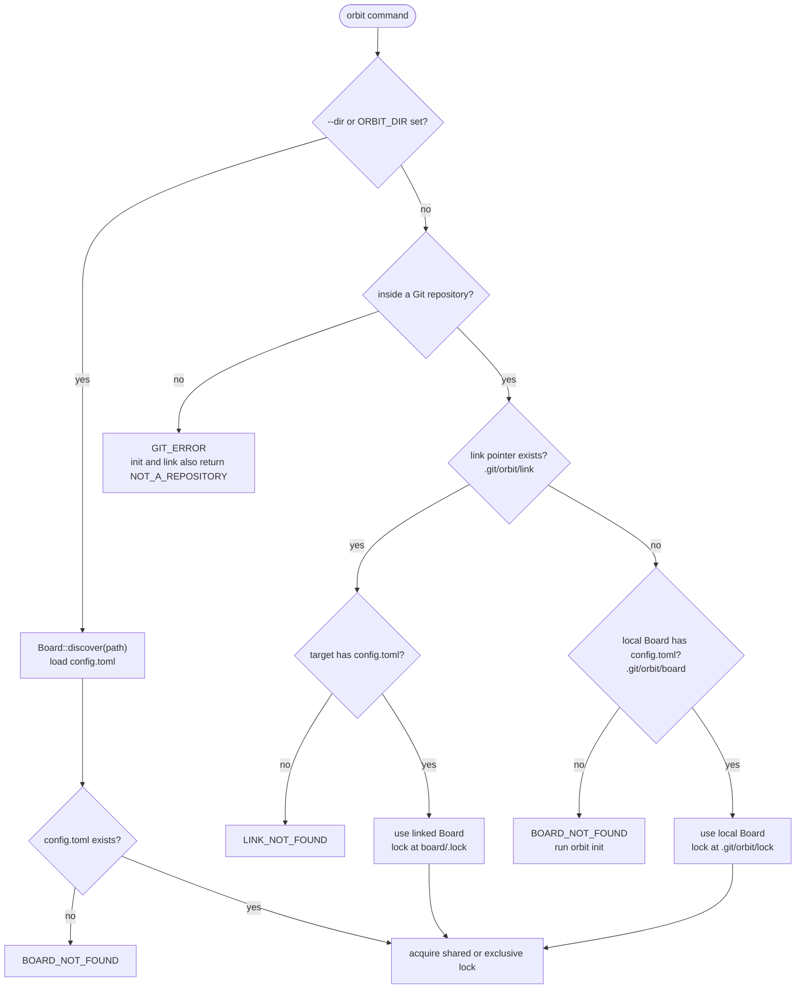

The pointer lives in the Git common directory, not in a worktree. That is why a claim made from a linked worktree and a claim made from the main worktree serialize on the same lock and see the same tasks. A linked Board keeps its own lock at `<board>/.lock`; the local Board keeps its lock at `<git-common-dir>/orbit/lock`.

### Domain relationships

A Task is the unit of work. Its claim fields are a single time-bounded claim, and its comments live in a sidecar file keyed by the same ID. Dependency edges are IDs stored in frontmatter, so they can point across the whole Workspace.

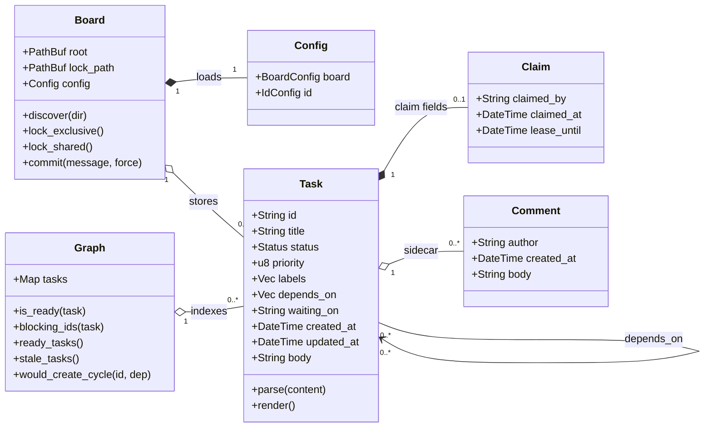

## 2. Task state machine

Only four values are **stored** in `status`: `todo`, `in_progress`, `done`, and `cancelled`. Ready, blocked, waiting, stale, and held are **derived** from other fields, so they are not states and cannot be written as one.

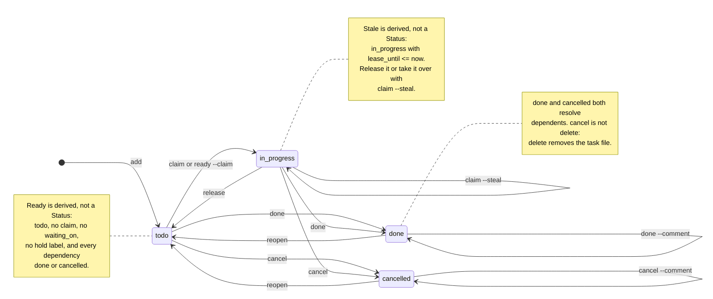

### Transition rules

| From | Command | To | Rules |
| --- | --- | --- | --- |
| none | `add` | `todo` | Creates `tasks/ID.md`. Priority defaults to `2`; dependencies must exist. |
| `todo` | `claim` or `ready --claim` | `in_progress` | The readiness gate must pass. `--by` is required unless `ORBIT_AGENT`, `USER`, or `USERNAME` identifies the agent. A live claim returns `ALREADY_CLAIMED`; a stale claim returns `CLAIM_STALE` unless `--steal`. |
| `in_progress` | `heartbeat` | `in_progress` | Only the claim holder; extends `lease_until` by `lease_minutes`. The heartbeat write is not auto-committed. |
| `in_progress` | `claim --steal` | `in_progress` | Replaces the holder and resets `claimed_at` and `lease_until`. `--steal` does not bypass hold labels or dependencies. |
| `in_progress` | `release` | `todo` | The holder must release unless `--force`; clears all claim fields. Releasing an unclaimed task is a no-op. |
| `todo` or `in_progress` | `done` | `done` | Every dependency must be `done` or `cancelled`. A **live** claim requires the caller to be the holder unless `--force`; a stale claim does not block. Clears claim fields and `waiting_on`. |
| `todo` or `in_progress` | `cancel` | `cancelled` | A live claim requires the holder unless `--force`. Clears claim fields and `waiting_on`. Resolves dependents. |
| `done` or `cancelled` | `reopen` | `todo` | Refuses when a dependent is already `done` unless `--force`. Clears claim fields and `waiting_on`. |
| `done` | `done --comment` | `done` | Appends a comment and updates `updated_at`; without a comment it is a no-op (`changed: false`). |
| `cancelled` | `cancel --comment` | `cancelled` | Appends a comment and updates `updated_at`; without a comment it is a no-op (`changed: false`). |
| `done` | `cancel` | rejected | `INVALID_TRANSITION`; reopen first. |
| `cancelled` | `done` | rejected | `INVALID_TRANSITION`; reopen first. |
| any | `delete` | removed | Not a Status transition. Removes `tasks/ID.md` and `comments/ID.md`. A live claim requires the holder unless `--force`. With dependents, requires `--force`, which first removes the edge from each dependent. |
| any | `update`, `label`, `comment`, `depend`, `undepend` | unchanged | Metadata only. `update`, `label`, and `comment` also work on terminal tasks. `depend` refuses terminal tasks and cycles; `undepend` is idempotent. |

### The readiness gate

`ready` is computed fresh on every command. It never comes from a stored flag.

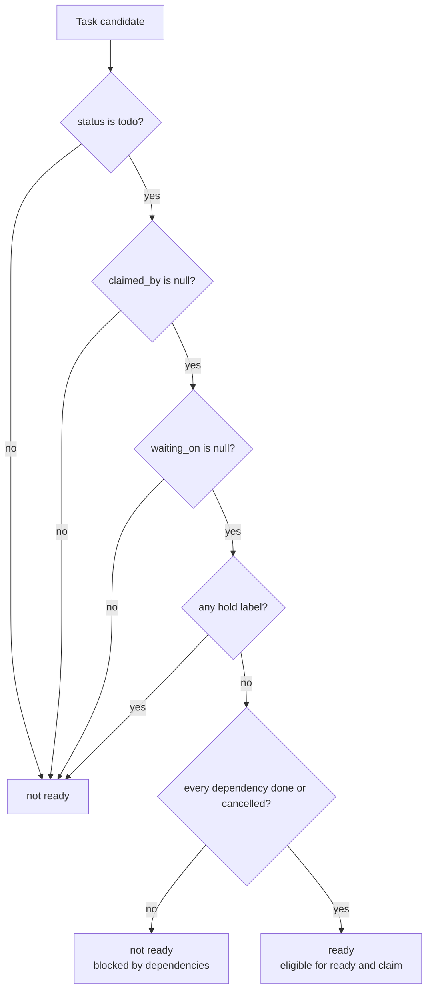

The failure codes follow the gate: `WAITING_EXTERNAL` for `waiting_on`, `LABEL_BLOCKED` for a hold label, `DEPENDENCY_BLOCKED` for unfinished dependencies, `ALREADY_CLAIMED` for a live claim, and `CLAIM_STALE` for an expired one. `--steal` bypasses only the claim checks, never the gate.

### Stored versus derived

| Concept | Stored? | Source |
| --- | --- | --- |
| Status | yes | `status` in frontmatter |
| Priority | yes | `priority`, integer `0`–`3` |
| Labels | yes | `labels`, normalized, sorted, deduplicated |
| Dependencies | yes | `depends_on` IDs |
| External wait | yes | `waiting_on` text |
| Claim and lease | yes | `claimed_by`, `claimed_at`, `lease_until` |
| Comments | yes, separately | `comments/ID.md` |
| Ready | no | `Graph::is_ready` |
| Blocked | no | `Graph::blocking_ids` |
| Stale | no | `in_progress` with `lease_until <= now` |
| Held | no | labels intersect `non_ready_labels` |

## 3. Command flow

The command map shows which command feeds the next stage. The state machine above defines the actual status transitions; this map shows how the commands relate.

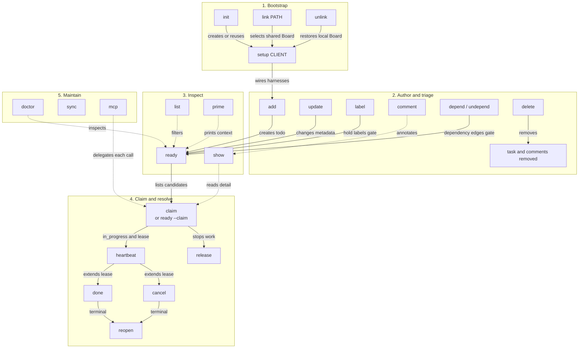

This map shows forward flow; solid arrows are the primary path, while dotted arrows are inspection or maintenance relationships. The state machine above holds the back edges where `release`, `done`, `cancel`, or `reopen` return a task to an earlier state. `delete` removes a task and its comments without a Status transition. `sync` commits pending heartbeat-only changes independently of the forward path.

| Family | Commands | Effect |
| --- | --- | --- |
| Bootstrap | `init`, `link`, `unlink`, `setup` | Create or select the Board, then reconcile harness files, MCP entries, and hooks. |
| Authoring | `add`, `update`, `label`, `comment`, `depend`, `undepend`, `delete` | Create tasks and change metadata. No command here changes Status except `delete`, which removes the task. |
| Inspection | `list`, `show`, `ready`, `prime` | Read-only. `ready` is the derived queue; `prime` is the compact agent context. |
| Execution | `claim`, `ready --claim`, `heartbeat`, `release`, `done`, `cancel`, `reopen` | Change Status or the claim. Writes take the exclusive lock. |
| Maintenance | `doctor`, `sync`, `mcp` | Check integrity, commit heartbeat-only changes, and serve MCP over stdio. |

## 4. Workspace initialization

### Workspace topology

A Workspace is one Board plus every Repository linked to it. Linking writes a pointer in the Repository's Git common directory; the Board itself stays in one place, so cross-repository Dependencies share one graph. `unlink` removes the pointer and returns the Repository to its local Board, if one exists.

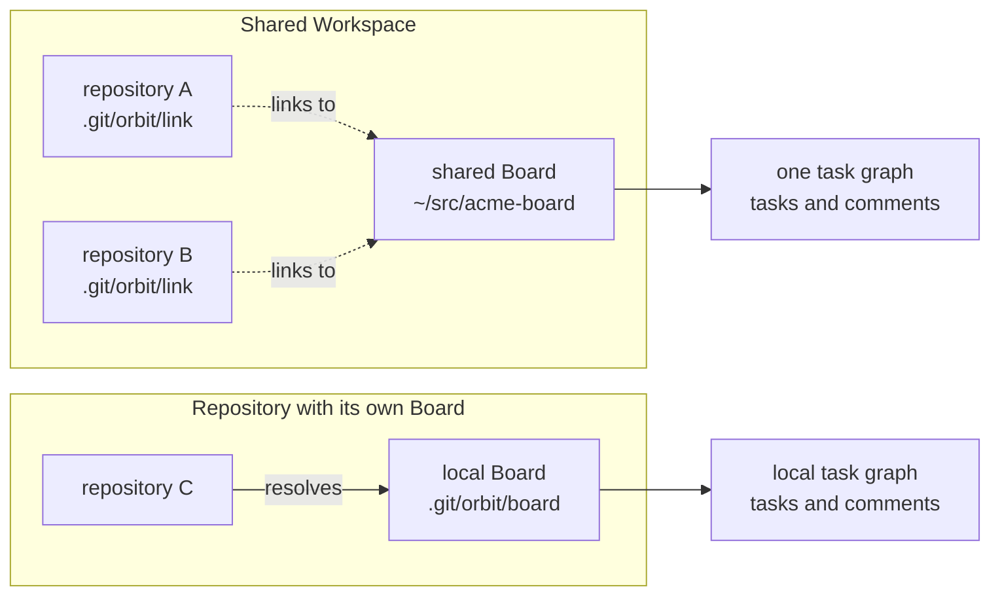

### Initializing a workspace

`orbit init` is idempotent. It creates or reuses the Board, links an explicit target, and reconciles the selected harnesses instead of rejecting an existing installation.

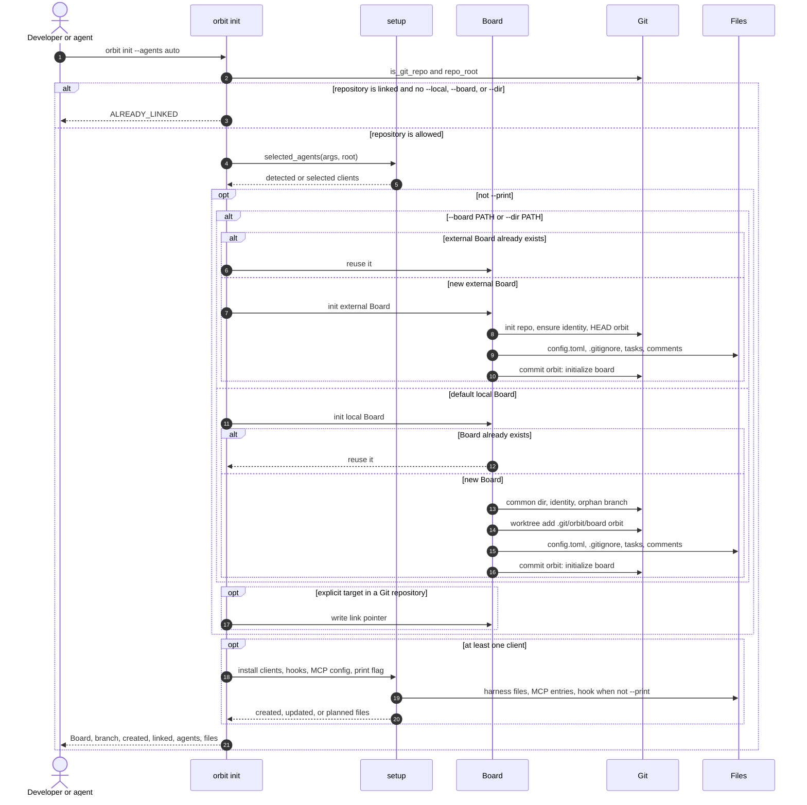

With `--print`, the same plan is returned without writing the Board, the link pointer, or harness files. Re-running `init` reuses an existing Board and reports `unchanged` files where the managed content already matches.

### Linking and unlinking

| Command | Pointer | Board | Harness config |
| --- | --- | --- | --- |
| `init` | unchanged | Creates or reuses the local Board. | Reconciles detected or selected clients. |
| `init --local` | removed | Creates or reuses the local Board even when linked. | Reconciles. |
| `init --board PATH` | written | Creates or reuses the external Board. | Reconciles; MCP entries record the shared Board path. |
| `link PATH` | written | Must already be a Board. | Refreshes existing client config unless `--no-refresh`. |
| `unlink` | removed | Local Board is kept and becomes active again. | Refreshes if a local Board exists. |

A link warning about a shadowed Board means the repository still has its own Board on disk. Linking did not delete it. A missing target returns `LINK_NOT_FOUND`; the pointer is not repaired automatically.

## 5. Task lifecycle

The common agent path is `add` → `ready --claim` → `heartbeat` → `done`. Each command is a separate process; the Board lock is held only for that process.

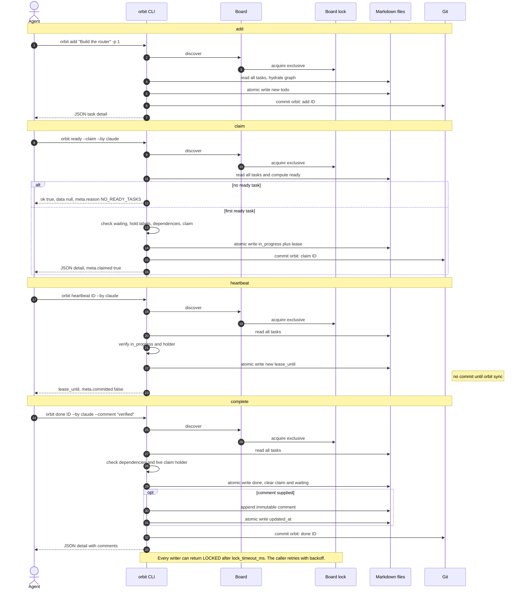

`done` refuses unfinished dependencies and cancelled tasks. A live claim requires the holder unless `--force`; a stale claim does not. If a completion comment fails after the status write, the task is still done and the result carries `COMMENT_FAILED` with exit code `1`.

### Concurrent claims

Two agents can ask for work at the same time. The second process waits for the lock, then re-reads the board, so it cannot claim the task the first process just took.

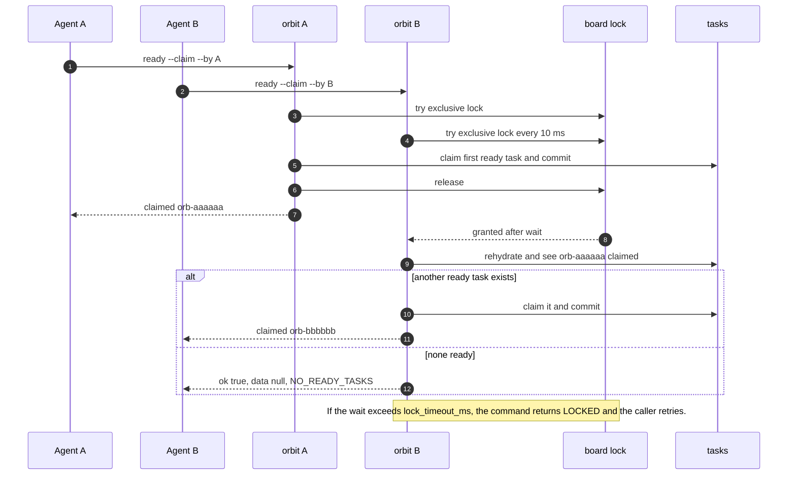

## 6. MCP bridge

`orbit mcp` speaks JSON-RPC 2.0 over stdio. For each `tools/call`, it maps the tool arguments to CLI flags, spawns the installed `orbit` binary with `--json`, and returns the CLI envelope as text. The server holds no board lock between calls.

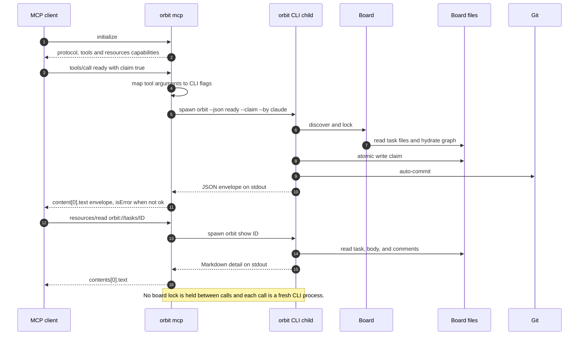

## 7. Failure and recovery

| Situation | Behavior |
| --- | --- |
| Lock contention | Writers wait up to `lock_timeout_ms`, retrying every 10 ms, then return `LOCKED` with `retryable: true`. Retry with backoff. |
| Crash during a write | The old file survives; a `.tmp-orbit-*` file may remain. `doctor` reports it and `doctor --fix` removes it. |
| Multi-file mutation crash | Files are serialized but not transactional across files. `doctor` reports dangling dependencies and a repeated `delete --force` resumes cleanup. |
| Auto-commit failure | The state is already on disk. The command succeeds with `meta.warnings: ["COMMIT_FAILED: ..."]`; `orbit sync` retries the commit. |
| Heartbeat-only changes | Not committed immediately. The next meaningful mutation or `orbit sync` commits them. |
| Missing linked Board | `LINK_NOT_FOUND`; re-link or restore the Board. |
| Missing local Board | `BOARD_NOT_FOUND`; run `orbit init`. |
| Corrupt task, comment, or graph | `doctor` reports `CORRUPT_TASK`, `CORRUPT_COMMENT`, `ORPHAN_COMMENT`, `DANGLING_DEP`, or `CYCLE_DETECTED`. `doctor --fix` only removes stale temp files; it does not rewrite tasks or comments. |
| Forced reopen of a done dependency | A done dependent can keep an unfinished dependency as a historical fact. `doctor` warns; the next `done` of that dependent still enforces its dependencies. |

## 8. Where to change what

| Change | Start here | Also update |
| --- | --- | --- |
| Add a CLI command | `src/cli.rs`, then the dispatch in `src/commands.rs` | `tests/cli.rs`, `SPEC.md`, and this command map |
| Change a status transition | The handler in `src/commands.rs`, plus `Graph::is_ready` or `blocking_ids` if readiness changes | `tests/properties.rs`, the state machine in this document, and `SPEC.md` |
| Add a task field | `TaskFrontmatter` and parsing in `src/task.rs` | `graph::task_summary` and `task_detail`, plus round-trip tests |
| Add an MCP tool | `tool_definitions` and `dispatch_tool` in `src/mcp.rs` | `tests/mcp.rs`, the MCP bridge section, and `SPEC.md` |
| Add a harness | `SetupClient` and the install and remove plans in `src/setup.rs` | Detection tests in `tests/setup.rs`, onboarding tests, and `docs/agents/` |
| Change board storage | `src/board.rs` and the init path | [ADR 0001](adr/0001-markdown-board-on-orphan-branch.md), [ADR 0002](adr/0002-single-writer-lock-and-atomic-rename.md), and the component map here |

## 9. Invariants

- The board is the only source of truth. There is no persistent index, cache, or watcher; every command rehydrates from Markdown.
- Readers take the shared lock for a consistent snapshot. Writers take the exclusive lock for the read-modify-write.
- Each file is published with a temp file, `fsync`, and rename. A crash cannot truncate a task.
- Ready and blocked are derived on every command. They are never stored in frontmatter.
- `done` and `cancelled` both resolve dependents. `delete` is not a status; it removes the task and its comments.
- Comments are append-only and immutable. A correction is a new comment.
- Meaningful mutations auto-commit to the `orbit` branch. Heartbeats wait for the next mutation or `sync`. Nothing is pushed.
- MCP does not bypass the CLI. Every tool call reuses the same lock, atomic-write, auto-commit, and error envelope.
- Agent configuration is written with managed markers or key-level merges so `setup --remove` deletes only Orbit-managed content.
