# Orbit Architecture

Status: describes v0.9.1 behavior, including the Orbit folder (`DIR`, default `.orbit`), user-scoped agent setup, legacy layout migration, and GitHub provider diagnostics. [`SPEC.md`](./SPEC.md) is canonical for behavior and the JSON contract; [`GLOSSARY.md`](./GLOSSARY.md) defines the vocabulary. This document visualizes that design and maps it to the Rust modules.

The short version: Orbit is one binary, two front doors (the JSON CLI and the MCP stdio server), and no daemon. A board command resolves a Board, takes a lock, rebuilds the task graph from Markdown, applies one transition, publishes files atomically, and optionally commits to an orphan Git branch.

## 1. Component map

Solid arrows are calls or data flow. Dotted arrows are selection or lookup. The `orbit mcp` server is a bridge, not a second implementation: it spawns the CLI for every tool call.

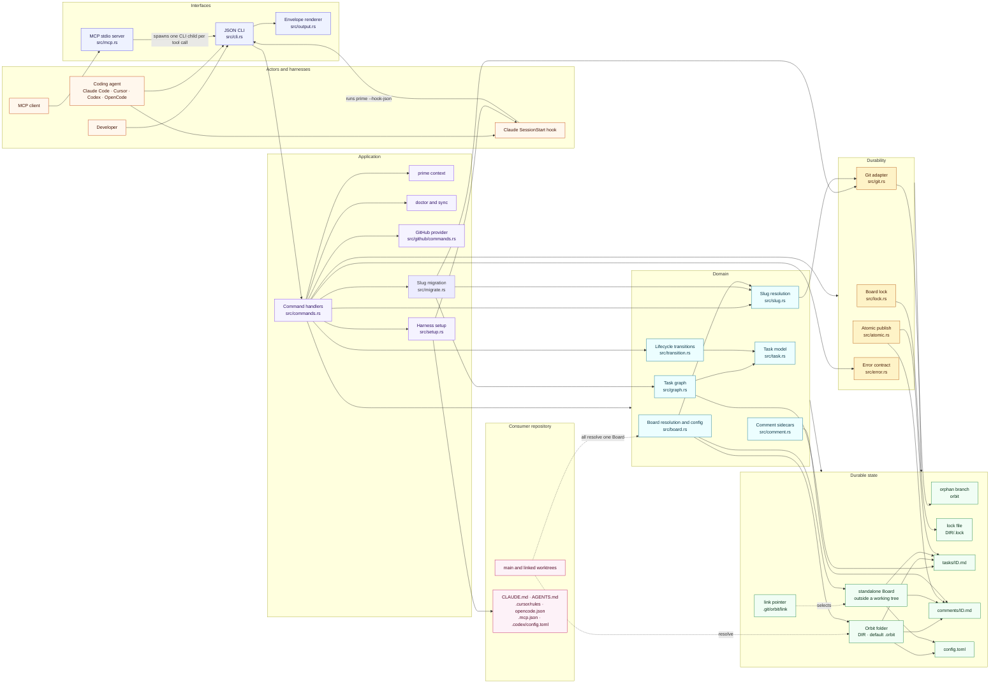

### What each layer owns

| Layer | Modules | Responsibility |
| --- | --- | --- |
| Interface | `src/cli.rs`, `src/output.rs`, `src/mcp.rs` | Parse commands, render terminal output or exactly one JSON object on stdout in `--json`, and expose the same operations over MCP. |
| Application | `src/commands.rs`, `src/migrate.rs`, `src/github/commands.rs` | Dispatch, acquire the right lock mode, hydrate the graph, call one Task transition, call the writer, and shape the result. GitHub commands provide read-only status diagnostics and explicit Issue synchronization; `doctor` includes GitHub health checks when configured. Prefix migration plans, validates, and applies the one-commit rewrite. |
| Domain | `src/board.rs`, `src/slug.rs`, `src/graph.rs`, `src/task.rs`, `src/transition.rs`, `src/comment.rs` | Board discovery and config, slug normalization and validation, task parsing and rendering, lifecycle transition rules, dependency validation, readiness, counts, and comments. |
| Durability | `src/lock.rs`, `src/atomic.rs`, `src/git.rs` | One Board-wide advisory lock at `<DIR>/.lock`, temp-file + fsync + rename publication, and auto-commit to the board branch. |
| Contract | `src/error.rs` | Stable error codes, messages, details, and retryability. |
| Setup | `src/setup.rs` | Detect harnesses and write managed instruction files, MCP entries, and the Claude SessionStart hook. |

### Human output and JSON

Board commands have two output paths. Human output is for terminals: `list` renders an aligned table with `ID`, `STATUS`, `P`, `TYPE`, `TITLE`, `LABELS`, and `CLAIMED BY` columns, while `ready`, `tree`, and `prime` use compact summary lines. Table widths follow the current data, labels are comma-joined, and titles longer than 60 characters are shortened. Root Tasks are ordered by priority, then creation time and ID; each Parent Task is followed by its SubTasks, also ordered by priority. `--group` renders one outlined table with a banner for each Parent Task, its SubTasks underneath, and a final `No parent` section.

`--json` is the contract. It always returns the full title and every field through the standard envelope, so the table's layout, truncation, and column set can change without breaking a consumer. Agents and scripts should parse JSON, not scrape the table.

### Board resolution

Every command resolves the Board before it does any work. The first match wins.

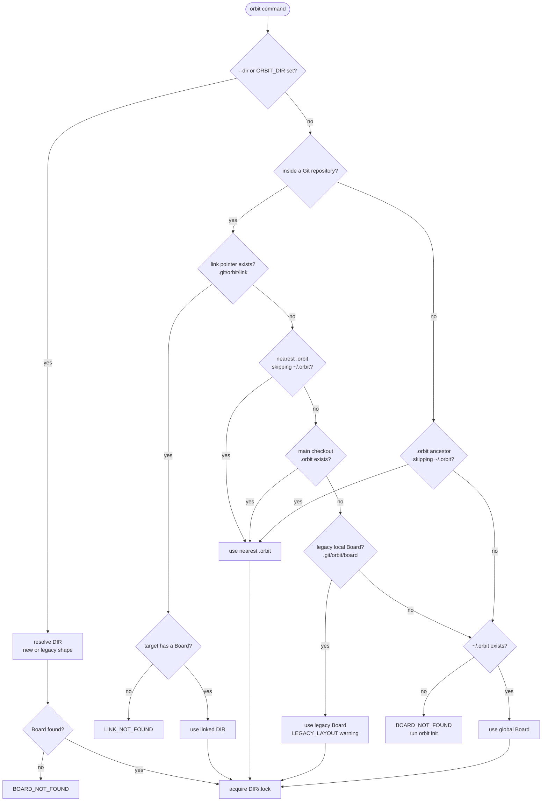

The pointer lives in the Git common directory, not in a worktree. That is why a claim made from a linked worktree and a claim made from the main worktree serialize on the same `<DIR>/.lock` and see the same tasks. A linked Board is a `DIR` outside the member repository; the global Board at `~/.orbit` is the last fallback and is never created by discovery. A legacy Board keeps its old hidden worktree and lock until `doctor --migrate` moves it. When both a new `.orbit` and a legacy local Board exist, the new one wins and the command warns with `AMBIGUOUS_BOARD`; `doctor` reports the duplicate.

### Domain relationships

A Task is the unit of work. Its claim fields are a single time-bounded claim, and its comments live in a sidecar file keyed by the same ID. Dependency edges are IDs stored in frontmatter, so they can point across the whole Workspace. A SubTask is a Task whose `parent` names another Task; parentage is one level deep and is not a Dependency. A Task also has a metadata-only Type (`task`, `epic`, `spike`, `chore`, or `decision`); `epic` is top-level only.

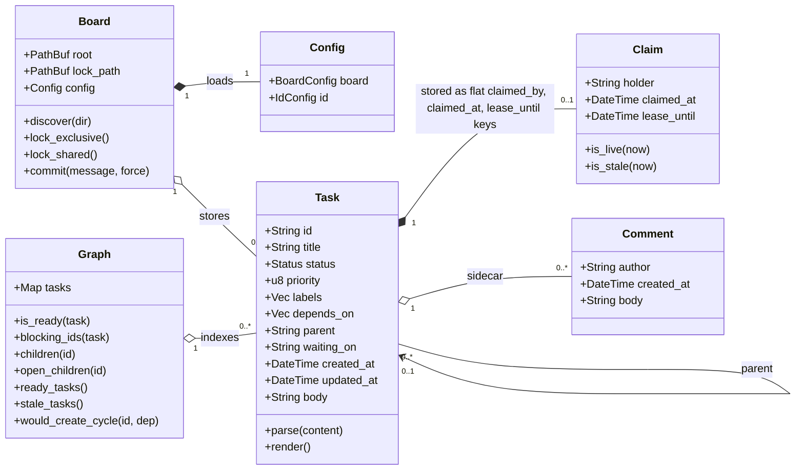

## 2. Task state machine

Only four values are **stored** in `status`: `todo`, `in_progress`, `done`, and `cancelled`. Ready, blocked, waiting, stale, and held are **derived** from other fields, so they are not states and cannot be written as one.

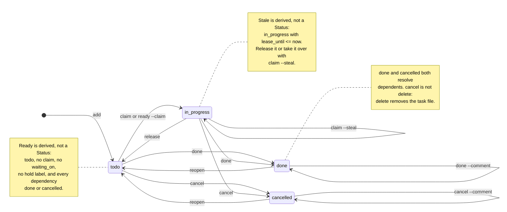

### Transition rules

These rules live in `src/transition.rs`: a Task owns its transitions and returns a typed `TransitionError`. Command handlers only load, call one transition, persist and print.

| From | Command | To | Rules |
| --- | --- | --- | --- |
| none | `add` | `todo` | Creates `tasks/ID.md`. Type defaults to `task`; priority defaults to `2`; dependencies must exist. `--parent` must name an existing, non-terminal Task that is not itself a SubTask, and cannot be combined with `--type epic`. |
| `todo` | `claim` or `ready --claim` | `in_progress` | The readiness gate must pass, including open SubTasks. `--by` is required unless `ORBIT_AGENT`, `USER`, or `USERNAME` identifies the agent. A live claim returns `ALREADY_CLAIMED`; a stale claim returns `CLAIM_STALE` unless `--steal`. |
| `in_progress` | `heartbeat` | `in_progress` | Only the claim holder; extends `lease_until` by `lease_minutes`. The heartbeat write is not auto-committed. |
| `in_progress` | `checkpoint` | `in_progress` | Only the claim holder; a stale claim still counts. Replaces `checkpoint`, keeping omitted optional fields; the first write needs `progress`; `--clear-next` and `--clear-blocker` remove one. Never changes Status or readiness. Rejected on a terminal task or a task with no claim. |
| `in_progress` | `claim --steal` | `in_progress` | Replaces the holder and resets `claimed_at` and `lease_until`, preserving the latest checkpoint. `--steal` does not bypass hold labels or dependencies. |
| `in_progress` | `release` | `todo` | The holder must release unless `--force`; clears all claim fields and preserves the latest checkpoint. Releasing an unclaimed task is a no-op. |
| `todo` or `in_progress` | `done` | `done` | Every dependency must be `done` or `cancelled`, and every SubTask must be resolved or cancelled by `--force` first. A **live** claim requires the caller to be the holder unless `--force`; a stale claim does not block. Clears claim fields and `waiting_on`. |
| `todo` or `in_progress` | `cancel` | `cancelled` | A Parent Task with open SubTasks requires `--force`, which cancels them first. A live claim requires the holder unless `--force`. Clears claim fields and `waiting_on`. Resolves dependents. |
| `done` or `cancelled` | `reopen` | `todo` | Reopening a SubTask of a done parent reopens the parent too; a cancelled parent must be reopened first. Refuses when a dependent is already `done` unless `--force`. Clears claim fields and `waiting_on`. |
| `done` | `done --comment` | `done` | Appends a comment and updates `updated_at`; without a comment it is a no-op (`changed: false`). |
| `cancelled` | `cancel --comment` | `cancelled` | Appends a comment and updates `updated_at`; without a comment it is a no-op (`changed: false`). |
| `done` | `cancel` | rejected | `INVALID_TRANSITION`; reopen first. |
| `cancelled` | `done` | rejected | `INVALID_TRANSITION`; reopen first. |
| any | `delete` | removed | Not a Status transition. Removes `tasks/ID.md` and `comments/ID.md`. A live claim requires the holder unless `--force`. With dependents or SubTasks, requires `--force`, which first removes edges from dependents and deletes the whole SubTask subtree. |
| any | `update`, `label`, `comment`, `depend`, `undepend` | unchanged | Metadata only. `update`, `label`, and `comment` also work on terminal tasks. `depend` refuses terminal tasks, cycles, and parent/child edges; `undepend` is idempotent. |

### The readiness gate

`ready` is computed fresh on every command. It never comes from a stored flag.

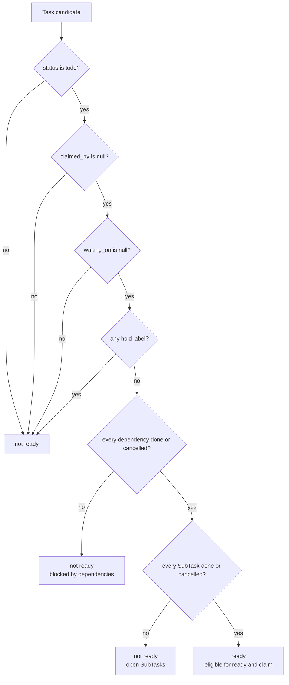

The failure codes follow the gate: `WAITING_EXTERNAL` for `waiting_on`, `LABEL_BLOCKED` for a hold label, `DEPENDENCY_BLOCKED` for unfinished dependencies, `SUBTASKS_OPEN` for open SubTasks, `ALREADY_CLAIMED` for a live claim, and `CLAIM_STALE` for an expired one. `--steal` bypasses only the claim checks, never the gate.

### Stored versus derived

| Concept | Stored? | Source |
| --- | --- | --- |
| Status | yes | `status` in frontmatter |
| Priority | yes | `priority`, integer `0`–`3` |
| Labels | yes | `labels`, normalized, sorted, deduplicated |
| Dependencies | yes | `depends_on` IDs |
| Parent | yes | `parent` ID on a SubTask |
| SubTasks | yes, on the child | `parent` points at the Parent Task |
| External wait | yes | `waiting_on` text |
| Claim and lease | yes | `claimed_by`, `claimed_at`, `lease_until` |
| Checkpoint | yes | `checkpoint` with `by`, `at`, `progress`, `next`, `blocker` |
| Comments | yes, separately | `comments/ID.md` |
| Ready | no | `Graph::is_ready` |
| Blocked | no | `Graph::blocking_ids` and `Graph::open_children` |
| Stale | no | `in_progress` with `lease_until <= now` |
| Held | no | labels intersect `non_ready_labels` |

## 3. Command flow

The command map shows which command feeds the next stage. The state machine above defines the actual status transitions; this map shows how the commands relate.

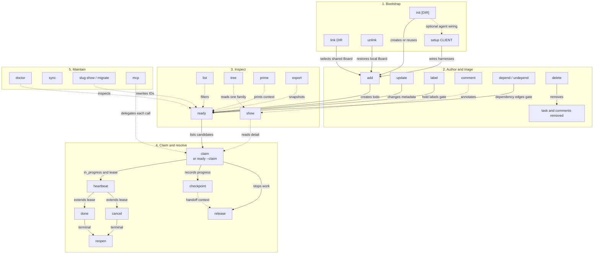

This map shows forward flow; solid arrows are the primary path, while dotted arrows are inspection or maintenance relationships. The state machine above holds the back edges where `release`, `done`, `cancel`, or `reopen` return a task to an earlier state. `delete` removes a task and its comments without a Status transition. `sync` commits pending heartbeat-only changes independently of the forward path. `slug` changes the Board's identity by rewriting every ID and then returning to the one-prefix model.

| Family | Commands | Effect |
| --- | --- | --- |
| Bootstrap | `init`, `link`, `unlink`, `setup` | Create or select the Board; optionally wire harness files, MCP entries, and hooks. |
| Authoring | `add`, `update`, `label`, `comment`, `depend`, `undepend`, `delete` | Create tasks and change metadata. No command here changes Status except `delete`, which removes the task. |
| Inspection | `list`, `show`, `tree`, `ready`, `prime`, `export`, `github status` | Read-only. `tree` is the scoped family view; `ready` is the derived queue; `prime` is the compact agent context; `export` is the deterministic full snapshot; `github status` diagnoses provider health without changing the Board or GitHub. |
| Execution | `claim`, `ready --claim`, `heartbeat`, `checkpoint`, `release`, `done`, `cancel`, `reopen` | Change Status, the claim, or the claim holder's handoff record. Writes take the exclusive lock. |
| Maintenance | `doctor`, `sync`, `github`, `slug`, `mcp` | Check Board and configured GitHub health, commit heartbeat-only changes, explicitly synchronize GitHub Issues, inspect or rewrite the Task-ID prefix, and serve MCP over stdio. |

## 4. Board layouts and initialization

### Topology

A Workspace is one Board plus every Repository linked to it. The Board lives in the Orbit folder (`DIR`): inside a Git working tree, `DIR` is a worktree of that repository on the `orbit` branch; outside one, it is a standalone Git repository. Linking writes a pointer in each Repository's Git common directory, so cross-repository Dependencies share one graph. `unlink` removes the pointer and returns the Repository to the main checkout's `.orbit`, if one exists. The global Board at `~/.orbit` is the last discovery fallback.

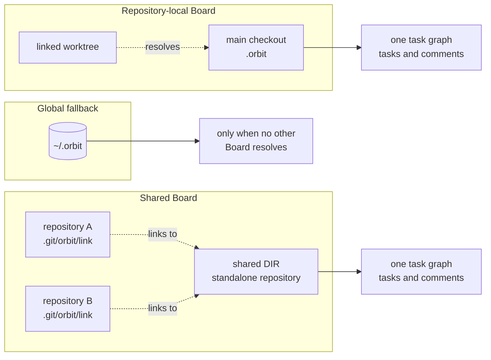

### Resolving the Task-ID slug

`orbit init` resolves the literal `id.prefix` from `DIR` before creating a Board. A `DIR` named `.orbit` uses its parent folder name; any other `DIR` uses its own name; `--global` and `~/.orbit` use `orb` with a warning; an explicit `--slug` overrides. Auto-derived names are normalized and never fail; explicit names are strict. Re-runs preserve the stored prefix, an empty Board can change it, and a hand-edited new-style prefix is detected as `PREFIX_MISMATCH` before task parsing. `src/slug.rs` owns normalization, validation, suggestions, and the anchor rule.

`orbit slug show` reads the stored prefix, task/SubTask counts, and comment-file count without loading the graph. `orbit slug migrate <slug>` is the explicit rewrite path for a populated Board. It keeps each random suffix, rewrites `parent`, `depends_on`, comment filenames and Orbit headers, updates `id.prefix`, and records one commit. It refuses an unhealthy Board, a target collision, and live claims unless `--force`; a dry run reports the plan and claims without writing.

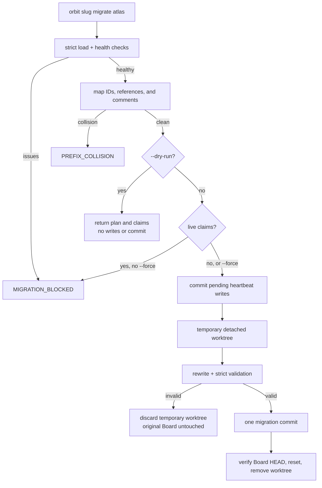

The temporary worktree is the transaction boundary: the real Board is not touched until the migrated tree has passed strict loading and the doctor-equivalent integrity checks. A failure after the reset can leave the migrated commit and a removable temporary worktree, but not a half-renamed Board. `src/migrate.rs` owns the plan, safety checks, rewrite, and commit.

### Creating a Board

`orbit init [DIR]` chooses the storage mode from where `DIR` lives. It refuses to create a Board that would compete with an existing repository-local resolution for `DIR`: if a link, an ancestor `.orbit`, the main checkout's `.orbit`, or a legacy Board already resolves, the command returns `ALREADY_INITIALIZED` before writing. `--global` and the `~/.orbit` fallback are exempt. Re-running on the same `DIR` is idempotent.

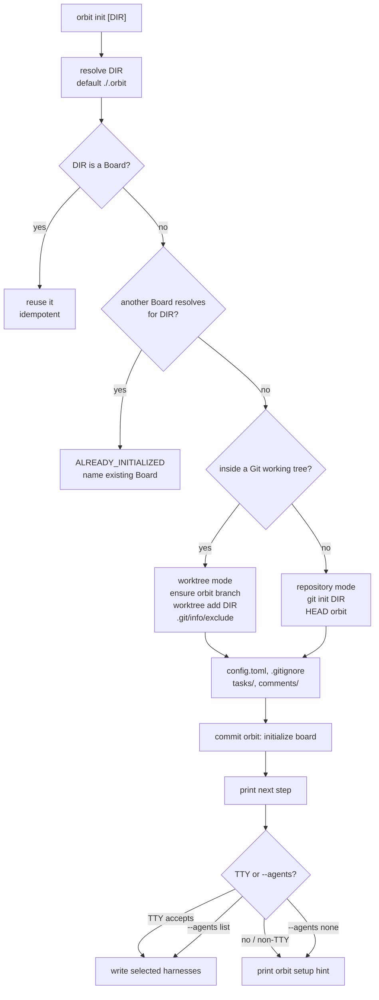

A standalone `DIR` must be empty apart from `.git`, so the first commit contains only Board files; otherwise `init` returns `CONFIG_ERROR`. A worktree-mode `init` writes the `DIR` path to `.git/info/exclude`; it never edits a tracked `.gitignore`. `--print` returns the same plan without writing.

### Initializing a Board and wiring agents

`init` is pure until the user asks for agent wiring. It creates the Board, commits, and then either prompts in a TTY, respects `--agents`, or prints the `orbit setup` hint. The first MCP wiring also chooses between the absolute Orbit binary path, which needs no editor `PATH`, and the portable `orbit` command, which does.

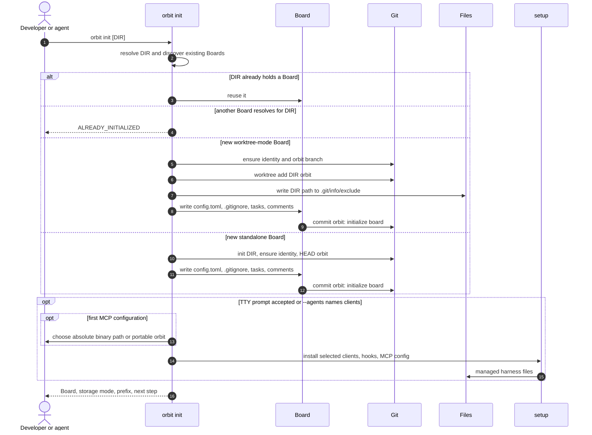

With `--print`, the Board, exclusion entry, and harness files are planned but not written. Re-running `init` reuses the Board and reports unchanged managed files when wiring is requested.

### Legacy migration

Legacy Boards keep resolving with a `LEGACY_LAYOUT` warning. `doctor --migrate` performs the explicit, resumable move.

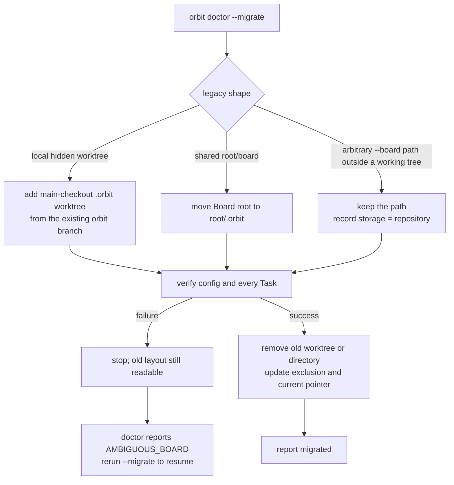

A forced `git clean -xdff` that removes `DIR` leaves the `orbit` branch and a stale worktree record. `doctor` reports `ORPHAN_WORKTREE`; `doctor --fix` or `init` prunes the record and re-attaches `DIR` without task loss.

### Linking and unlinking

| Command | Pointer | Board | Harness config |
| --- | --- | --- | --- |
| `init` | unchanged | Creates or reuses `DIR`. | Writes only when the prompt is accepted or `--agents` names clients. |
| `link DIR` | written | Must already be a Board; a legacy target resolves with a warning. | Refreshes existing managed client files unless `--no-refresh`; no Board path is stored. |
| `unlink` | removed | The main checkout's `.orbit` becomes active again, if it exists. | Refreshes existing managed client files; no Board path is stored. |

A link warning about a shadowed Board means the repository still has its own Board on disk, at the main checkout's `.orbit` or in the legacy local layout. Linking did not delete it. A missing target returns `LINK_NOT_FOUND`; the pointer is not repaired automatically. A linked legacy Board keeps returning a `LEGACY_LAYOUT` warning until it is migrated. Generated configs record the Orbit binary but no Board path, so moving `DIR` does not stale them; `doctor` reports an older absolute path as `ABSOLUTE_BOARD_PATH`.

## 5. Task lifecycle

The common agent path is `add` → `ready --claim` → `heartbeat` → `checkpoint` → `done`. Each command is a separate process; the Board lock is held only for that process.

```mermaid
sequenceDiagram
    autonumber
    actor Agent
    participant CLI as orbit CLI
    participant BRD as Board
    participant LCK as Board lock
    participant FS as Markdown files
    participant GIT as Git

    Note over Agent,GIT: add
    Agent->>CLI: orbit add "Build the router" -p 1
    CLI->>BRD: discover
    BRD->>LCK: acquire exclusive
    CLI->>FS: read all tasks, hydrate graph
    CLI->>FS: atomic write new todo
    CLI->>GIT: commit orbit: add ID
    CLI-->>Agent: JSON task detail

    Note over Agent,GIT: claim
    Agent->>CLI: orbit ready --claim --by claude
    CLI->>BRD: discover
    BRD->>LCK: acquire exclusive
    CLI->>FS: read all tasks and compute ready
    alt no ready task
        CLI-->>Agent: ok true, data null, meta.reason NO_READY_TASKS
    else first ready task
        CLI->>CLI: check waiting, hold labels, dependencies, claim
        CLI->>FS: atomic write in_progress plus lease
        CLI->>GIT: commit orbit: claim ID
        CLI-->>Agent: JSON detail, meta.claimed true
    end

    Note over Agent,GIT: heartbeat
    Agent->>CLI: orbit heartbeat ID --by claude
    CLI->>BRD: discover
    BRD->>LCK: acquire exclusive
    CLI->>FS: read all tasks
    CLI->>CLI: verify in_progress and holder
    CLI->>FS: atomic write new lease_until
    Note right of GIT: no commit until orbit sync
    CLI-->>Agent: lease_until, meta.committed false

    Note over Agent,GIT: checkpoint
    Agent->>CLI: orbit checkpoint ID --by claude --progress "..." --next "..."
    CLI->>BRD: discover
    BRD->>LCK: acquire exclusive
    CLI->>FS: read all tasks
    CLI->>CLI: verify holder; merge progress, next, blocker
    CLI->>FS: atomic write checkpoint in frontmatter
    CLI->>GIT: commit orbit: checkpoint ID
    CLI-->>Agent: JSON detail with the checkpoint

    Note over Agent,GIT: complete
    Agent->>CLI: orbit done ID --by claude --comment "verified"
    CLI->>BRD: discover
    BRD->>LCK: acquire exclusive
    CLI->>FS: read all tasks
    CLI->>CLI: Task.complete checks dependencies and live claim holder
    CLI->>FS: atomic write done, clear claim and waiting
    opt comment supplied
        CLI->>FS: append immutable comment
        CLI->>FS: atomic write updated_at
    end
    CLI->>GIT: commit orbit: done ID
    CLI-->>Agent: JSON detail with comments

    Note over CLI,LCK: Every writer can return LOCKED after lock_timeout_ms. The caller retries with backoff.
```

`done` refuses unfinished dependencies and cancelled tasks. A live claim requires the holder unless `--force`; a stale claim does not. If a completion comment fails after the status write, the task is still done and the result carries `COMMENT_FAILED` with exit code `1`.

A checkpoint is optional and independent of the lease: the holder can record progress, the next action, and a blocker at any point, then release or let the lease expire. `claim --steal`, `release`, and `reopen` preserve the record; terminal transitions keep it as archived history while the active queue stops exposing it.

### Concurrent claims

Two agents can ask for work at the same time. The second process waits for the lock, then re-reads the board, so it cannot claim the task the first process just took.

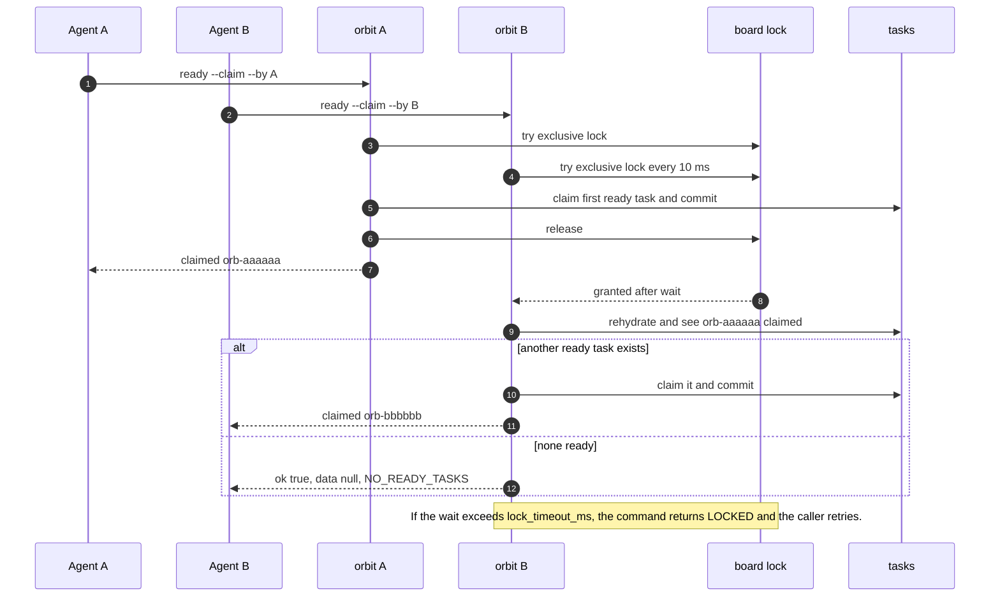

## 6. MCP bridge

`orbit mcp` speaks JSON-RPC 2.0 over stdio. For each `tools/call`, it maps the tool arguments to CLI flags, spawns the installed `orbit` binary with `--json`, and returns the CLI envelope as text. The server holds no board lock between calls.

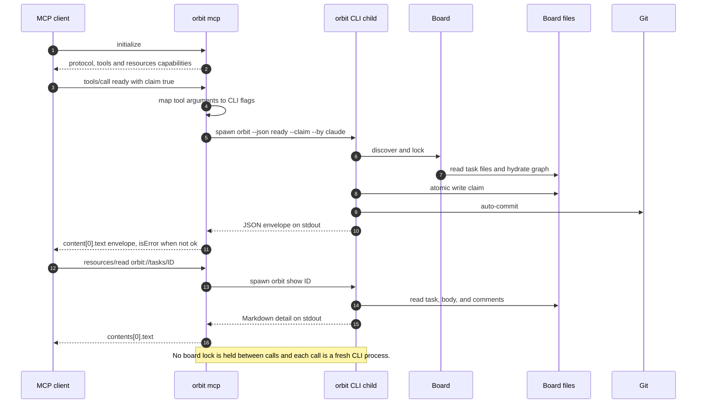

## 7. Failure and recovery

| Situation | Behavior |
| --- | --- |
| Lock contention | Writers wait up to `lock_timeout_ms`, retrying every 10 ms, then return `LOCKED` with `retryable: true`. Retry with backoff. |
| Crash during a write | The old file survives; a `.tmp-orbit-*` file may remain. `doctor` reports it and `doctor --fix` removes it. |
| Multi-file mutation crash | Files are serialized but not transactional across files. `doctor` reports dangling dependencies and a repeated `delete --force` resumes cleanup. |
| Auto-commit failure | The state is already on disk. The command succeeds with `meta.warnings: ["COMMIT_FAILED: ..."]`; `orbit sync` retries the commit. |
| Heartbeat-only changes | Not committed immediately. The next meaningful mutation or `orbit sync` commits them. |
| Slug migration fails | No files are changed if validation fails; fix the issues from `orbit doctor`. If the reset fails after a commit, inspect the temporary worktree named in the error and run `git worktree prune` after recovery. |
| Missing linked Board | `LINK_NOT_FOUND`; re-link or restore the Board. |
| Missing local Board | `BOARD_NOT_FOUND`; run `orbit init`. |
| Removed `DIR` | The `orbit` branch still holds every Task. `doctor` reports `ORPHAN_WORKTREE`; `doctor --fix` or `orbit init` re-attaches it. |
| Half-moved or duplicated layout | `doctor` reports `AMBIGUOUS_BOARD`; `doctor --migrate` resolves the pair. |
| Storage mode mismatch | `doctor` reports `STORAGE_MISMATCH`; repair the worktree or standalone repository before writing. |
| Corrupt task, comment, or graph | `doctor` reports `CORRUPT_TASK`, `CORRUPT_COMMENT`, `ORPHAN_COMMENT`, `DANGLING_DEP`, `DANGLING_PARENT`, `NESTED_SUBTASK`, `PARENT_MISMATCH`, or `CYCLE_DETECTED`. `doctor --fix` removes stale temp files and re-attaches an orphan worktree; it does not rewrite tasks or comments. |
| Forced reopen of a done dependency | A done dependent can keep an unfinished dependency as a historical fact. `doctor` warns; the next `done` of that dependent still enforces its dependencies. |

## 8. Where to change what

| Change | Start here | Also update |
| --- | --- | --- |
| Add a CLI command | `src/cli.rs`, then the dispatch in `src/commands.rs` | `tests/cli.rs`, `SPEC.md`, and this command map |
| Change a status transition | The Task transition in `src/transition.rs`, plus `Graph::is_ready` or `blocking_ids` if readiness changes | `tests/properties.rs`, the state machine in this document, and `SPEC.md` |
| Add a task field | `TaskFrontmatter` and parsing in `src/task.rs` | `graph::task_summary` and `task_detail`, plus round-trip tests |
| Add an MCP tool | `tool_definitions` and `dispatch_tool` in `src/mcp.rs` | `tests/mcp.rs`, the MCP bridge section, and `SPEC.md` |
| Change human `list` output | `format_table` and `truncate` in `src/commands.rs` | The human-output note here, `docs/commands.md`, and the README example |
| Add a harness | `SetupClient` and the install and remove plans in `src/setup.rs` | Detection tests in `tests/setup.rs`, onboarding tests, and `docs/agents/` |
| Change board storage | `src/board.rs` and the init path | [ADR 0001](adr/0001-markdown-board-on-orphan-branch.md), [ADR 0002](adr/0002-single-writer-lock-and-atomic-rename.md), [ADR 0012](adr/0012-orbit-folder.md), and the component map here |

## 9. Invariants

- The board is the only source of truth. There is no persistent index, cache, or watcher; every command rehydrates from Markdown.
- A Board is one Orbit folder `DIR`; the storage mode (`worktree` or `repository`) changes Git plumbing, not the files, lock, command behavior, or JSON contract.
- Discovery never creates a Board. `init` refuses when a repository-local Board already resolves for the target `DIR` (except `--global`), and `~/.orbit` is used only when it already exists.
- Readers take the shared lock for a consistent snapshot. Writers take the exclusive lock for the read-modify-write.
- Each file is published with a temp file, `fsync`, and rename. A crash cannot truncate a task.
- Ready and blocked are derived on every command. They are never stored in frontmatter.
- Parentage is one level deep and is not a Dependency. A Parent Task is Ready only when every SubTask is `done` or `cancelled`.
- `done` and `cancelled` both resolve dependents. `delete` is not a status; it removes the task and its comments, and `--force` removes a SubTask subtree.
- Comments are append-only and immutable. A correction is a new comment.
- Meaningful mutations auto-commit to the `orbit` branch. Heartbeats wait for the next mutation or `sync`. Nothing is pushed.
- `export` takes the shared lock and writes nothing. Its snapshot is sorted by task ID and contains no timestamps or machine-local paths.
- Human output is presentation only. `list` tables may truncate titles or change column widths; `--json` carries the complete, stable shape.
- MCP does not bypass the CLI. Every tool call reuses the same lock, atomic-write, auto-commit, and error envelope.
- Agent configuration is written with managed markers or key-level merges so `setup --remove` deletes only Orbit-managed content. Generated configs record the Orbit binary but not the Board path.
