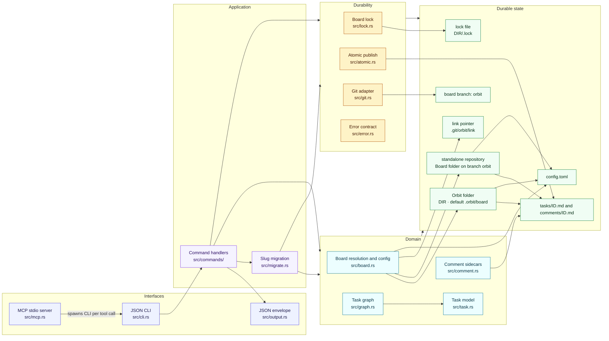

# Orbit Specification

Status: pre-alpha. This document describes the working tree, which carries the local-first revamp: every Board folder is its own Git repository with member Repositories and an optional Board host ([ADR 0019](./adr/0019-board-folder-is-its-own-repository.md)), and Remote Trackers sit behind a provider-neutral port ([ADR 0018](./adr/0018-remote-trackers-behind-an-orbit-port.md)). v0.10.2 is the latest release. This document is canonical. `docs/brainstorming.md` and `docs/spec_alpha.md` are research notes kept for context.

## 1. What Orbit is

Orbit is a Git-native issue tracker and local work queue for coding agents. A Task is a Markdown file; one Rust binary serves the board through a strict JSON CLI and an optional MCP server.

The wedge is narrow and deliberate:

> **Markdown-as-truth + Git-reviewable task diffs + no Dolt/SQLite + multi-process serialization without a daemon.**

Beads already provides claims, ready-work detection, priorities, hash IDs, and worktree sharing on top of Dolt. Orbit does not try to beat Beads at distributed sync, federation, or scale. It wins by keeping the board human-readable and diffable, and by making concurrent local agents safe with a single locked writer instead of a database server.

### Non-goals for v1

- Hosted sync or federation beyond the single Board host: `orbit board host`/`sync` pushes the Board's `orbit` branch to one chosen remote with an Orbit-aware merge ([ADR 0019](./adr/0019-board-folder-is-its-own-repository.md)); there is no multi-writer service.
- Dolt, SQLite, or any second source of truth.
- A daemon or background watcher.
- Web UI.
- Beads-style issue-type entities or attachments. Parentage is the
  Board-configured Issue hierarchy ([ADR 0022](./adr/0022-issue-model-and-platform-architecture.md));
  Issue types are Board configuration, not separate entities.
- Opaque remote trackers other than the explicit Remote Tracker sync or an opted-in auto-push ([github-sync.md](./github-sync.md)).
- GitHub Projects automation or ProjectV2 field synchronization. Projects remain a downstream view over Issues; see [ADR 0015](./adr/0015-github-projects-downstream.md).

## 2. Architecture

1. **Board (truth):** a dedicated Git repository on branch `orbit`, checked out in a Board folder (ADR 0019). A repository-local Board defaults to the hidden `<repository>/.orbit/board`; an anchor Board lives at `<anchor>/.orbit/board`; a visible Board folder is anchored by the `.orbit/board` pointer file instead. The rebuildable cache sits beside the Board at `<orbit>/cache`. Board history never enters a code repository.
2. **Tasks:** Markdown files at `tasks/<id>.md` inside `DIR`.
3. **Comments:** append-only Markdown sidecars at `comments/<id>.md` inside `DIR`.
4. **Index (speed):** every process rebuilds an in-memory graph from the task files. There is no persistent cache and no watcher.
5. **Writes (safety):** every mutation takes one Board-wide exclusive lock at `<DIR>/.lock`, performs a read-modify-write, and publishes each file with a temp-file + `fsync` + rename. Readers take a shared lock for a consistent snapshot.
6. **History:** meaningful mutations auto-commit to the `orbit` branch. Heartbeat/lease-only changes are committed by `orbit sync`. The branch is pushed only to a configured Board host, with `orbit board sync` or `board.host_sync = "auto"` ([ADR 0019](./adr/0019-board-folder-is-its-own-repository.md)); Remote Issue auto-push is a separate opt-in per Board ([ADR 0018](./adr/0018-remote-trackers-behind-an-orbit-port.md)).

The board is deliberately outside code branches: task churn never enters a feature PR, and agents in separate worktrees share one queue. See `docs/adr/0001-markdown-board-on-orphan-branch.md`, `docs/adr/0002-single-writer-lock-and-atomic-rename.md`, `docs/adr/0012-orbit-folder.md`, and `docs/adr/0019-board-folder-is-its-own-repository.md`.

### 2.1 Component view

Orbit is one binary with two front doors: the JSON CLI and the MCP stdio server. `orbit mcp` is a bridge, not a second implementation; each tool call spawns the CLI. There is no daemon, watcher, or persistent index.



The detailed module map, board-resolution flow, domain relationships, state machine, command map, and sequence diagrams are in [`docs/ARCHITECTURE.md`](./ARCHITECTURE.md).

## 3. Domain model

The canonical vocabulary lives in `docs/GLOSSARY.md`. In short:

- A Task has one stored **Status**: a name defined by the Board's **Workflow**. Every Status belongs to a **Status Category** — `todo`, `active`, `done`, or `canceled` — and the shipped templates (`minimal`, `standard`, `agentic`) or a custom `[workflow]` section in `config.toml` define the names, Transitions, and the single Ready Status.
- A **Parent Task** groups its descendants, and its completion depends on them. A **SubTask** is a Task with a `parent`; it is claimable and completable in its own right. Parentage follows the Board's configured Issue hierarchy (`board.hierarchy`; default `epic` > `story`/`task`/`bug` > `sub-task`) and is not a Dependency.
- **Kind** is structural and derived: `task` or `subtask`.

- **Type** is the stored Issue type, configured per Board under `board.types` (default `epic`, `story`, `task`, `bug`, `sub-task`; `board.default_type` picks the default, `task`). The type decides where in the hierarchy an Issue may sit: a child must be on a strictly deeper level than its parent. An **Epic** or **spec** is a top-level Issue with `type: epic`. External trackers call the unit an Issue and a child a Sub-issue; see [`docs/GLOSSARY.md`](./GLOSSARY.md), [ADR 0009](./adr/0009-keep-task-vocabulary.md), [ADR 0010](./adr/0010-structural-type-field.md), and [ADR 0022](./adr/0022-issue-model-and-platform-architecture.md).
- **Ready** is derived: the Task sits in the Workflow's Ready Status (the one Status flagged `ready`), has no Assignee (claimed or assigned), is not Waiting, carries no Hold Label, has no open Dependency (a blocking Link to a Task not in a closed Status Category), and has no open descendant.
- **Blocked** is derived: at least one Dependency is not in a closed Status Category, or a Parent Task has at least one open descendant.
- **Waiting** is an external blocker recorded as a blocking Link to an external reference; it is not a Status.
- An **Assignee** is the human or agent identity responsible for a Task, with an identity **Kind** (`human` or `agent`). An assignee may hold a **Lease** — the time window a `claim` sets — or none: `assign` sets an assignee without a lease, which is how humans take work. A `claim` sets the assignee and a fresh lease together; `heartbeat` requires a lease and extends it. An expired, unreleased lease makes the assignment **Stale**: the Task is not Ready, but it can be released or stolen, and the previous assignee can still record a Checkpoint until takeover.
- The **Reporter** is the identity that created the Task, recorded at creation (`add --reporter`, defaulting to `ORBIT_AGENT` then `USER`) and never changed.
- A **Checkpoint** is the assignee's latest handoff note: progress, the next useful action, and any blocker. It is stored on the Task, survives release and takeover, and never affects readiness or claim eligibility.
- **Done** and **Cancelled** Statuses (the `done` and `canceled` categories) both resolve dependents. Cancelled exists so abandoned work does not have to lie with `done` or destroy history with `delete`. A closing Transition records its **Resolution** on the Task; returning to an open Status clears it.
- **Priority** is a name from the Board's ordered `board.priorities` list — `highest`, `high`, `medium`, `low` by default, most important first. Tasks store the name and sort by its ordinal in that list, so a Board can rename or reorder priorities; a stored name outside the list sorts after every configured name.
- **Label** is a short lowercase string attached to a Task for filtering or workflow state. **Hold Labels** are configured labels that suspend readiness; the defaults are `needs-triage`, `needs-info`, and `ready-for-human`. `ready-for-agent`, `bug`, and `enhancement` are neutral.
- **Comment** is an append-only, authored, timestamped note on a Task. Comments do not affect Status or readiness.

### 3.1 Status state machine

The lifecycle is a **Workflow** defined by the Board, not a fixed enum. `config.toml` selects a shipped template — `minimal`, `standard` (the default), or `agentic` — or defines `[workflow]` `statuses`, `transitions`, and `initial` directly. Every Status has a name and a category (`todo`, `active`, `done`, `canceled`); exactly one Status is flagged `ready`. The standard template:

```text
statuses:    ready (todo, ready) · todo (todo) · in_progress (active)
             · done (done) · cancelled (canceled)
initial:     ready
transitions: claim · release · promote · defer · done · cancel · reopen
```
```

`minimal` drops the `todo` backlog and its `promote`/`defer` edges; `agentic` adds `blocked` and review-oriented statuses. Custom workflows may add statuses such as `In Review` and transitions such as `submit`; validation requires unique status and transition names, valid categories, exactly one ready Status, an initial Status that exists, transitions that reference defined statuses, resolutions only on transitions into closed categories, and no resolutions on transitions into open statuses.

The built-in commands drive named Workflow edges:

| From category | Command | Transition | Effect |
| --- | --- | --- | --- |
| any | `add` | — | Creates `tasks/ID.md` in the initial Status. |
| ready Status | `claim`, `ready --claim` | `claim` | The readiness gate must pass, including open SubTasks. `--by` is required unless `ORBIT_AGENT`, `USER`, or `USERNAME` identifies the agent; `--kind` records the assignee's identity kind (`agent` by default, `human` allowed). Sets the assignee and a fresh lease. A live lease returns `ALREADY_CLAIMED`; a stale lease returns `CLAIM_STALE` unless `--steal`. |
| ready Status | `assign <id> --to NAME` | — | Sets the assignee without a lease — how humans take work. `--kind` defaults to `human`; replacing a different assignee needs `--force` and drops the old lease. A lease-less assignee blocks `heartbeat` but not `checkpoint`. |
| `active` | `heartbeat` | — | Only the assignee holding a live lease; extends `lease_until` by `lease_minutes`. The heartbeat write is not auto-committed. |
| `active` | `checkpoint` | — | Only the assignee; a stale lease still counts. Replaces `checkpoint`, keeping omitted optional fields; the first write needs `progress`; `--clear-next` and `--clear-blocker` remove one. Never changes Status or readiness. Rejected on a closed Status or a task with no assignee. |
| `active` | `claim --steal` | `claim` | Replaces the assignee and resets the lease times, preserving the latest checkpoint. `--steal` does not bypass hold labels or dependencies. |
| `active` | `release` | `release` | The assignee must release unless `--force`; clears the assignee and lease and preserves the latest checkpoint. Releasing an unassigned task is a no-op. |
| open | `done` | `done` | Every Dependency must be in a closed category, and every SubTask must be resolved or cancelled by `--force` first. A **live** lease requires the caller to be the assignee unless `--force`; a stale lease does not block. Clears assignee and lease and `waiting_on`; records the transition's resolution. |
| open | `cancel` | `cancel` | A Parent Task with open SubTasks requires `--force`, which cancels them first. A live lease requires the assignee unless `--force`. Clears assignee and lease and `waiting_on`; records the transition's resolution. Resolves dependents. |
| closed | `reopen` | `reopen` | Reopening a SubTask reopens every closed ancestor too, nearest first; an actively leased ancestor ends the walk. Refuses when a dependent is already closed unless `--force`. Clears assignee and lease, `waiting_on`, and the resolution. |
| any | `transition <name>` | any defined edge | Runs one named Workflow transition directly, honoring the assignee check where the edge requires it. An unknown name or an edge that does not start from the current Status fails with `INVALID_TRANSITION` naming the valid transitions. |
| any | `delete` | removed | Not a Status transition. Removes `tasks/ID.md` and `comments/ID.md`. A live lease requires the assignee unless `--force`. With dependents or SubTasks, requires `--force`, which first removes edges from dependents and deletes the whole SubTask subtree. |

Closed categories (`done`, `canceled`) resolve dependents; `reopen`-style transitions return a Task to an open Status; `cancel` is not `delete`. `orbit show` reports `status_category`, `resolution`, and `allowed_transitions` — the Workflow edges valid from the current Status. Waiting, hold labels, and dependency edges are gates on readiness and claims, not Statuses. The full transition table and readiness gate are in [`docs/ARCHITECTURE.md`](./ARCHITECTURE.md).

## 4. Task file

### ID

A Board has one **Slug**, stored as the literal `id.prefix` with a trailing dash (`teramigo-`). A Task ID is that prefix followed by 6–8 random Crockford base32 characters: `0123456789abcdefghjkmnpqrstvwxyz`. A SubTask ID is `<parent-id>.<random>`: the parent ID, a dot, and a fresh 6–8 character suffix. SubTasks inherit the prefix automatically.

Examples: `teramigo-32fdfd` (Task), `teramigo-32fdfd.7fk2m9` (SubTask), and `orb-a7b2c9` (the legacy default). A legacy prefix without a trailing dash remains valid and keeps generating IDs; no migration is required. One level only: a second dot is invalid. `id.prefix` accepts lowercase letters, digits, and dashes, and must not contain a dot, so the dot always marks the parent boundary. The filename stem is the single source of truth; there is no `id` field in frontmatter.

`orbit slug migrate <slug>` can rewrite every ID to a new prefix when the Board's identity changes. The random suffix is preserved, so it rewrites only prefixes and structured references; the Board still has exactly one prefix afterwards. This is an explicit, one-commit operation, not a permanent multi-prefix mode.

### Project key

Every Issue also carries a sequential **project key** — `PREFIX-N`, such as `ORB-12` — the human- and token-cheap handle allocated under the exclusive Board lock when the Issue is created (`orbit add`, `orbit batch`, `orbit remote import`). The prefix derives from `id.prefix` (`orb-` → `ORB`); `keys.toml` at the Board root records the prefix and `next_key`, the next number to hand out, so a deleted Issue's key is never reused. Tasks that predate keys simply have none and display their Task ID.

The key is a handle, not the identity: the Task ID (the file name) is immutable and is never rewritten — not even when a key collision forces a re-key. Anywhere a Task ID is accepted — `show`, `depend`, `delete`, `comment`, batch references, `parent` and link targets — a project key resolves too, case-insensitively (`orbit show ORB-12`, `orbit show orb-12`). JSON output exposes `key` and `key_aliases` beside the immutable `id`; human `list` and `show` lead with the key and still print the Task ID.

When two diverged Board clones hand the same key to different Issues, `orbit board sync` keeps the key on the Issue with the lowest Task ID — a rule both clones compute identically — and re-keys the others to fresh numbers, recording the contested key in each loser's `key_aliases`. An alias resolves only when no live key claims it, so the old key keeps reaching an Issue after the keeper is deleted. `keys.toml` merges by maximum `next_key` during sync so no handed-out key is reused; a prefix split is a file-level conflict. The same re-key rule resolves key collisions when `init` merges child Boards.

### Layout

The Board folder, `DIR`, is a standalone Git repository on branch `orbit`. Its default inside a repository is the hidden `<repository>/.orbit/board`; an anchor Board is `<anchor>/.orbit/board`; a visible Board folder is anchored by an `.orbit/board` pointer file holding its absolute path. The Orbit folder `.orbit` also holds the rebuildable `cache/`; inside a code repository the whole folder is hidden through `.git/info/exclude`, never `.gitignore`.

```text
<DIR>/
├── config.toml
├── keys.toml
├── .gitignore
├── tasks/
│   ├── .gitkeep
│   ├── orb-a7b2c9.md
│   ├── orb-f14c02.md
│   └── orb-f14c02.d4b3df.md
└── comments/
    ├── .gitkeep
    ├── orb-a7b2c9.md
    └── orb-f14c02.d4b3df.md
```

Comments are optional; the file is created on the first comment. The task file remains the description and acceptance criteria; `orbit show` merges the task and its comments.

The Board data lock is `<DIR>/.lock` and is gitignored. Initialization uses a short-lived bootstrap lock in `DIR` that is never committed.

Every Board is a standalone repository; the retired `board.storage` modes are gone (ADR 0019). A Board folder without its own `.git`, a Board worktree of another repository, a Board directly at `.orbit`, a `<workspace>/board` folder, or a config still carrying `board.storage` is a pre-ADR-0019 layout: commands answer `BOARD_NOT_MIGRATED` until `orbit migrate` converts it.

An explicit `DIR` that is created fresh must be empty apart from `.git`, so the initial Board commit contains only Board files; otherwise `init` returns `CONFIG_ERROR`.

### Frontmatter

The example below is a SubTask file, `tasks/orb-f14c02.d4b3df.md`.

```yaml
---
title: Build the CLI router
status: in_progress
type: task
priority: medium
labels:
- ready-for-agent
- bug
links:
- type: blocks
  target: orb-a7b2c9
- type: discovered-from
  target: jira:PROJ-123
  attributes:
    found-by: alice
parent: orb-f14c02
checkpoint:
  by: claude-1
  at: 2026-10-23T12:10:00Z
  progress: Parser and tests pass.
  next: Wire the CLI.
  blocker: Waiting for review.
assignee:
  name: claude-1
  kind: agent
lease:
  claimed_at: 2026-10-23T12:00:00Z
  lease_until: 2026-10-23T12:30:00Z
reporter: alice
properties:
  ci:
    passed: true
created_at: 2026-10-23T11:00:00Z
updated_at: 2026-10-23T12:00:00Z
---

Body text, acceptance criteria, notes.
```

Required: `title`, `status`, `created_at`, `updated_at`. `status` names a Status from the Board's Workflow; `resolution` (optional) records the outcome a closing Transition set and is cleared on reopen. Optional: `key` (the Issue's sequential project key `PREFIX-N`, allocated at creation; absent on Tasks that predate keys), `key_aliases` (former project keys that still resolve after a Board-sync re-key; sorted, deduplicated), `type` (default `board.default_type`, `task`; one of the Board's `board.types`; always written on save), `priority` (a name from `board.priorities`; defaults to `board.default_priority`, `medium` unless the Board changes it), `labels` (default empty, normalized, sorted, deduplicated), `links` (default empty; typed relations to other Tasks or external references — see Links below; `depends_on` and `waiting_on` remain as compatibility views), `parent` (absent for a Task; when present the Task is a SubTask and the value names its Parent Task), `checkpoint`, `component` (optional; a short lowercase slug, restricted to `board.components` when the Board configures them), `verification` (optional; trimmed text up to 2000 characters; concise agent checks or commands), `repository` (optional; the member Repository that owns the Task, filled from the current Repository by `orbit add`), `external_id` (optional; the Task's identity in an external system, unique per Board; `doctor` reports a duplicate as `DUPLICATE_EXTERNAL_ID`), `remote` (optional provider-neutral link — `tracker`, `project`, `id`, optional `url`, `active`, and an opaque `baseline` — or inactive provenance when a Remote Tracker provider is enabled), `github` (optional legacy GitHub link kept for backward compatibility; new writes use `remote`), `source_key` (optional; a caller-chosen Source Key of 1 to 200 printable ASCII characters without spaces, unique per Board; `add --source-key` returns the existing Task instead of creating a duplicate, and `doctor` reports a key on two Tasks as `DUPLICATE_SOURCE_KEY`), `properties` (optional; a map from owner to a JSON object, see Properties below). A link with no `active` field is active; detach writes `active: false` while retaining the stable identity and sync baseline. Unknown fields are preserved on rewrite. Timestamps are RFC 3339 UTC. A `parent` must name an existing, non-terminal Task whose type sits on a strictly shallower level of `board.hierarchy` than the child's type; parent cycles are rejected, and the Task ID never encodes the parent. `doctor` reports a disallowed edge or unknown type as `INVALID_TYPE`, a missing required field as `MISSING_REQUIRED_FIELD`, and a parent cycle as `PARENT_CYCLE`.
**Properties.** A Property is structured data that one tool attaches to a Task under the tool's name, its owner — the owner is the property's namespace. An owner is a lowercase slug (`[a-z0-9][a-z0-9-]*`, at most 40 characters); a value is a JSON object of at most 8192 bytes serialized compactly. Orbit stores, returns, and shows Properties but never interprets them: they never affect Ready, Blocked, Claim eligibility, or Status, and they are never pushed to or pulled from a Remote Tracker. Board host sync merges them per owner. `show`, `list`, and `export` return `properties` (an empty object when none); human `show` prints one `property <owner>: <json>` line per owner. `doctor` reports a malformed Property as `INVALID_PROPERTY`.

**Links.** A Link is a typed relation stored on the Task: `type` names the relation the *target* has toward the owner (`blocks` on Task T targeting D reads "D blocks T"), `target` is either an Orbit Task ID (a bare string) or an external reference (`{system, id, url?}`, for example `jira:PROJ-123`), `blocking` optionally overrides the type's default, and `attributes` is an optional map of arbitrary key/value data. Built-in types are `blocks`, `relates-to`, `duplicates`, and `discovered-from`; `blocks` defaults to blocking and every other type to non-blocking, and any other lowercase slug is a custom type. Blocking links drive readiness — the Task is not Ready while a blocking link names an open Task or an external reference — and only blocking links take part in cycle checks; non-blocking links may form cycles freely. `orbit link add|remove|list` manages links; `orbit depend`/`undepend` and `add --depends-on` are shorthand for a blocking `blocks` link between two Tasks, and `add --waiting-on` records a blocking `waiting-on` link to an external reference. `show`/`list`/`export` return `links` (each entry carries `type`, `target`, the resolved `blocking` flag, `inward`/`outward` names, and `attributes`) plus the derived `depends_on` (open blocking Task targets) and `waiting_on` (external blocking targets) views. Legacy `depends_on`/`waiting_on` frontmatter keys are read once into `links` on load and never written back.

The body is free-form Markdown. Orbit does not duplicate the title as an H1. Frontmatter is parsed as the first `---` block, not by splitting the whole file on `---`.

### Comments

`comments/<id>.md` is created on the first comment. Each comment is an immutable block:

```markdown
# Comments: orb-a7b2c9

<!-- orbit:comment {"author":"opencode","created_at":"2026-10-23T12:00:00Z"} -->
Body text.
<!-- /orbit:comment -->
```

Comments are append-only; there is no edit or delete command. A correction is a new comment. `orbit show` and `orbit comment list` parse the blocks. The body must not contain the Orbit comment markers.

### Checkpoints

A Task stores at most one **Checkpoint** in its frontmatter: the assignee's latest handoff note. `by` and `at` identify the last writer and the time of that write; `progress` is required; `next` and `blocker` are optional. `orbit checkpoint` replaces the record. The first write requires `progress`; later writes may update one field and keep the rest, and `--clear-next` or `--clear-blocker` removes an optional field. A partial update rewrites `by` and `at` even when it keeps the previous `progress` text, so the record always names the assignee who last accepted responsibility for it.

The caller must hold the Claim; a Stale Claim still counts until another agent steals it. The command refuses a task with no Claim and a terminal task with `INVALID_TRANSITION`. A Checkpoint does not change Status, readiness, Claim eligibility, links, or blockers.

`orbit show`, every task-detail projection, `list`, `ready`, `prime`, MCP `get`, and `export` expose the record as `checkpoint`. When the Task is terminal, the latest Checkpoint stays in the task file as archived history and the detail projection adds `checkpoint_archived: true`; active queue surfaces never list terminal Tasks. A Checkpoint is Orbit-owned execution state stored on the Board and is not synchronized to GitHub Issues or any other external tracker.

### Config

```toml
[board]
branch = "orbit"
lease_minutes = 30
default_priority = "medium"
priorities = ["highest", "high", "medium", "low"]  # ordered most to least important
non_ready_labels = ["needs-triage", "needs-info", "ready-for-human"]
auto_commit = true
lock_timeout_ms = 2000
# types / hierarchy / default_type are omitted while they match the
# defaults: epic > story/task/bug > sub-task, default type `task`.

[id]
length = 6
prefix = "orb-"

# Optional: pick a shipped workflow template (minimal, standard, agentic;
# standard is the default) or define a custom one. Omitted, the Board uses
# the standard template.
# [workflow]
# template = "agentic"

# Optional: profiles applied by `orbit setup <plugin>`, one [[profiles]]
# record per profile — see §5 Profiles.
# [[profiles]]
# name = "acme"
# source = "user"
# requires = ["workflow"]
```

`[workflow]` selects the Board's lifecycle. `template` names a shipped workflow — `minimal`, `standard` (the default), or `agentic`. Setting `statuses`, `transitions`, or `initial` instead defines a custom workflow; validation requires unique status and transition names, valid categories (`todo`, `active`, `done`, `canceled`), exactly one status flagged `ready`, an `initial` status that exists, transitions that reference defined statuses, resolutions only on transitions into closed categories, and none on transitions into open statuses. See §3.1 for the shipped templates. The three templates ship inside Orbit; a Profile's `[workflow]` section selects one of them or defines a custom workflow the same way.

`board.storage` is retired (ADR 0019): every Board is a standalone repository, so the key is neither written nor honored; a config that still carries it marks a legacy Board for `orbit migrate`. `board.priorities` is the ordered Priority vocabulary, most important first; each entry is a lowercase name and `board.default_priority` must name one of them. Tasks store a Priority name and sort by its position in the list, so renaming or reordering the list reorders every Task without rewriting files. `board.types` declares the Issue type vocabulary (`[[board.types]]` entries with `name` and optional `required` frontmatter fields), `board.hierarchy` orders the types into levels (`[[board.hierarchy]]` entries with a `types` list, top level first; a child must sit strictly deeper than its parent), and `board.default_type` names the type `orbit add` uses when neither `--type` nor `--parent` applies. All three are omitted from `config.toml` while they match the defaults (`epic`, `story`, `task`, `bug`, `sub-task`; `epic` > `story`/`task`/`bug` > `sub-task`; `task`); a legacy `board.max_subtask_depth` key is ignored. `id.prefix` must contain only lowercase letters, digits, and dashes; a dot remains valid in legacy IDs but new IDs never contain one. A prefix ending in `-` is a new-style `<slug>-`: the slug part is 1–20 characters, starts and ends alphanumeric, and contains no `--`, so the full prefix is at most 21 characters. A legacy prefix without a trailing dash stays valid under the same alphabet rules with a 20-character cap. The default is `orb-`. Optional `id.accepted_prefixes` lists additional valid Task-ID prefixes retained when Boards with different slugs are consolidated; new Task IDs still use `id.prefix`.
## 5. Board lifecycle

A Board lives in a Board folder, `DIR`, which is always a standalone Git repository on branch `orbit`. In a Git working tree, the default is `./.orbit/board` — the hidden Board inside the repository's Orbit folder, with `cache/` beside it (or the main checkout's from a linked worktree). A `DIR` that is itself a Git working-tree root, including `.`, means "initialize that checkout" and resolves to its `./.orbit/board` (the main checkout's from a linked worktree); the repository root's own `.orbit` anchors it. Any other `DIR` inside a repository is a visible Board folder anchored by the repository's `.orbit/board` pointer file and hidden through `.git/info/exclude`. Outside Git, `orbit init` at an anchor folder creates `<anchor>/.orbit/board`; any other directory becomes a visible Board folder anchored by a sibling `.orbit`. `--dir` and `ORBIT_DIR` accept an anchor or a Board directory.

`orbit init [DIR] [--slug SLUG] [--agents LIST|none|all] [--print]`:

1. Resolves the target and refuses to create a Board when a conflicting repository-local Board or anchor `.orbit` layout already exists, or when an explicit Board directory is not empty. A Board at `~/.orbit` is exempt. A configured `user.name` / `user.email` is required. The repository does not need an initial commit. A pre-ADR-0019 Board at the target is refused with `BOARD_NOT_MIGRATED`.
2. Creates `DIR` as a standalone Git repository on branch `orbit` — `git init` plus an initial commit — and, for a hidden Board, the `.orbit` folder around it; for a visible Board it writes the `.orbit/board` pointer file naming `DIR`. Inside a code repository the Orbit folder and any visible Board folder are listed in `.git/info/exclude`, never `.gitignore`. `<orbit>/cache` is reserved beside the Board.
3. Writes `config.toml` with the resolved `id.prefix` (no `board.storage`), plus `.gitignore`, `tasks/.gitkeep`, and `comments/.gitkeep`.
4. Commits `orbit: initialize board`.
5. Prints a numbered setup report: the Board (path, branch, storage mode, prefix, and exclusion), the coding-agent integration (wired harnesses, MCP command, and managed files), and the `orbit doctor` verification step, followed by next commands. A standalone Board always includes `orbit repo add DIR` in its next steps. In a TTY it asks whether to wire the detected coding-agent harnesses; without a TTY it writes no agent files and explains the `orbit setup` hint. `--agents` skips the prompt. `--print` reports the same steps in future tense, includes generated file contents, and writes nothing.

`orbit init` is idempotent when `DIR` already holds a Board: the Board is reused and nothing is rewritten. If a different repository-local Board already resolves for `DIR`, `init` returns `ALREADY_INITIALIZED` naming that Board and creates nothing. The `~/.orbit` fallback does not block creating a local Board. Run `orbit repo remove` before creating a local Board in a repository that joined explicitly. `--print` computes the same result without writing.

`init` takes its target from the positional argument, then `--dir`/`ORBIT_DIR`.
With no target it uses `./.orbit` inside Git, the current directory as a Board
anchor outside Git, or a discovered anchor when invoked from a member Repository.
An explicit target that is already a Git working-tree root, such as `.` or a
repository path, also uses that checkout's `./.orbit/board` (or the main
checkout's from a linked worktree) instead of treating the root as an explicit
Board directory; a target that is already a Board folder is reused in place.
Running `orbit init` in `~` creates an ordinary Board at `~/.orbit/board`;
there is no `--global` flag. `repo add` uses only its positional path;
`--dir`/`ORBIT_DIR` never retarget the pointer it writes.

A repository owns one local Board. A member Repository inside an anchor discovers
the anchor's Board by walking above its Git root and needs no `orbit repo add`.
Anchor discovery takes precedence over a member-local Board and reports
`AMBIGUOUS_BOARD`; `orbit init <anchor>` refuses to create the first anchor
Board when a member-local Board already exists. `init` on an anchor that still
contains child Boards previews and merges them, preserving Task IDs and keeping
the children as backups under `<anchor>/.orbit/backups/`. A second `.orbit` in
the same working tree is refused.

`orbit init` run in `~` creates an ordinary standalone Board at `~/.orbit/board`.
It uses normal init target resolution and layout, is exempt from conflicting-Board
checks, and is found by the ordinary nearest-`.orbit` walk. Discovery never
creates it implicitly.

A Board anchor is a normal folder, not a Git repository. Run
`orbit init <anchor>` to create `<anchor>/.orbit/board` and reserve
`<anchor>/.orbit/cache`. Repositories inside the anchor discover the Board
automatically, including across their Git boundary. Repositories outside it can
join with `orbit repo add <anchor-or-board>`. `orbit init` does not clone
repositories.


### Member Repository discovery

`orbit repo refresh` explicitly scans the Board anchor's child directories and
explicit memberships. Repositories discovered below the anchor need no command;
`orbit repo add DIR` joins a repository from outside it by writing the
repository's Orbit link pointer and recording explicit membership, and
`orbit repo remove NAME` drops explicit membership and clears a pointer that
points back to this Board. Discovered child members cannot be removed — their
membership comes from the folder layout. The rebuildable inventory is cached at
`<anchor>/.orbit/cache/member-repositories.json`; `orbit repo list` reports
discovered and explicit members, and `orbit repo refresh` reports which
Repositories joined or left. Tasks record their owning Repository in the
optional `repository` frontmatter field; `orbit add` fills it from the current
Repository automatically.

When `orbit init` runs on an anchor that still contains child Boards, it
previews and merges them: Task IDs are preserved, imported Tasks record their
Repository, differing child ID prefixes move to `id.accepted_prefixes`, and the
child Boards stay on disk under `<anchor>/.orbit/backups/`. Before publishing
imports, init preflights every child's Tasks, Comments, and merged prefix
configuration under the destination Board's exclusive lock. A Task collision
returns `CONFIG_ERROR` without publishing imports or relocating children; a
newly created anchor Board may remain. Repository attribution is applied before
Task comparison, so retries accept equivalent previous imports and reject real
edits. Existing Comments are preserved. Publication remains atomic per file;
I/O failure or interruption can leave partial imports for a retry. An existing
child Board or an unrecognized `.orbit` layout is reported rather than shadowed or
discarded.

### Remote Issue catalog

The Remote Issue catalog is the rebuildable cache of Remote Issue summaries
for the Board's Remote Projects, stored at `.orbit/cache/remote-issues.json`.
`orbit remote issues refresh` updates it explicitly — a Remote Project whose
refresh fails keeps its previous snapshot, marked stale — and `orbit remote
issues list`/`show` browse it. `orbit remote import`, `detach`, and `reattach`
link or unlink Tasks; nothing is imported without an explicit request
([ADR 0018](./adr/0018-remote-trackers-behind-an-orbit-port.md)). On Boards
migrated from the Workspace era the frozen GitHub repository catalog
(`<anchor>/.orbit/cache/repositories.json`) remains on disk as legacy state;
nothing reads it — member Repository origins replaced it.

### Board host and sync

`orbit board host [REPO|URL|--none]` records the Board host — a member
Repository name/path or git URL whose remote stores the Board's `orbit`
branch — or shows/clears it. `orbit board sync` fetches the host, merges
Orbit-aware (different Tasks and fields merge, Comments union, the earlier
Claim wins, a same-field conflict stops until `--resolve FIELD=local|host`),
and pushes; history is merged, never rebased or force-pushed. `keys.toml`
merges by maximum `next_key`, and Issues whose project keys collide across
the diverged clones are re-keyed with the old key recorded as an alias (see
Project key above). The Slug is
re-checked against the host before every merge, and the Board lock is held
only around local steps, never across the fetch or push.
`board.host_sync = "auto"` syncs at `orbit prime` and after commits.
A local repository path resolves to that repository's `origin` remote when it
has one; a path without `origin` (a bare repository) is pushed to directly.

`orbit board move DIR` renames the Board folder to DIR (same filesystem; DIR
must not exist or be empty), rewrites the anchor's `.orbit/board` pointer file
— or restores the hidden layout when DIR is `.orbit/board` — moves the
`.git/info/exclude` entry, and rewrites explicit members' `.git/orbit/link`.
Bare `orbit init --visible` names the visible Board folder `issues`.

### Slugs

A Board has one slug. It is resolved from `DIR` when the Board is created; an empty Board can change it with `--slug`:

| Command | No `--slug` | With `--slug` |
| --- | --- | --- |
| `init` | Repository folder, or anchor-folder basename outside Git | explicit |
| `init DIR` | Anchor-root or Board-directory basename | explicit |
| `init` run in `~` | `orb`, with a warning | explicit |

The repository-local `./.orbit/board` uses the repository folder name. An anchor Board uses the anchor-folder name, so `~/src/acme` becomes `acme-`. A linked worktree defaults to the main checkout's `.orbit/board`, so it keeps the same Board and slug.

Auto-derived names are normalized: lowercase; every run outside `[a-z0-9]` becomes one `-`; collapse and trim `-`; fall back to `orb`; cap at 20 characters at the last dash, or hard-cut. Auto names never fail. A warning on stderr is emitted when the anchor is the home directory or `/`.

Explicit `--slug` is a bare word and is strict: 1–20 characters, `[a-z0-9-]`, alphanumeric first and last, no `--`. A violation returns `INVALID_SLUG` with a normalized suggestion. A trailing dash, uppercase, dot, underscore, space, or non-ASCII character is rejected.

Auto-adoption applies only when the Board is created. Re-running `init` without `--slug` preserves the stored prefix. An empty Board can change its prefix with `--slug`; a populated Board returns `SLUG_LOCKED` naming the current prefix, the requested prefix, the task count, and the `orbit slug migrate <slug>` command that can rewrite it. Passing the current slug is a no-op with no commit. `--print` computes the same prefix without writing.

Editing `id.prefix` by hand on a populated Board produces one `PREFIX_MISMATCH` from strict commands and in `doctor`, naming the configured prefix, the observed prefix, and the file count, instead of one `CORRUPT_TASK` per file. If some IDs match the configured prefix, the remaining files keep the per-file behavior. A legacy no-dash prefix cannot be inferred safely, so those boards also keep the per-file `CORRUPT_TASK` behavior. Migration refuses a mismatched Board; restore `id.prefix` first.

### Migrating the slug

`orbit slug show` is read-only and takes the shared lock. It reports `data.slug` (the bare slug from `id.prefix`), `data.prefix` (the literal prefix), `data.tasks`, `data.subtasks`, and `data.comment_files`. It does not load the graph, so it still reports the stored identity when `doctor` finds issues.

`orbit slug migrate <SLUG> [--dry-run] [--force]` is the explicit path for a populated Board. It validates `<SLUG>` with the same rules as `--slug` (`INVALID_SLUG` with a normalized suggestion). Passing the current slug is a no-op with `changed: false`, `applied: false`, no commit, and no file writes; a legacy no-dash prefix with the same slug is also a no-op.

The migration is deterministic:

- A top-level ID keeps its random suffix: `orb-a7b2c9` becomes `atlas-a7b2c9`.
- A SubTask keeps the parent suffix and its child suffix: `orb-a7b2c9.d4b3df` becomes `atlas-a7b2c9.d4b3df`.
- `parent` and every internal `links` target are rewritten structurally from the mapping, never by text search.
- Every comment file is renamed and its Orbit-generated `# Comments: <old-id>` header is updated. Comment bodies are copied verbatim.
- `id.prefix` is updated to `<slug>-`.
- Task bodies, checkpoint text, unknown frontmatter fields, comment text, Git history, external links, and old task IDs quoted in prose are not rewritten. YAML serialization may normalize formatting when a task is saved.

An empty Board is migrated by changing `config.toml` and committing, with zero mappings.

#### Migration safety

- The Board must pass a strict graph load plus the doctor-equivalent issues that matter for a rewrite: orphan or corrupt comments, comment headers that do not match their filename, hierarchy violations (`INVALID_TYPE`, `PARENT_CYCLE`, `MISSING_REQUIRED_FIELD`), and a Board checked out on the wrong branch. Any issue returns `MIGRATION_BLOCKED` with `details.reason: "unhealthy"` and the issues.
- Live claims (`lease_until > now`) return `MIGRATION_BLOCKED` with `details.reason: "live_claims"` and the affected `from`, `to`, `holder`, and `lease_until` values. `--force` permits the migration and the result lists the same claims; holders must re-read the Board.
- Pending heartbeat-only writes are flushed with an `orbit: sync` commit before building the migration. If the Board is still dirty, migration returns `MIGRATION_BLOCKED` with `details.reason: "dirty_board"`.
- The rewrite is built in a temporary detached Git worktree, validated with a strict load, and committed as `orbit: migrate task prefix from <old> to <new>`. The real Board is then reset to that commit and the temporary worktree is removed. A failure before the reset leaves the original Board untouched. If the Board branch advances while the temporary tree is being built, migration returns `MIGRATION_BLOCKED` with `details.reason: "board_moved"` and writes nothing.
- If two source IDs map to the same target, migration returns `PREFIX_COLLISION` with the target and sources, and writes nothing.
- `--dry-run` performs the same validation and returns the plan with `applied: false`, `commit: null`, and no writes or commits. It reports live claims so the user can decide about `--force`, but does not refuse them.

The plan shape is:

```json
{
  "current": {"slug": "orb", "prefix": "orb-"},
  "target": {"slug": "atlas", "prefix": "atlas-"},
  "changed": true,
  "tasks": 42,
  "subtasks": 17,
  "comment_files": 31,
  "references": 24,
  "mappings": [{"from": "orb-a7b2c9", "to": "atlas-a7b2c9"}],
  "claims": [{"from": "orb-a7b2c9", "to": "atlas-a7b2c9", "holder": "claude", "lease_until": "2026-10-23T12:30:00Z"}],
  "collisions": [],
  "dry_run": false,
  "applied": true,
  "commit": "4f2a91c..."
}
```

`references` counts the structured `parent` and internal `links` targets rewritten. Mappings are sorted by old ID; claims are sorted by old ID. `comment_files` counts comment files, not comment blocks. A successful apply sets `applied: true` and the full commit hash; a no-op or dry run sets `commit: null`.

The migration is not reversible for external references. `git revert` restores the files, but old IDs in pull requests, chat, docs, agent memory, and shell history remain stale. Run `--dry-run` first, pick the final slug deliberately, and treat the prefix as immutable again afterwards.

`orbit repo add DIR` writes an Orbit link pointer into the target repository for a repository joining an existing Board, and records explicit membership on the Board. `DIR` can be a Board anchor (whose Board is `<anchor>/.orbit/board`) or a Board directory. A target that holds no Board returns `LINK_NOT_FOUND`. `orbit repo remove NAME` drops explicit membership and clears the pointer when it points back to this Board. Because the pointer lives in the repository's Git common directory, every worktree of that repository resolves the same Board. Adding does not delete a local Board; it shadows it and reports every shadowed local Board path, including a legacy `<git-common-dir>/orbit/board`.

Every command resolves the Board in this order. The first match wins. An Orbit folder `.orbit` resolves its hidden `board/` directory or the `board` pointer file naming a visible Board folder; a Board sitting directly at `.orbit`, at `.board`, at a retired shared `<root>/board`, or in `<git-common-dir>/orbit/board` is a legacy layout that resolves with a `LEGACY_LAYOUT` warning but then fails Board commands with `BOARD_NOT_MIGRATED` until `orbit migrate` converts it.

1. `--dir` or `ORBIT_DIR`, which names a Board anchor or a Board directory directly.
2. The repository link pointer written by `orbit repo add`. A legacy target — an old board root or an anchor containing `board/` — resolves with a `LEGACY_LAYOUT` warning.
3. The nearest `.orbit` walking up from the current directory, across Git boundaries; it resolves to `.orbit/board` or the pointer's visible folder.
4. The same walk restarted from the worktree's main checkout. Only a linked worktree can resolve differently.
5. The retired in-Git store at `<git-common-dir>/orbit/board`, reported in the trace for `orbit migrate` but never selected for ordinary commands.

Outside a Git working tree the nearest `.orbit` walk is the whole search. A
pointer whose target no longer contains a Board returns `LINK_NOT_FOUND`. A
missing Board returns `BOARD_NOT_FOUND` and names `orbit init`. A member-local
Board that competes with its anchor Board is reported as `AMBIGUOUS_BOARD`;
commands use the resolved Board and do not merge or delete either copy. A
Board directly at `<anchor>/.orbit` is a legacy layout and `orbit init
<anchor>` reports it instead of silently moving or shadowing it.

### Legacy layouts and migration

Before ADR 0019, a local Board lived at `<git-common-dir>/orbit/board` with its lock at `<git-common-dir>/orbit/lock`, a worktree-backed Board lived at `.orbit` as a worktree of the code repository, and a shared Board lived at `<workspace>/board` or an arbitrary `--board` path. Those Boards still resolve through discovery or a legacy link target with a `LEGACY_LAYOUT` warning, but every Board command then fails with `BOARD_NOT_MIGRATED` until the Board is converted.

`orbit migrate [--apply|--dry-run]` is the explicit conversion (preview by default). It turns the resolved legacy Board into a standalone repository on branch `orbit` at the canonical location — the hidden `.orbit/board` inside the repository's or anchor's Orbit folder, or a visible Board folder anchored by the `.orbit/board` pointer file — moves `<git-common-dir>/orbit/board` content onto that branch, removes the old worktree record, writes the `.git/info/exclude` entries, and reserves `.orbit/cache`. In the same commit it rewrites task frontmatter `github:` links to `remote:`, moves `repo:*` labels into the `repository` field, converts `[github]` configuration into remote project entries, drops `board.storage`, and seeds `board.components` from the Component values Tasks already use. Re-running after `--apply` is a no-op. Other repositories that shared the old Board may need to run `orbit repo add DIR` again. A legacy Board directly at an anchor's `.orbit` remains available through an explicit `--dir` path; `orbit init <anchor>` reports it and will not shadow it.

`orbit migrate model [--apply|--dry-run]` is the one-shot Issue-model conversion for Boards written before ADR 0022 (preview by default; it refuses with `MIGRATION_BLOCKED` while the Board still needs the layout migration). It rewrites `config.toml`, every Task file, and `keys.toml` in a single validated commit built in a temporary Git worktree — legacy status names map onto the resolved workflow by category (`todo` to the Ready status), a pre-model Board gains `workflow.template = "standard"`, numeric priorities and `board.default_priority` index the ordered `board.priorities` list, `depends_on`/`waiting_on`/`claimed_by`/`claimed_at`/`lease_until` rewrite to `links`/`assignee`/`lease`, `area`/`repo`/`repo:*` labels/`annotations` move to `component`/`repository`/`properties`, parented default-type Tasks are re-typed to the hierarchy's leaf type, unknown Issue types join `board.types`/`board.hierarchy`, and every Task without a `key` receives the next sequential project key. Values that cannot move safely stay in place and are reported as warnings; Task IDs, bodies, comments, checkpoints, unknown frontmatter fields, and existing keys/aliases are preserved. `--apply` refuses when the conversion would introduce new Board issues or the tree is dirty, commits `orbit: migrate board model`, and fast-forwards the Board; re-running reports `already_migrated` and writes nothing.

### Agent configuration

`orbit setup [CLIENT] --scope project|user` defaults to `project`. Project scope writes repository-level instruction files and MCP configs. User scope writes the same managed content at the harness's user-level locations. Neither scope records an absolute Board path: generated configs rely on discovery from the project directory, or on `--dir`/`ORBIT_DIR` when an editor launches the server elsewhere. MCP configs record an absolute Orbit binary path by default so GUI-launched editors need no `PATH`; `--portable-mcp` writes the bare `orbit` command instead and requires the editor's `PATH` to resolve it. `doctor` reports an older config that still records a Board path as `ABSOLUTE_BOARD_PATH`; re-running `setup` rewrites it path-free.

### Profiles

A **Profile** is a declarative TOML document that translates a plugin's vocabulary onto a Board (ADR 0022): it never adds code, it only selects configuration the kernel already understands. `orbit setup <plugin>` resolves the target in this order — an explicit path (`./acme.toml` or any name containing `/` or ending `.toml`), profiles shipped inside the binary, `<board>/profiles/<name>.toml`, `<orbit>/profiles/<name>.toml`, `<repo>/profiles/<name>.toml`, `~/.config/orbit/profiles/<name>.toml`, then `./profiles/<name>.toml` — and, when the name is also an agent integration (`claude`, `cursor`, `codex`, `opencode`, `devin`, `mattpocock`), applies the profile alongside the harness files. A target that is neither an integration nor a resolvable profile fails with `INVALID_ARGUMENT`.

The profile format:

```toml
name = "acme"                  # optional; defaults to the file stem
description = "Acme plugin"
contract = "1.0.0"             # minimum contract version, semver
requires = ["workflow", "links"]   # capabilities the binary must provide
optional = ["remote"]          # capabilities used when present, tolerated missing
holds = ["needs-info"]         # merged into board.non_ready_labels

[roles]                        # plugin role name -> assignee kind
reviewer = "human"             # `agent` or `human`

[vocabulary.status]            # plugin-term -> Orbit-term maps, recorded verbatim
triage = "in_review"
[vocabulary.priority]
p0 = "highest"

[workflow]                     # optional; same shape as config.toml [workflow]
template = "agentic"           # or statuses/transitions/initial for a custom workflow

[board]                        # optional board.* overrides; absent fields keep current values
priorities = ["highest", "high", "medium", "low"]
default_priority = "medium"
non_ready_labels = ["needs-triage"]
components = ["api"]
default_type = "task"
# types = [{ name = "bug", required = ["steps"] }]
# hierarchy = [{ types = ["epic"] }, { types = ["story", "task", "bug"] }]
```

Before touching the Board, `orbit setup` negotiates the profile's requirements: every `requires` entry must be a Capability this binary provides (the same list `orbit capabilities` reports), and `contract` must not be newer than the binary's contract. An unmet profile fails with `PROFILE_UNMET`, whose `details` name the missing capabilities and required contract — `optional` entries never block. Applying writes the profile's `[workflow]` and `[board]` overrides, merges `holds` into `non_ready_labels`, and upserts a `[[profiles]]` record (name, source, contract, requires/optional, holds, roles, vocabulary) into `config.toml` under the Board lock, committing `orbit: apply profile <name>`. Re-applying the same profile is a no-op — `data.changed` is `false` and nothing commits — and re-applying with a different source or content replaces the record in place. `--check` reports `installed`/`stale`/`unmet` without writing; `--print` previews the resulting `config.toml`; `--remove` refuses a profile-only target because profiles are declarative (remove the `[[profiles]]` record and its settings by hand or apply a different profile), and only warns when a profile rides along with a harness removal.

`orbit doctor` re-checks every `[[profiles]]` record against the running binary and reports `PROFILE_UNMET` for a profile whose requirements are no longer met — for example after a downgrade or a hand-edited record. `orbit capabilities` lists the binary's supported `capabilities` and the Board's applied `profiles` so consumers can negotiate before choosing commands.

### Doctor

`doctor` runs without a Board and reports the discovery trace. Running without a Board is not itself a failure; the layout findings and task checks determine health. It diagnoses a legacy layout, a half-moved Board (`AMBIGUOUS_BOARD`), an orphan worktree whose `orbit` branch record outlived `DIR` (`ORPHAN_WORKTREE`), a `board.storage` value that disagrees with the Board's Git shape (`STORAGE_MISMATCH`), and managed agent configs with an absolute Board path (`ABSOLUTE_BOARD_PATH`). From a Board anchor or any member repository it additionally names the resolved Board and reports missing or malformed layout, undiscovered, unreachable, or stale member repositories, interrupted migrations and local Board remnants, duplicate GitHub identities, orphaned links, field-level sync conflicts, and managed agent setup drift or collisions. Plain non-Git member directories are informational warnings rather than findings; a directory that used to be a repository remains an actionable stale-repository finding. Every diagnostic identifies a severity, affected repository or Task/Issue when applicable, cause, and safe next action. It also re-checks each applied `[[profiles]]` record and reports `PROFILE_UNMET` when the profile's required capabilities or minimum contract exceed this binary. `doctor --fix` removes stale temp files and re-attaches an orphan worktree; legacy Board layouts are converted with `orbit migrate`. Task-level checks run when a Board is resolved.

When the Board has a configured GitHub provider, `doctor` also reports GitHub authentication and required scopes, linked-repository access, and (in full mode) organization Issue Field configuration problems. These checks are read-only and are collected alongside Board diagnostics; a GitHub problem does not prevent task or Board integrity checks from running. Board diagnostics are likewise read-only unless an explicit deterministic `--fix` is requested; doctor never resolves semantic conflicts, merges or deletes Tasks, detaches repositories, closes Issues, or overwrites user-authored agent files.

Auto-commit policy: create/update/claim/release/checkpoint/done/cancel/reopen/depend/undepend/delete/comment/label commit immediately as `orbit: <verb> <id>`. Heartbeat and lease-only writes are not committed until the next meaningful mutation or `orbit sync`. A failed commit does not fail the operation: the state is already on disk and the result carries `meta.warnings: ["COMMIT_FAILED: ..."]`. `doctor` reports uncommitted board changes. A slug migration first flushes heartbeat-only writes as `orbit: sync`, then records one `orbit: migrate task prefix from <old> to <new>` commit. The branch is pushed only to a configured Board host via `orbit board sync` or `board.host_sync = "auto"`; Remote Issue auto-push is a separate opt-in API write.

## 6. Commands

`--json` is global. `orbit <command> --help` is the reference: it carries a long
description and copy-pasteable examples for every command and subcommand.
`docs/commands.md` mirrors that reference and adds the scenario each command fits.
The command map and the `init` and task-lifecycle sequences are in
[`docs/ARCHITECTURE.md`](./ARCHITECTURE.md).

### Command surface

```text
orbit init [DIR] [--slug SLUG] [--visible[=NAME]] [--host[=REPO|URL]] [--agents LIST|none|all] [--portable-mcp] [--print]
orbit repo <add|remove|list|refresh>
orbit slug show
orbit slug migrate <SLUG> [--dry-run] [--force]
orbit add <TITLE> [-p N] [--type TYPE] [--depends-on ID]... [--parent ID] [--waiting-on TEXT] [--label LABEL]... [--body TEXT|--body-file PATH|-] [--reporter NAME]
orbit list [--status S] [--priority NAME] [--claimed-by NAME] [--waiting] [--type TYPE]... [--exclude-type TYPE]... [--label LABEL]... [--exclude-label LABEL]... [--repository NAME|--unlabeled] [--linked|--local] [--parent ID] [--group] [--all] [--include-closed]
orbit ready [--limit N] [--parent ID] [--repository NAME] [--type TYPE]... [--exclude-type TYPE]... [--label LABEL]... [--exclude-label LABEL]... [--all] [--claim] [--by NAME]
orbit show <id>
orbit tree <id>
orbit claim <id> [--by NAME] [--kind KIND] [--steal] [--worktree]
orbit assign <id> --to NAME [--kind KIND] [--force]
orbit release <id> [--by NAME] [--force]
orbit heartbeat <id> [--by NAME]
orbit checkpoint <id> [--progress TEXT] [--next TEXT|--clear-next] [--blocker TEXT|--clear-blocker] [--by NAME]
orbit done <id> [--by NAME] [--force] [--comment TEXT | --comment-file PATH]
orbit cancel <id> [--by NAME] [--force] [--comment TEXT | --comment-file PATH]
orbit reopen <id> [--force]
orbit transition <id> <name> [--by NAME] [--force]
orbit update <id> [--title TEXT] [--body TEXT|--body-file PATH] [--priority NAME] [--type TYPE] [--waiting-on TEXT|--clear-waiting]
orbit label add <id> <label>...
orbit label remove <id> <label>...
orbit label list
orbit comment add <id> [--body TEXT|--body-file PATH|-] [--by NAME]
orbit comment list <id>
orbit property set <id> <owner> --value JSON
orbit property remove <id> <owner>
orbit batch --file PATH|- [--dry-run] [--by NAME]
orbit link add <id> [--type TYPE] (--to ID|--external SYSTEM:ID) [--url URL] [--blocking|--no-blocking] [--attribute KEY=VALUE]...
orbit link remove <id> [--type TYPE] (--to ID|--external SYSTEM:ID)
orbit link list <id>
orbit depend <id> <dep-id>
orbit undepend <id> <dep-id>
orbit delete <id> [--by NAME] [--force]
orbit prime [--hook-json] [--repository NAME] [--label LABEL]... [--by NAME]
orbit export
orbit setup <claude|cursor|codex|opencode|devin|mattpocock|all> [--scope project|user] [--hooks] [--no-mcp] [--portable-mcp] [--mcp-bin PATH] [--print] [--check] [--remove]
orbit mcp
orbit migrate [--apply|--dry-run]
orbit migrate model [--apply|--dry-run]
orbit doctor [--fix]
orbit sync
orbit board <host|sync>
orbit remote <status|connect|disconnect|list|issues|import|link|create|detach|reattach|sync|auto-push>
orbit triage <context|review|apply>
```

GitHub sync runs through the provider-neutral Remote Tracker port
([ADR 0018](./adr/0018-remote-trackers-behind-an-orbit-port.md)): the built-in
GitHub adapter owns Issue Fields, provider modes, the `orbit:in-progress`
marker, `state_reason` translation, and Projects behavior, while the shared
engine owns baselines, three-way conflict detection, previews, auto-push,
relationships, and link persistence. There is no optional build feature.

`orbit remote status` is a read-only provider diagnostic. It reports the `gh`
identity and known token scopes, configured organization and linked repositories,
Area and Verification field configuration/resolution, linked Task count, local
Task count without an Issue, auto-push state, pending pull/push changes,
conflicts, unsupported cross-repository relationships, and a recommended next
step. `--json` exposes the same diagnostic data in a stable
structure, including provider `mode`, field applicability, `next_action`, and
`next_command`. In basic mode, organization Issue Fields are not applicable and
the status check only requires the `repo` scope.

`orbit remote create TASK...` previews selected Local Tasks without writing.
`--apply` creates one GitHub Issue for each eligible selected Task, then stores
the confirmed `owner/repo#number` link and sync baseline on that Task. It also records the link's sync baseline on the Task so `orbit remote sync` has
nothing left to fetch for it. A linked
Task is rejected and directs the user to sync; done and cancelled Tasks require
`--include-closed` and create closed Issues. Each batch result reports success
or failure independently. Repository Boards infer a destination only when one
repository is linked; Boards with several available GitHub repositories require
`--project OWNER/REPO` to choose the destination.

### Automatic push

`[remote] auto_push = true` opts a Board into publishing mapped Task changes
after a successful write command for every configured Remote Tracker; the
legacy `[github] auto_push` key is still honored until migration. `orbit remote auto-push on|off` toggles the same flag,
writes and commits the Board config, reports the previous value, and warns when
enabling with zero or multiple available repositories because new Tasks cannot
infer a single Issue destination. The default is `false`. Auto-push is push-only and
synchronous: it never pulls, never resolves a conflict by overwriting a remote
value, and never creates an Issue for an existing Local Task. The Board lock is
held for the complete push. `--no-sync` and `ORBIT_NO_AUTO_SYNC=1` suppress it;
explicit `orbit remote sync` is never suppressed.

The trigger is a change to title, body, labels, status, `component`, or
`verification`. Priority, type, links, claims, checkpoints, comments, and
Remote Issue relationships do not trigger a remote write. The command wrapper
snapshots `tasks/*.md` before and after a task write command and pushes every
changed Task whose mapped delta is non-empty. Deleted Tasks leave their Issues
untouched and warn when linked. `orbit remote *`, `orbit board *`, `orbit sync`,
`doctor`, `init`/`repo`, migrations, and `delete` are excluded;
`triage apply` is included.

`orbit add` creates an Issue when exactly one repository is available — linked
on a repository Board, or linked with `orbit remote connect`. With zero or multiple
repositories the Task stays local with a warning. A failed creation is not
retried automatically; use `orbit remote create` explicitly. Enabling the flag
does not backfill existing Local Tasks.

`todo` and `in_progress` both map to an open Issue. Claiming adds the reserved
label `orbit:in-progress`; release, `done`, `cancel`, and reopen to `todo` remove
it. The label is excluded from Label sync in both directions and never read back
as a Status. `done` closes with `state_reason: completed`, `cancelled` closes
with `state_reason: not_planned`, and reopen reopens. Native `state_reason` is
authoritative; `wontfix` remains a pull fallback for older Issues and is never
added automatically.

A field changed on both sides is skipped with a `REMOTE_AUTO_PUSH_CONFLICT`
warning. Remote-only changes produce `REMOTE_AUTO_PUSH_PENDING` and are left for
explicit sync. When any field is skipped, the sync baseline does not advance, so
the conflict remains visible. The local mutation always succeeds; remote failures
are warnings, not command errors. If the local mutation's Git commit failed,
auto-push is skipped rather than publishing state outside Board history.
`orbit remote status` reports whether auto-push is enabled, pending changes, and
local Tasks without an Issue; `doctor` reports a missing reserved label or the
absence of a linked repository.

GitHub Projects are downstream of Issues. Orbit does not call the ProjectV2 API,
request Project scopes, or synchronize Project membership, Status, views, or
custom fields. A Project's auto-add workflow can include Orbit-created Issues,
and optional Project workflows can mirror Issue close/reopen into Status. A card
move alone never changes an Issue or Task; only GitHub's separate **Auto-close
issue** workflow turns a Project Status change into an Issue close, which pull
sync then sees as an Issue change. Because Project custom fields are not
organization Issue Fields, a Project field named `Area` is distinct from the
`Area` field Orbit syncs. Project drafts remain invisible until converted to
repository Issues, and multiple Projects may contain the same Issue without
creating duplicate links. See [ADR 0015](./adr/0015-github-projects-downstream.md).

`--agents` accepts `none`, `all`, or a comma-separated list of client names. Without it, `init` asks in a TTY and otherwise writes no agent files while explaining the `orbit setup` hint in its report; `--print` never prompts. `--agents none` is the non-interactive "Board only" choice.

`TYPE` is one of the Board's configured Issue types (`epic`, `story`, `task`, `bug`, `sub-task` by default). `--type` and `--exclude-type` are repeatable on `list` and `ready`; `--label` is repeatable on `list`, `ready`, and `prime`; `--exclude-label` is repeatable on `list` and `ready`; `--repository NAME` matches the Task's `repository` field case-insensitively. `--component`/`--exclude-component` filter on the `component` field and are validated against `board.components` when the Board configures them. `--linked` and `--local` are mutually exclusive filters on `list`; `--local` includes Tasks whose Remote identity is retained as inactive provenance.
### Milestones

Entries record what each release delivered. Some name commands that were later retired or renamed; [CHANGELOG.md](../CHANGELOG.md) maps each retired command to its replacement.

- M0: core CLI, JSON contract, global lock, atomic writes, auto-commit, and tests. Implemented.
- M1: `setup` recipes, `prime --hook-json`, Claude hooks, skill files, the mattpocock bridge, and anchor-level agent guidance. Implemented.
- M2: `orbit mcp` over stdio, `orbit://tasks/{id}` resources, and project-local MCP configs. Implemented.
- M3: packaging and release automation. Implemented.
- M4: labels, comments, hold labels, and triage integration. Implemented.
- M5: one-command onboarding. `init` creates the Board and reconciles detected harnesses idempotently; `orbit repo add`/`remove` share one Board across repositories; hooks record the absolute binary; `setup --check` reports drift. Implemented.
- M6: multi-Repository Boards, SubTasks, flat IDs with parent frontmatter, repo/label-scoped queues, and deterministic export. Implemented.
- v0.5.0: metadata-only `type`, `tree`, close candidates, parent progress fields, and label/type exclusions. Implemented.
- v0.6.0: aligned human `list` table with `--group` and parent-first ordering, `--tree` removal, and per-board Task-ID slugs. Presentation and identity changes; the JSON contract is unchanged.
- v0.7.0: `orbit slug show` for read-only identity reporting and `orbit slug migrate` for an explicit, atomic prefix rewrite on populated Boards. The one-prefix invariant is preserved; task bodies, checkpoint text, comment text, Git history, and external links are not rewritten.
- v0.8.0: the Orbit folder replaces the hidden `board` path and `orbit workspace`. `init [DIR]` creates every Board shape, `link DIR` shares it, discovery walks `.orbit` to the main checkout and the global fallback, `setup --scope` writes path-free configs, and `doctor` diagnoses and migrates legacy layouts. Superseded by v0.8.1 on Windows.
- v0.8.1: hardens `doctor --migrate` and makes legacy worktree migration and the test suite pass on Windows. Supersedes v0.8.0.
- v0.8.2: replaces the terse `init` status with a numbered onboarding report, explains each prompt choice, annotates verification and next-step commands, includes unchanged MCP configs in reconciliation output, and aligns the product description across the README, Cargo metadata, CLI help, and generated agent instructions.
- v0.9.0: claim checkpoints. A claimant records progress, the next action, and a blocker in the task frontmatter; the record survives release, takeover, and reopen, never affects readiness, and stays as archived history after done or cancelled. Exposed through the CLI, MCP, detail JSON, and export.
- v0.9.0: optional GitHub Issue provider (`orbit remote`) for multi-repository linking, explicit adopt/create, and bidirectional sync with conflict detection. The provider and `orbit triage` ship in default release binaries and installers. Default `full` mode uses organization Issue Fields for `area` and `verification`; `basic` mode supports personal repositories without Issue Fields and limits Triage to labels. `orbit remote connect` configures organization-owned origins and leaves personal-account origins unchanged, reporting the exact `[github]` settings to add or merge into `config.toml` for basic mode while preserving other linked repositories. `orbit remote connect --fields` resolves existing fields by default; `--create-fields` explicitly creates missing fields after checking organization administrator access. `orbit remote status` reports integration health without writing; `doctor` checks GitHub configuration when enabled. See [github-sync.md](./github-sync.md) and [ADR 0014](./adr/0014-github-issue-provider.md).
- v0.9.1: Matt Pocock compatibility hardening. Documents the Orbit-vs-skills boundary, adds the agent-brief template, aligns Wayfinder labels and claims, and enforces triage state/category role invariants.
- v0.9.2: fixes live GitHub organization Issue Field discovery by querying the `IssueFields` union and its concrete field types, restoring organization-backed `orbit remote connect --fields` and `--create-fields`.
- v0.9.3: fixes the live GraphQL transport to call `gh api graphql` with a complete query document, so organization field discovery and creation work against the real GitHub API.
- v0.9.4: treats `admin:org` and `write:org` as satisfying `read:org`, avoiding a false missing-scope warning for organization administrators.
- v0.10.0: Workspace Issue catalog and migration. `orbit remote issues refresh`, `list`, and `show` browse Remote Issues, and `orbit remote import`, `detach`, and `reattach` link or unlink Tasks and import only on explicit request; `orbit workspace migrate` consolidates legacy Boards; `doctor` is Workspace-aware; included repositories participate in GitHub adopt/status/sync without separate links; `orbit remote create` previews and batches; GitHub Projects are downstream of Issues. See [ADR 0015](./adr/0015-github-projects-downstream.md).
- v0.10.2: Workspace migration preserves the legacy Workspace Board configuration, including `[github]`, when it stages a new Board; `orbit workspace refresh` infers the organization from child repositories that share one owner.
- v0.10.1: packaging patch. The binary is functionally identical to v0.10.0; the packaged onboarding smoke now validates batched `orbit remote create --apply` output so the release pipeline can publish to npm. v0.10.0 remains available as a GitHub Release.

### Command rules

- `list` hides `done` and `cancelled` unless `--include-closed`. Inside a member Repository or one of its worktrees `list` and `ready` are scoped to that Repository's Tasks plus Board-wide Tasks (no `repository`); `--all` widens the scope to the whole Board, and at the Board's root there is no scoping. `--type` is repeatable and matches any listed Type; `--exclude-type` hides any listed Type. `--label` is repeatable and every label must match; `--exclude-label` is repeatable and hides a Task carrying any named label. `--repository NAME` matches the Task's `repository` field case-insensitively. `--unlabeled` conflicts with `--label` and `--repository`. `--linked` and `--local` are mutually exclusive and filter by active Remote Issue link; `--local` includes detached provenance.
- Human `list` output is an aligned table with `ID`, `STATUS`, `PRIORITY`, `TYPE`, `ISSUE`, `TITLE`, `LABELS`, and `CLAIMED BY` columns. `ISSUE` is `-` for a Local Task, `#N` for a Linked Task, and `~#N` for detached provenance. Root Tasks sort by priority, then creation time, then ID; each Parent Task is followed by its SubTasks, sorted by priority, then creation time, then ID. `--group` renders one outlined table with a banner for each Parent Task, its SubTasks underneath, and a final `No parent` section; parent groups follow the parent's priority and SubTasks follow their own priority. Titles longer than 60 characters are truncated with an ellipsis. The table is presentation only; `--json` carries the full title and every field and is the contract for scripts and agents.
- `ready` and `prime` accept the same `--repository` and repeatable `--label` filters, plus `--component`/`--exclude-component`. `ready` also accepts `--parent`, `--type`, `--exclude-type`, and `--exclude-label`; `prime` reports `close_candidates` for non-terminal Parent Tasks with at least one SubTask and no open SubTasks. All filters combine with AND.
- `add --type epic` and `update --type epic` are refused when the Task has a `parent`; epic is top-level only. `type` defaults to `task` and is written explicitly on every save.
- `init` accepts `--slug` as a bare word. Explicit invalid input returns `INVALID_SLUG` with a normalized suggestion. Re-runs preserve the stored prefix; an empty Board can change it, a populated Board returns `SLUG_LOCKED` naming `orbit slug migrate <slug>`; `--print` previews the same prefix without writing.
- `init` derives the slug from `DIR`: the parent folder name when `DIR` is named `.orbit`, otherwise `DIR`'s own name. Boards anchored at `~/.orbit` use `orb` with a warning. Explicit `--slug` wins.
- `init` refuses to create a second Board for the same location. A re-run on the same `DIR` is idempotent; an attempt to create `.orbit` while a link pointer, ancestor `.orbit`, main-checkout `.orbit`, or legacy Board already resolves for `DIR` returns `ALREADY_INITIALIZED` and names the existing Board. `orbit repo remove` clears an explicit membership and its pointer; move or migrate an ancestor, main-checkout, or legacy Board. The `~/.orbit` Board is exempt.
- `init` run in `~` creates or reuses `~/.orbit/board` as a standalone Board. Discovery uses it only when it already exists; no command creates it implicitly.
- `slug show` is read-only and reports the slug, literal prefix, task/SubTask counts, and comment-file count. `slug migrate` is the explicit rewrite path described in [Migrating the slug](#migrating-the-slug); it is exposed as the MCP tool `slug_migrate`.
- `slug migrate` validates the target like `--slug`. The current slug is a no-op with no commit. Applying with live claims requires `--force`; dry-run reports them without refusing. An unhealthy Board returns `MIGRATION_BLOCKED`; a target collision returns `PREFIX_COLLISION`. `--dry-run` writes nothing.
- A hand-edited `id.prefix` that matches no task file returns one `PREFIX_MISMATCH` from strict loads and `doctor`. Migration refuses this state; restore the configured prefix first.
- `export` is read-only, takes the shared lock, and emits a deterministic snapshot: tasks sorted by ID, no timestamps or machine-local paths. `schema_version` is `5` (5 added the Issue `key` and `key_aliases` fields; 4 renamed Annotations to namespaced Properties and promoted `area`/`repo` to `component`/`repository` plus `external_id`); `data.board.prefix` is the literal Task-ID prefix.
- `done` never bypasses unfinished dependencies. `--force` overrides a competing live claim and, on a Parent Task, cancels open SubTasks before closing it.
- A forced `reopen` can leave an already-done dependent with an unfinished dependency. That is a historical fact, not corruption: `doctor` reports it as a warning, and the next `done` of that dependent still enforces its dependencies.
- `reopen` refuses when a done dependent exists unless `--force`. Reopening a SubTask of a done parent reopens the parent too.
- `delete` refuses when dependents exist unless `--force`; `--force` removes the ID from each dependent first. A Parent Task with SubTasks is refused unless `--force`, which deletes the whole subtree.
- `depend` refuses self-links, missing tasks, cycles through blocking links, linking a terminal task, and parent/child edges in either direction. It is shorthand for `link add --type blocks --to`; parentage is not a Link — use `add --parent`.
- `link add` rejects a blocking link that would close a cycle; non-blocking types never create cycles. `link remove` is idempotent and matches on type (when given) and target; external targets match on `system`+`id` regardless of `url`.
- `add --parent <id>` creates a SubTask and stores `parent`. The parent must exist, be non-terminal, and the child's type must sit strictly below the parent's type in `board.hierarchy`; without `--type` the child takes the leaf type (`sub-task` by default).
- A Parent Task is Ready only when every SubTask is `done` or `cancelled`. `claim`, `done`, and `cancel` refuse with `SUBTASKS_OPEN` while open SubTasks remain. `done --force` and `cancel --force` cancel the open SubTasks first; `delete` refuses a Parent Task with SubTasks unless `--force`, which deletes the whole subtree.
- `reopen` of a SubTask under a done Parent Task reopens the parent too. A SubTask under a cancelled parent is refused until the parent is reopened.
- `list --parent <id>` filters to that Parent Task's SubTasks; `list --group` keeps parents and SubTasks together in human output.
- `tree <id>` returns one Task and its SubTasks at every level, root first with descendants depth-first, with the same task rows as `list`/`ready`; the root may be a SubTask that has SubTasks, while a SubTask without SubTasks is refused. `data` carries `root`, `tasks`, and `count`.
- `doctor` reports missing parents (`DANGLING_PARENT`), parent cycles (`PARENT_CYCLE`), disallowed parent/type edges and unknown types (`INVALID_TYPE`), and missing per-type required fields (`MISSING_REQUIRED_FIELD`).
- `doctor` runs without a Board. It reports the discovery trace and the layout findings `LEGACY_LAYOUT`, `AMBIGUOUS_BOARD`, `ORPHAN_WORKTREE`, `STORAGE_MISMATCH`, and `ABSOLUTE_BOARD_PATH`, then runs task-level checks when a Board is resolved. From a Board anchor or a member Repository it also names the resolved Board and reports member Repository discovery and access failures, interrupted migrations and local Board remnants, duplicate Remote identities, orphaned links, field-level sync conflicts, and managed agent setup drift or collisions. Findings carry `severity`, the affected repository/Task/Issue when applicable, `cause`, and a safe `next_action`. Plain non-Git child directories are reported as non-blocking warnings, not findings.
- `doctor --fix` removes stale temp files and re-attaches an orphan `orbit` worktree whose `DIR` was deleted; it repairs the repository that holds `--dir`/`ORBIT_DIR` when given, else the current one. It does not rewrite tasks or comments. `orbit migrate` performs the explicit legacy migration described in [Legacy layouts and migration](#legacy-layouts-and-migration): it previews by default, `--apply` converts the Board into a standalone repository in one commit, and a re-run is a no-op. Before it deletes a legacy copy it requires the Task and comment Markdown of both copies to be byte-identical and refuses with `MIGRATION_BLOCKED` otherwise, or when the legacy worktree has uncommitted changes. After `init` merges child Boards on an anchor it notes that other Repositories that shared the old Board must run `orbit repo add` again.
- `undepend` is idempotent.
- `cancel` resolves dependents. It requires the assignee unless `--force`; on a Parent Task, `--force` also cancels open SubTasks.
- `label add` and `label remove` are idempotent. Labels are lowercase slugs; invalid labels are rejected with `INVALID_LABEL`.
- `claim` by the current assignee renews that assignee's lease, live or stale, and succeeds; any other identity still gets `ALREADY_CLAIMED` or `CLAIM_STALE` without `--steal`.
- A Task carrying a configured hold label is not Ready; `claim` returns `LABEL_BLOCKED`. `--steal` does not bypass hold labels; remove the label first.
- `done` and `cancel` accept `--comment TEXT` or `--comment-file PATH`; the note is appended in the same locked operation as the terminal status change, so an agent cannot record a completion note before the task is closed.
- `comment add` is append-only and immutable. A comment has an author and RFC 3339 timestamp; corrections are new comments. `delete` removes the task's comment file.
- `checkpoint` replaces the latest handoff record. The first write requires `--progress`; later writes may update only the fields passed. The caller must hold the claim (a stale lease counts), and a terminal task or unclaimed task returns `INVALID_TRANSITION`. The record never changes readiness, claim eligibility, or dependencies. `release`, `claim --steal`, and `reopen` preserve it; terminal tasks keep it as archived history and the detail projection reports `checkpoint_archived: true`.
- `doctor` reports malformed comments (`CORRUPT_COMMENT`) and comment files with no task (`ORPHAN_COMMENT`).
- `setup` is idempotent, preserves unrelated content, and refuses to overwrite an existing rule or skill file it does not manage. `--remove` removes only Orbit-managed sections, files, and hooks.
- `init` is idempotent for the same `DIR`: it reuses the Board and, when agent wiring is requested, reconciles the managed integration, reporting `created`, `updated`, `unchanged`, and `skipped` files. It never creates a second Board for a working tree.
- `orbit repo add DIR` joins an outside Repository by writing its link pointer and recording explicit membership; `orbit repo remove NAME` drops it and clears the pointer when it targets this Board, and both refresh existing managed client files. Agent configs carry no Board path, so the Board is resolved at command time. Refresh preserves an existing portable or absolute MCP command mode. A legacy pointer target resolves with a `LEGACY_LAYOUT` warning.
- `init` detects Claude, Cursor, Codex, OpenCode, and Devin from installed commands, home markers, and project markers. Matt Pocock skills are a separate compatibility integration and are not an init harness. In a TTY it asks whether to wire the detected clients; without a TTY it only prints the hint. `--agents none|all|list` skips the prompt, and `--print` never prompts. When the first MCP config is about to be written, the TTY flow also offers an absolute binary path (default) or the portable `orbit` command; `--portable-mcp` selects the latter non-interactively.
- `setup --scope project|user` defaults to `project`. Project scope writes repository-level files; user scope writes the harness's user-level files. Generated configs record the Orbit binary but not the Board path. `--print`, `--check`, and `--remove` operate on the selected scope.
- `setup --check` reports `installed`, `missing`, or `stale` per file and exits non-zero unless the integration is installed.
- `setup --hooks` installs the SessionStart hook for Claude Code and Devin, recording the absolute binary path. Devin's project hook lives in `.devin/hooks.v1.json` (the event map is the whole file); the user-scope hook nests under the `hooks` key of `~/.config/devin/config.json`. `--remove` recognizes both the absolute and legacy bare command forms.
- `init --agents all` and `setup` refuse to record a binary under npm's `_npx` cache or a temporary directory (`EPHEMERAL_BIN`); use `orbit setup --portable-mcp` for a portable command.
- `setup` writes project-local MCP configs for Claude, Cursor, Codex, OpenCode, and Devin by default, recording the absolute path of the running Orbit binary; `--no-mcp` skips them, `--portable-mcp` writes the bare `orbit` command, and `--mcp-bin PATH` overrides the recorded command. `mattpocock` has no MCP client and ignores explicit MCP options with a warning. OpenCode uses the V2 `mcp.servers.orbit` shape with `type: local` and a command array, and no `enabled` flag.
- `setup mattpocock` manages `docs/agents/issue-tracker.md` and `docs/agents/triage-labels.md` (or their user-scope equivalents). Hand-written guides without Orbit's marker are reported as `skipped` and left unchanged; managed sections update and remove normally.
- Generated MCP configs are machine-specific. A config whose command is a bare `orbit` is portable but requires the editor's `PATH` to contain Orbit, so a repair without `--portable-mcp` restores the absolute-path default.
- `setup --remove` always removes MCP configs, but only entries that look like Orbit's; a foreign `orbit` server is left in place with a warning. OpenCode setup migrates a legacy `mcp.orbit` entry to `mcp.servers.orbit` without duplicating the server; removal clears both forms and preserves unrelated servers.
- No config command; `config.toml` is hand-edited.

## 7. JSON contract

Success:

```json
{"ok": true, "data": {}, "meta": {}}
```

Error:

```json
{"ok": false, "error": {"type": "orbit://problems/dependency-blocked", "title": "Dependency Blocked", "code": "DEPENDENCY_BLOCKED", "message": "Cannot complete orb-a7b2c9", "detail": "Cannot complete orb-a7b2c9", "retryable": false, "hint": "Resolve the blocking Issues listed in details first.", "details": {"blocking": ["orb-f14c02"]}}}
```

Every error carries the RFC 9457-style problem fields alongside the legacy ones: `type` is a stable `orbit://problems/<kebab-code>` URI derived from `code`, `title` is a short human summary derived from `code`, `detail` is the specific cause (the redacted message without the remediation suffix), `message` is the legacy text (cause plus ` Next: <remediation>` when a remediation exists), `retryable` flags transient failures, and `hint` is the remediation when one exists or a per-code-category default. `code`, `message`, `retryable`, and `details` are unchanged for existing consumers.

- In `--json`, stdout is exactly one JSON object. Logs and warnings go to stderr; `meta.warnings` carries non-fatal issues.
- Exit codes: `0` success, `1` domain failure (including a failing health check), `2` usage.
- `NO_READY_TASKS` is a success with `data: null` and `meta.reason: "NO_READY_TASKS"`.
- `doctor` reports `data.healthy: false` and exits `1` when it finds issues.
- `orbit prime --hook-json` is the one exception to the envelope: it prints the SessionStart hook payload, `{"hookSpecificOutput":{"hookEventName":"SessionStart","additionalContext":"..."}}`, which both Claude Code and Devin consume. It cannot be combined with `--json`.

### Contract version and capabilities

`config.toml` carries `contract = "<semver>"`: the contract version the Board was written for. Every Orbit binary speaks one contract (`orbit_tracker::contract::VERSION`, currently `1.0.0`). `Config::validate` — the choke point every Board open passes through — refuses a Board whose contract is newer than the binary's with `CONTRACT_VERSION_UNSUPPORTED`; an older or equal contract is accepted, and a missing field reads as the current contract.

`orbit capabilities [--json]` is the handshake (ADR 0022). It reads `config.toml` leniently — without validation — so it still answers on a Board every other command refuses. `data` reports `orbit_version`, the binary's `contract`, `capabilities` (the named features this binary provides — the vocabulary Profiles negotiate `requires`/`optional` against), `board.contract` and `board.compatible`, the enabled optional `modules` (`remote` with its projects/trackers and `auto_push`, `workspace` with its include/exclude/detached lists; the legacy `[github]` section reports as the `remote` module's `github_adapter`), the Board's applied `profiles` (the `[[profiles]]` record names), and `workflow`: `source` (`template` or `custom`), `template` when templated, `initial`, every `statuses` entry (`name`, `category`, `ready`), and every `transitions` entry (`name`, `from`, `to`, `resolution`). `workflow` is `null` when the Board's `[workflow]` section does not resolve on this binary. The MCP tool `capabilities` exposes the same command.

### Batch

`orbit batch --file PATH|-` reads `{"operations": [...]}`. Each operation has an `op` (`add`, `update`, `label`, `depend`, `undepend`, `link`, `unlink`, `claim`, `assign`, `heartbeat`, `release`, `done`, `cancel`, `reopen`, `transition`, `comment`, `property`) and the fields of its command: `add` takes `key` (Source Key), `title`, `type`, `parent`, `labels`, `depends_on`, `body`, `priority`, `repository`, `waiting_on`, `component`, `verification`, `external_id`, `reporter`, `properties`; `update` takes `id` plus `title`, `body`, `priority`, `type`, `waiting_on`/`clear_waiting`, `component`/`clear_component`, `verification`/`clear_verification`, `repository`/`clear_repository`, `external_id`/`clear_external_id`; `label` takes `id`, `add`, `remove`; `depend`/`undepend` take `id`, `on`; `link` takes `id`, `type` (optional, default `relates-to`), `to` or `external` (exactly one), optional `url`, `blocking`, and `attributes` (an object); `unlink` takes `id`, optional `type`, and `to` or `external`; `claim` takes `id`, `by`, `kind`, `steal`; `assign` takes `id`, `to`, `kind`, `force`; `heartbeat` takes `id`, `by`; `release`, `done`, and `cancel` take `id`, `by`, `force` (and `comment` for `done`/`cancel`); `reopen` takes `id`, `force`; `transition` takes `id`, `name`, `by`, `force`; `comment` takes `id`, `by`, `body`; `property` takes `id`, `owner`, `value` (an object, or null to remove). Unknown fields fail with `INVALID_BATCH`.

A reference (`id`, `on`, `parent`, `depends_on` entries) is a Task ID, a project key or key alias (resolved case-insensitively), or `key:` plus a Source Key added earlier in the Batch or already on the Board. `by` defaults to `--by`, then `ORBIT_AGENT`, then `USER`.

Operations run in order on one in-memory snapshot under the exclusive lock. On the first failure nothing is written and the error carries the operation's own code with `details.index` and `details.op`. On success Orbit writes changed Task files, appends comments, and makes one commit, unless every operation is a `heartbeat`. `data` is `{"keys": {SOURCE_KEY: ID}, "results": [{"index", "op", "id", "changed", "matched"}], "committed": bool, "dry_run": bool}`. `--dry-run` validates under the shared lock and writes nothing. New Tasks are written in the order the Batch created them, before other changed Tasks, so a crash between writes leaves a consistent Board, and a re-run commits files a crashed run left uncommitted. Re-running converges for `add` with a Source Key, `update`, `label`, `depend`, `undepend`, `property`, a `claim` by the current holder, `heartbeat`, `release`, `done` or `cancel` of a terminal Task, and `reopen` of an open Task. It does not converge for `comment` (or `done`/`cancel` with a `comment`), which appends again, or for an operation whose precondition a later operation in the same Batch removed, such as `claim` followed by `done` of the same Task. The MCP tool `batch` takes `operations`, `dry_run`, and `by`.

### Export snapshot

`orbit export --json` returns the standard envelope with this `data` shape:

```json
{
  "schema_version": 3,
  "board": {"branch": "orbit", "prefix": "orb-", "task_count": 1, "comment_count": 0},
  "tasks": [
    {
      "id": "orb-a7b2c9",
      "kind": "task",
      "title": "Build the CLI router",
      "status": "ready",
      "status_category": "todo",
      "resolution": null,
      "allowed_transitions": ["claim", "defer", "done", "cancel"],
      "type": "task",
      "priority": "medium",
      "labels": ["ready-for-agent"],
      "parent": null,
      "subtasks": [],
      "open_subtasks": [],
      "subtask_count": 0,
      "resolved_subtask_count": 0,
      "open_subtask_count": 0,
      "eligible_for_close": false,
      "links": [],
      "depends_on": [],
      "waiting_on": null,
      "checkpoint": null,
      "checkpoint_archived": null,
      "assignee": null,
      "assignee_kind": null,
      "claimed_at": null,
      "lease_until": null,
      "reporter": "alice",
      "created_at": "2026-10-23T11:00:00Z",
      "updated_at": "2026-10-23T12:00:00Z",
      "ready": true,
      "blocking": [],
      "dependents": [],
      "body": "Body text, acceptance criteria, notes.",
      "comments": [],
      "comment_count": 0
    }
  ]
}
```

- `tasks` contains every Task and SubTask, including `done` and `cancelled`, sorted by ID.
- Each entry is the `show --json` detail shape: `kind`, `type`, `parent`, `subtasks`, `open_subtasks`, `subtask_count`, `resolved_subtask_count`, `open_subtask_count`, `eligible_for_close`, `labels`, `links`, `depends_on`, `dependents`, `waiting_on`, `checkpoint`, derived `ready` and `blocking`, the body, and the full comments. `eligible_for_close` is true only for a non-terminal Parent Task with at least one SubTask and no open SubTasks. `checkpoint_archived` is true when a recorded checkpoint belongs to a terminal Task.
- The snapshot is a pure function of board state: no export timestamp and no machine-local paths. Comments keep their file order.
- Consumers should pin `schema_version` and ignore unknown fields.

Error codes: `NOT_FOUND`, `CORRUPT_TASK`, `DANGLING_DEP`, `DANGLING_PARENT`, `PARENT_CYCLE`, `MISSING_REQUIRED_FIELD`, `PREFIX_MISMATCH`, `CYCLE_DETECTED`, `DEPENDENCY_BLOCKED`, `SUBTASKS_OPEN`, `SUBTASKS_EXIST`, `ALREADY_CLAIMED`, `CLAIM_STALE`, `NOT_CLAIM_HOLDER`, `WAITING_EXTERNAL`, `INVALID_TRANSITION`, `INVALID_ARGUMENT`, `INVALID_SLUG`, `SLUG_LOCKED`, `MIGRATION_BLOCKED`, `BOARD_NOT_MIGRATED`, `PREFIX_COLLISION`, `INVALID_TYPE`, `INVALID_AREA`, `INVALID_LABEL`, `LABEL_BLOCKED`, `CORRUPT_COMMENT`, `ORPHAN_COMMENT`, `LOCKED`, `ALREADY_INITIALIZED`, `BOARD_NOT_FOUND`, `BOARD_CORRUPT`, `GIT_ERROR`, `CLAIM_WORKTREE_FAILED`, `IO_ERROR`, `CONFIG_ERROR`, `ID_COLLISION`, `NOT_A_REPOSITORY`, `LINK_NOT_FOUND`, `EPHEMERAL_BIN`, `GITHUB_NOT_CONFIGURED`, `GITHUB_REPO_NOT_LINKED`, `GITHUB_SETUP_INCOMPLETE`, `REMOTE_TRACKER_UNKNOWN`, `REMOTE_PROJECT_NOT_LINKED`, `REMOTE_ISSUE_CONFLICT`, `BOARD_HOST_NOT_CONFIGURED`, `BOARD_HOST_CONFLICT`, `BOARD_SYNC_CONFLICT`, `TRIAGE_APPROVAL_REQUIRED`, `TRIAGE_INVALID_PROPOSAL`, `CONTRACT_VERSION_UNSUPPORTED`.

Warnings and `doctor` findings use a separate namespace. The base findings are `LEGACY_LAYOUT`, `AMBIGUOUS_BOARD`, `ORPHAN_WORKTREE`, `STORAGE_MISMATCH`, and `ABSOLUTE_BOARD_PATH`; Remote Tracker findings report configuration, link, and sync problems. They appear in `meta.warnings` or in the `doctor` issue list; they are not command failures. Findings include `severity` (`error` or `warning`), the affected repository/Task/Issue when applicable, `cause`, and a safe `next_action`. Retired `WORKSPACE_*`, `MATTPOCOCK_*`, and `GITHUB_*` finding codes remain defined for compatibility.

`LOCKED` is retryable. Everything else is not unless `details` says otherwise.

## 8. Concurrency and durability

- Writers acquire `<DIR>/.lock` exclusively with a short bounded retry (`lock_timeout_ms`), then fail with `LOCKED` (retryable).
- Readers acquire the same lock shared for the duration of the command, so multi-file reads see a consistent snapshot.
- Each file is written to a temp file in its directory (`tasks/` or `comments/`), fsynced, renamed over the target, and the directory is fsynced on Unix.
- A crash mid-write leaves the old file intact and a stale temp file; `doctor` reports it and `doctor --fix` removes it.
- A forced removal of a legacy worktree Board's `DIR` leaves the `orbit` branch and a stale worktree record. Discovery never writes files or Git state, even when no Board resolves. `doctor` reports `ORPHAN_WORKTREE` with a migration hint; explicitly run `orbit doctor --fix` to restore `DIR` from the branch, then `orbit migrate` to convert it to a standalone Board folder. Ordinary commands do not re-attach it or emit repair warnings. No committed Task is lost.
- Multi-file mutations (`delete --force`, `done --comment`/`cancel --comment`, comment append plus task `updated_at`) are serialized but not transactional across files. A crash can leave a partially cleaned board; `doctor` reports dangling dependencies and a repeated `delete --force` resumes the cleanup.
- `slug migrate` is the exception: it builds the complete rewrite in a temporary detached Git worktree, validates it, commits once, and only then resets the real Board. A crash before the reset leaves the original Board untouched; a crash after it leaves the migrated Board at one commit plus a removable temporary worktree.
- Network filesystems are unsupported. Locks are advisory; all writes must go through Orbit.

## 9. Agent integration

CLI + `orbit prime` is the primary interface. `prime` prints ~1k tokens: workflow rules, agent identity, ready tasks, close candidates, stale claims, and counts. `prime --hook-json` emits the SessionStart envelope with the same text as `additionalContext`, which both Claude Code and Devin consume. The hook records the resolved binary path, and `doctor` reports when `orbit` is not that binary on `PATH`.

`orbit init` creates the Board only; it writes harness files when the TTY prompt is accepted or `--agents` names clients. `orbit setup` writes one harness explicitly. Project scope (`--scope project`, the default) writes repository-level files: Claude (`CLAUDE.md`, optional SessionStart hook in `.claude/settings.json`, `.mcp.json`), Cursor (`.cursor/rules/orbit.mdc`, `.agents/skills/orbit/SKILL.md`, `.cursor/mcp.json`), Codex (`.agents/skills/orbit/SKILL.md`, `AGENTS.md`, `.codex/config.toml`), OpenCode (`AGENTS.md`, `opencode.json`), and Devin (`.devin/rules/orbit.md`, `.devin/skills/orbit/SKILL.md`, optional SessionStart hook in `.devin/hooks.v1.json`, `.devin/mcp_config.json`). Matt Pocock (`docs/agents/issue-tracker.md`, `docs/agents/triage-labels.md`) remains an explicit compatibility setup path, not an init harness. User scope (`--scope user`) writes the same managed content at the harness's user-level locations. `init` selects harnesses by detection or `--agents`; `setup` selects one explicitly named client. Orbit-managed sections and files use markers or key-level merging; `--remove` removes only those sections, files, hooks, and MCP entries. Generated configs record the Orbit binary but not the Board path, so moving `DIR` does not stale them; a managed config that still contains an absolute Board path is reported by `doctor` as `ABSOLUTE_BOARD_PATH`. MCP entries use an absolute binary path by default, or the portable `orbit` command with `--portable-mcp`; the portable form requires the editor's `PATH`. Hand-written Matt Pocock guides without the marker are reported as `skipped` and left untouched.

MCP complements the CLI and is installed by default for clients that support it; `--no-mcp` keeps an instructions-only setup. `orbit mcp` speaks JSON-RPC 2.0 over stdio. Every public command except the environment meta commands (`init`, `setup`, `mcp`, `schema`) is reachable through a tool: the historical task tools `ready`, `list`, `get`, `create`, `update`, `claim`, `assign`, `release`, `heartbeat`, `checkpoint`, `finish`, `transition`, `link`, `delete`, `label`, `comment`, `property`, `batch`, plus registry-driven tools named after their CLI path — `tree`, `reopen`, `prime`, `export`, `doctor`, `sync`, `repo_*`, `slug_*`, `migrate`, `migrate_model`, `board_*`, `remote_*`, and `triage_*`. The tool surface, argument schemas, and `readOnlyHint`/`destructiveHint`/`idempotentHint`/`openWorldHint` annotations are generated from the command registry in `src/registry.rs`, which also backs `orbit schema` and the generated section of `docs/commands.md`; a parity test fails the build when a clap subcommand lacks a registry entry or an MCP tool. `create` accepts `parent` to make a SubTask, `type` to set the work shape, and `reporter` to name the creator; `update` accepts `type`; `claim` accepts `kind` (the assignee's identity kind) and `assign` sets an assignee without a lease; `checkpoint` records the assignee's handoff; `list` and `ready` accept `parent`, `repository`, `components`, `exclude_components`, `labels`, `exclude_labels`, `types`, and `exclude_types` to scope a feature or component. It also exposes `orbit://tasks/{id}` as a Markdown resource, with `resources/list` and `resources/templates/list`. The server invokes the installed `orbit` binary for each tool call, so it reuses the same lock, atomic-write, auto-commit, and error-envelope path; it holds no board lock between calls. Tool results carry the Orbit envelope as `content[0].text` and as `structuredContent` (each tool declares the shared envelope `outputSchema`); `isError` is true when `ok` is false or the CLI exits non-zero.

## 10. Milestones

**M0 — walking skeleton.** Board init, add/show/list/ready/claim/release/heartbeat/done/cancel/reopen/update/depend/undepend/delete/prime/doctor/sync, JSON contract, global lock, atomic writes, auto-commit, tests. No setup, MCP, or packaging.

**M1 — agent setup.** `setup` recipes, `prime --hook-json`, SessionStart hooks, skill files, and anchor-level agent guidance. Implemented: `init` on a Board anchor writes the managed `AGENTS.md`/`CLAUDE.md` entry points, and `orbit setup` inside each member Repository installs its harness integration; Matt Pocock guidance remains a separate compatibility path.

**M2 — MCP.** `orbit mcp` over stdio with the original 13 tools, `orbit://tasks/{id}` resources, project-local MCP configs generated by `setup` (opt out with `--no-mcp`), and protocol-level tests against the CLI. Implemented.

**M3 — distribution.** cargo-dist configuration in `dist-workspace.toml`, shell/PowerShell installers, the `@rcmendes/orbit` npm package, the generated release workflow, and `docs/RELEASING.md`. Implemented and released through v0.9.0.

**M4 — triage metadata.** Labels, comments, hold-label readiness, label/comment CLI and MCP tools, and the triage integration docs. Implemented.

**M5 — one-command onboarding.** Idempotent `init`, harness detection and selection, shared-Board membership via `orbit repo add`, absolute-binary hooks, and `setup --check`. Implemented; v0.8.1 makes `init` pure and moves wiring behind the prompt or `setup`.

**M6 — multi-Repository Boards, SubTasks, export, and Remote Issues.** A Board anchored over several repositories shares one graph; `orbit repo add` joins Repositories from outside the anchor, and the retired `orbit link`/`orbit workspace` commands are gone. `orbit remote issues`/`import`/`detach`/`reattach` refresh, browse, or explicitly import selected records from the separate Remote Issue catalog. `add --parent`, scoped queues, deterministic `export`, and the configurable Issue hierarchy are implemented.

**v0.5.0 — structural Type.** Metadata-only `type`, `tree` family view, close candidates, parent progress fields, and label/type exclusions. Implemented.

**v0.6.0 — grouped table and slugs.** Aligned human `orbit list` output with `--group`, parent-first ordering, and per-board Task-ID slugs. Implemented.

**v0.7.0 — slug migration.** `orbit slug show` and `orbit slug migrate` add read-only identity reporting and an explicit, atomic prefix rewrite for populated Boards. Implemented.

**v0.8.0–v0.10.0 — Orbit folder, GitHub provider, and Remote Issue catalog.** `init` creates the Orbit folder, `link` shares it (later replaced by member Repositories), and `doctor` diagnoses and migrates legacy layouts. The GitHub Issue provider adds explicit adopt/create/sync with conflict detection. The Remote Issue catalog adds refresh/list/show plus import/detach/reattach and Workspace-aware diagnostics.

**Unreleased — local-first revamp.** Every Board folder is its own Git repository on branch `orbit` (ADR 0019): `orbit migrate` converts legacy layouts, `orbit link`/`unlink`/`workspace`/`github` are retired, a Board has member Repositories (`orbit repo add|remove|list|refresh`), `init` merges child Boards on an anchor, and an optional Board host (`orbit board host|sync`, `board.host_sync`) stores history remotely with an Orbit-aware merge. Remote Trackers sit behind a provider-neutral port (ADR 0018): `orbit remote` covers connect/disconnect/list/issues/import/link/create/detach/reattach/sync/auto-push, `remote:` links replace `github:`, `[remote]`/`[[remote.projects]]`/`[remote.github]` replace `[github]`, and `repo:*` labels move to the `repository` field. Task Components are free-form slugs from `board.components`, `repository` and `component` are first-class filterable fields, `annotations` became owner-namespaced `properties`, and `external_id` records an external identity unique per Board; `list`/`ready` scope to the current member Repository plus Board-wide Tasks (`--all` widens, `--include-closed` shows closed work).

## 11. Testing

- Unit tests for frontmatter parsing/serialization, label normalization, comment parsing/appending, ID generation, graph validation, readiness, and transitions.
- Property tests (`proptest`) over random DAGs: acyclicity, readiness consistency, terminal states resolving dependencies, no dangling refs.
- Label/comment integration tests: hold labels block readiness and claims, label filters, comment append-only behavior, delete cascade, and doctor diagnostics.
- Checkpoint integration tests: claimant-only writes, partial updates and clearing, persistence across release and `claim --steal`, no effect on readiness, terminal archive retention with `checkpoint_archived`, and MCP exposure.
- Multi-process tests: concurrent claims, dependencies, and deletes against one board; assert serializability and distinct claims.
- Crash test: abort a writer between temp write and rename; the old file survives and `doctor --fix` removes the temp.
- Worktree integration: initialize in the main worktree, claim from a linked worktree, assert one board.
- Orbit folder tests: a secondary worktree resolves the main checkout's `.orbit/board`; `init` there reuses it; commands run from `src/` resolve the root Board and `init` there refuses while that Board exists; `git clean -xdff` removes `DIR` and `doctor --fix` re-attaches it with every Task intact; `init` outside a repository creates an anchored Board; `~/.orbit` resolves only when it exists and `init` run in `~` creates `~/.orbit/board`.
- Anchor tests (`tests/init_dir.rs`, `tests/discovery.rs`): `init <anchor>` creates `.orbit/board` plus `.orbit/cache` outside Git; the anchor and nested child Git directories resolve one Board without pointers; an outside Repository joins with `orbit repo add`; `--dir`/`ORBIT_DIR` accept the anchor or a Board directory; child-local Boards and unknown `.orbit` contents are reported without being overwritten; legacy direct `.orbit` Boards remain explicitly addressable.
- Member Repository tests (`tests/repo.rs`): `orbit repo add` writes the link pointer and records explicit membership, `repo remove` clears both, `repo refresh` rebuilds `member-repositories.json` reporting additions and removals, a discovered child cannot be removed, and a shadowed local Board is reported.
- Child Board merge and migration tests (`tests/discovery.rs`, `tests/migrate.rs`): `init` on an anchor previews and merges child Boards preserving Task IDs, moving child prefixes to `id.accepted_prefixes`, recording each imported Task's Repository, and keeping children as backups under `.orbit/backups`; dry-run is read-only.
- Legacy layout tests: old `<git-common-dir>/orbit/board`, `.orbit`-as-Board, shared `<root>/board`, and worktree-backed targets resolve with `LEGACY_LAYOUT` and then fail commands with `BOARD_NOT_MIGRATED`; `orbit migrate` previews by default, `--apply` converts to the standalone layout preserving Tasks while rewriting `github:` links, `repo:*` labels, `[github]` config, and seeding `board.components`, and a re-run is a no-op; an interrupted migration reports `AMBIGUOUS_BOARD`; an orphan worktree reports `ORPHAN_WORKTREE`; a leftover `board.storage` reports `STORAGE_MISMATCH`.
- Remote port tests (`tests/remote.rs`, `tests/remote_surface.rs`): connect/disconnect/list manage Remote Projects, the Remote Issue catalog refreshes and archives, import/link/create/detach/reattach preview then apply, sync plans and resolves conflicts per field, and auto-push toggles `[remote] auto_push`.
- Board host tests (`tests/board_host.rs`): `board host` shows/sets/clears the host, `board sync` fetches, merges Orbit-aware, and pushes, a same-field conflict waits for `--resolve FIELD=local|host`, and `board.host_sync = "auto"` syncs at `orbit prime` and after commits.
- Setup recipe tests: managed sections, idempotence, hook merge/removal, conflict refusal, `--remove` preserving user content, project versus user scope, and TTY versus non-TTY `init` behavior.
- Onboarding tests: idempotent `init`, first-board refusal, harness detection and selection, link-pointer precedence over a local Board, `--dir`/`ORBIT_DIR` overrides, main-checkout fallback, vanished link targets, and ephemeral binary rejection.
- SubTask, ID, filter, and export integration tests: `tests/subtasks.rs` and `tests/export.rs`.
- Slug tests: normalization and validation tables, auto-adoption from repository and anchor roots and explicitly named Board directories, home-directory Board fallback, explicit overrides, empty/populated Board changes, `PREFIX_MISMATCH`, and the export/prime prefix fields.
- Slug migration tests: show counts, dry-run with no writes, full Task/SubTask/reference/comment rewrite, one-commit atomicity, live-claim refusal and `--force`, unhealthy-board refusal, invalid input, no-op, empty Board, legacy no-dash prefixes, and flushing heartbeat-only writes.
- Human-output tests cover the aligned `list` table, including the header and non-task Type rendering, alongside the JSON shapes in `tests/types.rs`.
- MCP tests: initialize, tools/list, label/comment/checkpoint round-trips, SubTask/parent filtering, resources, and error envelopes over a real stdio child process.
- Golden JSON and error-envelope tests.
- CI on macOS, Linux, and Windows: `cargo fmt --check`, `cargo clippy -- -D warnings`, `cargo test`.
- A Linux `setup-check` CI job runs `orbit setup opencode --no-mcp --check`, so the checked-in `AGENTS.md` managed block stays in sync with the generator; `--no-mcp` keeps machine-local MCP configuration out of the check.
- A Linux `dist-check` CI job runs `dist generate --check` so the release workflow stays in sync with `dist-workspace.toml`.
- Non-gating benchmark: 10k tasks hydrate in under 100ms.

## 12. Distribution

`dist-workspace.toml` configures cargo-dist 0.33.1. It builds macOS arm64/x86_64, Linux x86_64/aarch64 (glibc), and Windows x86_64; installers are shell, PowerShell, and npm. The npm package is `@rcmendes/orbit` (`npm-package = "orbit"`, `npm-scope = "@rcmendes"`); the Cargo package remains `orbit-tracker`, so archive and installer filenames use that name while the binary and npm bin are `orbit`.

Tagging `v*` triggers `.github/workflows/release.yml`: it plans, builds, creates the GitHub Release with `CHANGELOG.md` notes, and publishes npm using the `NPM_TOKEN` secret. The token must have read/write access to `@rcmendes` and 2FA bypass enabled. `.github/workflows/smoke.yml` runs `scripts/onboarding-smoke.sh` and `scripts/onboarding-smoke.ps1` on Linux, macOS, and Windows: on pull requests it builds from source, and on a published release it runs the public installers and the npm package, then exercises `init --agents <client>` for a detected harness, `add`, `ready`, and a real MCP initialize/tools-list handshake through the generated agent command. The smoke isolates the project and home directory so it cannot reuse local agent configuration. macOS binaries are unsigned in v1; musl static builds and code signing are deferred. Homebrew is configured through cargo-dist but gated on a `homebrew-tap` repository and a write token; see `docs/RELEASING.md`.

## 13. Decisions

- [0001. Markdown board on an orphan branch](./adr/0001-markdown-board-on-orphan-branch.md) (superseded by 0019)
- [0002. Single-writer lock and atomic rename](./adr/0002-single-writer-lock-and-atomic-rename.md)
- [0003. Hand-rolled MCP JSON-RPC](./adr/0003-hand-rolled-mcp-jsonrpc.md)
- [0004. MCP tool calls spawn the CLI](./adr/0004-mcp-tool-calls-spawn-the-cli.md)
- [0005. Comments sidecar files](./adr/0005-comments-sidecar-files.md)
- [0006. Shared board across repositories](./adr/0006-shared-board-across-repositories.md) (superseded by 0019)
- [0007. Hierarchical Task and SubTask IDs](./adr/0007-hierarchical-task-and-subtask-ids.md)
- [0008. Workspace root directory](./adr/0008-workspace-root-directory.md) (replaced by 0012)
- [0009. Keep Task vocabulary](./adr/0009-keep-task-vocabulary.md)
- [0010. Add a structural Type field](./adr/0010-structural-type-field.md)
- [0011. Rewrite IDs when the slug changes](./adr/0011-rewrite-ids-on-slug-migration.md)
- [0012. One Orbit folder for every Board](./adr/0012-orbit-folder.md) (superseded by 0019)
- [0013. Claim checkpoints in task frontmatter](./adr/0013-claim-checkpoints.md)
- [0014. GitHub Issue provider](./adr/0014-github-issue-provider.md) (superseded by 0018)
- [0015. GitHub Projects stay downstream of Issues](./adr/0015-github-projects-downstream.md)
- [0016. Opt-in automatic push to GitHub Issues](./adr/0016-opt-in-auto-push.md) (superseded by 0018)
- [0017. Keep staged Board rewrites separate](./adr/0017-keep-staged-board-rewrites-separate.md)
- [0018. Remote Trackers behind an Orbit-defined port](./adr/0018-remote-trackers-behind-an-orbit-port.md)
- [0019. Every Board folder is its own Git repository, with an optional Board host](./adr/0019-board-folder-is-its-own-repository.md)
