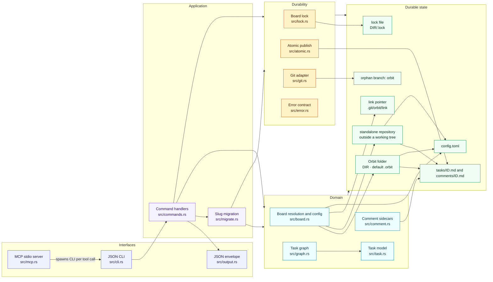
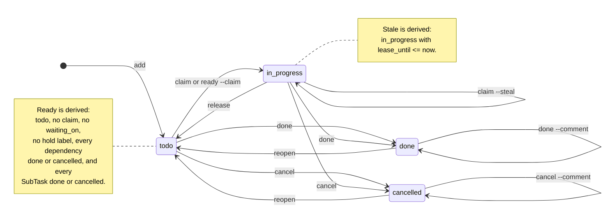

# Orbit Specification

Status: pre-alpha; v0.8.2 is the latest release and includes the Orbit folder layout ([ADR 0012](./adr/0012-orbit-folder.md)). This document is canonical. `docs/brainstorming.md` and `docs/spec_alpha.md` are research notes kept for context.

## 1. What Orbit is

Orbit is a Git-native issue tracker and local work queue for coding agents. A Task is a Markdown file; one Rust binary serves the board through a strict JSON CLI and an optional MCP server.

The wedge is narrow and deliberate:

> **Markdown-as-truth + Git-reviewable task diffs + no Dolt/SQLite + multi-process serialization without a daemon.**

Beads already provides claims, ready-work detection, priorities, hash IDs, and worktree sharing on top of Dolt. Orbit does not try to beat Beads at distributed sync, federation, or scale. It wins by keeping the board human-readable and diffable, and by making concurrent local agents safe with a single locked writer instead of a database server.

### Non-goals for v1

- Hosted sync, federation, or multi-machine merge.
- Dolt, SQLite, or any second source of truth.
- A daemon or background watcher.
- Web UI.
- Arbitrary-depth hierarchy, Beads-style issue-type entities, or attachments.
  Parent Tasks group one level of SubTasks; work shape is the metadata-only Type
  field.
- Hosted sync, federation, or opaque remote trackers other than explicit GitHub Issue sync ([github-sync.md](./github-sync.md)).
- Automatic pushes to a remote.

## 2. Architecture

1. **Board (truth):** a dedicated orphan Git branch named `orbit`, checked out in the Orbit folder `DIR` (default `<project>/.orbit`). Inside a Git working tree, `DIR` is a worktree of that repository; outside one, it is an independent repository on the `orbit` branch. Every worktree of the repository resolves to the same `DIR`, and a repository may link to a shared external Board (section 5).
2. **Tasks:** Markdown files at `tasks/<id>.md` inside `DIR`.
3. **Comments:** append-only Markdown sidecars at `comments/<id>.md` inside `DIR`.
4. **Index (speed):** every process rebuilds an in-memory graph from the task files. There is no persistent cache and no watcher.
5. **Writes (safety):** every mutation takes one Board-wide exclusive lock at `<DIR>/.lock`, performs a read-modify-write, and publishes each file with a temp-file + `fsync` + rename. Readers take a shared lock for a consistent snapshot.
6. **History:** meaningful mutations auto-commit to the `orbit` branch. Heartbeat/lease-only changes are committed by `orbit sync`. Nothing is pushed automatically.

The board is deliberately outside code branches: task churn never enters a feature PR, and agents in separate worktrees share one queue. See `docs/adr/0001-markdown-board-on-orphan-branch.md`, `docs/adr/0002-single-writer-lock-and-atomic-rename.md`, and `docs/adr/0012-orbit-folder.md`.

### 2.1 Component view

Orbit is one binary with two front doors: the JSON CLI and the MCP stdio server. `orbit mcp` is a bridge, not a second implementation; each tool call spawns the CLI. There is no daemon, watcher, or persistent index.



The detailed module map, board-resolution flow, domain relationships, state machine, command map, and sequence diagrams are in [`docs/ARCHITECTURE.md`](./ARCHITECTURE.md).

## 3. Domain model

The canonical vocabulary lives in `docs/GLOSSARY.md`. In short:

- A Task has one stored **Status**: `todo`, `in_progress`, `done`, or `cancelled`.
- A **Parent Task** groups **SubTasks**, and its completion depends on them. A **SubTask** is a Task with a `parent`; it is claimable and completable in its own right. Parentage is one level deep and is not a Dependency.
- **Kind** is structural and derived: `task` or `subtask`.
- **Type** is the stored work shape: `task` (default), `epic`, `spike`, `chore`, or `decision`. Type is metadata and does not affect readiness. An **Epic** or **spec** is a top-level Task with `type: epic`; `epic` is refused on a SubTask. External trackers call the unit an Issue and a child a Sub-issue; see [`docs/GLOSSARY.md`](./GLOSSARY.md), [ADR 0009](./adr/0009-keep-task-vocabulary.md), and [ADR 0010](./adr/0010-structural-type-field.md).
- **Ready** is derived: `todo`, no Claim (including no Stale Claim), not Waiting, no Hold Label, every Dependency is `done` or `cancelled`, and every SubTask is `done` or `cancelled`.
- **Blocked** is derived: at least one Dependency is not `done` or `cancelled`, or a Parent Task has at least one open SubTask.
- **Waiting** is an external blocker recorded by `waiting_on`; it is not a Status.
- A **Claim** is exclusive, time-bounded responsibility for a Task. The time window is a **Lease**. An expired, unreleased Claim is **Stale**: the Task is not Ready, but it can be released or stolen.
- A **Checkpoint** is the claim holder's latest handoff note: progress, the next useful action, and any blocker. It is stored on the Task, survives release and takeover, and never affects readiness or claim eligibility.
- **Done** and **Cancelled** both resolve dependents. Cancelled exists so abandoned work does not have to lie with `done` or destroy history with `delete`.
- **Priority** is `P0` (highest) through `P3` (lowest); the stored value is an integer `0`–`3`.
- **Label** is a short lowercase string attached to a Task for filtering or workflow state. **Hold Labels** are configured labels that suspend readiness; the defaults are `needs-triage`, `needs-info`, and `ready-for-human`. `ready-for-agent`, `bug`, and `enhancement` are neutral.
- **Comment** is an append-only, authored, timestamped note on a Task. Comments do not affect Status or readiness.

### 3.1 Status state machine

Only four values are stored in `status`:



`done` and `cancelled` both resolve dependents. `reopen` returns a terminal Task to `todo`; `release` returns an active claim to `todo`; `cancel` is not `delete`. Waiting, hold labels, and dependency edges are gates on readiness and claims, not Statuses. The full transition table and readiness gate are in [`docs/ARCHITECTURE.md`](./ARCHITECTURE.md).

## 4. Task file

### ID

A Board has one **Slug**, stored as the literal `id.prefix` with a trailing dash (`teramigo-`). A Task ID is that prefix followed by 6–8 random Crockford base32 characters: `0123456789abcdefghjkmnpqrstvwxyz`. A SubTask ID is `<parent-id>.<random>`: the parent ID, a dot, and a fresh 6–8 character suffix. SubTasks inherit the prefix automatically.

Examples: `teramigo-32fdfd` (Task), `teramigo-32fdfd.7fk2m9` (SubTask), and `orb-a7b2c9` (the legacy default). A legacy prefix without a trailing dash remains valid and keeps generating IDs; no migration is required. One level only: a second dot is invalid. `id.prefix` accepts lowercase letters, digits, and dashes, and must not contain a dot, so the dot always marks the parent boundary. The filename stem is the single source of truth; there is no `id` field in frontmatter.

`orbit slug migrate <slug>` can rewrite every ID to a new prefix when the Board's identity changes. The random suffix is preserved, so it rewrites only prefixes and structured references; the Board still has exactly one prefix afterwards. This is an explicit, one-commit operation, not a permanent multi-prefix mode.

### Layout

The Orbit folder, `DIR`, is the Board root. Its default is `<project>/.orbit`.

```text
<DIR>/
├── config.toml
├── .gitignore
├── tasks/
│   ├── .gitkeep
│   ├── orb-a7b2c9.md
│   ├── orb-f14c02.md
│   └── orb-f14c02.d4b3df.md
└── comments/
    ├── .gitkeep
    ├── orb-a7b2c9.md
    └── orb-f14c02.d4b3df.md
```

Comments are optional; the file is created on the first comment. The task file remains the description and acceptance criteria; `orbit show` merges the task and its comments.

The Board data lock is `<DIR>/.lock` in both storage modes and is gitignored. Initialization uses a short-lived bootstrap lock in `DIR` that is never committed.

`DIR` is stored in one of two private modes, recorded as `board.storage`:

- `worktree`: `DIR` is inside a Git working tree and is a worktree of that repository on the `orbit` branch. The path is written to the containing repository's `.git/info/exclude`, never to a tracked `.gitignore`. Every worktree of the repository resolves the same Board.
- `repository`: `DIR` is outside every Git working tree and is its own Git repository with `HEAD` on the `orbit` branch. The global Board and a shared Board that lives outside every working tree use this mode.

Both modes expose the same files, lock, commands, and JSON contract. An explicit `DIR` that is created fresh must be empty apart from `.git`, so the initial Board commit contains only Board files; otherwise `init` returns `CONFIG_ERROR`.

### Frontmatter

The example below is a SubTask file, `tasks/orb-f14c02.d4b3df.md`.

```yaml
---
title: Build the CLI router
status: todo
type: task
priority: 2
labels:
- ready-for-agent
- bug
depends_on:
- orb-a7b2c9
parent: orb-f14c02
waiting_on: Waiting for API credentials
checkpoint:
  by: claude-1
  at: 2026-10-23T12:10:00Z
  progress: Parser and tests pass.
  next: Wire the CLI.
  blocker: Waiting for review.
claimed_by: claude-1
claimed_at: 2026-10-23T12:00:00Z
lease_until: 2026-10-23T12:30:00Z
created_at: 2026-10-23T11:00:00Z
updated_at: 2026-10-23T12:00:00Z
---

Body text, acceptance criteria, notes.
```

Required: `title`, `status`, `created_at`, `updated_at`. Optional: `type` (default `task`; one of `task`, `epic`, `spike`, `chore`, `decision`; always written on save), `priority` (default `2`), `labels` (default empty, normalized, sorted, deduplicated), `depends_on` (default empty), `parent` (absent for a Task; when present the Task is a SubTask and the value names its Parent Task), `waiting_on`, `checkpoint`, `area` (optional; one of `board`, `cli`, `mcp`, `setup`, `docs`, `release`), `verification` (optional; trimmed text up to 2000 characters; concise agent checks or commands), `github` (optional link metadata when the GitHub provider is enabled), `claimed_by`, `claimed_at`, `lease_until`. Unknown fields are preserved on rewrite. Timestamps are RFC 3339 UTC. A `parent` must name an existing, non-terminal Task that is not itself a SubTask; SubTasks are one level deep, a SubTask cannot have `type: epic`, and the SubTask ID must encode the same parent. `doctor` reports a mismatch as `PARENT_MISMATCH` or an invalid epic as `INVALID_TYPE`.

The body is free-form Markdown. Orbit does not duplicate the title as an H1. Frontmatter is parsed as the first `---` block, not by splitting the whole file on `---`.

### Comments

`comments/<id>.md` is created on the first comment. Each comment is an immutable block:

```markdown
# Comments: orb-a7b2c9

<!-- orbit:comment {"author":"opencode","created_at":"2026-10-23T12:00:00Z"} -->
Body text.
<!-- /orbit:comment -->
```

Comments are append-only; there is no edit or delete command. A correction is a new comment. `orbit show` and `orbit comment list` parse the blocks. The body must not contain the Orbit comment markers.

### Checkpoints

A Task stores at most one **Checkpoint** in its frontmatter: the claim holder's latest handoff note. `by` and `at` identify the last writer and the time of that write; `progress` is required; `next` and `blocker` are optional. `orbit checkpoint` replaces the record. The first write requires `progress`; later writes may update one field and keep the rest, and `--clear-next` or `--clear-blocker` removes an optional field. A partial update rewrites `by` and `at` even when it keeps the previous `progress` text, so the record always names the claimant who last accepted responsibility for it.

The caller must hold the Claim; a Stale Claim still counts until another agent steals it. The command refuses a task with no Claim and a terminal task with `INVALID_TRANSITION`. A Checkpoint does not change Status, readiness, Claim eligibility, dependencies, or `waiting_on`.

`orbit show`, every task-detail projection, `list`, `ready`, `prime`, MCP `get`, and `export` expose the record as `checkpoint`. When the Task is terminal, the latest Checkpoint stays in the task file as archived history and the detail projection adds `checkpoint_archived: true`; active queue surfaces never list terminal Tasks. A Checkpoint is Orbit-owned execution state stored on the Board and is not synchronized to GitHub Issues or any other external tracker.

### Config

```toml
[board]
branch = "orbit"
storage = "worktree"
lease_minutes = 30
default_priority = 2
non_ready_labels = ["needs-triage", "needs-info", "ready-for-human"]
auto_commit = true
lock_timeout_ms = 2000

[id]
length = 6
prefix = "orb-"
```

`board.storage` is `worktree` or `repository` and records how `DIR` is backed by Git. A legacy Board without the field has its mode inferred from its location and is reported by `doctor` until migrated. `id.prefix` must contain only lowercase letters, digits, and dashes; a dot is reserved for the SubTask boundary. A prefix ending in `-` is a new-style `<slug>-`: the slug part is 1–20 characters, starts and ends alphanumeric, and contains no `--`, so the full prefix is at most 21 characters. A legacy prefix without a trailing dash stays valid under the same alphabet rules with a 20-character cap. The default is `orb-`.

## 5. Board lifecycle

A Board lives in the Orbit folder, `DIR`. The default is `./.orbit` in the current directory; in a linked worktree it is the main checkout's `.orbit`. Every command takes `DIR` as the folder delegated to Orbit: the positional argument of `init`, the argument of `link`, and `--dir`/`ORBIT_DIR`.

`orbit init [DIR] [--slug SLUG] [--global] [--agents LIST|none|all] [--print]`:

1. Resolves `DIR` and refuses to create a Board when a repository-local Board already resolves for it. `--global` is exempt. A configured `user.name` / `user.email` is required. The repository does not need an initial commit.
2. Chooses the storage mode:
   - Inside a Git working tree, it creates the `orbit` orphan branch if needed, adds `DIR` as a worktree of that repository, and writes the `DIR` path to `.git/info/exclude`. It never edits a tracked file.
   - Outside every Git working tree, it makes `DIR` an independent Git repository with `HEAD` on the `orbit` branch.
3. Writes `config.toml` with the resolved `id.prefix` and `board.storage`, plus `.gitignore`, `tasks/.gitkeep`, and `comments/.gitkeep`.
4. Commits `orbit: initialize board`.
5. Prints a numbered setup report: the Board (path, branch, storage mode, prefix, and exclusion), the coding-agent integration (wired harnesses, MCP command, and managed files), and the `orbit doctor` verification step, followed by next commands. A standalone Board always includes `orbit link DIR` in its next steps. In a TTY it asks whether to wire the detected coding-agent harnesses; without a TTY it writes no agent files and explains the `orbit setup` hint. `--agents` skips the prompt. `--print` reports the same steps in future tense, includes generated file contents, and writes nothing.

`orbit init` is idempotent when `DIR` already holds a Board: the Board is reused and nothing is rewritten. If a different repository-local Board already resolves for `DIR`, `init` returns `ALREADY_INITIALIZED` naming that Board and creates nothing. The `~/.orbit` fallback does not block creating a local Board. Run `orbit unlink` before creating a local Board in a linked repository. A linked repository keeps its Board until `unlink`. `--print` computes the same result without writing.

`init` takes `DIR` from the positional argument; when it is absent, from `--dir` or `ORBIT_DIR`; otherwise it uses `./.orbit`. `--global` is exclusive with a positional `DIR` and with `--dir`/`ORBIT_DIR` and means `~/.orbit`. `link` uses only its positional `DIR`; `--dir`/`ORBIT_DIR` never retarget the pointer written by `link`.

A repository owns one local Board. A nested repository (for example a submodule) has its own resolution scope and may resolve its own nested Board, but a second `.orbit` in the same working tree is refused because the `orbit` branch can be checked out by only one worktree.

`orbit init --global` targets `~/.orbit` and creates a `repository`-mode Board unless it already exists, even when `~` happens to sit inside another Git working tree. The global Board is the last discovery fallback and is never created while resolving a command.

A workspace is a `DIR` outside every member repository plus one link per repository. Create the workspace folder, run `orbit init` inside it, then run `orbit link <DIR>` in each repository. `orbit init` does not clone repositories or link them.

### Slugs

A Board has one slug. It is resolved from `DIR` when the Board is created; an empty Board can change it with `--slug`:

| Command | No `--slug` | With `--slug` |
| --- | --- | --- |
| `init` | `DIR` basename, or its parent's basename when `DIR` is named `.orbit` | explicit |
| `init DIR` | `DIR` basename, or its parent's basename when `DIR` is named `.orbit` | explicit |
| `init --global` | `orb`, with a warning | explicit |

The default `./.orbit` therefore uses the project folder name: `~/src/acme/.orbit` becomes `acme-`. An explicit `DIR` such as `~/src/acme` also becomes `acme-`. A linked worktree defaults to the main checkout's `.orbit`, so it keeps the same Board and slug.

Auto-derived names are normalized: lowercase; every run outside `[a-z0-9]` becomes one `-`; collapse and trim `-`; fall back to `orb`; cap at 20 characters at the last dash, or hard-cut. Auto names never fail. A warning on stderr is emitted when the anchor is the home directory or `/`.

Explicit `--slug` is a bare word and is strict: 1–20 characters, `[a-z0-9-]`, alphanumeric first and last, no `--`. A violation returns `INVALID_SLUG` with a normalized suggestion. A trailing dash, uppercase, dot, underscore, space, or non-ASCII character is rejected.

Auto-adoption applies only when the Board is created. Re-running `init` without `--slug` preserves the stored prefix. An empty Board can change its prefix with `--slug`; a populated Board returns `SLUG_LOCKED` naming the current prefix, the requested prefix, the task count, and the `orbit slug migrate <slug>` command that can rewrite it. Passing the current slug is a no-op with no commit. `--print` computes the same prefix without writing.

Editing `id.prefix` by hand on a populated Board produces one `PREFIX_MISMATCH` from strict commands and in `doctor`, naming the configured prefix, the observed prefix, and the file count, instead of one `CORRUPT_TASK` per file. If some IDs match the configured prefix, the remaining files keep the per-file behavior. A legacy no-dash prefix cannot be inferred safely, so those boards also keep the per-file `CORRUPT_TASK` behavior. Migration refuses a mismatched Board; restore `id.prefix` first.

### Migrating the slug

`orbit slug show` is read-only and takes the shared lock. It reports `data.slug` (the bare slug from `id.prefix`), `data.prefix` (the literal prefix), `data.tasks`, `data.subtasks`, and `data.comment_files`. It does not load the graph, so it still reports the stored identity when `doctor` finds issues.

`orbit slug migrate <SLUG> [--dry-run] [--force]` is the explicit path for a populated Board. It validates `<SLUG>` with the same rules as `--slug` (`INVALID_SLUG` with a normalized suggestion). Passing the current slug is a no-op with `changed: false`, `applied: false`, no commit, and no file writes; a legacy no-dash prefix with the same slug is also a no-op.

The migration is deterministic:

- A top-level ID keeps its random suffix: `orb-a7b2c9` becomes `atlas-a7b2c9`.
- A SubTask keeps the parent suffix and its child suffix: `orb-a7b2c9.d4b3df` becomes `atlas-a7b2c9.d4b3df`.
- `parent` and every `depends_on` entry are rewritten structurally from the mapping, never by text search.
- Every comment file is renamed and its Orbit-generated `# Comments: <old-id>` header is updated. Comment bodies are copied verbatim.
- `id.prefix` is updated to `<slug>-`.
- Task bodies, checkpoint text, unknown frontmatter fields, comment text, Git history, external links, and old task IDs quoted in prose are not rewritten. YAML serialization may normalize formatting when a task is saved.

An empty Board is migrated by changing `config.toml` and committing, with zero mappings.

#### Migration safety

- The Board must pass a strict graph load plus the doctor-equivalent issues that matter for a rewrite: orphan or corrupt comments, comment headers that do not match their filename, `PARENT_MISMATCH`, and a Board checked out on the wrong branch. Any issue returns `MIGRATION_BLOCKED` with `details.reason: "unhealthy"` and the issues.
- Live claims (`lease_until > now`) return `MIGRATION_BLOCKED` with `details.reason: "live_claims"` and the affected `from`, `to`, `holder`, and `lease_until` values. `--force` permits the migration and the result lists the same claims; holders must re-read the Board.
- Pending heartbeat-only writes are flushed with an `orbit: sync` commit before building the migration. If the Board is still dirty, migration returns `MIGRATION_BLOCKED` with `details.reason: "dirty_board"`.
- The rewrite is built in a temporary detached Git worktree, validated with a strict load, and committed as `orbit: migrate task prefix from <old> to <new>`. The real Board is then reset to that commit and the temporary worktree is removed. A failure before the reset leaves the original Board untouched. If the Board branch advances while the temporary tree is being built, migration returns `MIGRATION_BLOCKED` with `details.reason: "board_moved"` and writes nothing.
- If two source IDs map to the same target, migration returns `PREFIX_COLLISION` with the target and sources, and writes nothing.
- `--dry-run` performs the same validation and returns the plan with `applied: false`, `commit: null`, and no writes or commits. It reports live claims so the user can decide about `--force`, but does not refuse them.

The plan shape is:

```json
{
  "current": {"slug": "orb", "prefix": "orb-"},
  "target": {"slug": "atlas", "prefix": "atlas-"},
  "changed": true,
  "tasks": 42,
  "subtasks": 17,
  "comment_files": 31,
  "references": 24,
  "mappings": [{"from": "orb-a7b2c9", "to": "atlas-a7b2c9"}],
  "claims": [{"from": "orb-a7b2c9", "to": "atlas-a7b2c9", "holder": "claude", "lease_until": "2026-10-23T12:30:00Z"}],
  "collisions": [],
  "dry_run": false,
  "applied": true,
  "commit": "4f2a91c..."
}
```

`references` counts the structured `parent` and `depends_on` entries rewritten. Mappings are sorted by old ID; claims are sorted by old ID. `comment_files` counts comment files, not comment blocks. A successful apply sets `applied: true` and the full commit hash; a no-op or dry run sets `commit: null`.

The migration is not reversible for external references. `git revert` restores the files, but old IDs in pull requests, chat, docs, agent memory, and shell history remain stale. Run `--dry-run` first, pick the final slug deliberately, and treat the prefix as immutable again afterwards.

`orbit link DIR` writes an absolute pointer at `<git-common-dir>/orbit/link` for a repository joining an existing Board. `DIR` is the Orbit folder itself (`.../.orbit`); `link` does not append `.orbit`. It may be a local worktree or a standalone repository. A legacy target — a board root, or an old workspace root containing `board/` — is accepted with a `LEGACY_LAYOUT` warning and resolves to that Board. That warning continues on later commands while the linked Board keeps a legacy layout. A target that holds no Board returns `LINK_NOT_FOUND`. `orbit unlink` removes the pointer. Because the pointer lives in the common directory, every linked worktree resolves the same Board. Linking does not delete a local Board; it shadows it and reports every shadowed local Board path, including a legacy `<git-common-dir>/orbit/board`.

Every command resolves the Board in this order. The first match wins.

1. `--dir` or `ORBIT_DIR`, which names the Orbit folder itself (or a legacy Board root) directly; the resolver does not append `.orbit`.
2. The link pointer at `<git-common-dir>/orbit/link`. A legacy target — an old board root or a workspace root containing `board/` — resolves with a `LEGACY_LAYOUT` warning.
3. The nearest `.orbit` walking up from the current directory to the enclosing repository root, or to `$HOME` outside a repository, skipping `~/.orbit` itself. The walk stops at the repository root: a `.orbit` in a folder above the repository is not found, so use `link` or `--dir` to share one across repositories.
4. The main checkout's `.orbit`. The main checkout is the parent of the Git common directory when that directory is literally named `.git`; otherwise it is the repository root.
5. The legacy local layout at `<git-common-dir>/orbit/board`, with a `LEGACY_LAYOUT` warning.
6. `~/.orbit`, only when it already exists.

A pointer whose target no longer contains a Board returns `LINK_NOT_FOUND`. A missing Board returns `BOARD_NOT_FOUND` and names `orbit init`. A Board that exists in both a new `.orbit` and a legacy local layout is reported by `doctor` as `AMBIGUOUS_BOARD`; commands use the new `.orbit` and emit an `AMBIGUOUS_BOARD` warning, and do not merge or delete either copy.

### Legacy layouts and migration

Before this layout, a local Board lived at `<git-common-dir>/orbit/board` with its lock at `<git-common-dir>/orbit/lock`; a shared Board lived at `<workspace>/board` or an arbitrary `--board` path. Those Boards keep resolving through step 5 or through a legacy link target, with a warning. Legacy support is removed in the release after this change.

`orbit doctor --migrate` is the explicit, resumable migration. For a local Board it adds `<main-checkout>/.orbit` as a worktree of the existing `orbit` branch, verifies every Task, writes the exclusion entry, and removes the old worktree record. For a shared `<workspace>/board` it moves the Board root to `<workspace>/.orbit`. An arbitrary `--board` root outside every working tree is already DIR-shaped: it keeps its path, records `board.storage = "repository"`, and only the pointer changes. Other legacy roots are moved to a DIR that matches their storage mode. In every case the command updates the current repository's pointer. Interrupting the migration leaves at least one readable layout; re-running the command resumes. Other linked repositories may need to run `orbit link DIR` again.

### Agent configuration

`orbit setup [CLIENT] --scope project|user` defaults to `project`. Project scope writes repository-level instruction files and MCP configs. User scope writes the same managed content at the harness's user-level locations. Neither scope records an absolute Board path: generated configs rely on discovery from the project directory, or on `--dir`/`ORBIT_DIR` when an editor launches the server elsewhere. MCP configs record an absolute Orbit binary path by default so GUI-launched editors need no `PATH`; `--portable-mcp` writes the bare `orbit` command instead and requires the editor's `PATH` to resolve it. `doctor` reports an older config that still records a Board path as `ABSOLUTE_BOARD_PATH`; re-running `setup` rewrites it path-free.

### Doctor

`doctor` runs without a Board and reports the discovery trace. Running without a Board is not itself a failure; the layout findings and task checks determine health. It diagnoses a legacy layout, a half-moved Board (`AMBIGUOUS_BOARD`), an orphan worktree whose `orbit` branch record outlived `DIR` (`ORPHAN_WORKTREE`), a storage mode that disagrees with `board.storage` (`STORAGE_MISMATCH`), and managed agent configs with an absolute Board path (`ABSOLUTE_BOARD_PATH`). `doctor --fix` removes stale temp files and re-attaches an orphan worktree; `doctor --migrate` performs the legacy migration above. Task-level checks run when a Board is resolved.

When the Board has a configured GitHub provider, `doctor` also reports GitHub authentication and required scopes, linked-repository access, and (in full mode) organization Issue Field configuration problems. These checks are read-only and are collected alongside Board diagnostics; a GitHub problem does not prevent task or Board integrity checks from running.

Auto-commit policy: create/update/claim/release/checkpoint/done/cancel/reopen/depend/undepend/delete/comment/label commit immediately as `orbit: <verb> <id>`. Heartbeat and lease-only writes are not committed until the next meaningful mutation or `orbit sync`. A failed commit does not fail the operation: the state is already on disk and the result carries `meta.warnings: ["COMMIT_FAILED: ..."]`. `doctor` reports uncommitted board changes. A slug migration first flushes heartbeat-only writes as `orbit: sync`, then records one `orbit: migrate task prefix from <old> to <new>` commit. Nothing is pushed.

## 6. Commands

`--json` is global. `orbit <command> --help` is the reference: it carries a long
description and copy-pasteable examples for every command and subcommand.
`docs/commands.md` mirrors that reference and adds the scenario each command fits.
The command map and the `init` and task-lifecycle sequences are in
[`docs/ARCHITECTURE.md`](./ARCHITECTURE.md).

### Command surface

```text
orbit init [DIR] [--slug SLUG] [--global] [--agents LIST|none|all] [--portable-mcp] [--print]
orbit link <DIR> [--no-refresh]
orbit unlink
orbit slug show
orbit slug migrate <SLUG> [--dry-run] [--force]
orbit add <TITLE> [-p N] [--type TYPE] [--depends-on ID]... [--parent ID] [--waiting-on TEXT] [--label LABEL]... [--body TEXT|--body-file PATH|-]
orbit list [--status S] [--priority N] [--claimed-by NAME] [--waiting] [--type TYPE]... [--exclude-type TYPE]... [--label LABEL]... [--exclude-label LABEL]... [--repo NAME|--unlabeled] [--parent ID] [--group] [--all]
orbit ready [--limit N] [--parent ID] [--repo NAME] [--type TYPE]... [--exclude-type TYPE]... [--label LABEL]... [--exclude-label LABEL]... [--claim] [--by NAME]
orbit show <id>
orbit tree <id>
orbit claim <id> [--by NAME] [--steal]
orbit release <id> [--by NAME] [--force]
orbit heartbeat <id> [--by NAME]
orbit checkpoint <id> [--progress TEXT] [--next TEXT|--clear-next] [--blocker TEXT|--clear-blocker] [--by NAME]
orbit done <id> [--by NAME] [--force] [--comment TEXT | --comment-file PATH]
orbit cancel <id> [--by NAME] [--force] [--comment TEXT | --comment-file PATH]
orbit reopen <id> [--force]
orbit update <id> [--title TEXT] [--body TEXT|--body-file PATH] [--priority N] [--type TYPE] [--waiting-on TEXT|--clear-waiting]
orbit label add <id> <label>...
orbit label remove <id> <label>...
orbit label list
orbit comment add <id> [--body TEXT|--body-file PATH|-] [--by NAME]
orbit comment list <id>
orbit depend <id> <dep-id>
orbit undepend <id> <dep-id>
orbit delete <id> [--by NAME] [--force]
orbit prime [--hook-json] [--repo NAME] [--label LABEL]... [--by NAME]
orbit export
orbit setup <claude|cursor|codex|opencode|mattpocock|all> [--scope project|user] [--hooks] [--no-mcp] [--portable-mcp] [--mcp-bin PATH] [--print] [--check] [--remove]
orbit mcp
orbit doctor [--fix | --migrate]
orbit sync
orbit github <status|connect|setup|repo|adopt|create|sync>
orbit triage <context|review|apply>
```

GitHub sync and Triage require Orbit 0.9.0 or newer. Default release builds
include the `github-provider` capability. A build without that capability returns
`GITHUB_UNSUPPORTED` when it loads a Board with active `[github]` configuration;
it must not silently ignore configured GitHub state.

`orbit github status` is a read-only provider diagnostic. It reports the `gh`
identity and known token scopes, configured organization and linked repositories,
Area and Verification field configuration/resolution, linked Task count, pending
pull/push changes, conflicts, unsupported cross-repository relationships, and a
recommended next step. `--json` exposes the same diagnostic data in a stable
structure, including provider `mode`, field applicability, `next_action`, and
`next_command`. In basic mode, organization Issue Fields are not applicable and
the status check only requires the `repo` scope.

`--agents` accepts `none`, `all`, or a comma-separated list of client names. Without it, `init` asks in a TTY and otherwise writes no agent files while explaining the `orbit setup` hint in its report; `--print` never prompts. `--agents none` is the non-interactive "Board only" choice.

`TYPE` is one of `task`, `epic`, `spike`, `chore`, or `decision`. `--type` and `--exclude-type` are repeatable on `list` and `ready`; `--label` is repeatable on `list`, `ready`, and `prime`; `--exclude-label` is repeatable on `list` and `ready`; `--repo NAME` is shorthand for `--label repo:NAME`.

### Milestones

- M0: core CLI, JSON contract, global lock, atomic writes, auto-commit, and tests. Implemented.
- M1: `setup` recipes, `prime --hook-json`, Claude hooks, skill files, and the mattpocock bridge. Implemented.
- M2: `orbit mcp` over stdio, `orbit://tasks/{id}` resources, and project-local MCP configs. Implemented.
- M3: packaging and release automation. Implemented.
- M4: labels, comments, hold labels, and triage integration. Implemented.
- M5: one-command onboarding. `init` creates the Board and reconciles detected harnesses idempotently; `link` and `unlink` share one Board across repositories; hooks record the absolute binary; `setup --check` reports drift. Implemented.
- M6: workspaces, SubTasks, dot-hierarchical IDs, repo/label-scoped queues, and deterministic export. Implemented.
- v0.5.0: metadata-only `type`, `tree`, close candidates, parent progress fields, and label/type exclusions. Implemented.
- v0.6.0: aligned human `list` table with `--group` and parent-first ordering, `--tree` removal, and per-board Task-ID slugs. Presentation and identity changes; the JSON contract is unchanged.
- v0.7.0: `orbit slug show` for read-only identity reporting and `orbit slug migrate` for an explicit, atomic prefix rewrite on populated Boards. The one-prefix invariant is preserved; task bodies, checkpoint text, comment text, Git history, and external links are not rewritten.
- v0.8.0: the Orbit folder replaces the hidden `board` path and `orbit workspace`. `init [DIR]` creates every Board shape, `link DIR` shares it, discovery walks `.orbit` to the main checkout and the global fallback, `setup --scope` writes path-free configs, and `doctor` diagnoses and migrates legacy layouts. Superseded by v0.8.1 on Windows.
- v0.8.1: hardens `doctor --migrate` and makes legacy worktree migration and the test suite pass on Windows. Supersedes v0.8.0.
- v0.8.2: replaces the terse `init` status with a numbered onboarding report, explains each prompt choice, annotates verification and next-step commands, includes unchanged MCP configs in reconciliation output, and aligns the product description across the README, Cargo metadata, CLI help, and generated agent instructions.
- Unreleased: claim checkpoints. A claimant records progress, the next action, and a blocker in the task frontmatter; the record survives release, takeover, and reopen, never affects readiness, and stays as archived history after done or cancelled. Exposed through the CLI, MCP, detail JSON, and export.
- Unreleased (minimum Orbit version 0.9.0): optional GitHub Issue provider (`orbit github`) for multi-repository linking, explicit adopt/create, and bidirectional sync with conflict detection. The provider and `orbit triage` ship in default release binaries and installers. Default `full` mode uses organization Issue Fields for `area` and `verification`; `basic` mode supports personal repositories without Issue Fields and limits Triage to labels. `orbit github connect` configures organization-owned origins and leaves personal-account origins unchanged, reporting the exact `[github]` settings to add or merge into `config.toml` for basic mode while preserving other linked repositories. `orbit github setup` resolves existing fields by default; `--create-fields` explicitly creates missing fields after checking organization administrator access. `orbit github status` reports integration health without writing; `doctor` checks GitHub configuration when enabled. See [github-sync.md](./github-sync.md) and [ADR 0014](./adr/0014-github-issue-provider.md).

### Command rules

- `list` hides `done` and `cancelled` unless `--all`. `--type` is repeatable and matches any listed Type; `--exclude-type` hides any listed Type. `--label` is repeatable and every label must match; `--exclude-label` is repeatable and hides a Task carrying any named label. `--repo NAME` is shorthand for `--label repo:NAME`. `--unlabeled` conflicts with `--label` and `--repo`.
- Human `list` output is an aligned table with `ID`, `STATUS`, `P`, `TYPE`, `TITLE`, `LABELS`, and `CLAIMED BY` columns. Root Tasks sort by priority, then creation time, then ID; each Parent Task is followed by its SubTasks, sorted by priority, then creation time, then ID. `--group` renders one outlined table with a banner for each Parent Task, its SubTasks underneath, and a final `No parent` section; parent groups follow the parent's priority and SubTasks follow their own priority. Titles longer than 60 characters are truncated with an ellipsis. The table is presentation only; `--json` carries the full title and every field and is the contract for scripts and agents.
- `ready` and `prime` accept the same `--repo` and repeatable `--label` filters. `ready` also accepts `--parent`, `--type`, `--exclude-type`, and `--exclude-label`; `prime` reports `close_candidates` for non-terminal Parent Tasks with at least one SubTask and no open SubTasks. All filters combine with AND.
- `add --type epic` and `update --type epic` are refused when the Task has a `parent`; epic is top-level only. `type` defaults to `task` and is written explicitly on every save.
- `init` accepts `--slug` as a bare word. Explicit invalid input returns `INVALID_SLUG` with a normalized suggestion. Re-runs preserve the stored prefix; an empty Board can change it, a populated Board returns `SLUG_LOCKED` naming `orbit slug migrate <slug>`; `--print` previews the same prefix without writing.
- `init` derives the slug from `DIR`: the parent folder name when `DIR` is named `.orbit`, otherwise `DIR`'s own name. `--global` and `~/.orbit` use `orb` with a warning. Explicit `--slug` wins.
- `init` refuses to create a second Board for the same location. A re-run on the same `DIR` is idempotent; an attempt to create `.orbit` while a link, ancestor `.orbit`, main-checkout `.orbit`, or legacy Board already resolves for `DIR` returns `ALREADY_INITIALIZED` and names the existing Board. `unlink` clears a link; move or migrate an ancestor, main-checkout, or legacy Board. `--global` and the `~/.orbit` fallback are exempt.
- `init --global` creates or reuses `~/.orbit` in `repository` mode. Discovery uses it only when it already exists; no command creates it implicitly.
- `slug show` is read-only and reports the slug, literal prefix, task/SubTask counts, and comment-file count. `slug migrate` is the explicit rewrite path described in [Migrating the slug](#migrating-the-slug); it is not exposed as an MCP tool.
- `slug migrate` validates the target like `--slug`. The current slug is a no-op with no commit. Applying with live claims requires `--force`; dry-run reports them without refusing. An unhealthy Board returns `MIGRATION_BLOCKED`; a target collision returns `PREFIX_COLLISION`. `--dry-run` writes nothing.
- A hand-edited `id.prefix` that matches no task file returns one `PREFIX_MISMATCH` from strict loads and `doctor`. Migration refuses this state; restore the configured prefix first.
- `export` is read-only, takes the shared lock, and emits a deterministic snapshot: tasks sorted by ID, no timestamps or machine-local paths. `schema_version` is `2`; `data.board.prefix` is the literal Task-ID prefix.
- `done` never bypasses unfinished dependencies. `--force` overrides a competing live claim and, on a Parent Task, cancels open SubTasks before closing it.
- A forced `reopen` can leave an already-done dependent with an unfinished dependency. That is a historical fact, not corruption: `doctor` reports it as a warning, and the next `done` of that dependent still enforces its dependencies.
- `reopen` refuses when a done dependent exists unless `--force`. Reopening a SubTask of a done parent reopens the parent too.
- `delete` refuses when dependents exist unless `--force`; `--force` removes the ID from each dependent first. A Parent Task with SubTasks is refused unless `--force`, which deletes the whole subtree.
- `depend` refuses self-dependencies, missing tasks, cycles, adding a dependency to a terminal task, and parent/child edges in either direction. Parentage is not a Dependency; use `add --parent`.
- `add --parent <id>` creates a SubTask and stores `parent`. The parent must exist, be non-terminal, and not itself be a SubTask; SubTasks are one level deep.
- A Parent Task is Ready only when every SubTask is `done` or `cancelled`. `claim`, `done`, and `cancel` refuse with `SUBTASKS_OPEN` while open SubTasks remain. `done --force` and `cancel --force` cancel the open SubTasks first; `delete` refuses a Parent Task with SubTasks unless `--force`, which deletes the whole subtree.
- `reopen` of a SubTask under a done Parent Task reopens the parent too. A SubTask under a cancelled parent is refused until the parent is reopened.
- `list --parent <id>` filters to that Parent Task's SubTasks; `list --group` keeps parents and SubTasks together in human output.
- `tree <id>` returns one Parent Task and its direct SubTasks, root first, with the same task rows as `list`/`ready`; it refuses a SubTask. `data` carries `root`, `tasks`, and `count`.
- `doctor` reports missing parents (`DANGLING_PARENT`), nested or self parents (`NESTED_SUBTASK`), parent/ID mismatches (`PARENT_MISMATCH`), and an epic on a SubTask (`INVALID_TYPE`).
- `doctor` runs without a Board. It reports the discovery trace and the layout findings `LEGACY_LAYOUT`, `AMBIGUOUS_BOARD`, `ORPHAN_WORKTREE`, `STORAGE_MISMATCH`, and `ABSOLUTE_BOARD_PATH`, then runs task-level checks when a Board is resolved.
- `doctor --fix` removes stale temp files and re-attaches an orphan `orbit` worktree whose `DIR` was deleted; it repairs the repository that holds `--dir`/`ORBIT_DIR` when given, else the current one. It does not rewrite tasks or comments. `doctor --migrate` performs the explicit, resumable legacy migration described in [Legacy layouts and migration](#legacy-layouts-and-migration). Before it deletes a legacy copy it requires the Task and comment Markdown of both copies to be byte-identical and refuses with `MIGRATION_BLOCKED` otherwise, or when the legacy worktree has uncommitted changes. After a workspace migration it lists a note: other Repositories still linked to the old `board` path must run `orbit link` again.
- `undepend` is idempotent.
- `cancel` resolves dependents. It requires the claim holder unless `--force`; on a Parent Task, `--force` also cancels open SubTasks.
- `label add` and `label remove` are idempotent. Labels are lowercase slugs; invalid labels are rejected with `INVALID_LABEL`.
- A Task carrying a configured hold label is not Ready; `claim` returns `LABEL_BLOCKED`. `--steal` does not bypass hold labels; remove the label first.
- `done` and `cancel` accept `--comment TEXT` or `--comment-file PATH`; the note is appended in the same locked operation as the terminal status change, so an agent cannot record a completion note before the task is closed.
- `comment add` is append-only and immutable. A comment has an author and RFC 3339 timestamp; corrections are new comments. `delete` removes the task's comment file.
- `checkpoint` replaces the latest handoff record. The first write requires `--progress`; later writes may update only the fields passed. The caller must hold the claim (a stale lease counts), and a terminal task or unclaimed task returns `INVALID_TRANSITION`. The record never changes readiness, claim eligibility, or dependencies. `release`, `claim --steal`, and `reopen` preserve it; terminal tasks keep it as archived history and the detail projection reports `checkpoint_archived: true`.
- `doctor` reports malformed comments (`CORRUPT_COMMENT`) and comment files with no task (`ORPHAN_COMMENT`).
- `setup` is idempotent, preserves unrelated content, and refuses to overwrite an existing rule or skill file it does not manage. `--remove` removes only Orbit-managed sections, files, and hooks.
- `init` is idempotent for the same `DIR`: it reuses the Board and, when agent wiring is requested, reconciles the managed integration, reporting `created`, `updated`, `unchanged`, and `skipped` files. It never creates a second Board for a working tree.
- `link DIR` writes the pointer; `unlink` removes it and refreshes existing managed client files. Agent configs carry no Board path, so the Board is resolved at command time. Refresh preserves an existing portable or absolute MCP command mode. A legacy target is accepted with a `LEGACY_LAYOUT` warning.
- `init` detects Claude, Cursor, Codex, OpenCode, and the mattpocock bridge from installed commands, home markers, and project markers. In a TTY it asks whether to wire the detected clients; without a TTY it only prints the hint. `--agents none|all|list` skips the prompt, and `--print` never prompts. When the first MCP config is about to be written, the TTY flow also offers an absolute binary path (default) or the portable `orbit` command; `--portable-mcp` selects the latter non-interactively.
- `setup --scope project|user` defaults to `project`. Project scope writes repository-level files; user scope writes the harness's user-level files. Generated configs record the Orbit binary but not the Board path. `--print`, `--check`, and `--remove` operate on the selected scope.
- `setup --check` reports `installed`, `missing`, or `stale` per file and exits non-zero unless the integration is installed.
- `setup --hooks` installs Claude Code's SessionStart hook, recording the absolute binary path. `--remove` recognizes both the absolute and legacy bare command forms.
- `init --agents all` and `setup` refuse to record a binary under npm's `_npx` cache or a temporary directory (`EPHEMERAL_BIN`); use `orbit setup --portable-mcp` for a portable command.
- `setup` writes project-local MCP configs for Claude, Cursor, Codex, and OpenCode by default, recording the absolute path of the running Orbit binary; `--no-mcp` skips them, `--portable-mcp` writes the bare `orbit` command, and `--mcp-bin PATH` overrides the recorded command. `mattpocock` has no MCP client and ignores explicit MCP options with a warning. OpenCode uses the V2 `mcp.servers.orbit` shape with `type: local` and a command array, and no `enabled` flag.
- `setup mattpocock` leaves an existing `docs/agents/issue-tracker.md` without Orbit's managed marker unchanged and reports it as `skipped`; `--check` treats a custom doc as installed, `--remove` does not delete it, and agent refresh still recognizes it. Files with the marker update and remove normally.
- Generated MCP configs are machine-specific. A config whose command is a bare `orbit` is portable but requires the editor's `PATH` to contain Orbit, so a repair without `--portable-mcp` restores the absolute-path default.
- `setup --remove` always removes MCP configs, but only entries that look like Orbit's; a foreign `orbit` server is left in place with a warning. OpenCode setup migrates a legacy `mcp.orbit` entry to `mcp.servers.orbit` without duplicating the server; removal clears both forms and preserves unrelated servers.
- No config command; `config.toml` is hand-edited.

## 7. JSON contract

Success:

```json
{"ok": true, "data": {}, "meta": {}}
```

Error:

```json
{"ok": false, "error": {"code": "DEPENDENCY_BLOCKED", "message": "Cannot complete orb-a7b2c9", "retryable": false, "details": {"blocking": ["orb-f14c02"]}}}
```

- In `--json`, stdout is exactly one JSON object. Logs and warnings go to stderr; `meta.warnings` carries non-fatal issues.
- Exit codes: `0` success, `1` domain failure (including a failing health check), `2` usage.
- `NO_READY_TASKS` is a success with `data: null` and `meta.reason: "NO_READY_TASKS"`.
- `doctor` reports `data.healthy: false` and exits `1` when it finds issues.
- `orbit prime --hook-json` is the one exception to the envelope: it prints Claude Code's SessionStart payload, `{"hookSpecificOutput":{"hookEventName":"SessionStart","additionalContext":"..."}}`. It cannot be combined with `--json`.

### Export snapshot

`orbit export --json` returns the standard envelope with this `data` shape:

```json
{
  "schema_version": 2,
  "board": {"branch": "orbit", "prefix": "orb-", "task_count": 1, "comment_count": 0},
  "tasks": [
    {
      "id": "orb-a7b2c9",
      "kind": "task",
      "title": "Build the CLI router",
      "status": "todo",
      "type": "task",
      "priority": 2,
      "labels": ["repo:api"],
      "parent": null,
      "subtasks": [],
      "open_subtasks": [],
      "subtask_count": 0,
      "resolved_subtask_count": 0,
      "open_subtask_count": 0,
      "eligible_for_close": false,
      "depends_on": [],
      "waiting_on": null,
      "checkpoint": null,
      "checkpoint_archived": null,
      "claimed_by": null,
      "claimed_at": null,
      "lease_until": null,
      "created_at": "2026-10-23T11:00:00Z",
      "updated_at": "2026-10-23T12:00:00Z",
      "ready": true,
      "blocking": [],
      "dependents": [],
      "body": "Body text, acceptance criteria, notes.",
      "comments": [],
      "comment_count": 0
    }
  ]
}
```

- `tasks` contains every Task and SubTask, including `done` and `cancelled`, sorted by ID.
- Each entry is the `show --json` detail shape: `kind`, `type`, `parent`, `subtasks`, `open_subtasks`, `subtask_count`, `resolved_subtask_count`, `open_subtask_count`, `eligible_for_close`, `labels`, `depends_on`, `dependents`, `waiting_on`, `checkpoint`, derived `ready` and `blocking`, the body, and the full comments. `eligible_for_close` is true only for a non-terminal Parent Task with at least one SubTask and no open SubTasks. `checkpoint_archived` is true when a recorded checkpoint belongs to a terminal Task.
- The snapshot is a pure function of board state: no export timestamp and no machine-local paths. Comments keep their file order.
- Consumers should pin `schema_version` and ignore unknown fields.

Error codes: `NOT_FOUND`, `CORRUPT_TASK`, `DANGLING_DEP`, `DANGLING_PARENT`, `NESTED_SUBTASK`, `PARENT_MISMATCH`, `PREFIX_MISMATCH`, `CYCLE_DETECTED`, `DEPENDENCY_BLOCKED`, `SUBTASKS_OPEN`, `SUBTASKS_EXIST`, `ALREADY_CLAIMED`, `CLAIM_STALE`, `NOT_CLAIM_HOLDER`, `WAITING_EXTERNAL`, `INVALID_TRANSITION`, `INVALID_ARGUMENT`, `INVALID_SLUG`, `SLUG_LOCKED`, `MIGRATION_BLOCKED`, `PREFIX_COLLISION`, `INVALID_TYPE`, `INVALID_LABEL`, `LABEL_BLOCKED`, `CORRUPT_COMMENT`, `ORPHAN_COMMENT`, `LOCKED`, `ALREADY_INITIALIZED`, `BOARD_NOT_FOUND`, `BOARD_CORRUPT`, `GIT_ERROR`, `IO_ERROR`, `CONFIG_ERROR`, `ID_COLLISION`, `NOT_A_REPOSITORY`, `LINK_NOT_FOUND`, `EPHEMERAL_BIN`.

Warnings and `doctor` findings use a separate namespace: `LEGACY_LAYOUT`, `AMBIGUOUS_BOARD`, `ORPHAN_WORKTREE`, `STORAGE_MISMATCH`, and `ABSOLUTE_BOARD_PATH`. They appear in `meta.warnings` or in the `doctor` issue list; they are not command failures.

`LOCKED` is retryable. Everything else is not unless `details` says otherwise.

## 8. Concurrency and durability

- Writers acquire `<DIR>/.lock` exclusively with a short bounded retry (`lock_timeout_ms`), then fail with `LOCKED` (retryable).
- Readers acquire the same lock shared for the duration of the command, so multi-file reads see a consistent snapshot.
- Each file is written to a temp file in its directory (`tasks/` or `comments/`), fsynced, renamed over the target, and the directory is fsynced on Unix.
- A crash mid-write leaves the old file intact and a stale temp file; `doctor` reports it and `doctor --fix` removes it.
- A forced removal of `DIR` leaves the `orbit` branch and a stale worktree record. `doctor` reports `ORPHAN_WORKTREE`. Any command that finds no Board re-attaches `DIR` from the `orbit` branch on its own and warns `repaired: reattached ...`; `doctor --fix` and `orbit init` do the same explicitly. No Task is lost.
- Multi-file mutations (`delete --force`, `done --comment`/`cancel --comment`, comment append plus task `updated_at`) are serialized but not transactional across files. A crash can leave a partially cleaned board; `doctor` reports dangling dependencies and a repeated `delete --force` resumes the cleanup.
- `slug migrate` is the exception: it builds the complete rewrite in a temporary detached Git worktree, validates it, commits once, and only then resets the real Board. A crash before the reset leaves the original Board untouched; a crash after it leaves the migrated Board at one commit plus a removable temporary worktree.
- Network filesystems are unsupported. Locks are advisory; all writes must go through Orbit.

## 9. Agent integration

CLI + `orbit prime` is the primary interface. `prime` prints ~1k tokens: workflow rules, agent identity, ready tasks, close candidates, stale claims, and counts. `prime --hook-json` emits Claude Code's SessionStart envelope with the same text as `additionalContext`. The Claude hook records the resolved binary path, and `doctor` reports when `orbit` is not that binary on `PATH`.

`orbit init` creates the Board only; it writes harness files when the TTY prompt is accepted or `--agents` names clients. `orbit setup` writes one harness explicitly. Project scope (`--scope project`, the default) writes repository-level files: Claude (`CLAUDE.md`, optional SessionStart hook in `.claude/settings.json`, `.mcp.json`), Cursor (`.cursor/rules/orbit.mdc`, `.agents/skills/orbit/SKILL.md`, `.cursor/mcp.json`), Codex (`.agents/skills/orbit/SKILL.md`, `AGENTS.md`, `.codex/config.toml`), OpenCode (`AGENTS.md`, `opencode.json`), and mattpocock (`docs/agents/issue-tracker.md`). User scope (`--scope user`) writes the same managed content at the harness's user-level locations. `init` selects harnesses by detection or `--agents`; `setup` selects one explicitly named client. Orbit-managed sections and files use markers or key-level merging; `--remove` removes only those sections, files, hooks, and MCP entries. Generated configs record the Orbit binary but not the Board path, so moving `DIR` does not stale them; a managed config that still contains an absolute Board path is reported by `doctor` as `ABSOLUTE_BOARD_PATH`. MCP entries use an absolute binary path by default, or the portable `orbit` command with `--portable-mcp`; the portable form requires the editor's `PATH`. A hand-written `docs/agents/issue-tracker.md` without the marker is reported as `skipped` and left untouched, while `--check` still treats the integration as installed.

MCP complements the CLI and is installed by default for clients that support it; `--no-mcp` keeps an instructions-only setup. `orbit mcp` speaks JSON-RPC 2.0 over stdio and exposes 14 tools: `ready`, `list`, `get`, `create`, `update`, `claim`, `release`, `heartbeat`, `checkpoint`, `finish`, `link`, `delete`, `label`, `comment`. `create` accepts `parent` to make a SubTask and `type` to set the work shape; `update` accepts `type`; `checkpoint` records the claim holder's handoff; `list` and `ready` accept `parent`, `repo`, `labels`, `exclude_labels`, `types`, and `exclude_types` to scope a feature or repository. It also exposes `orbit://tasks/{id}` as a Markdown resource, with `resources/list` and `resources/templates/list`. The server invokes the installed `orbit` binary for each tool call, so it reuses the same lock, atomic-write, auto-commit, and error-envelope path; it holds no board lock between calls. Tool results carry the Orbit envelope as `content[0].text`; `isError` is true when `ok` is false or the CLI exits non-zero.

## 10. Milestones

**M0 — walking skeleton.** Board init, add/show/list/ready/claim/release/heartbeat/done/cancel/reopen/update/depend/undepend/delete/prime/doctor/sync, JSON contract, global lock, atomic writes, auto-commit, tests. No setup, MCP, or packaging.

**M1 — agent setup.** `setup` recipes, `prime --hook-json`, Claude hooks, skill files, mattpocock bridge. Implemented: one command writes managed instructions for Claude, Cursor, Codex, and OpenCode, with idempotent updates and clean removal.

**M2 — MCP.** `orbit mcp` over stdio with the original 13 tools, `orbit://tasks/{id}` resources, project-local MCP configs generated by `setup` (opt out with `--no-mcp`), and protocol-level tests against the CLI. Implemented.

**M3 — distribution.** cargo-dist configuration in `dist-workspace.toml`, shell/PowerShell installers, the `@rcmendes/orbit` npm package, the generated release workflow, and `docs/RELEASING.md`. Implemented and released through v0.8.2.

**M4 — triage metadata.** Labels, comments, hold-label readiness, label/comment CLI and MCP tools, and the triage integration docs. Implemented.

**M5 — one-command onboarding.** Idempotent `init`, harness detection and selection, shared-Board `link`/`unlink`, absolute-binary hooks, and `setup --check`. Implemented; v0.8.1 makes `init` pure and moves wiring behind the prompt or `setup`.

**M6 — workspaces, SubTasks, and export.** Workspaces now use a DIR plus `link`; the standalone `orbit workspace` command was removed in v0.8.1. Dot-hierarchical IDs, `add --parent`, scoped queues, deterministic `export`, and one-level hierarchy are implemented.

**v0.5.0 — structural Type.** Metadata-only `type`, `tree` family view, close candidates, parent progress fields, and label/type exclusions. Implemented.

**v0.6.0 — grouped table and slugs.** Aligned human `orbit list` output with `--group`, parent-first ordering, and per-board Task-ID slugs. Implemented.

**v0.7.0 — slug migration.** `orbit slug show` and `orbit slug migrate` add read-only identity reporting and an explicit, atomic prefix rewrite for populated Boards. Implemented.

## 11. Testing

- Unit tests for frontmatter parsing/serialization, label normalization, comment parsing/appending, ID generation, graph validation, readiness, and transitions.
- Property tests (`proptest`) over random DAGs: acyclicity, readiness consistency, terminal states resolving dependencies, no dangling refs.
- Label/comment integration tests: hold labels block readiness and claims, label filters, comment append-only behavior, delete cascade, and doctor diagnostics.
- Checkpoint integration tests: claimant-only writes, partial updates and clearing, persistence across release and `claim --steal`, no effect on readiness, terminal archive retention with `checkpoint_archived`, and MCP exposure.
- Multi-process tests: concurrent claims, dependencies, and deletes against one board; assert serializability and distinct claims.
- Crash test: abort a writer between temp write and rename; the old file survives and `doctor --fix` removes the temp.
- Worktree integration: initialize in the main worktree, claim from a linked worktree, assert one board.
- Orbit folder tests: a secondary worktree resolves the main checkout's `.orbit`; `init` there reuses it; commands run from `src/` resolve the root Board and `init` there refuses while that Board exists; `git clean -xdff` removes `DIR` and `doctor --fix` re-attaches it with every Task intact; `init` outside a repository creates a `repository`-mode Board; `~/.orbit` resolves only when it exists and `init --global` creates it.
- Legacy layout tests: old `<git-common-dir>/orbit/board` and `<workspace>/board` targets resolve with `LEGACY_LAYOUT`; `doctor --migrate` is resumable and preserves Tasks; an interrupted migration reports `AMBIGUOUS_BOARD`; an orphan worktree reports `ORPHAN_WORKTREE`; a wrong `board.storage` reports `STORAGE_MISMATCH`.
- Link tests: `link DIR` between repositories shares one graph, legacy workspace-root targets still resolve with a warning, `unlink` returns to the main checkout's Board, and `setup --scope user` writes no Board path.
- Setup recipe tests: managed sections, idempotence, hook merge/removal, conflict refusal, `--remove` preserving user content, project versus user scope, and TTY versus non-TTY `init` behavior.
- Onboarding tests: idempotent `init`, first-board refusal, harness detection and selection, link precedence over a local Board, `--dir`/`ORBIT_DIR` overrides, main-checkout fallback, vanished links, and ephemeral binary rejection.
- SubTask, ID, filter, and export integration tests: `tests/subtasks.rs` and `tests/export.rs`.
- Slug tests: normalization and validation tables, auto-adoption from a `.orbit` folder and from an explicitly named DIR, `--global` fallback, explicit overrides, empty/populated Board changes, `PREFIX_MISMATCH`, and the export/prime prefix fields.
- Slug migration tests: show counts, dry-run with no writes, full Task/SubTask/reference/comment rewrite, one-commit atomicity, live-claim refusal and `--force`, unhealthy-board refusal, invalid input, no-op, empty Board, legacy no-dash prefixes, and flushing heartbeat-only writes.
- Human-output tests cover the aligned `list` table, including the header and non-task Type rendering, alongside the JSON shapes in `tests/types.rs`.
- MCP tests: initialize, tools/list, label/comment/checkpoint round-trips, SubTask/parent filtering, resources, and error envelopes over a real stdio child process.
- Golden JSON and error-envelope tests.
- CI on macOS, Linux, and Windows: `cargo fmt --check`, `cargo clippy -- -D warnings`, `cargo test`.
- A Linux `setup-check` CI job runs `orbit setup opencode --no-mcp --check`, so the checked-in `AGENTS.md` managed block stays in sync with the generator; `--no-mcp` keeps machine-local MCP configuration out of the check.
- A Linux `dist-check` CI job runs `dist generate --check` so the release workflow stays in sync with `dist-workspace.toml`.
- Non-gating benchmark: 10k tasks hydrate in under 100ms.

## 12. Distribution

`dist-workspace.toml` configures cargo-dist 0.33.1. It builds macOS arm64/x86_64, Linux x86_64/aarch64 (glibc), and Windows x86_64; installers are shell, PowerShell, and npm. The npm package is `@rcmendes/orbit` (`npm-package = "orbit"`, `npm-scope = "@rcmendes"`); the Cargo package remains `orbit-tracker`, so archive and installer filenames use that name while the binary and npm bin are `orbit`.

Tagging `v*` triggers `.github/workflows/release.yml`: it plans, builds, creates the GitHub Release with `CHANGELOG.md` notes, and publishes npm using the `NPM_TOKEN` secret. The token must have read/write access to `@rcmendes` and 2FA bypass enabled. `.github/workflows/smoke.yml` runs `scripts/onboarding-smoke.sh` and `scripts/onboarding-smoke.ps1` on Linux, macOS, and Windows: on pull requests it builds from source, and on a published release it runs the public installers and the npm package, then exercises `init --agents <client>` for a detected harness, `add`, `ready`, and a real MCP initialize/tools-list handshake through the generated agent command. The smoke isolates the project and home directory so it cannot reuse local agent configuration. macOS binaries are unsigned in v1; musl static builds and code signing are deferred. Homebrew is configured through cargo-dist but gated on a `homebrew-tap` repository and a write token; see `docs/RELEASING.md`.

## 13. Decisions

- [0001. Markdown board on an orphan branch](./adr/0001-markdown-board-on-orphan-branch.md)
- [0002. Single-writer lock and atomic rename](./adr/0002-single-writer-lock-and-atomic-rename.md)
- [0003. Hand-rolled MCP JSON-RPC](./adr/0003-hand-rolled-mcp-jsonrpc.md)
- [0004. MCP tool calls spawn the CLI](./adr/0004-mcp-tool-calls-spawn-the-cli.md)
- [0005. Comments sidecar files](./adr/0005-comments-sidecar-files.md)
- [0006. Shared board across repositories](./adr/0006-shared-board-across-repositories.md)
- [0007. Hierarchical Task and SubTask IDs](./adr/0007-hierarchical-task-and-subtask-ids.md)
- [0008. Workspace root directory](./adr/0008-workspace-root-directory.md) (replaced by 0012)
- [0009. Keep Task vocabulary](./adr/0009-keep-task-vocabulary.md)
- [0010. Add a structural Type field](./adr/0010-structural-type-field.md)
- [0011. Rewrite IDs when the slug changes](./adr/0011-rewrite-ids-on-slug-migration.md)
- [0012. One Orbit folder for every Board](./adr/0012-orbit-folder.md)
- [0013. Claim checkpoints in task frontmatter](./adr/0013-claim-checkpoints.md)
