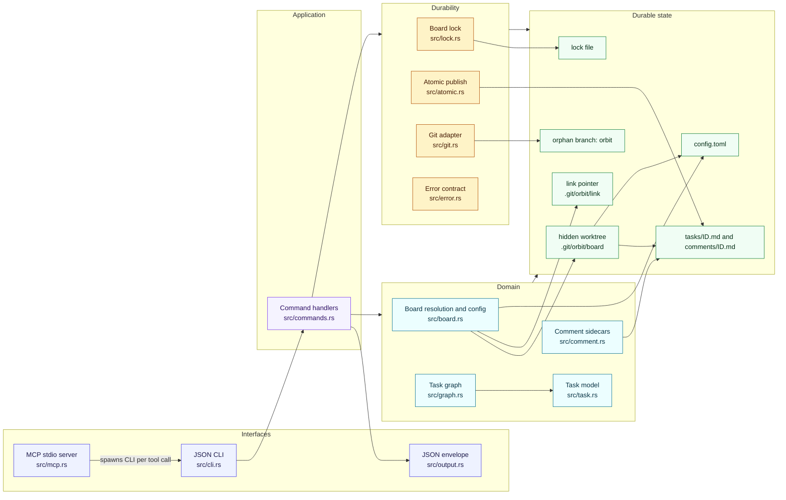
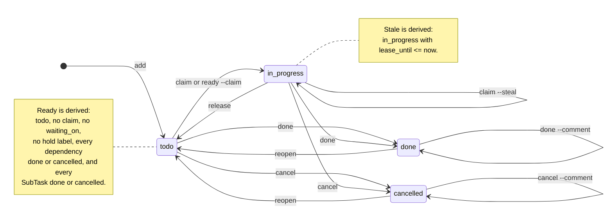

# Orbit Specification

Status: pre-alpha; v0.4.0 is the latest release. This document is canonical. `docs/brainstorming.md` and `docs/spec_alpha.md` are research notes kept for context.

## 1. What Orbit is

Orbit is a local work queue for coding agents. A Task is a Markdown file; one Rust binary serves the board through a strict JSON CLI and an optional MCP server.

The wedge is narrow and deliberate:

> **Markdown-as-truth + Git-reviewable task diffs + no Dolt/SQLite + multi-process serialization without a daemon.**

Beads already provides claims, ready-work detection, priorities, hash IDs, and worktree sharing on top of Dolt. Orbit does not try to beat Beads at distributed sync, federation, or scale. It wins by keeping the board human-readable and diffable, and by making concurrent local agents safe with a single locked writer instead of a database server.

### Non-goals for v1

- Hosted sync, federation, or multi-machine merge.
- Dolt, SQLite, or any second source of truth.
- A daemon or background watcher.
- Web UI.
- Arbitrary-depth hierarchy, first-class issue types, or attachments. Parent
  Tasks group one level of SubTasks; an epic or spec is a convention on top of
  that, not a stored type.
- GitHub/Jira/Linear sync.
- Automatic pushes to a remote.

## 2. Architecture

1. **Board (truth):** a dedicated orphan Git branch named `orbit`, checked out in a hidden worktree at `<git-common-dir>/orbit/board`. Every worktree of the repository resolves to the same board. A repository may instead link to a shared external Board (section 5).
2. **Tasks:** Markdown files at `tasks/<id>.md` inside the board.
3. **Comments:** append-only Markdown sidecars at `comments/<id>.md` inside the board.
4. **Index (speed):** every process rebuilds an in-memory graph from the task files. There is no persistent cache and no watcher.
5. **Writes (safety):** every mutation takes one repo-wide exclusive lock, performs a read-modify-write, and publishes each file with a temp-file + `fsync` + rename. Readers take a shared lock for a consistent snapshot.
6. **History:** meaningful mutations auto-commit to the `orbit` branch. Heartbeat/lease-only changes are committed by `orbit sync`. Nothing is pushed automatically.

The board is deliberately outside code branches: task churn never enters a feature PR, and agents in separate worktrees share one queue. See `docs/adr/0001-markdown-board-on-orphan-branch.md` and `docs/adr/0002-single-writer-lock-and-atomic-rename.md`.

### 2.1 Component view

Orbit is one binary with two front doors: the JSON CLI and the MCP stdio server. `orbit mcp` is a bridge, not a second implementation; each tool call spawns the CLI. There is no daemon, watcher, or persistent index.



The detailed module map, board-resolution flow, domain relationships, state machine, command map, and sequence diagrams are in [`docs/ARCHITECTURE.md`](./ARCHITECTURE.md).

## 3. Domain model

The canonical vocabulary lives in `docs/GLOSSARY.md`. In short:

- A Task has one stored **Status**: `todo`, `in_progress`, `done`, or `cancelled`.
- A **Parent Task** groups **SubTasks**, and its completion depends on them. A **SubTask** is a Task with a `parent`; it is claimable and completable in its own right. Parentage is one level deep and is not a Dependency.
- An **Epic** or **spec** is not a stored type. It is a top-level Task, conventionally labelled `epic`, that groups SubTasks. External trackers call the unit an Issue and a child a Sub-issue; see [`docs/GLOSSARY.md`](./GLOSSARY.md) and [ADR 0009](./adr/0009-keep-task-vocabulary.md).
- **Ready** is derived: `todo`, no Claim (including no Stale Claim), not Waiting, no Hold Label, every Dependency is `done` or `cancelled`, and every SubTask is `done` or `cancelled`.
- **Blocked** is derived: at least one Dependency is not `done` or `cancelled`, or a Parent Task has at least one open SubTask.
- **Waiting** is an external blocker recorded by `waiting_on`; it is not a Status.
- A **Claim** is exclusive, time-bounded responsibility for a Task. The time window is a **Lease**. An expired, unreleased Claim is **Stale**: the Task is not Ready, but it can be released or stolen.
- **Done** and **Cancelled** both resolve dependents. Cancelled exists so abandoned work does not have to lie with `done` or destroy history with `delete`.
- **Priority** is `P0` (highest) through `P3` (lowest); the stored value is an integer `0`–`3`.
- **Label** is a short lowercase string attached to a Task for filtering or workflow state. **Hold Labels** are configured labels that suspend readiness; the defaults are `needs-triage`, `needs-info`, and `ready-for-human`. `ready-for-agent`, `bug`, and `enhancement` are neutral.
- **Comment** is an append-only, authored, timestamped note on a Task. Comments do not affect Status or readiness.

### 3.1 Status state machine

Only four values are stored in `status`:



`done` and `cancelled` both resolve dependents. `reopen` returns a terminal Task to `todo`; `release` returns an active claim to `todo`; `cancel` is not `delete`. Waiting, hold labels, and dependency edges are gates on readiness and claims, not Statuses. The full transition table and readiness gate are in [`docs/ARCHITECTURE.md`](./ARCHITECTURE.md).

## 4. Task file

### ID

A Task ID is the configured `id.prefix` (default `orb-`) followed by 6–8 random Crockford base32 characters: `0123456789abcdefghjkmnpqrstvwxyz`. A SubTask ID is `<parent-id>.<random>`: the parent ID, a dot, and a fresh 6–8 character suffix.

Examples: `orb-a7b2c9` (Task), `orb-a7b2c9.d4b3df` (SubTask), and `orb-f14c02` (a legacy Task, still valid). Legacy IDs are ordinary Task IDs; a legacy Task can parent `orb-f14c02.d4b3df` without migration. One level only: a second dot is invalid. `id.prefix` accepts lowercase letters, digits, and dashes, and must not contain a dot, so the dot always marks the parent boundary. The filename stem is the single source of truth; there is no `id` field in frontmatter.

### Layout

```text
<board_root>/
├── config.toml
├── .gitignore
├── tasks/
│   ├── .gitkeep
│   ├── orb-a7b2c9.md
│   ├── orb-f14c02.md
│   └── orb-f14c02.d4b3df.md
└── comments/
    ├── .gitkeep
    ├── orb-a7b2c9.md
    └── orb-f14c02.d4b3df.md
```

Comments are optional; the file is created on the first comment. The task file remains the description and acceptance criteria; `orbit show` merges the task and its comments.

The lock is runtime state outside the board for the default layout: `<git-common-dir>/orbit/lock`. For an external board (`ORBIT_DIR`), it is `<board_root>/.lock` and is gitignored.

### Frontmatter

The example below is a SubTask file, `tasks/orb-f14c02.d4b3df.md`.

```yaml
---
title: Build the CLI router
status: todo
priority: 2
labels:
- ready-for-agent
- bug
depends_on:
- orb-a7b2c9
parent: orb-f14c02
waiting_on: Waiting for API credentials
claimed_by: claude-1
claimed_at: 2026-10-23T12:00:00Z
lease_until: 2026-10-23T12:30:00Z
created_at: 2026-10-23T11:00:00Z
updated_at: 2026-10-23T12:00:00Z
---

Body text, acceptance criteria, notes.
```

Required: `title`, `status`, `created_at`, `updated_at`. Optional: `priority` (default `2`), `labels` (default empty, normalized, sorted, deduplicated), `depends_on` (default empty), `parent` (absent for a Task; when present the Task is a SubTask and the value names its Parent Task), `waiting_on`, `claimed_by`, `claimed_at`, `lease_until`. Unknown fields are preserved on rewrite. Timestamps are RFC 3339 UTC. A `parent` must name an existing, non-terminal Task that is not itself a SubTask; SubTasks are one level deep, and the SubTask ID must encode the same parent. `doctor` reports a mismatch as `PARENT_MISMATCH`.

The body is free-form Markdown. Orbit does not duplicate the title as an H1. Frontmatter is parsed as the first `---` block, not by splitting the whole file on `---`.

### Comments

`comments/<id>.md` is created on the first comment. Each comment is an immutable block:

```markdown
# Comments: orb-a7b2c9

<!-- orbit:comment {"author":"opencode","created_at":"2026-10-23T12:00:00Z"} -->
Body text.
<!-- /orbit:comment -->
```

Comments are append-only; there is no edit or delete command. A correction is a new comment. `orbit show` and `orbit comment list` parse the blocks. The body must not contain the Orbit comment markers.

### Config

```toml
[board]
branch = "orbit"
lease_minutes = 30
default_priority = 2
non_ready_labels = ["needs-triage", "needs-info", "ready-for-human"]
auto_commit = true
lock_timeout_ms = 2000

[id]
length = 6
prefix = "orb-"
```

`id.prefix` must contain only lowercase letters, digits, and dashes; a dot is reserved for the SubTask boundary.

## 5. Board lifecycle

`orbit init`:

1. Requires a Git repository unless `--board PATH` is given. A configured `user.name` / `user.email` is required. The repository does not need an initial commit.
2. Creates the `orbit` orphan branch if needed.
3. Adds a hidden worktree at `<git-common-dir>/orbit/board`.
4. Writes `config.toml`, `.gitignore`, `tasks/.gitkeep`, and `comments/.gitkeep`.
5. Commits `orbit: initialize board`.
6. Detects coding-agent harnesses and reconciles their integration.

`orbit init` is idempotent: an existing Board is reused, and the agent integration is reconciled rather than rejected. In a repository linked to a shared Board, `init` refuses unless `--local` is passed. Outside a Git repository it refuses with `NOT_A_REPOSITORY` and names `--board` as the alternative.

`orbit workspace <FOLDER>` creates the workspace directory if needed and an external Board at `<FOLDER>/board`. It does not clone repositories, link them, or write agent configuration; each repository joins with `orbit link <FOLDER>`. A workspace root inside a Git working tree is rejected with `WORKSPACE_INSIDE_REPO`. The command is idempotent: an existing Board is reported, not overwritten.

`--board PATH` creates an external Board at `PATH` when it does not exist, links the repository to it, and wires agents. The link is a pointer at `<git-common-dir>/orbit/link` containing the resolved Board path. `orbit link PATH` writes the same pointer for a repository joining an existing Board; `PATH` may be a Board root or a workspace root containing `board/`, and a workspace root resolves to that Board. `orbit unlink` removes it. Because the pointer lives in the common directory, every linked worktree resolves the same Board.

Every command resolves the Board in this order: `--dir`, then `ORBIT_DIR`, then the repository link, then the Board in the Git common directory. A pointer whose target no longer contains a Board returns `LINK_NOT_FOUND`. A linked repository keeps its local Board on disk; linking shadows it and does not delete it.

Auto-commit policy: create/update/claim/release/done/cancel/reopen/depend/undepend/delete/comment/label commit immediately as `orbit: <verb> <id>`. Heartbeat and lease-only writes are not committed until the next meaningful mutation or `orbit sync`. A failed commit does not fail the operation: the state is already on disk and the result carries `meta.warnings: ["COMMIT_FAILED: ..."]`. `doctor` reports uncommitted board changes. Nothing is pushed.

## 6. Commands

`--json` is global. `orbit <command> --help` is the reference: it carries a long
description and copy-pasteable examples for every command and subcommand.
`docs/commands.md` mirrors that reference and adds the scenario each command fits.
The command map and the `init` and task-lifecycle sequences are in
[`docs/ARCHITECTURE.md`](./ARCHITECTURE.md).

### M0 (walking skeleton)

```text
orbit init [--board PATH] [--agents SELECTOR] [--no-agents] [--hooks] [--local] [--mcp-bin PATH] [--print]
orbit workspace <FOLDER>
orbit link <PATH> [--no-refresh]
orbit unlink
orbit add <title> [-p N] [--label LABEL]... [--depends-on ID]... [--parent ID] [--waiting-on TEXT] [--body TEXT|--body-file PATH|-]
orbit list [--status S] [--priority N] [--claimed-by NAME] [--label LABEL]... [--repo NAME|--unlabeled] [--parent ID] [--tree] [--waiting] [--all]
orbit ready [--limit N] [--parent ID] [--repo NAME] [--label LABEL]... [--claim] [--by NAME]
orbit show <id>
orbit claim <id> [--by NAME] [--steal]
orbit release <id> [--by NAME] [--force]
orbit heartbeat <id> [--by NAME]
orbit done <id> [--by NAME] [--force] [--comment TEXT | --comment-file PATH]
orbit cancel <id> [--by NAME] [--force] [--comment TEXT | --comment-file PATH]
orbit reopen <id> [--force]
orbit update <id> [--title TEXT] [--body TEXT|--body-file PATH] [--priority N] [--waiting-on TEXT|--clear-waiting]
orbit depend <id> <dep-id>
orbit undepend <id> <dep-id>
orbit delete <id> [--by NAME] [--force]
orbit prime [--hook-json] [--repo NAME] [--label LABEL]... [--by NAME]
orbit export
orbit doctor [--fix]
orbit sync
```

`--agents` accepts `auto`, `all`, `none`, `ask`, or a comma-separated list of client names. The default is `ask` when stdin is a terminal and `auto` otherwise. `--agents ask` reads from stdin even without a terminal.

### Later milestones

- M1: `setup <claude|cursor|codex|opencode|mattpocock|all> [--hooks] [--no-mcp] [--mcp-bin PATH] [--print] [--check] [--remove]`; `prime --hook-json`; managed instruction files. Implemented.
- M2: `orbit mcp` (stdio MCP server); project-local MCP configs written by default; `--no-mcp` opts out. Implemented.
- M3: packaging and release automation. Implemented.
- M4: labels, comments, and triage integration. Implemented.
- M5: one-command onboarding. `init` creates the Board and reconciles detected harnesses idempotently; `link` and `unlink` share one Board across repositories; hooks record the absolute binary; `setup --check` reports drift. Implemented.
- M6: workspaces, SubTasks, dot-hierarchical IDs, repo/label-scoped queues, and deterministic export. `orbit workspace`, `add --parent`, `list/ready/prime --repo/--label`, and `export --json` are implemented.

### M4 commands

```text
orbit label add <id> <label>...
orbit label remove <id> <label>...
orbit label list
orbit comment add <id> --body TEXT|--body-file PATH|- [--by NAME]
orbit comment list <id>
```

### Command rules

- `list` hides `done` and `cancelled` unless `--all`. `--label` is repeatable and every label must match; `--exclude-label` is repeatable and hides a Task carrying any named label. `--repo NAME` is shorthand for `--label repo:NAME`. `--unlabeled` conflicts with `--label` and `--repo`.
- `ready` and `prime` accept the same `--repo` and repeatable `--label` filters. `ready` also accepts `--parent` and `--exclude-label`; all filters combine with AND.
- `export` is read-only, takes the shared lock, and emits a deterministic snapshot: tasks sorted by ID, no timestamps or machine-local paths. `schema_version` is `2`.
- `done` never bypasses unfinished dependencies. `--force` overrides a competing live claim and, on a Parent Task, cancels open SubTasks before closing it.
- A forced `reopen` can leave an already-done dependent with an unfinished dependency. That is a historical fact, not corruption: `doctor` reports it as a warning, and the next `done` of that dependent still enforces its dependencies.
- `reopen` refuses when a done dependent exists unless `--force`. Reopening a SubTask of a done parent reopens the parent too.
- `delete` refuses when dependents exist unless `--force`; `--force` removes the ID from each dependent first. A Parent Task with SubTasks is refused unless `--force`, which deletes the whole subtree.
- `depend` refuses self-dependencies, missing tasks, cycles, adding a dependency to a terminal task, and parent/child edges in either direction. Parentage is not a Dependency; use `add --parent`.
- `add --parent <id>` creates a SubTask and stores `parent`. The parent must exist, be non-terminal, and not itself be a SubTask; SubTasks are one level deep.
- A Parent Task is Ready only when every SubTask is `done` or `cancelled`. `claim`, `done`, and `cancel` refuse with `SUBTASKS_OPEN` while open SubTasks remain. `done --force` and `cancel --force` cancel the open SubTasks first; `delete` refuses a Parent Task with SubTasks unless `--force`, which deletes the whole subtree.
- `reopen` of a SubTask under a done Parent Task reopens the parent too. A SubTask under a cancelled parent is refused until the parent is reopened.
- `list --parent <id>` filters to that Parent Task's SubTasks; `list --tree` keeps parents and SubTasks together in human output.
- `doctor` reports missing parents (`DANGLING_PARENT`), nested or self parents (`NESTED_SUBTASK`), and parent/ID mismatches (`PARENT_MISMATCH`).
- `undepend` is idempotent.
- `cancel` resolves dependents. It requires the claim holder unless `--force`; on a Parent Task, `--force` also cancels open SubTasks.
- `label add` and `label remove` are idempotent. Labels are lowercase slugs; invalid labels are rejected with `INVALID_LABEL`.
- A Task carrying a configured hold label is not Ready; `claim` returns `LABEL_BLOCKED`. `--steal` does not bypass hold labels; remove the label first.
- `done` and `cancel` accept `--comment TEXT` or `--comment-file PATH`; the note is appended in the same locked operation as the terminal status change, so an agent cannot record a completion note before the task is closed.
- `comment add` is append-only and immutable. A comment has an author and RFC 3339 timestamp; corrections are new comments. `delete` removes the task's comment file.
- `doctor` reports malformed comments (`CORRUPT_COMMENT`) and comment files with no task (`ORPHAN_COMMENT`).
- `doctor --fix` only removes stale temp files; it does not rewrite tasks or comments.
- `setup` is idempotent, preserves unrelated content, and refuses to overwrite an existing rule or skill file it does not manage. `--remove` removes only Orbit-managed sections, files, and hooks.
- `init` is idempotent: it creates or reuses the Board and reconciles agent integration, reporting `created`, `updated`, `unchanged`, and `skipped` files. In a linked repository it refuses unless `--local` is passed.
- `init --board PATH` creates or reuses an external Board and links the repository. `link PATH` writes the pointer; `unlink` removes it and refreshes agent config back to the local Board.
- `init` detects Claude, Cursor, Codex, OpenCode, and the mattpocock bridge from installed commands, home markers, and project markers. `--agents auto|all|none|ask|list` overrides detection; without a terminal the default is `auto`.
- `setup --check` reports `installed`, `missing`, or `stale` per file and exits non-zero unless the integration is installed.
- `setup --hooks` installs Claude Code's SessionStart hook, recording the absolute binary path. `--remove` recognizes both the absolute and legacy bare command forms.
- `init` and `setup` refuse to record a binary under npm's `_npx` cache or a temporary directory (`EPHEMERAL_BIN`); use `--mcp-bin orbit` for a portable command.
- `setup` writes project-local MCP configs for Claude, Cursor, Codex, and OpenCode by default, recording the absolute path of the running Orbit binary; `--no-mcp` skips them and `--mcp-bin PATH` overrides the recorded command. `mattpocock` has no MCP client and ignores explicit MCP options with a warning. OpenCode uses the V2 `mcp.servers.orbit` shape with `type: local` and a command array, and no `enabled` flag.
- `setup mattpocock` leaves an existing `docs/agents/issue-tracker.md` without Orbit's managed marker unchanged and reports it as `skipped`; `--check` treats a custom doc as installed, `--remove` does not delete it, and agent refresh still recognizes it. Files with the marker update and remove normally.
- Generated MCP configs are machine-specific. A config whose command is a bare `orbit` is portable but requires the editor's `PATH` to contain Orbit.
- `setup --remove` always removes MCP configs, but only entries that look like Orbit's; a foreign `orbit` server is left in place with a warning. OpenCode setup migrates a legacy `mcp.orbit` entry to `mcp.servers.orbit` without duplicating the server; removal clears both forms and preserves unrelated servers.
- No config command; `config.toml` is hand-edited.

## 7. JSON contract

Success:

```json
{"ok": true, "data": {}, "meta": {}}
```

Error:

```json
{"ok": false, "error": {"code": "DEPENDENCY_BLOCKED", "message": "Cannot complete orb-a7b2c9", "retryable": false, "details": {"blocking": ["orb-f14c02"]}}}
```

- In `--json`, stdout is exactly one JSON object. Logs and warnings go to stderr; `meta.warnings` carries non-fatal issues.
- Exit codes: `0` success, `1` domain failure (including a failing health check), `2` usage.
- `NO_READY_TASKS` is a success with `data: null` and `meta.reason: "NO_READY_TASKS"`.
- `doctor` reports `data.healthy: false` and exits `1` when it finds issues.
- `orbit prime --hook-json` is the one exception to the envelope: it prints Claude Code's SessionStart payload, `{"hookSpecificOutput":{"hookEventName":"SessionStart","additionalContext":"..."}}`. It cannot be combined with `--json`.

### Export snapshot

`orbit export --json` returns the standard envelope with this `data` shape:

```json
{
  "schema_version": 2,
  "board": {"branch": "orbit", "task_count": 1, "comment_count": 0},
  "tasks": [
    {
      "id": "orb-a7b2c9",
      "kind": "task",
      "title": "Build the CLI router",
      "status": "todo",
      "priority": 2,
      "labels": ["repo:api"],
      "parent": null,
      "subtasks": [],
      "open_subtasks": [],
      "subtask_count": 0,
      "resolved_subtask_count": 0,
      "open_subtask_count": 0,
      "eligible_for_close": false,
      "depends_on": [],
      "waiting_on": null,
      "claimed_by": null,
      "claimed_at": null,
      "lease_until": null,
      "created_at": "2026-10-23T11:00:00Z",
      "updated_at": "2026-10-23T12:00:00Z",
      "ready": true,
      "blocking": [],
      "dependents": [],
      "body": "Body text, acceptance criteria, notes.",
      "comments": [],
      "comment_count": 0
    }
  ]
}
```

- `tasks` contains every Task and SubTask, including `done` and `cancelled`, sorted by ID.
- Each entry is the `show --json` detail shape: `kind`, `parent`, `subtasks`, `open_subtasks`, `subtask_count`, `resolved_subtask_count`, `open_subtask_count`, `eligible_for_close`, `labels`, `depends_on`, `dependents`, derived `ready` and `blocking`, the body, and the full comments. `eligible_for_close` is true only for a non-terminal Parent Task with at least one SubTask and no open SubTasks.
- The snapshot is a pure function of board state: no export timestamp and no machine-local paths. Comments keep their file order.
- Consumers should pin `schema_version` and ignore unknown fields.

Error codes: `NOT_FOUND`, `CORRUPT_TASK`, `DANGLING_DEP`, `DANGLING_PARENT`, `NESTED_SUBTASK`, `PARENT_MISMATCH`, `CYCLE_DETECTED`, `DEPENDENCY_BLOCKED`, `SUBTASKS_OPEN`, `SUBTASKS_EXIST`, `ALREADY_CLAIMED`, `CLAIM_STALE`, `NOT_CLAIM_HOLDER`, `WAITING_EXTERNAL`, `INVALID_TRANSITION`, `INVALID_ARGUMENT`, `INVALID_LABEL`, `LABEL_BLOCKED`, `CORRUPT_COMMENT`, `ORPHAN_COMMENT`, `LOCKED`, `ALREADY_INITIALIZED`, `BOARD_NOT_FOUND`, `BOARD_CORRUPT`, `GIT_ERROR`, `IO_ERROR`, `CONFIG_ERROR`, `ID_COLLISION`, `NOT_A_REPOSITORY`, `ALREADY_LINKED`, `LINK_NOT_FOUND`, `WORKSPACE_INSIDE_REPO`, `EPHEMERAL_BIN`.

`LOCKED` is retryable. Everything else is not unless `details` says otherwise.

## 8. Concurrency and durability

- Writers acquire `<lock>` exclusively with a short bounded retry (`lock_timeout_ms`), then fail with `LOCKED` (retryable).
- Readers acquire the same lock shared for the duration of the command, so multi-file reads see a consistent snapshot.
- Each file is written to a temp file in its directory (`tasks/` or `comments/`), fsynced, renamed over the target, and the directory is fsynced on Unix.
- A crash mid-write leaves the old file intact and a stale temp file; `doctor` reports it and `doctor --fix` removes it.
- Multi-file mutations (`delete --force`, `done --comment`/`cancel --comment`, comment append plus task `updated_at`) are serialized but not transactional across files. A crash can leave a partially cleaned board; `doctor` reports dangling dependencies and a repeated `delete --force` resumes the cleanup.
- Network filesystems are unsupported. Locks are advisory; all writes must go through Orbit.

## 9. Agent integration

CLI + `orbit prime` is the primary interface. `prime` prints ~1k tokens: workflow rules, agent identity, ready tasks, stale claims, and counts. `prime --hook-json` emits Claude Code's SessionStart envelope with the same text as `additionalContext`. The Claude hook records the resolved binary path, and `doctor` reports when `orbit` is not that binary on `PATH`.

`orbit init` and `orbit setup` write project-local files: Claude (`CLAUDE.md`, optional SessionStart hook in `.claude/settings.json`, `.mcp.json`), Cursor (`.cursor/rules/orbit.mdc`, `.agents/skills/orbit/SKILL.md`, `.cursor/mcp.json`), Codex (`.agents/skills/orbit/SKILL.md`, `AGENTS.md`, `.codex/config.toml`), OpenCode (`AGENTS.md`, `opencode.json`), and mattpocock (`docs/agents/issue-tracker.md`). `init` selects harnesses by detection or `--agents`; `setup` selects one explicitly named client. Orbit-managed sections and files use markers or key-level merging; `--remove` removes only those sections, files, hooks, and MCP entries. A hand-written `docs/agents/issue-tracker.md` without the marker is reported as `skipped` and left untouched, while `--check` still treats the integration as installed.

MCP complements the CLI and is installed by default for clients that support it; `--no-mcp` keeps an instructions-only setup. `orbit mcp` speaks JSON-RPC 2.0 over stdio and exposes 13 tools: `ready`, `list`, `get`, `create`, `update`, `claim`, `release`, `heartbeat`, `finish`, `link`, `delete`, `label`, `comment`. `create` accepts `parent` to make a SubTask; `list` and `ready` accept `parent`, `repo`, `labels`, and `exclude_labels` to scope a feature or repository. It also exposes `orbit://tasks/{id}` as a Markdown resource, with `resources/list` and `resources/templates/list`. The server invokes the installed `orbit` binary for each tool call, so it reuses the same lock, atomic-write, auto-commit, and error-envelope path; it holds no board lock between calls. Tool results carry the Orbit envelope as `content[0].text`; `isError` is true when `ok` is false or the CLI exits non-zero.

## 10. Milestones

**M0 — walking skeleton.** Board init, add/show/list/ready/claim/release/heartbeat/done/cancel/reopen/update/depend/undepend/delete/prime/doctor/sync, JSON contract, global lock, atomic writes, auto-commit, tests. No setup, MCP, or packaging.

**M1 — agent setup.** `setup` recipes, `prime --hook-json`, Claude hooks, skill files, mattpocock bridge. Implemented: one command writes managed instructions for Claude, Cursor, Codex, and OpenCode, with idempotent updates and clean removal.

**M2 — MCP.** `orbit mcp` over stdio with the 13 tools, `orbit://tasks/{id}` resources, project-local MCP configs generated by `setup` (opt out with `--no-mcp`), and protocol-level tests against the CLI. Implemented.

**M3 — distribution.** cargo-dist configuration in `dist-workspace.toml`, shell/PowerShell installers, the `@rcmendes/orbit` npm package, the generated release workflow, and `docs/RELEASING.md`. Implemented and released as v0.1.0 and v0.2.0.

**M4 — triage metadata.** Labels, comments, hold-label readiness, label/comment CLI and MCP tools, and the triage integration docs. Implemented.

## 11. Testing

- Unit tests for frontmatter parsing/serialization, label normalization, comment parsing/appending, ID generation, graph validation, readiness, and transitions.
- Property tests (`proptest`) over random DAGs: acyclicity, readiness consistency, terminal states resolving dependencies, no dangling refs.
- Label/comment integration tests: hold labels block readiness and claims, label filters, comment append-only behavior, delete cascade, and doctor diagnostics.
- Multi-process tests: concurrent claims, dependencies, and deletes against one board; assert serializability and distinct claims.
- Crash test: abort a writer between temp write and rename; the old file survives and `doctor --fix` removes the temp.
- Worktree integration: initialize in the main worktree, claim from a linked worktree, assert one board.
- Setup recipe tests: managed sections, idempotence, hook merge/removal, conflict refusal, and `--remove` preserving user content.
- Onboarding tests: idempotent `init`, harness detection and selection, link precedence over a local Board, `--dir`/`ORBIT_DIR` overrides, linked-worktree resolution, vanished links, and ephemeral binary rejection.
- Workspace, SubTask, ID, filter, and export integration tests: `tests/workspace.rs`, `tests/subtasks.rs`, and `tests/export.rs`.
- MCP tests: initialize, tools/list, label/comment round-trips, SubTask/parent filtering, resources, and error envelopes over a real stdio child process.
- Golden JSON and error-envelope tests.
- CI on macOS, Linux, and Windows: `cargo fmt --check`, `cargo clippy -- -D warnings`, `cargo test`.
- A Linux `setup-check` CI job runs `orbit setup opencode --no-mcp --check`, so the checked-in `AGENTS.md` managed block stays in sync with the generator; `--no-mcp` keeps machine-local MCP configuration out of the check.
- A Linux `dist-check` CI job runs `dist generate --check` so the release workflow stays in sync with `dist-workspace.toml`.
- Non-gating benchmark: 10k tasks hydrate in under 100ms.

## 12. Distribution

`dist-workspace.toml` configures cargo-dist 0.33.1. It builds macOS arm64/x86_64, Linux x86_64/aarch64 (glibc), and Windows x86_64; installers are shell, PowerShell, and npm. The npm package is `@rcmendes/orbit` (`npm-package = "orbit"`, `npm-scope = "@rcmendes"`); the Cargo package remains `orbit-tracker`, so archive and installer filenames use that name while the binary and npm bin are `orbit`.

Tagging `v*` triggers `.github/workflows/release.yml`: it plans, builds, creates the GitHub Release with `CHANGELOG.md` notes, and publishes npm using the `NPM_TOKEN` secret. The token must have read/write access to `@rcmendes` and 2FA bypass enabled. `.github/workflows/smoke.yml` runs `scripts/onboarding-smoke.sh` and `scripts/onboarding-smoke.ps1` on Linux, macOS, and Windows: on pull requests it builds from source, and on a published release it runs the public installers and the npm package, then exercises `init`, `add`, `ready`, and `setup --print`. macOS binaries are unsigned in v1; musl static builds and code signing are deferred. Homebrew is configured through cargo-dist but gated on a `homebrew-tap` repository and a write token; see `docs/RELEASING.md`.

## 13. Decisions

- `docs/adr/0001-markdown-board-on-orphan-branch.md`
- `docs/adr/0002-single-writer-lock-and-atomic-rename.md`
- `docs/adr/0003-hand-rolled-mcp-jsonrpc.md`
- `docs/adr/0004-mcp-tool-calls-spawn-the-cli.md`
- `docs/adr/0005-comments-sidecar-files.md`
