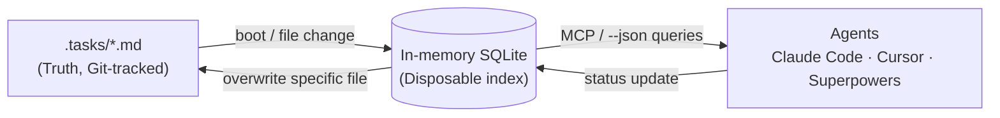

# 🪐 Orbit — Brainstorming Session

> Raw brainstorming session (Gemini) that took the project from *"which issue tracker should I use with mattpocock-skills?"* to *"let's build our own: **Orbit**, a Rust, AI-native, local issue tracker."*
>
> Source conversation: <https://gemini.google.com/app/0f445e8ce5f375fc>

## 📑 Table of Contents

1. [AI Agent Issue Trackers Ranked](#1-ai-agent-issue-trackers-ranked)
2. [Port Beans to Rust?](#2-port-beans-to-rust)
3. [Deep Review of `hmans/beans`](#3-deep-review-of-hmansbeans)
4. [Recreate from Scratch — Rust or Go?](#4-recreate-from-scratch--rust-or-go)
5. [Rust Architecture Draft](#5-rust-architecture-draft)
6. [Cycle Detection & Unblocked Filtering (`petgraph`)](#6-cycle-detection--unblocked-filtering-petgraph)
7. [OS-Level File Locking (`fs3`)](#7-os-level-file-locking-fs3)
8. [Custom Files vs SQLite](#8-custom-files-vs-sqlite)
9. [Ephemeral SQLite Cache (`rusqlite`)](#9-ephemeral-sqlite-cache-rusqlite)
10. [Auto-Rebuilding the Cache (`notify`)](#10-auto-rebuilding-the-cache-notify)
11. [Strict JSON CLI (`clap`)](#11-strict-json-cli-clap)
12. [Cursor `.mdc` Rules Generator](#12-cursor-mdc-rules-generator)
13. [Distribution with `cargo-dist`](#13-distribution-with-cargo-dist)
14. [Publishing to npm](#14-publishing-to-npm)
15. [Wiring up `/setup-matt-pocock-skills`](#15-wiring-up-setup-matt-pocock-skills)
16. [`orbit add`](#16-orbit-add)
17. [`orbit transition`](#17-orbit-transition)
18. [`orbit depend`](#18-orbit-depend)
19. [`orbit delete`](#19-orbit-delete)
20. [Naming: "Orbit"](#20-naming-orbit)
21. [Consolidated Spec](#21-consolidated-spec)
22. [Project Description, Goal & Pitch](#22-project-description-goal--pitch)

---

## 1. AI Agent Issue Trackers Ranked

**🧑 Prompt:** Evaluate and rank the top free issue trackers for AI agents. Assume use with `mattpocock-skills`. Use the latest version of all tools. Score, rank, and reason. Include all trackers natively offered by mattpocock-skills plus **pebble**, **beads**, **beans**, and any other good fit.

**🤖 Answer:** **Beans** is the top choice for an AI-native tracker alongside mattpocock-skills — best balance of local execution, agent-friendly API access, and zero-friction setup.

### Rankings

| Rank | Tracker | Score | Agent capability | Setup in mattpocock-skills | Best for |
|:----:|---------|:-----:|------------------|----------------------------|----------|
| 🥇 1 | **Beans** | 9.5/10 | High (GraphQL, CLI) | "Other" (custom config) | Offline-first, token-efficient querying |
| 🥈 2 | **Beads** | 9.0/10 | High (Dolt-backed graph) | "Other" (custom config) | Complex dependency graphs |
| 🥉 3 | **GitHub Issues** | 8.5/10 | Medium (`gh` CLI) | Native | Standard remote collaboration |
| 4 | **Local Markdown** | 8.0/10 | Basic (text search) | Native | Absolute simplicity |
| 5 | **GitLab Issues** | 7.5/10 | Medium (`glab` CLI) | Native | GitLab-hosted projects |
| 6 | **Pebble** | 2.0/10 | N/A | N/A | Business workflow reporting |

### 1️⃣ Beans — 9.5/10

MIT-licensed CLI issue tracker built for humans *and* coding agents. Stores tasks as plain Markdown in `.beans/`, fully version-controllable.

- **Why #1:** a built-in **GraphQL query engine** lets the AI fetch exactly the context it needs (low token usage) instead of searching messy markdown plans.
- Single Go binary — drops into rapid MVP workflows with no infrastructure.
- Native OpenCode plugin injects task context into active coding sessions.
- **Integration:** run `/setup-matt-pocock-skills`, select **"Other"**, and tell the agent to use the `beans` CLI.

### 2️⃣ Beads — 9.0/10

Distributed graph issue tracker for AI agents, powered by **Dolt** (a Git-versioned SQL database).

- **Why #2:** replaces flat markdown plans with a dependency-aware task graph — hash IDs and *ready-work detection*. Structurally prevents agents from pulling blocked tasks.
- **Integration:** referenced in the mattpocock-skills docs as tested under "Other". Requires installing Dolt (slightly more overhead than Beans).

### 3️⃣ GitHub Issues — 8.5/10

The standard remote tracker for the developer ecosystem.

- Uses the `gh` CLI; universally understood by LLMs and highly reliable.
- Lacks the specialised local graph structures of Beads/Beans.
- **Integration:** out-of-the-box; the setup skill binds the agent to `gh`.

### 4️⃣ Local Markdown (`.scratch/`) — 8.0/10

The built-in offline fallback of mattpocock-skills.

- Basic text files in `.scratch/`; zero external dependencies (not even a git remote).
- **Integration:** native. Great for prototyping; lacks Beans' query-ability and Beads' dependency mapping at scale.

### 5️⃣ GitLab Issues — 7.5/10

Functionally identical to GitHub Issues but uses `glab`. Ranked lower only because of a smaller CLI extension ecosystem; perfect if your remote lives there.

### 6️⃣ Pebble — 2.0/10

A business reporting / drafting / data-reconciliation tool for cross-functional corporate teams — **not** a CLI issue tracker for coding agents.

- Has MCP server logging and integrates with SharePoint/CRM data, but automates KPIs and emails, not TDD loops.
- **Wrong tool entirely** for a test-driven code execution loop.

### Setting up your choice

```rust
/setup-matt-pocock-skills
```

When prompted for the issue tracker, skip the native options and provide a short paragraph describing how the tool's CLI works. The agent records it in `docs/agents/issue-tracker.md`, so downstream skills (`to-spec`, `to-issues`, …) run against the chosen tracker.

### Sources

- hmans/beans — A CLI-based, flat-file issue tracker for humans and agents
- The `/setup-matt-pocock-skills` Skill — AI Hero
- Beads — Graph Issue Tracker for AI Coding Agents — AI/TLDR
- Pebble

---

## 2. Port Beans to Rust?

**🧑 Prompt:** Do you see any benefit of porting Beans to Rust?

**🤖 Answer:** A few distinct technical advantages — but the real-world ROI depends on the deployment target.

| Benefit | Detail |
|---------|--------|
| **WebAssembly portability** | Biggest functional unlock. Runs client-side in browser IDEs (VS Code Web) or edge environments; Rust compiles to Wasm far more cleanly and smaller than Go. |
| **Zero GC for local AI contexts** | Local LLMs already devour RAM. Rust's footprint is virtually invisible next to Go's GC runtime. |
| **Strict state management** | ADTs (enums) + pattern matching are ideal for parsing `.beans/` markdown and enforcing state machines (e.g. *a `Blocked` task can't jump straight to `Done`*). |

> **⚖️ Pragmatic verdict:** Go already ships statically linked binaries that run in milliseconds — the bottleneck for a file-backed tracker is **disk I/O, not CPU**. Port only if you want to embed in a Wasm editor or couple tightly to a Rust-native AI toolchain. For plain local CLI use, Go is fast enough, and rewriting working infrastructure is a distraction from shipping product.

---

## 3. Deep Review of `hmans/beans`

**🧑 Prompt:** Run a deep review on <https://github.com/hmans/beans> and list by priority what could improve: (1) robustness & efficiency; (2) working with Claude Code, Codex, Cursor and OpenCode v2; (3) working smoothly with mattpocock-skills and superpowers (obra); (4) easy install on macOS, Windows, Linux.

**🤖 Answer — prioritised roadmap:**

### 🔴 Priority: High — Robustness & efficiency

Flat Markdown in `.beans/` is great for VCS but a bottleneck for autonomous systems.

- **Concurrency & file locking** — fast agents updating status simultaneously can race and corrupt Markdown frontmatter.
  *Improvement:* strict file-level locking (`flock`) on `.beans` during writes.
- **Query-engine caching** — the GraphQL engine likely parses the whole directory to resolve relationships; disk I/O grows with project size.
  *Improvement:* `fsnotify` watcher + in-memory (or embedded SQLite WAL) cache of the dependency graph.

### 🚨 Priority: Critical — Agent compatibility (Claude Code, Codex, Cursor, OpenCode v2)

The repo relies on a basic OpenCode plugin (`beans-prime.ts`) and manual prompting, wasting context tokens on CLI mechanics.

- **Cursor & OpenCode v2 (`.mdc` rules)** — add `beans init --agents` generating `.cursor/rules/beans.mdc` that defines the frontmatter schema, structural rules and CLI commands, preventing hallucinated task dependencies.
- **Claude Code & Codex (MCP)** — shelling out via `beans prime` is inefficient. Embed an **MCP server** in the binary (`beans mcp-start`) exposing native tools such as `get_ready_beans` / `transition_status`.

### 🟡 Priority: Medium — mattpocock-skills & superpowers (obra)

- **Superpowers (obra):** the TUI/styled output breaks when piped between autonomous steps. Enforce a global `--json` flag (`beans list --json`) so Superpowers gets structured data instead of human strings.
- **mattpocock-skills:** skills expect `gh` or `.scratch/` conventions. Add `beans bridge --pocock` to append operational instructions to `docs/agents/issue-tracker.md` so `to-spec` / `to-issues` map into `.beans/` files.

### 🟡 Priority: Medium — Installation on Mac / Windows / Linux

Currently leans on `brew`, manual releases, or `go install` — friction on Windows.

- **Automated cross-platform distribution:** GoReleaser via GitHub Actions → zero-dependency binaries on every tag.
- **Frictionless installers:**
  - Mac/Linux: `curl -sSL https://beans.dev/install.sh | bash`
  - Windows: PowerShell one-liner, or register with `winget` / Scoop.
- **npm wrapper:** `npx @hmans/beans` runs anywhere Node exists, with no PATH changes.

---

## 4. Recreate from Scratch — Rust or Go?

**🧑 Prompt:** Beans isn't under my watch — should I recreate it from scratch? If so, Rust or Go?

**🤖 Answer:** Recreating it under the **Apoema Studio** umbrella is strategic. When all velocity relies on agentic workflows (Cursor Pro, Claude Code, Superpowers), you can't wait on upstream PR approvals for an embedded MCP server or strict JSON output. Forking an MIT project is fine, but owning the core infra gives full freedom.

The choice: *immediate deployment* vs *long-term architectural leverage*.

| | 🐹 Go — the velocity play | 🦀 Rust — the AI & edge play |
|---|---|---|
| **Time to market** | Original is already Go → direct reference. Core + `--json` + MCP server in a weekend. | Longer build, bigger payoff. |
| **Distribution** | GoReleaser → static binaries for Mac/Win/Linux via GitHub Actions. | `cargo-dist` (see [§13](#13-distribution-with-cargo-dist)). |
| **Memory** | GC adds slight overhead — not ideal next to heavy local LLMs. | **Zero GC**, runs nearly invisibly. |
| **State machines** | Possible. | Enums + pattern matching → compile-time rules (*can't move `Blocked` → `Done` without resolving deps*). |
| **Future** | — | Wasm & mobile readiness; same core logic in a Flutter Web dashboard; could evolve into a micro-SaaS. |

> **Verdict:** need it integrated *now* → **Go**. Want an indestructible, zero-overhead tool that scales into web/mobile → **Rust** (extra time).
> *(Decision taken later in the session: **Rust**.)*

---

## 5. Rust Architecture Draft

**🧑 Prompt:** Draft a Rust architecture for a local CLI issue tracker with an embedded MCP server.

**🤖 Answer:** AI-optimised: minimal memory overhead, structurally enforced dependencies, native interfaces for Claude Code, Cursor, and Superpowers.

### 5.1 Crate structure (Cargo workspace)

| Crate | Responsibility |
|-------|----------------|
| `core` | Domain logic, markdown parsing, state machines |
| `cli` | `clap` terminal input + strict JSON formatting |
| `mcp` | JSON-RPC Model Context Protocol over stdio |

### 5.2 Core domain & state management

Algebraic data types make invalid transitions unrepresentable.

```rust
// core/src/models.rs
use serde::{Deserialize, Serialize};

#[derive(Debug, Clone, Serialize, Deserialize, PartialEq, Eq)]
#[serde(rename_all = "lowercase")]
pub enum TaskState {
    Todo,
    InProgress,
    Blocked,
    Done,
}

#[derive(Debug, Serialize, Deserialize)]
pub struct TaskFrontmatter {
    pub id: String,
    pub title: String,
    pub state: TaskState,
    pub depends_on: Vec<String>,
}
```

Use **`petgraph`** to build an in-memory DAG of `.tasks/`. When an agent tries to move a task to `Done`, the engine traverses the graph; if any node in `depends_on` isn't `TaskState::Done`, core returns a typed `Error::TaskBlocked`, fed back to the LLM.

### 5.3 Concurrency & file I/O

- **File locking:** `fs3` or `fd-lock`. Every write takes an exclusive OS-level lock — if Claude Code and a background script write in the same millisecond, one safely waits.
- **Parsing:** `pulldown-cmark` for the body, `serde_yaml` for the YAML frontmatter.

### 5.4 MCP server layer (stdio)

Claude Code talks MCP (JSON-RPC 2.0 over stdin/stdout) to use tools natively instead of hallucinating bash.

```rust
// mcp/src/server.rs
use tokio::io::{stdin, stdout, AsyncBufReadExt, BufReader};

pub async fn run_mcp_server() {
    let mut reader = BufReader::new(stdin()).lines();

    // The event loop that Claude Code talks to natively
    while let Ok(Some(line)) = reader.next_line().await {
        let request: McpRequest = serde_json::from_str(&line).unwrap();

        let response = match request.method.as_str() {
            "get_ready_tasks" => handle_get_ready_tasks(),
            "transition_task" => handle_transition(request.params),
            _ => build_method_not_found(),
        };

        // Output back to stdout for Claude Code to read
        println!("{}", serde_json::to_string(&response).unwrap());
    }
}
```

**Tools to expose:** `list_unblocked_tasks`, `read_task_details(id)`, `update_status(id, state)`.

### 5.5 CLI & agent scaffolding

- **Strict JSON output** for Superpowers: global `tracker list --json` suppresses logging and emits a clean JSON array.
- **Zero-friction scaffolding:** `tracker init --agents` generates `.cursor/rules/tracker.mdc`, telling Cursor how the tracker works, the frontmatter schema, and forbidding hallucinated task IDs.

### 5.6 Distribution

`cargo-dist` or a GitHub Actions pipeline: on each release tag, compile static binaries for all targets and generate install scripts (PowerShell / shell) — no Rust required on user machines.

---

## 6. Cycle Detection & Unblocked Filtering (`petgraph`)

**🧑 Prompt:** Show how to implement cycle detection and unblocked task filtering using `petgraph`.

**🤖 Answer:** Map markdown tasks into a `DiGraph`. Nodes = tasks; a directed edge **A → B** means *"A depends on B"*. Keep a `HashMap<String, NodeIndex>` to translate task IDs.

```rust
use petgraph::graph::{DiGraph, NodeIndex};
use petgraph::algo::is_cyclic_directed;
use std::collections::HashMap;

#[derive(Debug, Clone, PartialEq, Eq)]
pub enum TaskState {
    Todo,
    InProgress,
    Blocked,
    Done,
}

#[derive(Debug, Clone)]
pub struct Task {
    pub id: String,
    pub title: String,
    pub state: TaskState,
}

pub struct TaskGraph {
    // The directed graph holding the tasks
    graph: DiGraph<Task, ()>,
    // Maps task IDs (e.g., "TASK-123") to their NodeIndex in the graph
    node_map: HashMap<String, NodeIndex>,
}

impl TaskGraph {
    pub fn new() -> Self {
        Self {
            graph: DiGraph::new(),
            node_map: HashMap::new(),
        }
    }

    /// Adds a task to the graph and stores its index
    pub fn add_task(&mut self, task: Task) {
        let id = task.id.clone();
        let idx = self.graph.add_node(task);
        self.node_map.insert(id, idx);
    }

    /// Creates a directed edge: from_task -> depends_on_task
    pub fn add_dependency(&mut self, task_id: &str, depends_on_id: &str) -> Result<(), String> {
        let task_idx = self.node_map.get(task_id).ok_or("Task not found")?;
        let dep_idx = self.node_map.get(depends_on_id).ok_or("Dependency not found")?;

        self.graph.add_edge(*task_idx, *dep_idx, ());
        Ok(())
    }

    /// Returns true if the agent created a circular dependency
    pub fn has_cycles(&self) -> bool {
        is_cyclic_directed(&self.graph)
    }

    /// Returns all tasks that are ready to be worked on
    pub fn get_unblocked_tasks(&self) -> Vec<Task> {
        let mut unblocked = Vec::new();

        for node_idx in self.graph.node_indices() {
            let task = &self.graph[node_idx];

            // Skip tasks that are already completed
            if task.state == TaskState::Done {
                continue;
            }

            // .neighbors() on a directed graph follows OUTGOING edges.
            // Edges are Task -> Dependency, so this iterates over everything the task depends on.
            let mut is_blocked = false;
            for dependency_idx in self.graph.neighbors(node_idx) {
                let dependency_task = &self.graph[dependency_idx];

                if dependency_task.state != TaskState::Done {
                    is_blocked = true;
                    break;
                }
            }

            if !is_blocked {
                unblocked.push(task.clone());
            }
        }

        unblocked
    }
}
```

### How it protects the autonomous loop

- **Cycle detection (`has_cycles`)** — when an agent edits `depends_on: ["TASK-2"]`, rebuild the graph in memory and run `is_cyclic_directed()` *before* writing or returning success. On `true`, reject with a structured error so the model corrects itself instead of corrupting state.
- **Unblocked filtering (`get_unblocked_tasks`)** — Superpowers/OpenCode asking *"what next?"* never reads every markdown file. `.neighbors()` walks only outgoing edges; if all are `Done`, the task enters the queue.

✅ Agents only spend tokens on tasks they can actually execute → far less context bloat in long sessions.

---

## 7. OS-Level File Locking (`fs3`)

**🧑 Prompt:** Show how to implement OS-level file locking in Rust so agents can't overwrite each other.

**🤖 Answer:** Autonomous agents loop fast; a Claude Code MCP call and a background Superpowers script transitioning the same task concurrently would corrupt frontmatter. Use **advisory OS-level locks** via `fs3` (an extension trait on `std::fs::File`) — and use the **non-blocking** `try_lock_exclusive` so the LLM gets an immediate error and can retry instead of hanging.

```rust
use std::fs::OpenOptions;
use std::io::{Read, Write, Seek, SeekFrom};
use fs3::FileExt; // Brings in the locking methods

pub fn transition_task_state(file_path: &str, new_state: &str) -> Result<(), String> {
    // 1. Open the file for both reading and writing
    let mut file = OpenOptions::new()
        .read(true)
        .write(true)
        .open(file_path)
        .map_err(|e| format!("Failed to open task file: {}", e))?;

    // 2. Acquire a non-blocking exclusive lock
    // If another agent is modifying this file, fail instantly instead of freezing the loop.
    if let Err(_) = file.try_lock_exclusive() {
        return Err("RESOURCE_BUSY: Another agent is modifying this task. Try again in a moment.".to_string());
    }

    // 3. Read the file contents securely while locked
    let mut contents = String::new();
    file.read_to_string(&mut contents)
        .map_err(|e| format!("Failed to read file: {}", e))?;

    // ... (parse the markdown, validate state changes via petgraph) ...
    let updated_contents = update_frontmatter_state(&contents, new_state);

    // 4. Overwrite the file completely
    // Truncate in case the new content is shorter than the old content
    file.set_len(0).map_err(|e| e.to_string())?;
    file.seek(SeekFrom::Start(0)).map_err(|e| e.to_string())?;
    file.write_all(updated_contents.as_bytes())
        .map_err(|e| format!("Failed to write file: {}", e))?;

    // 5. Explicitly unlock (also released automatically when `file` drops)
    let _ = file.unlock();

    Ok(())
}

fn update_frontmatter_state(contents: &str, new_state: &str) -> String {
    // Basic placeholder for frontmatter manipulation
    contents.replace("state: todo", &format!("state: {}", new_state))
}
```

### Why this works for AI

| Property | Explanation |
|----------|-------------|
| **Atomic updates** | Between `try_lock_exclusive()` and `unlock()` the file belongs to one process; a concurrent Cursor write bounces instantly. |
| **Fail-fast** | Models handle explicit errors far better than timeouts. A structured `RESOURCE_BUSY` lets Claude Code retry or switch to another unblocked task. |
| **Cross-platform** | `fs3` maps to `flock(2)` on Unix/macOS and `LockFile` on Windows — no conditional compilation. |

### Sources

- `fs3` — crates.io

---

## 8. Custom Files vs SQLite

**🧑 Prompt:** Is it better to use a custom file or SQLite?

**🤖 Answer:** The most critical architectural decision. The community is split between **"Markdown-as-Truth"** (original Beans) and **"SQLite-as-Memory"** (Beads, AgentDB).

### 8.1 Custom files (Markdown + YAML frontmatter)

One `.md` per task in `.tasks/`, YAML frontmatter for metadata (status, dependencies).

| ✅ Pros | ❌ Cons |
|---------|---------|
| **Git-native** — branch, diff, merge tasks like code | **Token bloat** — finding unblocked tasks means parsing dozens of files |
| **Tool-agnostic** — editable in VS Code/NeoVim if the CLI breaks | **Concurrency nightmares** — needs strict OS file locking (`fs3`) |
| **Zero setup** — Cursor/Claude Code natively read/write files | **Slow graph traversal** — whole directory re-parsed each run |

**Verdict:** great for humans and Git, terrible for agent efficiency at scale.

### 8.2 SQLite (structured engine)

One `tracker.db`, accessed only via the CLI or embedded MCP server.

| ✅ Pros | ❌ Cons |
|---------|---------|
| **Bulletproof state** — ACID + WAL, no file locking | **Git-hostile** — binary; no `git diff`; merge conflicts corrupt the file |
| **Zero token waste** — precise SQL over MCP (`SELECT * FROM tasks WHERE status='todo' AND blocked=false`) | **High friction** — a hallucinated command can't be fixed by opening the file in an editor |
| **Instant graph** — cycle/unblocked queries in microseconds | **Portability** — ship a DB engine (even embedded `rusqlite`), slight binary bloat |

**Verdict:** incredible for agent velocity/memory, a nightmare for Git collaboration.

### 8.3 ⭐ Recommendation: the "Disposable Index" hybrid

Used by tools like Aver and Beads: **Markdown as truth, SQLite as disposable cache.**



1. **Storage (truth):** flat Markdown in `.tasks/*.md` — beautiful Git history, fallback if everything breaks.
2. **Indexing (speed):** on CLI run / MCP boot, read the directory and build an in-memory SQLite (`rusqlite::Connection::open_in_memory()`) or a `petgraph` cache.
3. **Execution (agents):** Claude Code and Superpowers query the cache via MCP for instant, token-efficient answers.
4. **Writing:** on status update, core updates the cache and overwrites the specific Markdown file.

✅ Uncorruptible, queryable speed of SQLite for the AI + Git-native, human-readable simplicity of files.

### Sources

- *Stop Writing Markdown. Start Writing Memory.* — Aria Han (Medium)
- *Beads — Memory for your Agent and The Best Damn Issue Tracker*
- *I built a Git-native, Markdown-first knowledge tracker to escape SaaS*

---

## 9. Ephemeral SQLite Cache (`rusqlite`)

**🧑 Prompt:** Show how to use `rusqlite` to build an ephemeral in-memory cache from markdown files.

**🤖 Answer:** Parse frontmatter, build the DB in RAM, run one relational query to find unblocked work. Uses `rusqlite` v0.40.2.

### 9.1 Dependencies

```rust
[dependencies]
rusqlite = "0.40.2"
serde = { version = "1.0", features = ["derive"] }
serde_yaml = "0.9"
walkdir = "2.5"
```

### 9.2 Cache implementation

YAML dependencies become a relational join; a `NOT EXISTS` query filters blocked tasks natively (replacing manual graph traversal).

```rust
use rusqlite::{params, Connection, Result};
use serde::Deserialize;
use std::fs;
use walkdir::WalkDir;

#[derive(Deserialize, Debug)]
struct TaskFrontmatter {
    id: String,
    title: String,
    state: String,
    #[serde(default)]
    depends_on: Vec<String>,
}

pub fn get_unblocked_tasks_from_cache() -> Result<Vec<String>> {
    // 1. Initialize the ephemeral SQLite instance in RAM
    let conn = Connection::open_in_memory()?;

    // 2. Build the relational schema
    conn.execute_batch(
        "CREATE TABLE tasks (
            id TEXT PRIMARY KEY,
            title TEXT NOT NULL,
            state TEXT NOT NULL
        );
        CREATE TABLE task_dependencies (
            task_id TEXT NOT NULL,
            depends_on_id TEXT NOT NULL,
            PRIMARY KEY (task_id, depends_on_id)
        );"
    )?;

    // 3. Parse Markdown and seed the cache
    for entry in WalkDir::new(".tasks").into_iter().filter_map(|e| e.ok()) {
        if entry.path().extension().unwrap_or_default() == "md" {
            let content = fs::read_to_string(entry.path()).expect("Failed to read task file");

            // Extract the YAML block (between `---` tags at the top)
            if let Some(yaml_str) = extract_frontmatter(&content) {
                let fm: TaskFrontmatter = serde_yaml::from_str(yaml_str).unwrap();

                // Insert the primary task
                conn.execute(
                    "INSERT INTO tasks (id, title, state) VALUES (?1, ?2, ?3)",
                    params![fm.id, fm.title, fm.state],
                )?;

                // Insert all dependencies as individual rows for the join
                for dep in fm.depends_on {
                    conn.execute(
                        "INSERT INTO task_dependencies (task_id, depends_on_id) VALUES (?1, ?2)",
                        params![fm.id, dep],
                    )?;
                }
            }
        }
    }

    // 4. The execution query:
    // tasks that are not done, where ALL dependencies ARE done.
    let mut stmt = conn.prepare(
        "SELECT t.id
         FROM tasks t
         WHERE t.state != 'done'
         AND NOT EXISTS (
             SELECT 1
             FROM task_dependencies d
             JOIN tasks dep ON d.depends_on_id = dep.id
             WHERE d.task_id = t.id
             AND dep.state != 'done'
         )"
    )?;

    let unblocked_iter = stmt.query_map([], |row| row.get::<_, String>(0))?;
    let mut unblocked = Vec::new();

    for id in unblocked_iter {
        unblocked.push(id?);
    }

    Ok(unblocked)
}

fn extract_frontmatter(content: &str) -> Option<&str> {
    let parts: Vec<&str> = content.split("---").collect();
    if parts.len() >= 3 {
        Some(parts[1])
    } else {
        None
    }
}
```

Pushing dependency validation down to SQLite's C layer (instead of walking a graph in Rust) lets the CLI ingest hundreds of files and return actionable tasks in microseconds — no parsing bloat in the agent's context.

---

## 10. Auto-Rebuilding the Cache (`notify`)

**🧑 Prompt:** How do I use `notify` to automatically rebuild the SQLite cache when a file changes on disk?

**🤖 Answer:** Keep the cache synced with `.tasks/` via a background async watcher. Editors save with bursts of events (create, write, truncate, modify), so a raw watcher would trigger dozens of rebuilds per second — solved with **`notify-debouncer-mini`**, which collapses them into one notification.

### 10.1 Dependencies

```rust
[dependencies]
notify = "6.1"
notify-debouncer-mini = "0.4"
tokio = { version = "1.35", features = ["full"] }
rusqlite = "0.40.2"
# ... (walkdir, serde, etc. from previous steps)
```

### 10.2 Shared-state architecture

Tokio runs several async tasks and `rusqlite::Connection` must be mutated, so wrap it in `Arc<Mutex<Connection>>` — shared by the MCP server (reads) and the watcher (writes).

```rust
use notify_debouncer_mini::{new_debouncer, notify::RecursiveMode, DebouncedEvent};
use rusqlite::Connection;
use std::path::Path;
use std::sync::{Arc, Mutex};
use std::time::Duration;
use tokio::sync::mpsc;

// 1. Drop and rebuild the tables in the existing connection
pub fn rebuild_cache_in_place(conn: &mut Connection) {
    conn.execute_batch(
        "DROP TABLE IF EXISTS task_dependencies;
         DROP TABLE IF EXISTS tasks;
         CREATE TABLE tasks (id TEXT PRIMARY KEY, title TEXT NOT NULL, state TEXT NOT NULL);
         CREATE TABLE task_dependencies (task_id TEXT NOT NULL, depends_on_id TEXT NOT NULL, PRIMARY KEY (task_id, depends_on_id));"
    ).unwrap();

    // ... (Insert WalkDir parsing logic from the previous SQLite step here) ...
}

// 2. The async file watcher loop
pub fn start_cache_watcher(shared_conn: Arc<Mutex<Connection>>) {
    // Unbounded channel: sync debouncer -> async Tokio loop
    let (tx, mut rx) = mpsc::unbounded_channel();

    // 250ms window: 10 VS Code save events inside 250ms become 1 event.
    let mut debouncer = new_debouncer(Duration::from_millis(250), move |res: Result<Vec<DebouncedEvent>, _>| {
        if let Ok(events) = res {
            let _ = tx.send(events);
        }
    }).unwrap();

    // Watch the .tasks directory recursively
    debouncer
        .watcher()
        .watch(Path::new(".tasks"), RecursiveMode::Recursive)
        .unwrap();

    // Spawn the background Tokio task
    tokio::spawn(async move {
        // Move the debouncer in so it doesn't drop and stop watching
        let _d = debouncer;

        while let Some(events) = rx.recv().await {
            // Were any modified files actually Markdown tasks?
            let has_md_change = events.iter().any(|e| {
                e.path.extension().map_or(false, |ext| ext == "md")
            });

            if has_md_change {
                // Blocks the MCP server for a fraction of a millisecond while rebuilding
                let mut conn = shared_conn.lock().unwrap();
                rebuild_cache_in_place(&mut conn);
                println!("[Watcher] Detected file change. SQLite cache rebuilt.");
            }
        }
    });
}
```

### 10.3 Wiring in `main.rs`

Initialise the memory DB once, spawn the watcher, then boot the MCP server.

```rust
#[tokio::main]
async fn main() {
    // 1. Initialize the in-memory SQLite database
    let mut conn = Connection::open_in_memory().unwrap();
    rebuild_cache_in_place(&mut conn); // Initial hydration

    // 2. Wrap it for thread-safe shared access
    let shared_conn = Arc::new(Mutex::new(conn));

    // 3. Boot the background file watcher
    start_cache_watcher(shared_conn.clone());

    // 4. Start the MCP server, passing it the shared connection
    // (Update run_mcp_server to accept `shared_conn`)
    run_mcp_server(shared_conn).await;
}
```

> **🔁 How this elevates the agent loop:** if Claude Code edits a file via bash (`echo "state: done" > .tasks/TASK-1.md`) instead of the MCP tool, the watcher catches it within 250 ms, locks SQLite and rebuilds the graph. The next `get_unblocked_tasks` from Superpowers or Cursor gets up-to-date state — no stale-cache bugs.

---

## 11. Strict JSON CLI (`clap`)

**🧑 Prompt:** Show how to structure the CLI with `clap` to enforce strict JSON output for Superpowers (obra).

**🤖 Answer:** **Golden Rule of Agent CLIs:** *if `--json` is passed, stdout must contain nothing but the valid JSON payload.* One stray `println!("Loading tasks...")` crashes the LLM's parsing and breaks the loop.

### 11.1 Dependencies

```rust
[dependencies]
clap = { version = "4.4", features = ["derive"] }
serde = { version = "1.0", features = ["derive"] }
serde_json = "1.0"
```

### 11.2 CLI structure

A `global = true` flag on the top-level `Cli` makes `--json` available on every subcommand.

```rust
use clap::{Parser, Subcommand};
use serde::Serialize;
use std::process::exit;

// 1. Top-Level CLI Struct
#[derive(Parser)]
#[command(name = "beans")]
#[command(about = "An AI-native issue tracker for autonomous workflows", long_about = None)]
struct Cli {
    /// Output strictly in JSON format for autonomous agents (Superpowers/Cursor)
    #[arg(global = true, long)]
    json: bool,

    #[command(subcommand)]
    command: Commands,
}

// 2. Subcommands
#[derive(Subcommand)]
enum Commands {
    /// Lists all unblocked tasks
    List,
    /// Adds a new task
    Add { title: String },
    /// Transitions a task's state
    Transition { id: String, state: String },
}

// 3. Domain objects (must derive Serialize for JSON output)
#[derive(Serialize)]
struct Task {
    id: String,
    title: String,
    state: String,
}

#[derive(Serialize)]
struct CommandResult<T> {
    success: bool,
    data: Option<T>,
    error: Option<String>,
}
```

### 11.3 The output-router pattern

Route **all** output through one central manager so nobody accidentally writes non-JSON to stdout.

```rust
// 4. Central Output Router
fn output_result<T: Serialize>(is_json: bool, data: &T, human_formatter: impl Fn(&T) -> String) {
    if is_json {
        // Strict JSON to stdout. If serialization fails, report on stderr.
        match serde_json::to_string(data) {
            Ok(json_str) => println!("{}", json_str),
            Err(e) => {
                eprintln!(r#"{{"success":false,"error":"Serialization failed: {}"}}"#, e);
                exit(1);
            }
        }
    } else {
        // Human-readable output to stdout
        println!("{}", human_formatter(data));
    }
}

// ALL logging/debugging goes to STDERR, never STDOUT
macro_rules! log_info {
    ($is_json:expr, $($arg:tt)*) => {
        if !$is_json {
            eprintln!($($arg)*); // stderr, so it doesn't pollute piped JSON
        }
    };
}
```

### 11.4 Wiring `main`

`log_info!` sends progress to stderr for humans and stays silent when Superpowers passes `--json`.

```rust
fn main() {
    let cli = Cli::parse();

    match &cli.command {
        Commands::List => {
            log_info!(cli.json, "Scanning .tasks directory...");

            // Call your SQLite/petgraph logic here
            let unblocked_tasks = vec![
                Task { id: "TASK-1".into(), title: "Build CLI Router".into(), state: "todo".into() }
            ];

            let result = CommandResult {
                success: true,
                data: Some(unblocked_tasks),
                error: None,
            };

            output_result(cli.json, &result, |res| {
                // Formatting logic for humans
                let mut output = String::from("Unblocked Tasks:\n");
                for t in res.data.as_ref().unwrap() {
                    output.push_str(&format!(" - [{}] {}\n", t.id, t.title));
                }
                output
            });
        }
        Commands::Add { title } => {
            log_info!(cli.json, "Adding new task: {}", title);
            // ... implementation
        }
        Commands::Transition { id, state } => {
            // ... implementation
        }
    }
}
```

### Why this wins for Apoema Studio

- **Bulletproof pipelines** — `beans list --json | jq '.'` never chokes: `serde_json` serialisation + logs on stderr.
- **Minimal friction** — `global = true` means future subcommands inherit `--json`.
- **Structured errors** — `CommandResult { success, data, error }` tells the agent exactly where to look, eliminating hallucinated follow-ups.

---

## 12. Cursor `.mdc` Rules Generator

**🧑 Prompt:** Draft the Rust code and template for generating `.cursor/rules/tracker.mdc`.

**🤖 Answer:** Modern Cursor rules are `.mdc` files in `.cursor/rules/` — YAML-like frontmatter (`description`, `globs`, `alwaysApply`) followed by Markdown instructions. `beans init --agents` scaffolds a precise "constitution" so Cursor doesn't hallucinate bash commands, edit locked files, or bypass graph validation.

### 12.1 Rust generator module

```rust
use std::fs;
use std::path::Path;

pub fn generate_cursor_rules() -> Result<(), String> {
    let rules_dir = Path::new(".cursor/rules");

    // 1. Ensure the rules directory exists
    if !rules_dir.exists() {
        fs::create_dir_all(rules_dir)
            .map_err(|e| format!("Failed to create .cursor/rules directory: {}", e))?;
    }

    let mdc_path = rules_dir.join("beans-tracker.mdc");

    // 2. The .mdc template
    let mdc_content = r#"---
description: "Rules for interacting with the project's task management and issue tracker"
globs: ["*"]
alwaysApply: false
---
# Issue Tracker (Beans) Guidelines

This project uses a custom local issue tracker (Beans) backed by Markdown files in `.tasks/` and an ephemeral SQLite cache. You must NEVER modify the issue tracking logic or transition task states blindly.

## Core Directives
1. **Fetching Work:** When asked "What should I do next?" or "Find a task", you MUST run the command:
   `beans list --json`
   Parse this JSON to find tasks that are unblocked.

2. **Transitioning Tasks:** When you finish a task, or need to block it, you MUST use the CLI tool to ensure graph integrity and file locking:
   `beans transition <TASK_ID> <new_state>`
   Valid states are: `todo`, `in_progress`, `blocked`, `done`.

3. **Dependency Integrity:** NEVER manually edit the YAML frontmatter of `.tasks/*.md` files to change a task status. Doing so bypasses the cyclic dependency checks and OS-level file locks. Always use the CLI.

4. **Formatting:** If you must read a task's full description, you may read the `.tasks/<TASK_ID>.md` file directly. Pay attention to the markdown body, as it contains the specific acceptance criteria.
"#;

    // 3. Write the file to the workspace
    fs::write(&mdc_path, mdc_content)
        .map_err(|e| format!("Failed to write beans-tracker.mdc: {}", e))?;

    Ok(())
}
```

### 12.2 Wiring into the CLI

```rust
// In the Cli struct definition:
#[derive(Subcommand)]
enum Commands {
    /// Lists all unblocked tasks
    List,
    /// Transitions a task's state
    Transition { id: String, state: String },
    /// Initializes agent scaffolding (.cursor/rules)
    Init {
        #[arg(long, help = "Generates agent configuration files")]
        agents: bool,
    },
}

// In the main match block:
Commands::Init { agents } => {
    if *agents {
        log_info!(cli.json, "Initializing Cursor agent rules...");
        match generate_cursor_rules() {
            Ok(_) => output_result(cli.json, &CommandResult::<String> {
                success: true,
                data: Some("Created .cursor/rules/beans-tracker.mdc".into()),
                error: None,
            }, |res| res.data.clone().unwrap()),
            Err(e) => output_result(cli.json, &CommandResult::<String> {
                success: false,
                data: None,
                error: Some(e),
            }, |res| format!("Error: {}", res.error.as_ref().unwrap())),
        }
    } else {
        log_info!(cli.json, "Run with --agents to scaffold agent files.");
    }
}
```

### Why this format?

- Cursor reads the frontmatter to decide **when** to inject the rule into the system prompt.
- `globs: ["*"]` + `alwaysApply: false` → the rule isn't forced into every chat, but the `description` makes Cursor load it whenever tasks/issues/"what next" come up.
- Enforcing `--json` on reads stops Cursor from misreading human-formatted logs.

### Sources

- Cursor Rules Generator — `.mdc` Format — Design.dev
- Rules — Cursor Docs
- Rules in Cursor (`.mdc`) — The Secret Superpower Behind Its…
- GitHub — `PatrickJS/awesome-cursorrules`

---

## 13. Distribution with `cargo-dist`

**🧑 Prompt:** Show how to configure `cargo-dist` or GoReleaser to distribute these binaries to Mac, Windows and Linux automatically.

**🤖 Answer:** For Rust, **`cargo-dist`** is the gold standard — generates GitHub Actions pipelines, compiled binaries, and zero-friction installers (shell, PowerShell, Homebrew, npm) with no hand-written YAML.

### Step 1 — Install & initialise

```rust
cargo install cargo-dist
cargo dist init
```

Choose in the wizard:

| Prompt | Selection |
|--------|-----------|
| Target platforms | Windows, macOS (Apple Silicon & Intel), Linux |
| Installers | Shell script (Mac/Linux) + PowerShell script (Windows) |
| CI provider | GitHub Actions |

### Step 2 — What it modifies

- **`Cargo.toml`** — appends a `[profile.dist]` section (LTO, stripped debug symbols → max performance, min size).
- **`.github/workflows/release.yml`** — a production-grade matrix cross-compilation workflow.

```rust
git add Cargo.toml .github/
git commit -m "chore: configure cargo-dist for automated releases"
git push origin main
```

### Step 3 — Trigger a release

`cargo-dist` hooks into Git tags:

```rust
git tag v0.1.0
git push origin v0.1.0
```

### Step 4 — Output (zero-friction installers)

In ~3–5 minutes the Release page holds binaries for every OS plus one-liner installers you can drop into `.cursorrules`, the mattpocock-skills setup, or Superpowers init scripts:

```rust
# macOS / Linux
curl --proto '=https' --tlsv1.2 -LsSf https://github.com/apoemastudio/beans/releases/download/v0.1.0/beans-installer.sh | sh
```

```rust
# Windows (PowerShell)
irm https://github.com/apoemastudio/beans/releases/download/v0.1.0/beans-installer.ps1 | iex
```

Standalone static binaries mean neither you nor your agents ever need Rust installed.

---

## 14. Publishing to npm

**🧑 Prompt:** Show how to use `cargo-dist` to publish this Rust binary as an npm package so it installs instantly in Node-based agent workflows.

**🤖 Answer:** An npm wrapper lets users run `npx beans init` with no system packages or curl scripts. `cargo-dist` generates a lightweight JS wrapper that, on `npm install`, detects OS/arch and downloads the matching compiled binary from your GitHub release.

### 14.1 Enable the npm installer

Re-run `cargo dist init` and pick `npm`, or edit `Cargo.toml`:

```rust
[workspace.metadata.dist]
# Add "npm" to your list of installers
installers = ["shell", "powershell", "npm"]
# Optional: npm package scope (e.g., for @apoemastudio/beans)
npm-scope = "@apoemastudio"
```

### 14.2 Configure GitHub Actions

1. Generate a **classic automation token** in your npm account settings.
2. GitHub repo → **Settings → Secrets and variables → Actions**.
3. Create a repository secret named **`NPM_TOKEN`** with the token. (The generated workflow looks for exactly this name.)

### 14.3 Release & publish

```rust
git add Cargo.toml .github/
git commit -m "feat: add npm installer via cargo-dist"
git tag v0.1.1
git push origin v0.1.1
```

The Action compiles binaries, uploads them to the release, generates the `package.json` wrapper, and runs `npm publish`.

### 14.4 Seamless agent execution

```rust
# Agents can execute it directly without installing
npx @apoemastudio/beans list --json

# Or install it globally
npm install -g @apoemastudio/beans
beans init --agents
```

Immediate, zero-friction access for mattpocock-skills, OpenCode, Superpowers — on any OS.

---

## 15. Wiring up `/setup-matt-pocock-skills`

**🧑 Prompt:** Show exactly what paragraph to give `/setup-matt-pocock-skills` to make it use this custom beans CLI.

**🤖 Answer:** Run `/setup-matt-pocock-skills`, select **"Other"** for the issue tracker, and paste this verbatim. It's saved to `docs/agents/issue-tracker.md` and acts as a strict system prompt for all future autonomous loops.

> We use a custom AI-native local issue tracker called Beans. All tasks are stored as Markdown files inside the `.tasks/` directory, utilizing YAML frontmatter for dependency and state metadata. To find actionable, unblocked work, you MUST run `beans list --json` and parse the output. You are strictly forbidden from manually editing the YAML frontmatter to change a task's status, as this bypasses cyclic dependency checks and OS-level file locking. To change a task state, you must exclusively use the CLI command `beans transition <TASK_ID> <state>` (valid states: `todo`, `in_progress`, `blocked`, `done`). To create new tasks, run `beans add "Task Title"`. You may read the `.tasks/*.md` files directly to understand acceptance criteria, but all state mutations must occur via the `beans` CLI.

### Why this phrasing works

| Technique | Effect |
|-----------|--------|
| **"Forbidden" clause** | LLMs love shortcuts; forbidding manual edits forces them to respect `fs3` locks and `petgraph` validation. |
| **JSON mandate** | `--json` stops Superpowers/OpenCode from inventing string-parsing logic that crashes the pipeline. |
| **State enumeration** | Listing exact valid states prevents guesses like `in-review` / `completed` that would break the Rust enums. |

---

## 16. `orbit add`

**🧑 Prompt:** Show how to implement `beans add` in Rust to safely generate new markdown files with correct frontmatter.

**🤖 Answer:** Two guarantees: **collision-free IDs** and **atomic file creation**. If two agents create a task in the same millisecond they must not overwrite each other — use the OS-level `create_new(true)` flag (atomic check-and-create). IDs should be short and readable (`TSK-A7B2`) or timestamp-based.

### 16.1 Implementation

```rust
use std::fs::{self, OpenOptions};
use std::io::Write;
use std::path::Path;
use std::time::{SystemTime, UNIX_EPOCH};

// Generate a simple, readable, collision-resistant ID (e.g., TASK-169833A5)
fn generate_task_id() -> String {
    let timestamp = SystemTime::now()
        .duration_since(UNIX_EPOCH)
        .unwrap()
        .as_secs();

    // Small random hex to prevent sub-second collisions
    let random_hex = format!("{:04X}", rand::random::<u16>());
    format!("TASK-{:X}{}", timestamp % 100000, random_hex)
}

pub fn add_task(title: &str) -> Result<Task, String> {
    // 1. Ensure the .tasks directory exists
    let dir_path = Path::new(".tasks");
    if !dir_path.exists() {
        fs::create_dir_all(dir_path)
            .map_err(|e| format!("Failed to create .tasks directory: {}", e))?;
    }

    let id = generate_task_id();
    let file_path = dir_path.join(format!("{}.md", id));

    // 2. Strict YAML frontmatter template
    let content = format!(
r#"---
id: {}
title: "{}"
state: todo
depends_on: []
---

## Description
<!-- Provide specific acceptance criteria and context below -->
"#,
        id, title
    );

    // 3. Atomic file creation
    // create_new(true) fails instantly if the file exists, preventing race conditions.
    let mut file = OpenOptions::new()
        .write(true)
        .create_new(true)
        .open(&file_path)
        .map_err(|e| format!("Failed to atomically create task file {}: {}", id, e))?;

    // 4. Write the content
    file.write_all(content.as_bytes())
        .map_err(|e| format!("Failed to write to task file: {}", e))?;

    // 5. Return the structured domain object for JSON output
    Ok(Task {
        id,
        title: title.to_string(),
        state: "todo".to_string(),
    })
}
```

> 📦 Add `rand = "0.8"` to `Cargo.toml` for the hex generation.

### 16.2 Wiring into the CLI router

```rust
// Inside the main match block:
Commands::Add { title } => {
    log_info!(cli.json, "Creating new task...");

    match add_task(title) {
        Ok(task) => {
            let result = CommandResult {
                success: true,
                data: Some(task),
                error: None,
            };

            // Output safely based on the --json flag
            output_result(cli.json, &result, |res| {
                let t = res.data.as_ref().unwrap();
                format!("Successfully created [{}] {}", t.id, t.title)
            });
        }
        Err(e) => {
            let result = CommandResult::<Task> {
                success: false,
                data: None,
                error: Some(e),
            };

            output_result(cli.json, &result, |res| {
                format!("Error: {}", res.error.as_ref().unwrap())
            });
            std::process::exit(1);
        }
    }
}
```

### Why this fits the AI workflow

When Claude Code calls `beans add "Setup PostgreSQL" --json`:

1. **Immediate feedback** — outputs `{"success": true, "data": {"id": "TASK-5F9A...", "title": "Setup PostgreSQL", "state": "todo"}}`; the LLM parses the new `id` and knows which file to open for acceptance criteria.
2. **Zero-friction state sync** — the `notify-debouncer-mini` watcher updates the `rusqlite` cache the moment the file is written; the task is queryable without restarting the server.

---

## 17. `orbit transition`

**🧑 Prompt:** Show how to implement `beans transition`, combining `fs3` locks with `petgraph`/SQLite validation.

**🤖 Answer:** Synchronise with the SQLite cache to validate dependencies and use `fs3` to lock the file. If an agent tries to move a task to `done` while dependencies are incomplete, the operation is rejected and the **blocking task IDs are returned to the LLM**.

### 17.1 Implementation

Uses `regex` (add `regex = "1.10"`) to update only the `state:` line without re-serialising YAML and mangling the Markdown.

```rust
use std::fs::OpenOptions;
use std::io::{Read, Seek, SeekFrom, Write};
use std::path::Path;
use fs3::FileExt;
use rusqlite::{params, Connection};
use regex::Regex;

pub fn transition_task(id: &str, new_state: &str, cache_conn: &Connection) -> Result<Task, String> {
    let file_path = format!(".tasks/{}.md", id);
    if !Path::new(&file_path).exists() {
        return Err(format!("NOT_FOUND: Task file {} does not exist.", file_path));
    }

    // 1. Acquire non-blocking OS file lock
    let mut file = OpenOptions::new()
        .read(true)
        .write(true)
        .open(&file_path)
        .map_err(|e| format!("Failed to open file: {}", e))?;

    if file.try_lock_exclusive().is_err() {
        return Err(format!("RESOURCE_BUSY: Another agent is modifying {}. Retry in a moment.", id));
    }

    // 2. Read the file while locked
    let mut contents = String::new();
    file.read_to_string(&mut contents)
        .map_err(|e| format!("Failed to read file: {}", e))?;

    // 3. SQLite dependency validation
    // To complete the task, strictly enforce graph dependencies
    if new_state == "done" {
        let mut stmt = cache_conn.prepare(
            "SELECT d.depends_on_id
             FROM task_dependencies d
             JOIN tasks t ON d.depends_on_id = t.id
             WHERE d.task_id = ?1 AND t.state != 'done'"
        ).map_err(|e| format!("Database error: {}", e))?;

        let blocking_deps: Vec<String> = stmt.query_map(params![id], |row| row.get(0))
            .map_err(|e| format!("Query error: {}", e))?
            .filter_map(Result::ok)
            .collect();

        // 🛑 Hard stop: reject the transition if dependencies are pending
        if !blocking_deps.is_empty() {
            return Err(format!(
                "DEPENDENCY_ERROR: Cannot move {} to 'done'. You must first finish: {:?}",
                id, blocking_deps
            ));
        }
    }

    // 4. Safely update the YAML frontmatter
    // Regex replaces just the state line, preserving comments and markdown structure
    let state_re = Regex::new(r"(?m)^state:\s*.*$").unwrap();
    if !state_re.is_match(&contents) {
        return Err("CORRUPT_FRONTMATTER: Could not locate 'state:' line in YAML.".into());
    }
    let updated_contents = state_re.replace(&contents, format!("state: {}", new_state));

    // 5. Overwrite
    file.set_len(0).map_err(|e| e.to_string())?;
    file.seek(SeekFrom::Start(0)).map_err(|e| e.to_string())?;
    file.write_all(updated_contents.as_bytes())
        .map_err(|e| format!("Failed to write updated file: {}", e))?;

    // The lock is released automatically when `file` drops
    Ok(Task {
        id: id.to_string(),
        title: "Title omitted for brevity".to_string(),
        state: new_state.to_string(),
    })
}
```

### 17.2 Wiring to the command router

Pass the shared SQLite connection into the `transition` branch.

```rust
Commands::Transition { id, state } => {
    log_info!(cli.json, "Transitioning {} to {}...", id, state);

    // Validate the enum state locally before bothering with file locks
    let valid_states = ["todo", "in_progress", "blocked", "done"];
    if !valid_states.contains(&state.as_str()) {
        eprintln!("Error: Invalid state. Must be one of: {:?}", valid_states);
        std::process::exit(1);
    }

    // Pass the active SQLite cache connection to the function
    let db_conn = shared_conn.lock().unwrap();

    match transition_task(id, state, &db_conn) {
        Ok(task) => {
            output_result(cli.json, &CommandResult {
                success: true,
                data: Some(task),
                error: None,
            }, |res| format!("Successfully moved {} to '{}'", res.data.as_ref().unwrap().id, state));
        }
        Err(e) => {
            output_result(cli.json, &CommandResult::<Task> {
                success: false,
                data: None,
                error: Some(e),
            }, |res| format!("{}", res.error.as_ref().unwrap()));
            std::process::exit(1); // Non-zero exit forces the agent to realise it failed
        }
    }
}
```

### Why this guarantees workflow integrity

If an agent hallucinates a sequence (e.g. marking a frontend task `done` before the backend API task), `DEPENDENCY_ERROR` gives exact structured feedback: *"You must first finish: ['TASK-Backend']"*. Claude Code reads the JSON error, pivots to `.tasks/TASK-Backend.md`, and resumes in the correct order.

---

## 18. `orbit depend`

**🧑 Prompt:** Show how to implement a CLI command that safely adds a task dependency (`depends_on`) to a markdown file.

**🤖 Answer:** Adding a dependency is the **most dangerous** agent operation: it risks circular logic (A→B→C→A) which would freeze the autonomous loop forever. `add-dependency` therefore runs a **Recursive CTE** against the SQLite cache to verify no path from B back to A exists *before* taking the file lock and mutating the Markdown.

### 18.1 Cycle check + file mutation

Uses `serde_yaml` to mutate frontmatter safely without corrupting the Markdown body.

```rust
use std::fs::OpenOptions;
use std::io::{Read, Seek, SeekFrom, Write};
use rusqlite::{params, Connection};
use fs3::FileExt;
use serde_yaml::{Mapping, Value};

pub fn add_dependency(
    task_id: &str,
    depends_on_id: &str,
    cache_conn: &Connection,
) -> Result<(), String> {
    if task_id == depends_on_id {
        return Err("CYCLE_DETECTED: A task cannot depend on itself.".into());
    }

    // 1. Prevent circular dependencies via SQLite recursive CTE
    // Is there ALREADY a path from `depends_on_id` back to `task_id`?
    let mut stmt = cache_conn.prepare(
        "WITH RECURSIVE traverse(id) AS (
            SELECT depends_on_id FROM task_dependencies WHERE task_id = ?1
            UNION
            SELECT d.depends_on_id
            FROM task_dependencies d
            JOIN traverse t ON d.task_id = t.id
         )
         SELECT id FROM traverse WHERE id = ?2 LIMIT 1;"
    ).map_err(|e| format!("Database error: {}", e))?;

    let cycle_exists = stmt.exists(params![depends_on_id, task_id])
        .map_err(|e| format!("Query error: {}", e))?;

    if cycle_exists {
        return Err(format!(
            "CYCLE_DETECTED: Adding this dependency creates an infinite loop because {} already depends on {}.",
            depends_on_id, task_id
        ));
    }

    let file_path = format!(".tasks/{}.md", task_id);

    // 2. Acquire non-blocking OS file lock
    let mut file = OpenOptions::new()
        .read(true)
        .write(true)
        .open(&file_path)
        .map_err(|e| format!("NOT_FOUND: Could not open {}.md", task_id))?;

    if file.try_lock_exclusive().is_err() {
        return Err(format!("RESOURCE_BUSY: Another agent is modifying {}. Retry.", task_id));
    }

    // 3. Read and split the file
    let mut contents = String::new();
    file.read_to_string(&mut contents).unwrap();

    let parts: Vec<&str> = contents.splitn(3, "---").collect();
    if parts.len() < 3 {
        return Err("CORRUPT_FRONTMATTER: Invalid markdown file format.".into());
    }

    // 4. Safely mutate the YAML frontmatter
    let mut frontmatter: Mapping = serde_yaml::from_str(parts[1])
        .map_err(|e| format!("YAML parsing error: {}", e))?;

    let depends_on_key = Value::String("depends_on".to_string());

    // Ensure the depends_on array exists and append the new ID
    let deps_array = frontmatter
        .entry(depends_on_key)
        .or_insert(Value::Sequence(vec![]))
        .as_sequence_mut()
        .ok_or("CORRUPT_FRONTMATTER: 'depends_on' is not a list")?;

    let new_dep_val = Value::String(depends_on_id.to_string());
    if !deps_array.contains(&new_dep_val) {
        deps_array.push(new_dep_val);
    }

    let updated_yaml = serde_yaml::to_string(&frontmatter).unwrap();

    // 5. Reassemble and overwrite
    let updated_contents = format!("---\n{}---\n{}", updated_yaml.trim(), parts[2].trim_start());

    file.set_len(0).unwrap();
    file.seek(SeekFrom::Start(0)).unwrap();
    file.write_all(updated_contents.as_bytes()).unwrap();

    Ok(())
}
```

### 18.2 Wiring to the CLI router

```rust
// Inside the Commands enum:
/// Adds a dependency to a task
Depend {
    #[arg(help = "The task that is blocked")]
    task_id: String,
    #[arg(help = "The task that must be completed first")]
    depends_on_id: String
},

// Inside the main match block:
Commands::Depend { task_id, depends_on_id } => {
    log_info!(cli.json, "Linking {} -> {}...", task_id, depends_on_id);

    let db_conn = shared_conn.lock().unwrap();

    match add_dependency(task_id, depends_on_id, &db_conn) {
        Ok(_) => {
            output_result(cli.json, &CommandResult {
                success: true,
                data: Some(format!("{} now depends on {}", task_id, depends_on_id)),
                error: None,
            }, |res| res.data.clone().unwrap());
        }
        Err(e) => {
            output_result(cli.json, &CommandResult::<String> {
                success: false,
                data: None,
                error: Some(e),
            }, |res| res.error.clone().unwrap());
            std::process::exit(1);
        }
    }
}
```

### Why this is critical for velocity

Multi-file refactoring agents often try to optimise their own execution queues by rearranging task order. Enforcing graph validation at the SQLite level **structurally guarantees** an agent can't hallucinate a cyclic workflow that freezes your obra loops — with zero memory overhead.

---

## 19. `orbit delete`

**🧑 Prompt:** Show how to safely implement a command to delete a task and clean up its orphaned dependencies.

**🤖 Answer:** Deletion is a **two-phase** operation. If `TASK-B` depends on `TASK-A` and you just delete `TASK-A.md`, the next cache rebuild leaves `TASK-B` waiting on a ghost dependency — permanently blocked. Use the SQLite cache to look up **reverse dependencies**, strip the deleted ID from their frontmatter, and only then delete the target file.

### 19.1 Cleanup implementation

Each dependent is locked and updated before the target is removed.

```rust
use std::fs::{self, OpenOptions};
use std::io::{Read, Seek, SeekFrom, Write};
use rusqlite::{params, Connection};
use fs3::FileExt;
use serde_yaml::{Mapping, Value};

pub fn remove_task(target_id: &str, cache_conn: &Connection) -> Result<usize, String> {
    let target_path = format!(".tasks/{}.md", target_id);
    if !std::path::Path::new(&target_path).exists() {
        return Err(format!("NOT_FOUND: Task {} does not exist.", target_id));
    }

    // 1. Query the cache for all tasks that depend on the target
    let mut stmt = cache_conn.prepare(
        "SELECT task_id FROM task_dependencies WHERE depends_on_id = ?1"
    ).map_err(|e| format!("Database error: {}", e))?;

    let dependent_tasks: Vec<String> = stmt.query_map(params![target_id], |row| row.get(0))
        .map_err(|e| format!("Query error: {}", e))?
        .filter_map(Result::ok)
        .collect();

    let mut cleaned_count = 0;

    // 2. Iterate and safely mutate orphaned dependents
    for dep_id in &dependent_tasks {
        if let Err(e) = remove_dependency_from_file(dep_id, target_id) {
            // Fail fast if one file is busy; the agent can retry the delete.
            return Err(format!("FAILED_CLEANUP: Could not update dependent task {}: {}", dep_id, e));
        }
        cleaned_count += 1;
    }

    // 3. Delete the target task file
    // No fs3 lock here: fs::remove_file fails at the OS level if another
    // process currently holds an active handle to it.
    fs::remove_file(&target_path)
        .map_err(|e| format!("Failed to delete {}.md: {}", target_id, e))?;

    Ok(cleaned_count)
}

fn remove_dependency_from_file(task_id: &str, target_id_to_remove: &str) -> Result<(), String> {
    let file_path = format!(".tasks/{}.md", task_id);

    let mut file = OpenOptions::new()
        .read(true)
        .write(true)
        .open(&file_path)
        .map_err(|e| e.to_string())?;

    if file.try_lock_exclusive().is_err() {
        return Err("RESOURCE_BUSY".to_string());
    }

    let mut contents = String::new();
    file.read_to_string(&mut contents).unwrap();

    let parts: Vec<&str> = contents.splitn(3, "---").collect();
    if parts.len() < 3 {
        return Err("CORRUPT_FRONTMATTER".to_string());
    }

    let mut frontmatter: Mapping = serde_yaml::from_str(parts[1]).unwrap();
    let depends_on_key = Value::String("depends_on".to_string());

    if let Some(Value::Sequence(seq)) = frontmatter.get_mut(&depends_on_key) {
        let target_val = Value::String(target_id_to_remove.to_string());
        seq.retain(|x| x != &target_val); // Remove the orphaned ID
    }

    let updated_yaml = serde_yaml::to_string(&frontmatter).unwrap();
    let updated_contents = format!("---\n{}---\n{}", updated_yaml.trim(), parts[2].trim_start());

    file.set_len(0).unwrap();
    file.seek(SeekFrom::Start(0)).unwrap();
    file.write_all(updated_contents.as_bytes()).unwrap();

    Ok(())
}
```

### 19.2 Wiring to the CLI router

Strict JSON tells agents exactly how many dependent files were refactored.

```rust
// Inside the Commands enum:
/// Deletes a task and cleans up orphaned dependencies
Delete {
    #[arg(help = "The ID of the task to delete")]
    id: String
},

// Inside the main match block:
Commands::Delete { id } => {
    log_info!(cli.json, "Deleting {} and cleaning dependencies...", id);

    let db_conn = shared_conn.lock().unwrap();

    match remove_task(id, &db_conn) {
        Ok(cleaned_count) => {
            output_result(cli.json, &CommandResult {
                success: true,
                data: Some(format!("Deleted {} and cleaned up {} dependent tasks.", id, cleaned_count)),
                error: None,
            }, |res| res.data.clone().unwrap());
        }
        Err(e) => {
            output_result(cli.json, &CommandResult::<String> {
                success: false,
                data: None,
                error: Some(e),
            }, |res| res.error.clone().unwrap());
            std::process::exit(1);
        }
    }
}
```

### Agentic loop dynamics

If a Superpowers agent realises it created a duplicate task, `beans delete TASK-B` handles the cascading cleanup. Because `notify-debouncer-mini` watches `.tasks/`, the deletions and frontmatter mutations trigger a **single** SQLite rebuild within 250 ms, so the next `get_unblocked_tasks` MCP query reads a consistent state.

---

## 20. Naming: "Orbit"

**🧑 Prompt:** Yes — but the name of the issue tracker will be **"orbit"**.

**🤖 Answer:** Complete blueprint for **Orbit**, the AI-native, zero-overhead Rust issue tracker for Apoema Studio's autonomous workflows.

### 20.1 Storage & state (Markdown + YAML)

"Markdown-as-Truth" keeps the repo Git-native while preventing agents from corrupting state.

- **Structure:** flat files in `.tasks/TSK-123.md`.
- **Atomic operations:** every mutation (`add`, `transition`, `depend`, `delete`) takes a non-blocking OS-level lock via `fs3` (`try_lock_exclusive()`).
- **Fail-fast:** if Superpowers and Claude Code mutate the same task concurrently, one instantly gets a `RESOURCE_BUSY` JSON error and can pivot.

### 20.2 The ephemeral cache (SQLite)

A "Disposable Index" so agents never burn context reading dozens of files.

- **In-memory speed:** on boot, `rusqlite` parses the YAML frontmatter into a relational DB entirely in RAM.
- **Real-time sync:** a `notify-debouncer-mini` thread watches `.tasks/`; manual edits (Cursor, bash) trigger a rebuild within 250 ms.
- **Graph validation:** unblocked-work lookup and loop detection (`orbit depend A B`) run in microseconds via recursive CTEs.

### 20.3 The agent interfaces (the trifecta)

| Surface | Mechanism | Detail |
|---------|-----------|--------|
| **Superpowers (obra)** | CLI + global `--json` | `orbit list --json`, `orbit transition TSK-123 done --json`. Logs → stderr, pure serialised output → stdout. |
| **Claude Code** | MCP over stdio | Embedded Tokio JSON-RPC server; add `orbit mcp-start` to `.claude.json` so Claude queries the in-memory graph natively. |
| **Cursor IDE** | `.mdc` rules | `orbit init --agents` scaffolds `.cursor/rules/orbit.mdc`, forcing Cursor to use the CLI for state mutations. |

### 20.4 Cross-platform distribution

- **Automated builds:** tag `v0.1.0` → GitHub Action cross-compiles static binaries for macOS (Apple Silicon/Intel), Windows, Linux.
- **npm wrapper:** publishes `@apoemastudio/orbit`; Node-based agents run `npx @apoemastudio/orbit add "New Feature" --json`.
- **mattpocock-skills:** at `/setup-matt-pocock-skills` provide:

> We use a custom local tracker called Orbit. Tasks are in `.tasks/`. To find unblocked work, run `orbit list --json`. You must exclusively use `orbit transition <ID> <state>` to mutate states. Never manually edit YAML frontmatter.

---

## 21. Consolidated Spec

**🧑 Prompt:** Generate a markdown file with all this session.

**🤖 Answer:** The complete blueprint and implementation guide for Orbit, synthesising the session into one master architecture document.

# Orbit: AI-Native Issue Tracker

Orbit is a zero-overhead, AI-native local issue tracker built in Rust for Apoema Studio. It is designed to power autonomous loops (Cursor, Claude Code, Superpowers) without sacrificing Git compatibility or developer ergonomics.

### 21.1 Core architecture

Orbit uses a **Disposable Index** architecture:

1. **Storage (Truth):** tasks are flat Markdown files in `.tasks/*.md` with YAML frontmatter — Git-native and human-readable.
2. **Indexing (Speed):** on boot (or file change), an in-memory `rusqlite` database is built from the YAML frontmatter.
3. **Execution (Agents):** agents query the SQLite cache via CLI (`--json`) or MCP (`stdio`), spending zero context tokens to find unblocked work.
4. **Safety (Locking):** all state mutations use `fs3` non-blocking OS file locks and SQLite Recursive CTEs to prevent race conditions and cyclic dependencies.

### 21.2 Project setup (`Cargo.toml`)

```rust
[workspace]
members = ["core", "cli", "mcp"]

[workspace.dependencies]
tokio = { version = "1.35", features = ["full"] }
serde = { version = "1.0", features = ["derive"] }
serde_json = "1.0"
serde_yaml = "0.9"
clap = { version = "4.4", features = ["derive"] }
rusqlite = "0.40.2"
fs3 = "0.3"
walkdir = "2.5"
notify = "6.1"
notify-debouncer-mini = "0.4"
regex = "1.10"
rand = "0.8"
```

### 21.3 Ephemeral SQLite cache & watcher

The backbone of Orbit is an in-memory database that stays synced with `.tasks/`.

**Cache hydration — `core/src/cache.rs`**

```rust
use rusqlite::{params, Connection, Result};
use std::fs;
use walkdir::WalkDir;
use serde::Deserialize;

#[derive(Deserialize)]
struct TaskFrontmatter {
    id: String,
    title: String,
    state: String,
    #[serde(default)]
    depends_on: Vec<String>,
}

pub fn rebuild_cache_in_place(conn: &mut Connection) {
    conn.execute_batch(
        "DROP TABLE IF EXISTS task_dependencies;
         DROP TABLE IF EXISTS tasks;
         CREATE TABLE tasks (id TEXT PRIMARY KEY, title TEXT NOT NULL, state TEXT NOT NULL);
         CREATE TABLE task_dependencies (task_id TEXT NOT NULL, depends_on_id TEXT NOT NULL, PRIMARY KEY (task_id, depends_on_id));"
    ).unwrap();

    for entry in WalkDir::new(".tasks").into_iter().filter_map(|e| e.ok()) {
        if entry.path().extension().unwrap_or_default() == "md" {
            let content = fs::read_to_string(entry.path()).unwrap();
            let parts: Vec<&str> = content.split("---").collect();
            if parts.len() >= 3 {
                if let Ok(fm) = serde_yaml::from_str::<TaskFrontmatter>(parts[1]) {
                    conn.execute("INSERT INTO tasks (id, title, state) VALUES (?1, ?2, ?3)", params![fm.id, fm.title, fm.state]).unwrap();
                    for dep in fm.depends_on {
                        conn.execute("INSERT INTO task_dependencies (task_id, depends_on_id) VALUES (?1, ?2)", params![fm.id, dep]).unwrap();
                    }
                }
            }
        }
    }
}
```

**Async file watcher — `core/src/watcher.rs`**

```rust
use notify_debouncer_mini::{new_debouncer, notify::RecursiveMode};
use std::sync::{Arc, Mutex};
use std::time::Duration;
use tokio::sync::mpsc;

pub fn start_cache_watcher(shared_conn: Arc<Mutex<rusqlite::Connection>>) {
    let (tx, mut rx) = mpsc::unbounded_channel();
    let mut debouncer = new_debouncer(Duration::from_millis(250), move |res: Result<_, _>| {
        if let Ok(events) = res { let _ = tx.send(events); }
    }).unwrap();

    debouncer.watcher().watch(std::path::Path::new(".tasks"), RecursiveMode::Recursive).unwrap();

    tokio::spawn(async move {
        let _d = debouncer;
        while let Some(events) = rx.recv().await {
            let has_md = events.iter().any(|e| e.path.extension().map_or(false, |ext| ext == "md"));
            if has_md {
                let mut conn = shared_conn.lock().unwrap();
                crate::cache::rebuild_cache_in_place(&mut conn);
            }
        }
    });
}
```

### 21.4 File operations (add, transition, depend, delete)

Every operation locks the target file and validates logic against the SQLite graph before mutating.

| Command | Guarantee | Steps |
|---------|-----------|-------|
| `orbit add` | Collision-free IDs, no race conditions | `OpenOptions::new().write(true).create_new(true).open(&path)` → creates e.g. `TASK-A7B2.md` |
| `orbit transition` | Dependencies met before `done` | ① `SELECT` pending deps from SQLite ② `file.try_lock_exclusive()` ③ regex replace `r"(?m)^state:\s*.*$"` ④ atomic overwrite |
| `orbit depend` | No infinite execution loops | ① Recursive CTE: `WITH RECURSIVE traverse(id) AS (...) SELECT id FROM traverse WHERE id = ?2` ② cycle → `Err("CYCLE_DETECTED")` ③ lock file → append to YAML `depends_on` → overwrite |
| `orbit delete` | No orphaned dependencies | ① `SELECT` dependents from SQLite ② loop: lock → remove ID from YAML → overwrite ③ `fs::remove_file(&target_task)` |

### 21.5 Agent integrations

**① Superpowers CLI (`--json`)** — all commands respect `--json`, piping human logs to stderr and clean output to stdout.

```rust
#[derive(clap::Parser)]
struct Cli {
    #[arg(global = true, long)]
    json: bool,
    // ... subcommands
}
```

**② Claude Code MCP server** — embedded Tokio server handling stdio JSON-RPC for native tool calls. Add to `.claude.json`:

```rust
{
  "mcpServers": {
    "orbit": { "command": "npx", "args": ["@apoemastudio/orbit", "mcp-start"] }
  }
}
```

**③ Cursor IDE (`orbit init --agents`)** — scaffolds `.cursor/rules/orbit.mdc` to teach Cursor the JSON CLI.

```rust
---
description: "Rules for interacting with the project's task management and issue tracker"
globs: ["*"]
alwaysApply: false
---
# Orbit Guidelines
1. Fetch work via `orbit list --json`
2. Mutate state exclusively via `orbit transition <ID> <state>`
3. NEVER manually edit YAML frontmatter.
```

**④ mattpocock-skills prompt** — paste when running `/setup-matt-pocock-skills` → **"Other"**:

> We use a custom AI-native local issue tracker called Orbit. All tasks are stored as Markdown files inside the `.tasks/` directory, utilizing YAML frontmatter for dependency and state metadata. To find actionable, unblocked work, you MUST run `orbit list --json` and parse the output. You are strictly forbidden from manually editing the YAML frontmatter to change a task's status, as this bypasses cyclic dependency checks and OS-level file locking. To change a task state, you must exclusively use the CLI command `orbit transition <TASK_ID> <state>`. To create new tasks, run `orbit add "Task Title"`. You may read the `.tasks/*.md` files directly to understand acceptance criteria, but all state mutations must occur via the `orbit` CLI.

### 21.6 Automated distribution (`cargo-dist`)

Deployable across all OS environments without a local Rust toolchain.

1. **Initialize:** `cargo dist init` (select Shell, PowerShell, and npm).
2. **Release:** tag a commit (`v0.1.0`) → GitHub Actions run.
3. **Execute:**
   - Mac/Linux: `curl -LsSf https://github.com/apoemastudio/orbit/releases/download/... | sh`
   - Node pipelines: `npx @apoemastudio/orbit list --json`

### 21.7 Suggested next steps (offered by the assistant)

- 📦 Load a file generator tool to export this as a downloadable `.md`.
- 🔌 Drill down into how the MCP JSON-RPC serialisation works for `mcp-start`.

---

## 22. Project Description, Goal & Pitch

**🧑 Prompt:** Now create a brief description of the project, goal and pitch.

### 📝 Brief description

Orbit is a zero-overhead, AI-native local issue tracker built in Rust. It bridges human-readable Git workflows and the strict structural needs of autonomous coding agents, storing tasks as plain Markdown files while serving them through a fast, ephemeral SQLite graph cache and an embedded MCP server.

### 🎯 The goal

Eliminate context-window bloat and pipeline freezes in multi-agent workflows. Orbit structurally prevents AI models from hallucinating invalid task states, creating cyclic dependencies, or overwriting concurrent operations — guaranteeing a bulletproof execution loop for rapid software development.

### 🚀 The pitch

When building micro-SaaS products at maximum velocity, your autonomous toolchain — Cursor, Claude Code, and Superpowers — needs a central nervous system. Standard issue trackers force LLMs to burn thousands of tokens blindly parsing flat files, while database-heavy trackers break your Git history.

Orbit gives you the best of both worlds. It uses standard Markdown files for pristine version control, but instantly compiles them into an in-memory SQL graph that agents query natively via MCP or strict `--json` CLI outputs. By enforcing OS-level file locks and database-level dependency validation, Orbit makes it impossible for an agent to corrupt a task state or freeze a workflow. It operates with zero memory overhead, installs instantly via `npx`, and ensures your AI agents spend their context window writing code, not figuring out what to do next.
