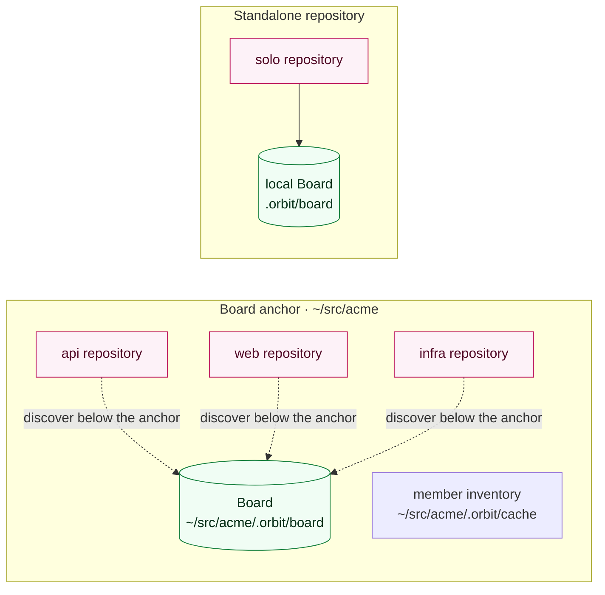

# Boards and repositories

One Board across many repositories: anchors, member discovery, remote hosts, and optional GitHub sync.

## Multi-repository Boards

A Board can span several Git repositories. Repositories inside the folder that anchors the Board — a non-Git directory, or a repository root — are **member Repositories** discovered automatically; repositories outside it join explicitly with `orbit repo add`. Cross-repository dependencies share one graph, every Git worktree resolves the same Board, and Issues record their owning Repository in the optional `repo` frontmatter field.



```bash
# Initialize the anchor folder and its Board.
mkdir -p ~/src/acme && cd ~/src/acme
orbit init                     # Board at ~/src/acme/.orbit/board

# From a member repository, use the shared Board automatically.
cd ~/src/acme/api
orbit list

# A repository outside the anchor joins explicitly.
orbit repo add ~/src/acme/api --name api
orbit repo remove api          # forget the membership; clears its link pointer
orbit repo list                # discovered and explicit member Repositories
orbit repo refresh             # rebuild the cached member inventory
```

`orbit init` on an anchor only creates the Board; it does not clone repositories. When the anchor already contains child Boards — repositories that anchored their own `.orbit` before the parent Board existed — init previews the merge, preserves every Issue ID, records each imported Issue's Repository, moves differing child ID prefixes to `id.accepted_prefixes`, and keeps the child Boards on disk under `<anchor>/.orbit/backups/`. An existing child Board or an unrecognized `.orbit` layout is reported rather than shadowed or discarded.

`orbit repo add PATH` writes the target repository's Orbit link pointer so discovery resolves this Board from inside it, then refreshes managed agent configuration; `orbit repo remove NAME` drops explicit membership and clears the pointer when it points back here. Repositories discovered below the anchor cannot be removed — their membership comes from the folder layout. `orbit repo refresh` rebuilds `.orbit/cache/member-repositories.json` and reports additions and removals; the cache is rebuildable and never stored in the Board repository.

To give the Board a remote home, `orbit board host REPO|URL` records a member Repository, local repository path (resolved to its `origin`), or git URL whose remote stores the Board's `orbit` branch, and `orbit board sync` merges local and hosted histories — different Issues and fields merge, Comments union, the earlier Claim wins, and a same-field conflict stops until `--resolve FIELD=local|host` picks a side.

Board discovery is: `--dir`/`ORBIT_DIR`, then the repository link pointer, then the nearest `.orbit` walking up across Git boundaries (restarted from a worktree's main checkout), then the retired in-Git store for migration diagnostics, then nothing. An explicit override wins for one command:

```bash
ORBIT_DIR=~/src/acme/.orbit orbit ready --json
```

### GitHub Issues (optional)

Boards can link GitHub repositories and map Issues to Issues by repository and issue number. Orbit is authoritative for linked Issue fields; sync is explicit unless the Board opts into `auto_push`, detects field-level conflicts, and keeps Orbit claims separate from GitHub assignees. Review and resolve conflicts with `--resolve FIELD=orbit|remote` before applying. See [docs/github-sync.md](../../docs/github-sync.md).

GitHub Projects are a downstream view over Issues. Orbit does not synchronize ProjectV2 membership, Status, views, or custom fields; use Project auto-add and item added/closed/reopened workflows for reporting, and keep Project Status out of Orbit's sync loop. Only GitHub's separate Auto-close issue workflow can turn a card move into an Issue close. See [the Projects boundary](../../docs/github-sync.md#github-projects).

GitHub sync and Triage require Orbit **v0.9.0 or newer**. The v0.9.0 default
release binaries, shell/PowerShell installers, and npm package include both
commands. For an organization-owned repository with Issue Fields ready, start
with a fresh Board and the GitHub CLI authenticated:

```bash
orbit init
gh auth login
orbit remote connect
orbit remote status
orbit add "First GitHub issue" -p 1
# Copy the Issue ID printed by `orbit add` and replace orb-a7b2c9 below.
orbit remote create orb-a7b2c9
orbit remote create orb-a7b2c9 --apply
orbit remote sync orb-a7b2c9 # preview only
orbit remote sync orb-a7b2c9 --apply
```

For a personal-account `origin`, `connect` reports the exact
`[[remote.projects]]` and `[remote.github]` entries
to add or merge into the Board's `config.toml`, without changing the Board.
Preserve other Remote Projects. Set `mode = "basic"` and include the
repository name as described below before creating or syncing Issues.

`orbit remote connect` checks `gh` authentication and access to the current checkout's GitHub `origin`. For an organization-owned repository, it validates the organization Issue Fields and writes the Board configuration. For a personal-account repository, it leaves configuration unchanged and reports the exact basic-mode entries to add or merge into the Board's `config.toml`, preserving other Remote Projects. Use `orbit remote connect --json` for machine-readable status, including the same guidance in `remediation` and `next_actions`.

Run `orbit remote status` for a read-only diagnostic of the authenticated account and scopes, linked repositories, applicable Issue Fields, linked Issue count, pending sync changes, conflicts, and unsupported relationships. `orbit doctor` includes GitHub configuration checks when GitHub is configured on the Board.

To publish mapped changes after local mutations instead of running `orbit remote sync` by hand, toggle auto-push on the Board:

```bash
orbit remote auto-push on     # writes [remote] auto_push = true and commits it
orbit remote auto-push off
```

The equivalent Board configuration is:

```toml
[remote]
auto_push = true

[[remote.projects]]
tracker = "github"
project = "alice/widget"

[remote.github]
mode = "basic"
```

Auto-push is push-only. `orbit add` creates an Issue when exactly one repository is available; title, body, labels, status, `component`, and `verification` changes are pushed; `done` closes with `state_reason: completed`, `cancelled` with `not_planned`, and `claim` adds the reserved `orbit:in-progress` label. It never pulls, never overwrites a field that changed on GitHub, and never creates an Issue for an existing Local Issue. Priority, type, comments, claims, checkpoints, and relationships do not trigger a push. Conflicts and failed pushes are warnings, not command failures; the baseline stays unchanged so `orbit remote sync <task>` can resolve them. Use `orbit --no-sync <command>` or `ORBIT_NO_AUTO_SYNC=1` for a local-only mutation. See [github-sync.md](../../docs/github-sync.md#automatic-push).

```bash
# Personal repository: [remote.github] mode = "basic" + a [[remote.projects]] entry.
orbit remote connect alice/widget
orbit remote create orb-a7b2c9 --project alice/widget
orbit remote create orb-a7b2c9 --project alice/widget --apply

# Connect an organization-owned repository from its checkout:
orbit remote connect
orbit remote status --json

# Or configure organization mode manually:
orbit remote connect acme/widget
orbit remote connect --fields
orbit remote connect --fields --create-fields # create missing fields (organization admin required)
orbit remote link orb-a7b2c9 https://github.com/acme/widget/issues/42
orbit remote link orb-a7b2c9 acme/widget#42
orbit remote sync orb-a7b2c9 --apply # publish changes to the adopted Issue
orbit add "A new local issue"        # use its printed ID below
orbit remote create orb-d4e5f6     # preview; automatically uses the only linked repository
orbit remote create orb-d4e5f6 --apply
```

`orbit remote create` accepts one or more Issue IDs and previews the destination,
Issue title/body, labels, Orbit status, and mapped open/closed state without
writing. Pass `--apply` to create Issues and link each Issue only after GitHub
confirms creation. A batch reports each Issue's result independently; linked Issues
are rejected on retry and should use `orbit remote sync`. Done and cancelled
Issues require `--include-closed`. When several GitHub repositories are available
to the Board, pass `--project OWNER/REPO` to choose the destination.

`orbit remote connect --fields` does not create fields unless `--create-fields` is passed.
See [the GitHub sync guide](../../docs/github-sync.md) for required permissions and
the fields Orbit creates.

For personal-account repositories, `connect` reports the exact manual basic-mode
settings rather than changing the Board. Basic mode syncs titles, bodies,
labels, and open/closed state without Issue Fields. `component` and `verification`
sync and structured Triage require full mode; basic-mode Triage supports labels
only. See [docs/github-sync.md](../../docs/github-sync.md) for limitations and
upgrade steps.
