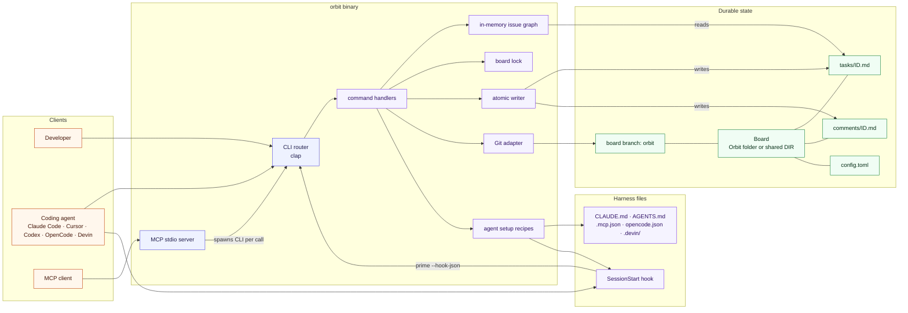
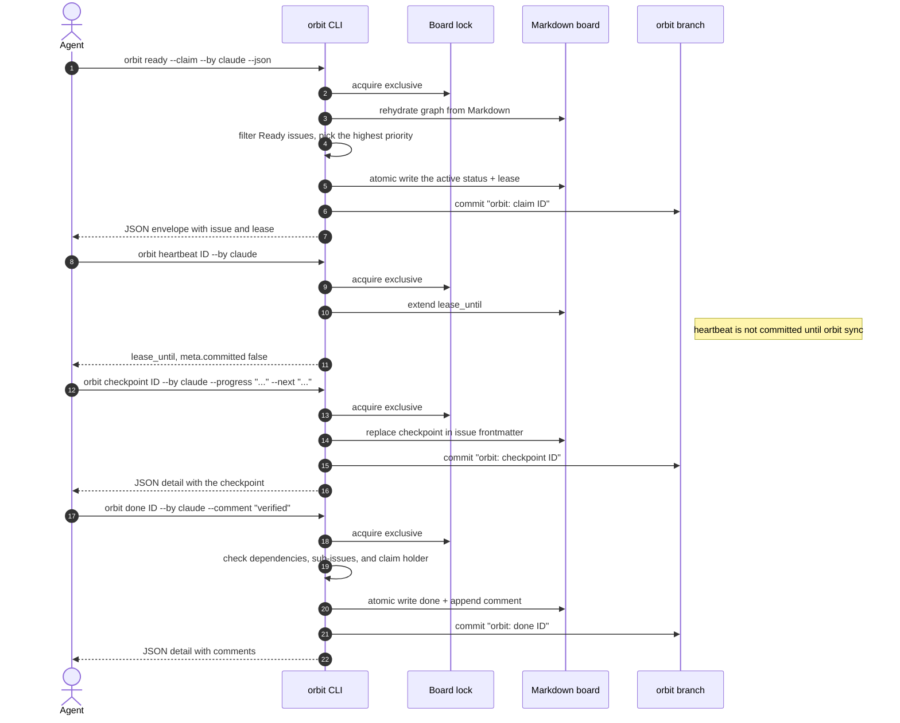
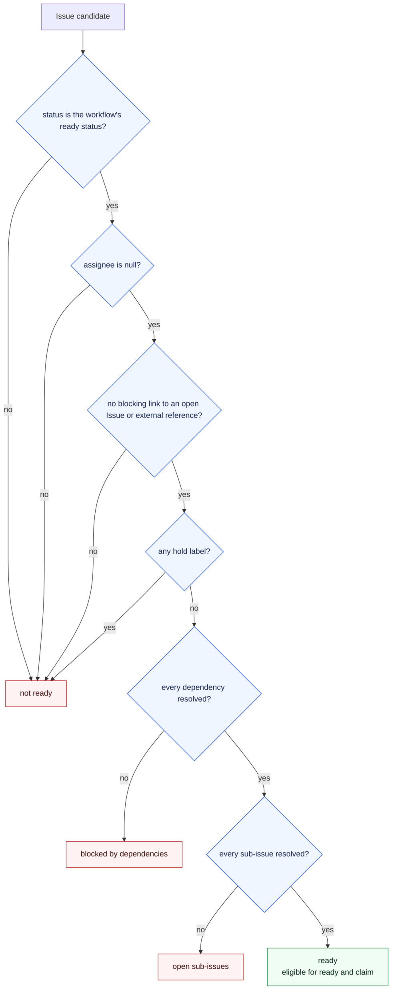
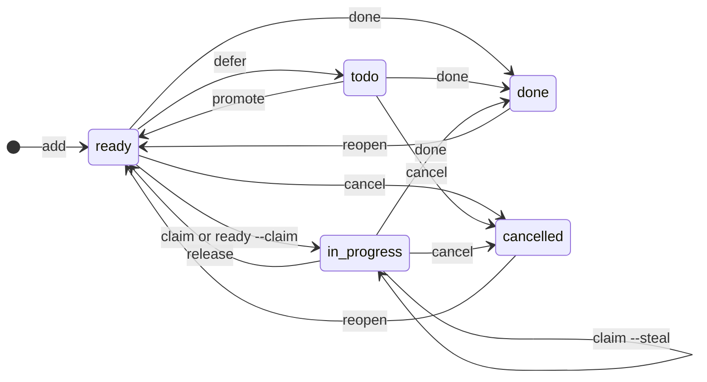

# How it works

One binary, two front doors, one lock, atomic Markdown writes. The architecture in one page.

Orbit is one binary with two front doors: the JSON CLI and the MCP stdio server. A command is a short-lived process. It resolves one Board, takes the right lock, rebuilds the issue graph from Markdown, applies one transition, publishes changed files atomically, and optionally commits to the `orbit` branch.



The full component map, board-resolution flow, domain model, state machine, readiness gate, command map, and sequence diagrams for `init`, the issue lifecycle, concurrent claims, and MCP live in [docs/ARCHITECTURE.md](../../docs/ARCHITECTURE.md).

## The agent loop

The common path is `add` → `ready --claim` → `heartbeat` → `done`. Each step is a separate process, and the board lock is held only for that step.



If nothing can start, `ready --claim` is still a success:

```json
{"ok": true, "data": null, "meta": {"reason": "NO_READY_TASKS"}}
```

Polling loops should wait and retry rather than treating that as an error. When another agent holds the issue, the loser gets `ALREADY_CLAIMED` with the holder and lease. When a lease expires, the issue becomes **stale**, not Ready; recover it with `orbit claim <id> --steal` or return it to the queue with `orbit release <id> --force`.

The queue order is priority, then age — opt-in scheduler strategies (`critical-path`, `touches` overlap avoidance, `capability`, `wip`) reorder or constrain it via `orbit ready --strategy` or `[scheduler]` in `config.toml`; see `docs/commands.md`.

A checkpoint is the structured handoff for that recovery. Only the claim holder can write one; it records progress, the next action, and any blocker. Releasing or stealing the issue keeps the checkpoint, so the next claimant sees it in `orbit show`, the JSON for `orbit ready`, MCP `get`, or the claim result. On a done or cancelled issue the latest checkpoint stays in the file as archived history (`checkpoint_archived: true`) but is not part of the active queue.

### The readiness gate

`ready` is computed on every command. It is never a stored flag.



The failure codes follow the gate: `WAITING_EXTERNAL` for an external blocking link, `LABEL_BLOCKED` for a hold label, `DEPENDENCY_BLOCKED` for unfinished blocking dependencies, `SUBTASKS_OPEN` for open children, `ALREADY_CLAIMED` for a live claim, and `CLAIM_STALE` for an expired one. `--steal` bypasses only the claim checks, never the gate.

### Status vs. derived state

The lifecycle is a workflow defined by the Board in `config.toml`: named statuses, each in a category (`todo`, `active`, `done`, `canceled`), named transitions between them, the initial status, and one ready status. Boards pick a shipped template — `minimal`, `standard` (the default), or `agentic` — or write a custom `[workflow]` section; `orbit transition <id> <name>` runs any defined edge, and `orbit show` lists `allowed_transitions`. The standard template:



A transition into a done or cancelled status records its resolution on the issue; reopening clears it. Ready, blocked, waiting, stale, and held are derived from claims, blocking links, labels, and sub-issues. They cannot be written as a Status. Statuses in the `done` and `canceled` categories both resolve dependents; `delete` is not a transition, it removes the task files.
