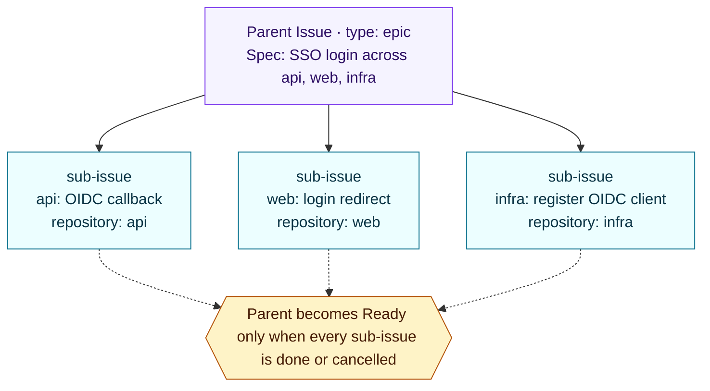

# Daily use

Sub-issues, epics, triage labels, dependencies, comments, export, and the change feed — the commands you run every day.

## Features and sub-issues

A Parent Issue groups sub-issues. The parent waits for the family; the children do not wait for each other unless you add a real dependency.



```bash
# Create the parent once.
orbit add "SSO login across api, web, infra" --type epic --body-file feature.md
# created orb-a7b2c9

# One sub-issue per piece of work.
# Run each add inside its member Repository so `repository` fills in.
orbit add "api: OIDC callback" --parent orb-a7b2c9
orbit add "web: login redirect" --parent orb-a7b2c9
orbit add "infra: register OIDC client" --parent orb-a7b2c9

# Scope an agent to one feature or one repository.
orbit ready --parent orb-a7b2c9 --claim --by api-agent
orbit ready --repository api --claim --by api-agent

# Claim into a worktree whose ticket branch starts on a spec's
# integration branch instead of the Repository's default branch.
orbit claim orb-a7b2c9.z21c2w --by api-agent --worktree --base feature/sso

# Inspect the family and its blockers.
orbit tree orb-a7b2c9
orbit list --parent orb-a7b2c9 --json

# Close the parent explicitly when the family is finished.
orbit done orb-a7b2c9 --by coordinator --comment "SSO shipped"
```

sub-issues nest as deep as the Board's `board.hierarchy` allows — `epic` > `story`/`task`/`bug` > `sub-task` by default. To go deeper, extend `board.types` and `board.hierarchy` in `config.toml`.

> **Warning:** `orbit done --force` or `orbit cancel --force` on a parent with open sub-issues cancels every open child. Use it when the remaining pieces are genuinely abandoned, not as a shortcut.

`orbit prime` surfaces **close candidates**: non-terminal Parent Issues with at least one sub-issue and no open children. Orbit never closes them automatically, so a coordinator decides when the feature is actually done.

## Issue-ID slugs

A Board has one slug that prefixes its Issue IDs. `orbit init` derives it from the repository or anchor folder name; a Board anchored at `~/.orbit` uses `orb` with a warning. Pass `--slug` to choose it explicitly:

```bash
orbit init --slug teramigo
orbit add "First issue" --json
# teramigo-32fdfd
```

Re-running `init` preserves the stored prefix. An empty Board can change it with `--slug`; a populated Board returns `SLUG_LOCKED`. Existing `orb-` Boards keep working unchanged; migration is optional.

To change the identity of an existing Board, use the explicit migration path instead of hand-editing `config.toml`:

```bash
orbit slug show                       # current slug, prefix, and counts
orbit slug migrate atlas --dry-run    # counts, references, and affected claims
orbit slug migrate atlas              # rewrite, validate, and commit once
```

Migration keeps each random suffix (`orb-32fdfd` → `atlas-32fdfd`, `orb-32fdfd.7fk2m9` → `atlas-32fdfd.7fk2m9`), rewrites `parent` and internal `links` targets, renames comment files and their Orbit header, and updates `id.prefix`. It refuses an unhealthy Board or a prefix collision, and live claims require `--force` so the affected agents know to re-read. Issue bodies, checkpoint text, comment text, Git history, and external links are not rewritten.

## Triage, labels, and comments

Labels are free-form lowercase slugs. Three of them are **hold labels**: while present, the issue is not Ready and cannot be claimed.

```bash
# A new report arrives.
orbit add "Login rejects valid tokens" -p 1 \
  --label bug --label needs-triage --body-file report.md

# Triage it into the agent queue.
orbit label add orb-a7b2c9 ready-for-agent
orbit label remove orb-a7b2c9 needs-triage

# Record the reasoning without rewriting the body.
orbit comment add orb-a7b2c9 --by rodrigo \
  --body "Confirmed on macOS. Add a regression test before closing."

# Hand off a long command's output.
cargo test 2>&1 | orbit comment add orb-a7b2c9 --by claude --body-file -
```

- **Hold labels:** `needs-triage`, `needs-info`, `ready-for-human` (configurable in `config.toml`).
- **Neutral labels:** `ready-for-agent`, `bug`, `enhancement`.
- **Comments** are append-only and immutable. A correction is a new comment; the thread is merged into `show`.
- **Waiting** is an external blocker: `orbit link add <id> --type waiting-on --external "external:upstream-2.4"` (or `jira:PROJ-123` for a named system), cleared later with `orbit link remove`.
- **Dependencies** are real blockers: `orbit depend <id> <dep-id>` or `orbit link add <id> --type blocks --to <dep-id>`. Non-blocking links (`relates-to`, `duplicates`, `discovered-from`, custom types) relate work without blocking it.
- **`wontfix`** is a label plus a terminal status: add the label and `orbit cancel <id> --by <agent>`.

Triage is what keeps the agent queue clean without hiding unfinished work from humans. `orbit list --label needs-triage` is the inbox; `orbit ready` is the frontier.

## Two front doors: JSON CLI and MCP

Every board command prints human-readable text by default. Add `--json` and stdout becomes exactly one JSON object, including errors.

```bash
orbit ready --claim --by claude --json
orbit show orb-a7b2c9 --json
orbit list --include-closed --json
```

```json
{
  "ok": true,
  "data": {
    "id": "orb-a7b2c9",
    "title": "Build the CLI router",
    "status": "in_progress",
    "priority": "high",
    "ready": false,
    "assignee": "claude"
  },
  "meta": {}
}
```

Errors are just as structured:

```json
{
  "ok": false,
  "error": {
    "code": "DEPENDENCY_BLOCKED",
    "message": "Cannot complete orb-a7b2c9",
    "retryable": false,
    "details": { "blocking": ["orb-f14c02"] }
  }
}
```

Exit codes are `0` for success, `1` for a domain failure, and `2` for a usage error. `LOCKED` is the one retryable code: another writer holds the lock, so retry after a short backoff.

## MCP

`orbit mcp` speaks JSON-RPC 2.0 over stdio. Every public command except the environment meta commands (`init`, `setup`, `mcp`, `schema`) is reachable through a tool: the issue tools `ready` · `list` · `get` · `create` · `update` · `claim` · `assign` · `release` · `heartbeat` · `checkpoint` · `finish` · `transition` · `link` · `delete` · `label` · `comment` · `property` · `batch`, plus path-named tools such as `tree`, `search`, `digest`, `prime`, `doctor`, `sync`, `repo_*`, `slug_*`, `migrate*`, `board_*`, `remote_*`, and `triage_*`. The full tool list, argument schemas, and safety annotations are generated from the command registry — run `orbit schema` to inspect it.

```bash
orbit mcp
orbit --dir ~/src/acme/.orbit mcp    # serve a specific Board
```

MCP is a bridge, not a second implementation. Each tool call spawns the installed `orbit` binary, so it reuses the same lock, atomic writes, auto-commit, and error envelope. It also serves `orbit://issues/{id}` as a Markdown resource. `create` accepts `parent`, `component`, `external_id`, and `type`; `update` accepts `type`, `component`, `repository`, and `external_id`; `checkpoint` records the active handoff state on a claimed issue; `list` and `ready` accept `parent`, `repository`, `components`, `exclude_components`, `labels`, `exclude_labels`, `types`, `exclude_types`, and `all`; `list` also accepts `include_closed`. Inside a member Repository both scope to it plus Board-wide Issues unless `all` is set.

Editors launch the server from their MCP configuration. `orbit setup` writes project-level configs for Claude, Cursor, Codex, OpenCode, and Devin by default, recording the absolute path of the running binary so editors launched outside a shell do not need `PATH`. `--scope user` writes the harness's user-level locations instead. Generated configs record no Board path; discovery starts from the project directory, and `--dir`/`ORBIT_DIR` covers an editor that launches elsewhere. Use `--no-mcp` for instructions only, or `--portable-mcp` to write the bare `orbit` command instead; the editor or agent that launches the MCP server must then find Orbit on its `PATH`. A repair without `--portable-mcp` returns MCP entries to the absolute-path default.

## Export the board

`orbit export --json` emits a deterministic snapshot of every Issue and sub-issue, including terminal work, type, labels, dependency and parent edges, parent progress fields, comments, and derived readiness.

```bash
orbit export --json > board.json
orbit export --json | jq '.data.issues[] | select(.type == "sub-task")'
```

The snapshot is ordered by issue ID, carries `schema_version` (currently `5`), and contains no timestamp or machine-local paths. The same board state produces the same data, which makes export suitable for a knowledge base, an archive, or a diff between two points in time. Pin `schema_version` in the collector.

## Follow the change feed

Every meaningful Board mutation lands as one commit on the Board's `orbit` branch, so `orbit changes` derives a named event feed — `issue.created`, `issue.transitioned`, `issue.commented`, `board.changed`, and more — by replaying that history, oldest first. Each event carries its actor and a trace id (the producing commit).

```bash
orbit changes --json                                  # everything, oldest first
orbit changes --since <cursor> --json                 # only newer events
orbit history orb-a7b2c9 --json                       # one Issue's timeline
```

`changes` returns a `cursor` (the Board head commit) to feed back as `--since` on the next poll; `history` accepts an Issue ID or project key and keeps resolving after the Issue is deleted. Both are read-only MCP tools too.

Two opt-in modules build on this (ADR 0022): `[[hooks]]` rules in `config.toml` fire local shell commands on Board events — spawned detached after a write commits, best-effort, they can never block or fail a write — and `[index] enabled = true` keeps a rebuildable parse cache under `cache/index.json` that speeds `list`/`ready`/`search` on large Boards (`orbit index status|rebuild`; the scan benchmark that gates the module is in `docs/benchmarks.md`).
